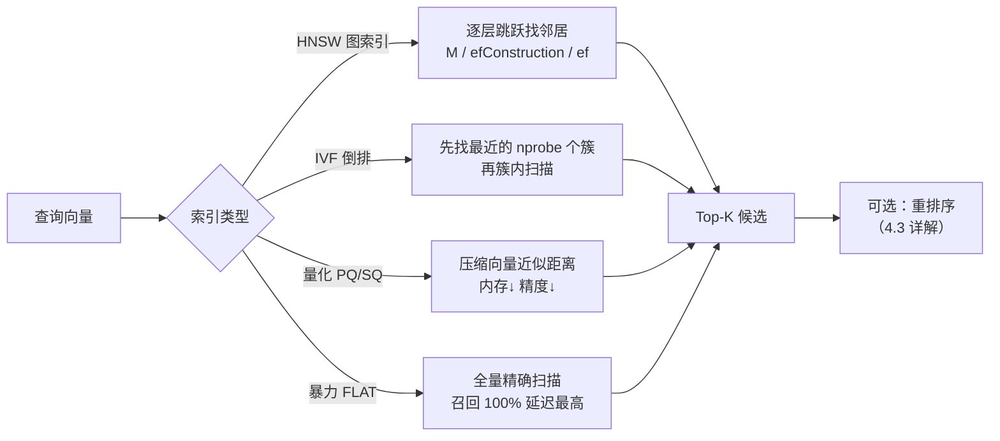
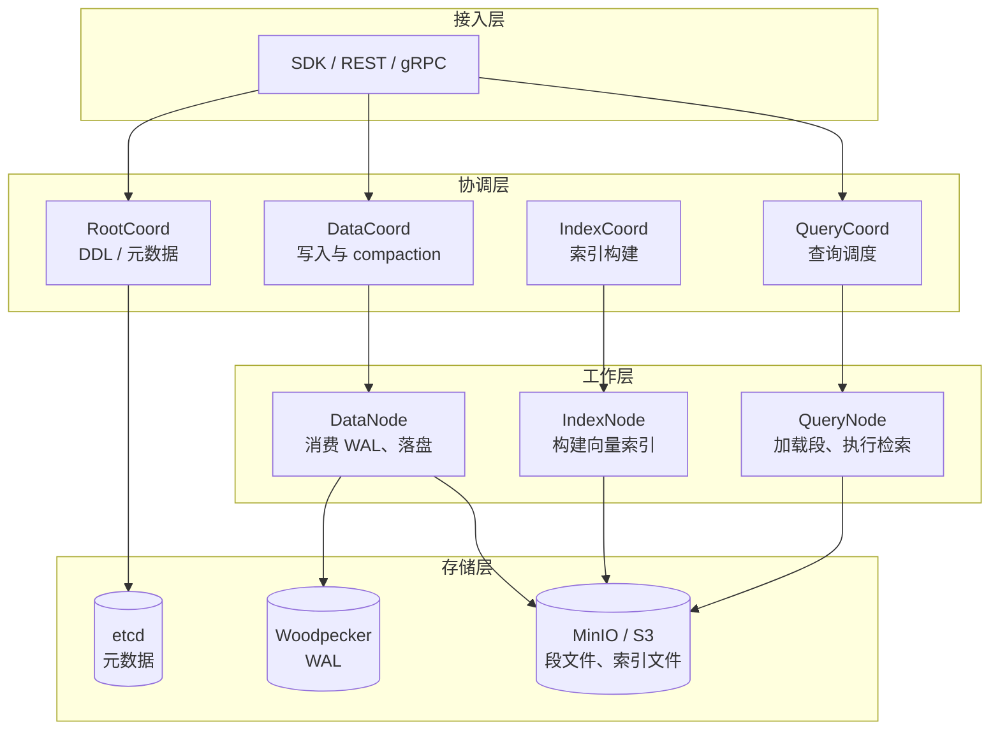
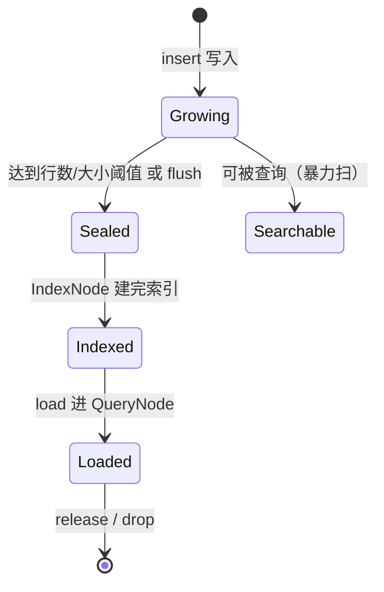
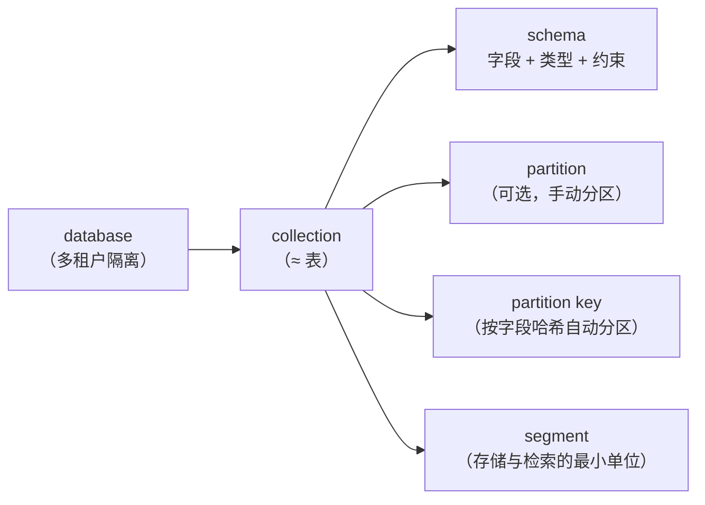
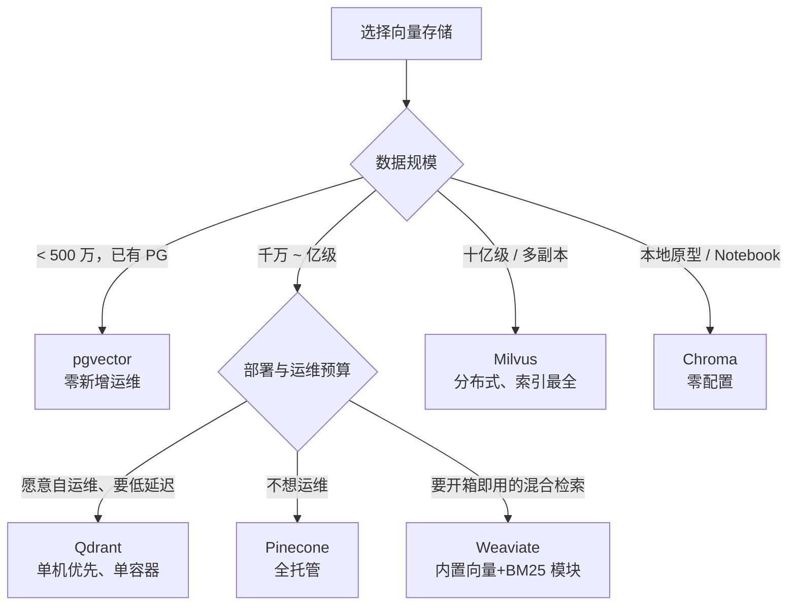

# 4.1 Milvus / Qdrant 向量数据库

> 把「相似度」变成一种可索引、可过滤、可水平扩展的查询能力

> **模块**：4.1 | **预计时间**：4h | **面试可答**：向量检索为什么需要专用库、HNSW/IVF 的参数如何取舍、Milvus 的分层架构与 segment 生命周期、Milvus 与 Qdrant/pgvector 的选型边界、过滤为什么必须下推

## 学习目标

- 说清向量检索的性能瓶颈在哪，以及 ANN 索引用「召回率」换「延迟」的机制
- 掌握 Milvus 的分层架构、数据模型（database → collection → partition → segment）与读写路径
- 能用 TypeScript SDK 建集合、建索引、写入、三种检索（稠密 / BM25 稀疏 / 混合）并做权限过滤
- 掌握 HNSW、IVF 系列索引的参数含义与调优顺序
- 能在 Milvus、Qdrant、pgvector、Chroma 之间做出有依据的选型

---

## 0. 开工前置：本章实验栈

第四阶段的每个实验都依赖同一套服务。仓库已提供组合文件，先起栈再进正文：

```bash
cd doc/04-向量数据库与检索系统/demo
docker compose -f docker-compose.kb.yml up -d
docker compose -f docker-compose.kb.yml ps
```

| 服务 | 端口 | 本章用途 |
|------|------|---------|
| Milvus（etcd + MinIO + standalone） | 19530 / 9091（WebUI） | 4.1 主检索库、4.3 混合检索 |
| Qdrant | 6333 / 6334 | 4.1 轻量对照 |
| Elasticsearch | 9200 | 4.2 全文与 kNN |
| Neo4j | 7474 / 7687 | 4.4 图谱与 Graph RAG |
| PostgreSQL / Redis | 5433 / 6379 | 4.5 元数据与任务队列 |

> ⚠️ 首次启动要拉约 6 GB 镜像，Milvus 冷启动约 40~90 秒（健康检查有 `start_period: 90s`）。只做本章实验时可用 `up -d milvus-standalone qdrant` 起子集。
>
> 内存基线：Milvus 约 2 GB、Elasticsearch 约 2 GB 镜像 / 1 GB 堆（`ES_JAVA_OPTS` 已限）、Neo4j 约 1 GB，全栈建议预留 8 GB 可用内存。

Milvus 官方单机拓扑是 **etcd（元数据）+ MinIO（对象存储）+ milvus-standalone** 三个常驻容器，外加一个一次性的 `milvus-volume-init` 修目录属主。v3.0.5 的消息队列默认是内嵌 Woodpecker（以 MinIO 为 WAL 后端），因此不再需要单独的 MQ 容器。参考：[Run Milvus with Docker Compose](https://milvus.io/docs/install_standalone-docker-compose.md)。

---

## 1. 为什么需要专用向量数据库

### 1.1 暴力检索的复杂度

给定 $N$ 条 $d$ 维向量，查询一条向量的最近邻，精确算法要对全部 $N$ 条做距离计算：

$$
\text{Cost}_{\text{brute}} = O(N \cdot d)
$$

$N = 1000$ 万、 $d = 1024$ 时，单次查询要算 100 亿次乘加——即使用 SIMD 也要几百毫秒，且随数据线性增长。专用向量库的核心价值不是「能存向量」，而是**用近似最近邻（ANN）索引把查询复杂度压到亚线性**：

| 能力 | 暴力扫描（数据库加一列 float 数组） | 专用向量库 |
|------|-----------------------------------|-----------|
| 查询复杂度 | $O(N \cdot d)$，随数据线性劣化 | ANN 索引近似 $O(\log N)$ 量级 |
| 向量压缩 | 无，全精度存储 | PQ/SQ/RaBitQ 等量化，内存降 4~32 倍 |
| 混合过滤 | `WHERE` + 排序，常退化为全表扫 | 标量索引 + 向量索引协同，过滤下推 |
| 水平扩展 | 分库分表要自己做 | 分片、副本、一致性级别内置 |
| 多向量 / 稀疏向量 | 基本没有 | 多向量字段、稀疏向量、内置 BM25 |

### 1.2 什么时候「不用」专用向量库

选型不是越专用越好。中小规模、已有 PostgreSQL 的团队，`pgvector` 往往是更优起点：

- 数据量 < 500 万条、QPS < 50、延迟要求 > 50 ms：pgvector + HNSW 足够
- 需要事务一致性、Join、行级权限：关系库天然具备，向量库要自己补
- 运维预算为零：多一个 Milvus 集群就多一套 etcd/MinIO 要守

**决策分水岭**：当「检索延迟」「索引内存」「多租户隔离」「稀疏 + 稠密混合」中任意两项成为瓶颈时，再引入专用向量库。4.1 讲 Milvus 与 Qdrant，pgvector 的边界在 [6.4 数据库与缓存](../../readme.md#_6-4-数据库与缓存)展开。

---

## 2. 向量检索的基本盘

### 2.1 三种度量与归一化

| 度量 | 公式 | 适用 | 注意 |
|------|------|------|------|
| 余弦相似度 COSINE | $\frac{a \cdot b}{\lVert a \rVert \lVert b \rVert}$ | 文本 embedding 默认 | 与向量长度无关，只看方向 |
| 内积 IP | $a \cdot b$ | 已归一化向量、推荐召回 | 未归一化时长度会主导分数 |
| 欧氏距离 L2 | $\lVert a - b \rVert_2$ | 图像、坐标类特征 | 距离越小越相似，与其他度量方向相反 |

关键结论：**向量先 L2 归一化后，COSINE 与 IP 的排序完全等价**（因为分母恒为 1）。所以「用 IP 更快」的前提是先归一化；没归一化就换 IP，是在悄悄改变语义。

### 2.2 ANN 索引：用召回率换延迟



| 索引 | 核心参数 | 优点 | 代价 |
|------|---------|------|------|
| FLAT | 无 | 召回 100%，结果可复现 | $O(N)$，只适合小数据或评测基线 |
| HNSW | `M`（每层邻居数）、`efConstruction`（建图候选数）、`ef`（查询候选数） | 高召回、低延迟，工业默认 | 内存占用大（图结构 + 原始向量） |
| IVF_FLAT / IVF_SQ8 | `nlist`（簇数）、`nprobe`（查询探测簇数） | 内存可控，适合大批量 | 需要训练；数据分布变化后要重建 |
| DISKANN | `search_list` | 磁盘索引，单机可扛十亿级 | 延迟高于内存索引 |

调参优先级（HNSW）：

1. `ef` 先调：查询时生效，越大召回越高、延迟越高，通常从 `topK * 4` 起试
2. `M` 后调：16~64，越大精度越高、内存越大
3. `efConstruction` 最后调：只影响建索引时间与图质量，不影响查询延迟

Milvus 的 `AUTOINDEX` 会根据数据规模自动选索引类型，**开发期用它，生产期按压测结果显式指定**。

---

## 3. Milvus 架构

Milvus 是存算分离的四层架构，理解它才能解释「为什么建完索引还要 load」「为什么删除不立刻释放空间」。



| 层 | 职责 | 排障时看什么 |
|----|------|-------------|
| 接入层 | 协议解析、请求路由、结果归并 | 客户端超时 / 重试配置 |
| 协调层 | DDL、调度、负载均衡 | 集合是否卡在 `creating index` |
| 工作层 | 真正干活：写入、建索引、查询 | QueryNode 内存是否够加载段 |
| 存储层 | 元数据、WAL、段文件 | etcd 健康、MinIO 容量 |

### 3.1 Segment 生命周期（最重要的心智模型）



三条推论，全部来自这张图：

1. **不 load 不能搜**：`loadCollectionSync` 把段拉进 QueryNode，这是内存换延迟的显式动作。
2. **刚写入的数据可能搜不到**：数据先落在 Growing 段（走 WAL），查询默认能扫 Growing，但跨节点可见性受一致性级别影响。
3. **删除是软删除**：`delete` 只打标记，空间要等 compaction 合并段后才释放，所以「删了数据但磁盘没降」是正常现象。

---

## 4. Milvus 数据模型与最小操作闭环

### 4.1 层级关系



设计选择：

- **多租户**：租户数少（< 50）用 database 隔离；租户数多用一个 collection + `tenant_id` 标量字段 + partition key，避免集合数量爆炸
- **partition**：适合「按业务线/时间冷热」切分，查询时指定 `partition_names` 减少扫描
- **dynamic field**：方便但会让 schema 失控，生产建议关闭并显式建模

### 4.2 字段类型速查

| 用途 | 字段类型 | 关键参数 |
|------|---------|---------|
| 主键 | `VarChar` / `Int64` | `is_primary_key`、`autoID` |
| 正文（要 BM25） | `VarChar` | `max_length`、`enable_analyzer: true` |
| 稠密向量 | `FloatVector` | `dim` 必须等于 embedding 维度 |
| 稀疏向量（BM25 输出） | `SparseFloatVector` | 由 Collection Function 自动写入 |
| 过滤维度 | `VarChar` / `Int64` / `Bool` | 建 `INVERTED` 标量索引 |

---

## 5. 实战：稠密 + BM25 混合检索集合

完整可运行脚本：[demo/src/milvus.ts](demo/src/milvus.ts)。先起栈再跑：

```bash
cd doc/04-向量数据库与检索系统/demo
bun install
bun run demo:milvus
```

> 脚本里的 embedding 是**确定性哈希替身**（[demo/src/embedding.ts](demo/src/embedding.ts)），只反映字面重合，不是语义模型。目的是让「写入 → 建索引 → 检索 → 融合 → 过滤」整条链路零 API Key 跑通；换真实模型只需替换 `embed()` 实现，其余代码不动。

### 5.1 建集合：一个 BM25 函数把文本变成稀疏向量

> 以下为**节选**（省略 `MilvusClient` 初始化与部分字段），完整可运行版本见 [demo/src/milvus.ts](demo/src/milvus.ts)。

```typescript
await client.createCollection({
  collection_name: 'kb_chunks',
  fields: [
    { name: 'id', data_type: DataType.VarChar, is_primary_key: true,
      type_params: { max_length: '128' } },
    // enable_analyzer 让 Milvus 在写入时对 text 分词；
    // 中文必须显式指定 chinese analyzer，否则 BM25 检索恒为空
    { name: 'text', data_type: DataType.VarChar,
      type_params: {
        max_length: '8192',
        enable_analyzer: 'true',
        analyzer_params: JSON.stringify({ type: 'chinese' })
      } },
    { name: 'title', data_type: DataType.VarChar,
      type_params: { max_length: '256' } },
    { name: 'doc_id', data_type: DataType.VarChar,
      type_params: { max_length: '128' } },
    { name: 'visibility', data_type: DataType.VarChar,
      type_params: { max_length: '16' } },
    { name: 'dense', data_type: DataType.FloatVector,
      type_params: { dim: '256' } },
    // 稀疏向量由函数写入，插入时不需要手动赋值
    { name: 'sparse', data_type: DataType.SparseFloatVector }
  ],
  functions: [
    {
      name: 'bm25_text',
      type: FunctionType.BM25,
      input_field_names: ['text'],
      output_field_names: ['sparse'],
      params: {}
    }
  ]
})
```

这是 Milvus 2.5 起最值得用的一项能力：**不用自己算 BM25，也不用维护两套系统**。写入时 Milvus 自动分词并生成稀疏向量，检索时 `data` 直接传查询字符串即可。

> ⚠️ **两个实测坑（v3.0.5 + SDK 3.0.6）**：
>
> 1. `type_params` 里的值必须是**字符串**：`max_length: 128`（数字）或 `enable_analyzer: true`（布尔）会在 protobuf 编码时抛 `ERR_INVALID_ARG_TYPE`。TypeScript 类型允许 `string | number | boolean`，运行时却只接受字符串——类型检查拦不住，必须实跑。
> 2. 中文文本不配 `analyzer_params: { type: 'chinese' }` 时，BM25 检索**静默返回空数组**（不报错）。默认 analyzer 不切中文词，查询词与索引词永远对不上。

> 关于写法：SDK 3.x 同时支持「顶层平铺」与 `type_params` 两种风格。顶层写法里的数字/布尔会被 `assignTypeParams` **自动转成字符串**（`max_length: 128`、`enable_analyzer: true`、`dim: 8` 实测均成功，`describeCollection` 回读为 `"128"` / `"true"` / `"8"`）；而**直接写进 `type_params` 的值必须自己转成字符串**，否则 protobuf 编码报错。本仓库统一用 `type_params`，因此需要手动加引号。

### 5.2 建索引 + load

```typescript
await client.createIndex([
  { collection_name: 'kb_chunks', field_name: 'dense',
    index_type: 'AUTOINDEX', metric_type: MetricType.COSINE },
  { collection_name: 'kb_chunks', field_name: 'sparse',
    index_type: 'SPARSE_INVERTED_INDEX', metric_type: 'BM25' }
])

// 标量字段也要建索引，否则 filter 退化为逐行判断
await client.createIndex({
  collection_name: 'kb_chunks',
  field_name: 'visibility',
  index_type: 'INVERTED'
})

await client.loadCollectionSync({ collection_name: 'kb_chunks' })
```

`createIndex` 收的是**数组**（批量建多个字段的索引），单字段索引也可以只传一个对象——这点与 `createCollection` 的 `index_params` 完全不同，是最容易写错的一处。

### 5.3 三种检索

```typescript
// ① 稠密：语义相似
await client.search({
  collection_name: 'kb_chunks',
  data: [embed('退款申请怎么提交')],
  anns_field: 'dense',
  limit: 3,
  output_fields: ['id', 'doc_id', 'text', 'visibility']
})

// ② 稀疏（BM25）：关键词精确命中。data 传字符串，由函数转稀疏向量
await client.search({
  collection_name: 'kb_chunks',
  data: ['增值税专用发票'],
  anns_field: 'sparse',
  limit: 3,
  output_fields: ['id', 'doc_id', 'text', 'visibility']
})

// ③ 混合：两路并行召回，RRF 融合
await client.hybridSearch({
  collection_name: 'kb_chunks',
  data: [
    { anns_field: 'dense', data: embed('发票红冲') },
    { anns_field: 'sparse', data: '发票红冲' }
  ],
  rerank: { strategy: 'rrf', params: { k: 60 } },
  limit: 3,
  output_fields: ['id', 'doc_id', 'text', 'visibility']
})
```

实测输出（本地栈、6 篇语料、替身 embedding）：

```text
[dense] 退款申请怎么提交 →
| id                  | doc               | score  |
| 01-退款政策#2       | 01-退款政策       | 0.2113 |
| 02-发票与对公转账#5 | 02-发票与对公转账 | 0.2098 |
| 06-开放API与限流#0  | 06-开放API与限流  | 0.2020 |

[bm25] 增值税专用发票 →
| id                  | doc               | score  |
| 02-发票与对公转账#1 | 02-发票与对公转账 | 14.787 |
| 01-退款政策#3       | 01-退款政策       | 11.056 |
| 02-发票与对公转账#2 | 02-发票与对公转账 | 7.195  |

[hybrid+RRF] 发票红冲 →
| id                  | doc               | score  |
| 02-发票与对公转账#3 | 02-发票与对公转账 | 0.0328 |
| 02-发票与对公转账#1 | 02-发票与对公转账 | 0.0320 |
| 01-退款政策#3       | 01-退款政策       | 0.0161 |
```

前两条命中的分差很能说明问题：稠密路 top1 只领先第二名 0.0015（替身 embedding 的能力上限），而 BM25 路 top1 领先 3.7 分——**专有名词只有关键词路能给出高置信度**。

可断言的预期结果（脚本内置断言，跑不通会直接抛错）：

1. 稠密检索 top1 的 `doc_id` 为 `01-退款政策`
2. BM25 检索 top1 的 `doc_id` 为 `02-发票与对公转账`（专有名词只有关键词路能稳定命中）
3. 混合检索结果按 RRF 分数降序，且同时包含两路各自的高分文档

> 分数不可跨查询比较：稠密路是余弦相似度（归一化后 0~1，原始向量为 -1~1），稀疏路是 BM25 分数（无上界），融合路是 RRF 分数（约为 $\sum 1/(k+\text{rank})$）。**只有同一路的分数才有可比性**，跨路比大小是新手最常见的误判。

### 5.4 权限过滤必须下推

验证「过滤生效」之前，先做**负向对照**：不带过滤时 internal 文档必须真的能被召回，否则「过滤后没有」可能只是因为本来就没召回。

```typescript
// ① 对照：不带过滤，internal 的《团队与权限》应出现在结果里
await client.search({
  collection_name: 'kb_chunks',
  data: [embed('成员离职笔记怎么交接')],
  anns_field: 'dense',
  limit: 5,
  output_fields: ['id', 'doc_id', 'visibility']
})

// ② 过滤：同一个查询加 visibility 条件，internal 必须消失
await client.search({
  collection_name: 'kb_chunks',
  data: [embed('成员离职笔记怎么交接')],
  anns_field: 'dense',
  expr: 'visibility == "public"',   // 下推到存储层
  limit: 5,
  output_fields: ['id', 'doc_id', 'visibility']
})
```

demo 的断言就是这一对：先断言不带过滤时结果里 `some(visibility === 'internal')`，再断言带过滤时 `every(visibility === 'public')` 且不含 `04-团队与权限`。只在正向断言「返回的都是 public」，无法区分「过滤生效」与「本来就没召回」。

反例（线上事故高发写法）：

```typescript
// ❌ 先取 5 条，再在应用层过滤：可见文档不足 5 条，甚至一条不剩
const hits = await client.search({ /* ... */ limit: 5 })
const visible = hits.results.filter((h) => h.visibility === 'public')
```

正确做法是把权限条件翻译成 `expr`，让过滤发生在 ANN 检索**内部**。Milvus 会先按标量索引剪枝再算距离；应用层过滤则会出现「召回被权限吃掉」的假空结果。4.5 会给出 RBAC → 过滤条件的翻译规则与一条完整 expr 示例。

---

## 6. Qdrant：轻量路线的对照实现

Qdrant 是 Rust 实现的单机优先向量库，API 设计围绕 **collection / point / payload** 三个概念，部署只需一个容器。

### 6.1 核心概念映射

| Milvus | Qdrant | 说明 |
|--------|--------|------|
| collection | collection | 同一层概念 |
| field（schema） | named vector + payload | Qdrant 无强 schema，payload 是任意 JSON |
| partition | payload index + filter | 用过滤代替物理分区 |
| `expr` | `filter`（must/should/must_not） | 过滤下推的语义一致 |
| `loadCollectionSync` | 不需要 | 自动管理索引与内存 |
| BM25 函数 | v1.20 起全文索引内置 BM25 打分（[Release Notes](https://github.com/qdrant/qdrant/releases/tag/v1.20.0)） | 建索引时 `scoring: true`，无需自算稀疏向量 |

> Qdrant 的 BM25 走**全文索引**（payload 字段），Milvus 走**集合函数 + 稀疏向量**。两条路线都能做关键词召回，差异在于 Qdrant 无需额外向量字段、Milvus 可把稀疏向量与其他向量字段一起做混合检索。

### 6.2 建集合与检索

```typescript
import { QdrantClient } from '@qdrant/js-client-rest'

const client = new QdrantClient({ url: 'http://localhost:6333' })

await client.createCollection('kb_chunks', {
  vectors: { size: EMBEDDING_DIM, distance: 'Cosine' }
})

// 过滤字段要建 payload index；全文索引开启 scoring 即得到 BM25 排序
await client.createPayloadIndex('kb_chunks', {
  field_name: 'visibility',
  field_schema: 'keyword'
})
await client.createPayloadIndex('kb_chunks', {
  field_name: 'text',
  // 中文无空格，必须用 multilingual 分词器（默认 word 会把整段当一个 token）
  field_schema: { type: 'text', tokenizer: 'multilingual', scoring: true }
})

await client.upsert('kb_chunks', {
  wait: true,
  points: chunks.map((chunk, index) => ({
    id: index + 1,
    vector: embedChunk(chunk.title, chunk.text),
    payload: {
      chunk_id: chunk.id,
      doc_id: chunk.docId,
      text: chunk.text,
      visibility: chunk.visibility
    }
  }))
})

// 稠密检索：v1.10+ 统一用 query（旧的 search 已并入 query）
const hits = await client.query('kb_chunks', {
  query: embed('退款申请怎么提交'),
  limit: 3,
  with_payload: true,
  filter: {
    must: [{ key: 'visibility', match: { value: 'public' } }]
  }
})

// BM25 检索：query 传文本对象，using 指向建了全文索引的字段
const bm25 = await client.query('kb_chunks', {
  query: { text: '增值税专用发票' },
  using: 'text',
  limit: 3,
  with_payload: true
})
```

实测（本地 1.20.0）：`query` top1 命中《退款政策》；BM25 top1 命中《发票与对公转账》，分数 12.44 / 8.86 / 5.21。

> ⚠️ **中文全文检索的隐藏坑**：只写 `scoring: true` 而不指定 `tokenizer: 'multilingual'`，Qdrant 会用默认的 `word` 分词器——中文整段被当成一个 token，查询恒为空数组且不报错。Qdrant 1.15 起支持 multilingual 分词（[v1.15.0 Release](https://github.com/qdrant/qdrant/releases/tag/v1.15.0)），专门解决无空格语言。

完整脚本：[demo/src/qdrant.ts](demo/src/qdrant.ts)。

### 6.3 两侧的取舍

| 维度 | Milvus | Qdrant |
|------|--------|--------|
| 定位 | 分布式、云原生、十亿级 | 单机优先、轻量、易运维 |
| 索引 | HNSW / IVF / DISKANN / GPU / 稀疏倒排 | HNSW + 稀疏向量 + 量化 |
| 内置 BM25 | ✅ 集合函数自动生成稀疏向量 | ✅ v1.20 起全文索引支持 BM25 打分（`scoring: true`） |
| 过滤 | `expr` + 标量索引 | filter + payload index（需显式建索引） |
| 扩展 | 分片、副本、多协调节点 | 分片、副本（集群版需额外组件） |
| 运维成本 | 高（etcd + 对象存储 + 多组件） | 低（单容器） |
| 适合 | 企业知识库、多租户 SaaS、混合检索 | 中小规模、边缘部署、快速验证 |

---

## 7. Collection 设计与索引优化

### 7.1 字段设计检查清单

- [ ] `dim` 与 embedding 模型输出维度一致，**换模型必须重建集合**（不能改维度）
- [ ] 主键用业务稳定 ID（`docId#chunkIndex`），不要用自增 ID——分片与重建时才能幂等覆盖
- [ ] 正文 `max_length` 按切分后的最长块设置，留 20% 余量；**单位是 UTF-8 字节不是字符**，中文约占 3 字节/字，按字符数估算会严重低估
- [ ] 过滤字段全部建 `INVERTED` 索引：租户、可见性、文档类型、时间
- [ ] 大文本、原始文件路径这类「不需要过滤也不需要返回给模型」的字段留在 PostgreSQL，向量库存指针

### 7.2 索引调优顺序

1. **先定 metric**：文本 embedding 用 COSINE；已归一化可用 IP 换一点性能
2. **开发期 AUTOINDEX**，上线前用真实数据压测
3. **HNSW 调 `ef`**（查询参数）到满足召回目标，再调 `M`
4. **数据 > 5000 万且内存吃紧**：考虑 IVF + 量化或 DISKANN
5. **过滤占比高**（如租户过滤后只剩 1% 数据）：用 partition key 或分区，避免「先全库搜再过滤」

### 7.3 多向量字段：同一份内容的多套表示

一个块常常同时需要「标题向量」和「正文向量」——标题短、语义集中，适合精确匹配；正文长、覆盖全，适合语义召回。Milvus 支持在同一集合里放多个向量字段，再用 hybridSearch 融合：

```typescript
// 建集合时声明两个向量字段（其余字段略，见 5.1）
fields: [
  { name: 'dense_title', data_type: DataType.FloatVector, type_params: { dim: '256' } },
  { name: 'dense_body', data_type: DataType.FloatVector, type_params: { dim: '256' } }
]

// 两路召回 + RRF，等价于「标题路 + 正文路」的融合
await client.hybridSearch({
  collection_name: 'kb_chunks',
  data: [
    { anns_field: 'dense_title', data: embed('退款') },
    { anns_field: 'dense_body', data: embed('退款申请怎么提交') }
  ],
  rerank: { strategy: 'rrf', params: { k: 60 } },
  limit: 5
})
```

要点：**两个字段的维度必须相同吗？不必**——每个字段独立声明 `dim`，但融合时各路分数不可比，RRF 仍是默认选择。多向量的代价是写入与存储翻倍，只有在「单一向量确实召回不准」时才值得上。

### 7.4 选型决策树



| 选项 | 一句话定位 | 何时排除 |
|------|-----------|---------|
| pgvector | PostgreSQL 扩展，复用现有事务与权限 | 数据上亿、需要多副本读写分离 |
| Milvus | 分布式向量库，索引与混合检索最全 | 团队没有 K8s/多组件运维能力 |
| Qdrant | 单机优先，API 简洁，1.20 起内置 BM25 | 需要十亿级与多协调节点 |
| Pinecone | 全托管，零运维 | 数据必须留在自建机房 / 成本敏感 |
| Weaviate | 内置向量化模块与 BM25 混合 | 想完全掌控 embedding 链路 |
| Chroma | 嵌入式，本地原型 | 生产并发与持久化要求高 |

### 7.5 容量估算

$$
\text{内存} \approx N \times d \times 4\text{ B} \times (1 + \text{索引放大})
$$

HNSW 的索引放大约 1.2~1.5 倍。举例：500 万条 × 1024 维 × 4 B ≈ 20.5 GB 原始向量，加索引后需 25~30 GB 内存才能全量加载。这个数字直接决定「要不要上量化」和「要不要用 DISKANN」。

---

## 8. 常见踩坑

| 现象 | 根因 | 处理 |
|------|------|------|
| 建完集合检索报 `collection not loaded` | 没执行 load | `loadCollectionSync`，并在启动流程里做就绪检查 |
| 刚 insert 的数据查不到 | Growing 段可见性受一致性级别影响 | 用 `Strong` 一致性，或 `flush({ collection_names: ['kb_chunks'] })` 后再查（仅测试用） |
| 删了数据磁盘没降 | 软删除 + 未 compaction | 等 `DataCoord` 触发 compaction，或手动 `compact` |
| filter 后结果数量不足 | 过滤在应用层做 | 把条件写进 `expr`，并给标量字段建索引 |
| 混合检索分数看起来很怪 | 跨路比分数 | 只比同一路；融合分只用于排序 |
| 维度不匹配报错 | 换了 embedding 模型 | 新建集合 + 全量重灌，不能原地改 `dim` |
| 写入报 `max_length` 超限 | 字段长度小于切分块长度 | 调大 `max_length` 或收紧切分长度 |
| 建集合抛 `ERR_INVALID_ARG_TYPE` | `type_params` 里放了数字/布尔 | 全部改字符串：`'128'`、`'true'` |
| BM25 检索恒为空数组 | 中文未配 `chinese` analyzer | `analyzer_params: JSON.stringify({ type: 'chinese' })` |
| 检索结果只有 `id` 和 `score` | 显式传了 `output_fields` 但没列业务字段 | 只返回列出的字段；不传 `output_fields` 则返回全部字段（含 `id`，也会带上 `dense` 浪费带宽） |
| `flush({ collection_name })` 报缺参数 | SDK 3.0.6 要求复数形式 | 用 `flush({ collection_names: ['kb_chunks'] })` |

---

## 面试问答

> **问：向量数据库和「数据库加一列向量」的本质区别是什么？**
>
> 答：区别在索引与存储引擎。给普通数据库加向量列，查询只能全量扫描做距离计算，复杂度 $O(N \cdot d)$ 且随数据线性劣化；专用向量库实现了 ANN 索引（HNSW/IVF/DISKANN），把查询压到亚线性，并配合量化压缩、标量索引下推过滤、分片副本实现水平扩展。换句话说，向量库卖的不是「存向量」，而是「在亿级数据上以毫秒级返回近似最近邻」。

> **问：HNSW 的 M、efConstruction、ef 分别影响什么？线上怎么调？**
>
> 答：`M` 是每个节点的邻居数，决定图的连通度，越大召回越高、内存越大；`efConstruction` 是建图时的候选队列长度，只影响建索引耗时与图质量，不影响查询延迟；`ef` 是查询时的候选队列长度，越大召回越高、延迟越高。线上调优顺序是先用真实数据把 `ef` 从 `topK * 4` 往上扫，画出「召回-延迟」曲线定 `ef`，再调 `M`（16~64），`efConstruction` 最后调。

> **问：Milvus 为什么建完索引还要 load？删除数据为什么磁盘不降？**
>
> 答：两者都源于存算分离 + segment 模型。索引文件建在对象存储上，`load` 是把段和索引加载进 QueryNode 内存的动作，不 load 就没有可查询的副本。删除是软删除：只写删除标记，查询时过滤掉，物理空间要等 compaction 把多个段合并重写后才释放。所以「删了不降盘」是设计使然，不是 bug。

> **问：多租户知识库，Milvus 里你会怎么隔离？**
>
> 答：看租户规模。租户少且需要物理隔离，用 database 或独立 collection；租户多（成千上万）用一个 collection，加 `tenant_id` 标量字段并建 INVERTED 索引，同时用 `partition_key_field: tenant_id` 让同一租户的数据落在同一批段上，减少跨租户扫描。关键是**所有检索必须带 `tenant_id` 过滤且下推到 expr**，绝不能在应用层过滤——那既漏数据又浪费召回。

> **问：Milvus 和 Qdrant 怎么选？**
>
> 答：按规模与运维预算选。需要十亿级、多副本、GPU、内置 BM25 混合检索、团队有 K8s 运维能力，选 Milvus；数据在千万级以内、想单容器部署、API 简洁、运维成本敏感，选 Qdrant。功能上 Milvus 更全（稀疏倒排、DISKANN、多向量），Qdrant 更轻（payload 灵活、过滤表达力好、部署简单）。二者都支持过滤下推和混合检索，差异主要在规模上限与运维复杂度。

---

## 实践练习

> 目标：把「权限过滤 + 分区隔离」做进检索路径，验证过滤下推的效果。

**要求**：

1. 给 `kb_chunks` 增加 `tenant_id` 字段（值 `acme` / `globex`），并建 INVERTED 索引。
2. 用 `partition_key_field` 重建集合，让同一租户的数据自动分区。
3. 检索时同时带 `tenant_id == "acme" and visibility == "public"`，断言返回结果全部满足两个条件。
4. 对比实验：同一查询「不带走过滤」与「带走过滤」各跑一次，记录返回条数与耗时。

**提示**：

- `partition_key_field` 只能在建集合时指定，改不了，需要重建 + 重灌。
- 过滤条件命中率极低时（如租户数据占比 1%），观察是否出现「召回被过滤吃掉」：把 `limit` 调大或改用 partition 指定分区。
- 用 `client.getLoadState({ collection_name })` 检查加载状态，避免把「没 load」误判成「过滤后为空」。

**预期效果**：

- 带租户过滤的检索结果 100% 属于 `acme`，且不含 `internal` 文档；
- 不带走过滤时能检到 `globex` 或 `internal` 的文档，证明过滤确实在检索层生效而不是数据里没有。

---

## 对比：Milvus vs Qdrant vs pgvector vs Chroma

| 维度 | Milvus | Qdrant | pgvector | Chroma |
|------|--------|--------|----------|--------|
| 形态 | 分布式向量数据库 | 单机优先向量库 | PostgreSQL 扩展 | 嵌入式/单机 |
| 规模上限 | 十亿级 | 千万~亿级 | 百万~千万级 | 十万级 |
| 索引 | HNSW/IVF/DISKANN/GPU/稀疏 | HNSW/稀疏/量化 | HNSW/IVFFlat | HNSW |
| 混合检索 | 内置 BM25 + 多向量 + RRF | 稀疏 + 稠密，多路融合 | 需自己拼 SQL + 全文检索 | 基础 |
| 事务/Join | 无 | 无 | ✅ 完整关系能力 | 无 |
| 运维成本 | 高 | 低 | 极低（复用现有 PG） | 极低 |
| 典型场景 | 企业知识库、多租户 SaaS | 中小规模、边缘、快速验证 | 已有 PG、强一致业务 | 本地原型、Notebook |

**一句话选型**：已有 PostgreSQL 且规模不大 → pgvector 起步；要做企业级混合检索 → Milvus；要单容器、低运维 → Qdrant；只做 Demo → Chroma。

---

## 总结

1. **向量库的价值是 ANN 索引**，不是「能存 float 数组」——理解这一点才能正确估算容量与延迟
2. **Milvus 的心智模型是 segment**：Growing → Sealed → Indexed → Loaded，load 才能搜、删除是软删、空间靠 compaction 回收
3. **BM25 函数是混合检索的捷径**：一个 `enable_analyzer` 文本字段 + 一个 BM25 函数，省掉一套 ES
4. **过滤必须下推**：`expr` / `filter` 是权限与多租户隔离的唯一正确位置
5. **选型看规模与运维预算**：Milvus 全、Qdrant 轻、pgvector 省、Chroma 快

**下一步**：

- [4.2 ElasticSearch 搜索引擎](02-ElasticSearch搜索引擎.md)：把关键词检索做到工业级（分词、相关度、聚合）
- [4.3 高级检索策略](03-高级检索策略.md)：RRF 融合、重排序、查询改写与评估

---

*参考资料*：
- [Milvus 官方文档：Docker Compose 单机部署](https://milvus.io/docs/install_standalone-docker-compose.md)
- [Milvus v3.0.5 Release（Release Notes）](https://github.com/milvus-io/milvus/releases/tag/v3.0.5)
- [Milvus Node.js SDK：Hybrid Search](https://milvus-io.github.io/milvus-sdk-node/operations/hybrid-search)
- [Milvus Node.js SDK：Full-Text Search（BM25 集合函数）](https://milvus-io.github.io/milvus-sdk-node/advanced/full-text-search)
- [Milvus 官方文档：Index 类型与参数](https://milvus.io/docs/index.md)
- [Qdrant 官方文档：Indexing（全文索引与 BM25 Scoring）](https://qdrant.tech/documentation/manage-data/indexing/)
- [Qdrant v1.20.0 Release（BM25 Scoring）](https://github.com/qdrant/qdrant/releases/tag/v1.20.0)
- [Qdrant v1.15.0 Release（multilingual 分词）](https://github.com/qdrant/qdrant/releases/tag/v1.15.0)
- [Qdrant 官方文档：Full-Text Search（BM25）](https://qdrant.tech/documentation/search/text-search/full-text-search/)
- [Qdrant 官方文档：Search / Query API](https://qdrant.tech/documentation/concepts/search/)
- [Qdrant JavaScript Client](https://github.com/qdrant/qdrant-js)
