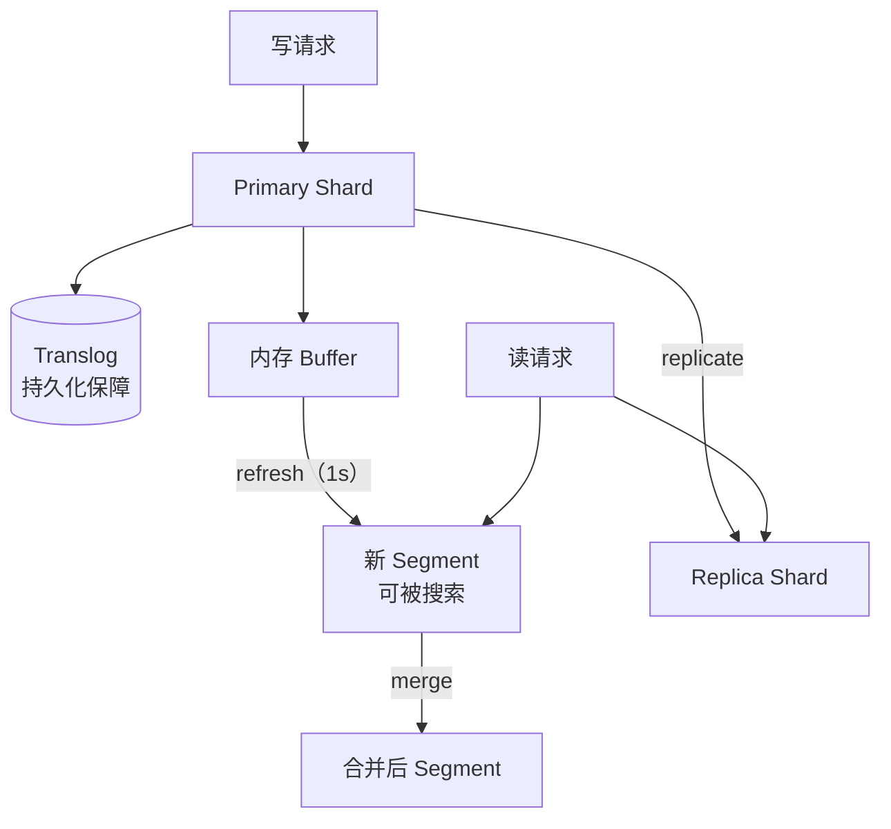
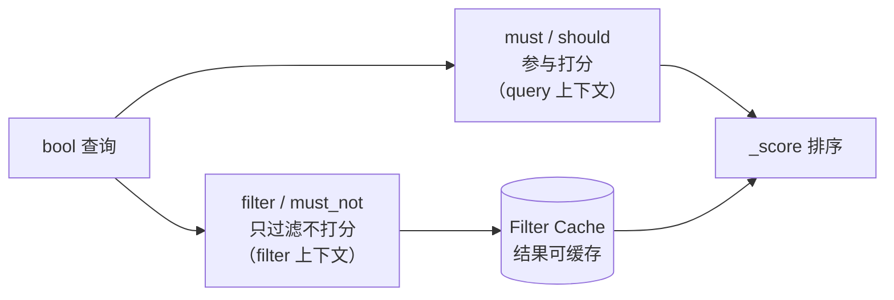

# 4.2 ElasticSearch 搜索引擎

> 向量解决「意思相近」，倒排索引解决「字面精确」——企业检索两条腿缺一不可

> **模块**：4.2 | **预计时间**：3.5h | **面试可答**：倒排索引与 BM25、text 与 keyword 的本质区别、query 与 filter 的差异、深分页为什么被限制、ES 9 的向量检索与 RRF 混合、mapping 设计踩坑

## 学习目标

- 理解倒排索引的构建流程（analyzer 三段）与 BM25 打分机制
- 掌握 mapping 设计：`text` / `keyword` / multi-fields / `dense_vector`，以及中文分词的落地方式
- 能写出正确的 `bulk` 写入与 `bool` 查询（query + filter 分工）
- 掌握 ES 9 的 kNN 检索与 RRF 混合检索写法
- 能定位 refresh 延迟、深分页、字段爆炸这三类高频线上问题

---

## 1. 为什么向量库之外还要 ES

### 1.1 两类召回的分工

| 查询 | 稠密向量 | BM25 / 倒排 | 说明 |
|------|---------|------------|------|
| 「退款政策」 | ✅ | ✅ | 语义与字面都命中 |
| 「LLM07 不安全的插件设计」 | ⚠️ 编号被语义稀释 | ✅ 精确命中 | 编号、型号、错误码是向量模型的盲区 |
| 「发票红冲」 | ⚠️ 依赖模型质量 | ✅ | 领域黑话 |
| 「怎么把钱要回来」 | ✅ | ❌ | 同义改写，字面零重合 |
| 「2026 年 3 月之后的合同」 | ❌ | ✅（filter） | 结构化条件本就该走标量 |

结论：**两路召回是互补关系，不是替代关系**。这也是 4.1 里 Milvus 要内置 BM25、4.2 里 ES 要支持 kNN 的原因——两个产品都在向对方靠拢。

### 1.2 选 ES 的额外理由

除了关键词召回，ES 还自带三样东西：

1. **聚合分析**：按文档、租户、时间做 `terms` / `date_histogram`，知识库运营看板直接出数
2. **成熟的过滤与排序**：`filter` 上下文有缓存，结构化筛选性能远好于向量库的 `expr`
3. **生态**：Kibana 排障、ILM 生命周期、快照备份、SQL 接口，运维路径成熟

---

## 2. 倒排索引与相关度

### 2.1 analyzer：文本入库前的三段处理


每个词项（term）对应一个倒排列表（posting list），记录「哪些文档、出现几次、在什么位置」。查询时先把 query 走**同一个 analyzer**，再用 term 去查倒排列表——**写入与查询的分词器必须一致**，否则就是经典的「建了索引搜不到」。

### 2.2 BM25：ES 的默认打分

$$
\text{score}(q, d) = \sum_{t \in q} \text{IDF}(t) \cdot \frac{f(t,d) \cdot (k_1 + 1)}{f(t,d) + k_1 \cdot (1 - b + b \cdot \frac{|d|}{\text{avgdl}})}
$$

三个直觉：

- **IDF**：越稀有的词权重越高（「红冲」比「怎么」重要）
- **饱和项** $f(t,d)$：词频收益递减，出现 100 次不会比 10 次重要 10 倍
- **长度归一** $b$：长文档天然更容易命中词，要打折； $b=0.75$ 为默认

BM25 与 4.1 里 Milvus 的稀疏检索是同一套打分，区别只在「谁来实现」：ES 是 Lucene 原生，Milvus 是集合函数生成的稀疏向量。

### 2.3 中文分词

ES 官方镜像**不带中文分词插件**。两条路线：

| 方案 | 做法 | 特点 |
|------|------|------|
| IK 分词器 | 安装 `analysis-ik` 插件，mapping 指定 `analyzer: ik_max_word` / `ik_smart` | 粒度可控，词典可扩展，国内事实标准 |
| 内置 CJK / smartcn | `analysis-smartcn` 插件或 `cjk` analyzer | 免词典维护，粒度较粗 |

教学栈为了「零插件启动」用的是默认 `standard` analyzer——它会把中文**逐字切分**，BM25 仍能工作（字级匹配），但效果不如词级。生产中文场景务必装 IK，并在 mapping 里显式指定。

---

## 3. 核心概念与物理模型

| 概念 | 含义 | 关键点 |
|------|------|--------|
| index | 逻辑上的「表」 | 一个 index 由多个 shard 组成 |
| mapping | 字段类型与分词规则 | 显式建模，禁止依赖动态映射 |
| shard | Lucene 索引分片，最小并行单位 | 数量建库时定，改要 reindex |
| replica | 分片副本 | 读扩展 + 高可用，不提升写入 |
| refresh | 把内存缓冲写入新 segment，使其可搜 | 默认 1s，不是持久化 |
| flush | 落盘 + 清 translog | 持久化语义在这里 |
| segment | Lucene 不可变段 | 删除是标记，靠 merge 回收 |



两个必须记住的推论：

- **`refresh` 不等于持久化**：写入后 1 秒内搜不到是正常现象，`refresh: true` 只用于测试和写入后立即校验
- **删除不立刻释放磁盘**：与 Milvus 的软删除同理，靠 segment merge 回收

---

## 4. mapping 设计

### 4.1 text 与 keyword 的本质区别

| 维度 | `text` | `keyword` |
|------|--------|-----------|
| 是否分词 | 是 | 否，整串作为一个 term |
| 用途 | 全文检索、相关度打分 | 精确匹配、过滤、排序、聚合 |
| 能否聚合 | ❌（除非开 fielddata，禁止） | ✅ |
| 典型字段 | 正文、标题 | ID、状态、标签、租户 |

同一个字段两种用途，用 **multi-fields** 解决：

```typescript
title: {
  type: 'text',
  fields: { keyword: { type: 'keyword', ignore_above: 256 } }
}
// 全文检索用 title，精确匹配/聚合用 title.keyword
```

### 4.2 本章的完整 mapping

> 以下为**节选**，完整版（含 client 初始化与写入）见 [demo/src/es.ts](demo/src/es.ts)。

```typescript
await es.indices.create({
  index: 'kb_chunks',
  mappings: {
    properties: {
      chunk_id: { type: 'keyword' },   // 稳定主键
      doc_id: { type: 'keyword' },     // 聚合与过滤
      tenant_id: { type: 'keyword' },  // 多租户过滤，与 Milvus / Neo4j 共用
      title: {
        type: 'text',
        fields: { keyword: { type: 'keyword', ignore_above: 256 } }
      },
      visibility: { type: 'keyword' }, // 权限过滤
      text: { type: 'text' },
      dense: {
        type: 'dense_vector',
        dims: EMBEDDING_DIM,
        index: true,                   // 不开就是纯存储，不能 kNN
        similarity: 'cosine'
      }
    }
  }
})
```

三个细节：

- `dense_vector` 的 `dims` 必须与 embedding 维度一致，**建完不可改**
- `index: true` 才构建 HNSW 图，否则只能脚本打分
- `similarity` 与 4.1 的 metric 对齐，文本用 `cosine`

### 4.3 动态映射的坑

默认动态映射会把字符串映射成 `text` + `.keyword` 子字段，数字映射成 `long`，日期可能被识别成 `text`。后果：

- 想按状态过滤时发现是 `text`，只能 `match` 不能 `term`
- 字段数量随数据漂移无限增长（**mapping 爆炸**），集群元数据膨胀
- 类型冲突后无法写入，只能 reindex

纪律：**生产索引一律显式 mapping + `"dynamic": "strict"`**，让不符合 schema 的写入直接失败。

---

## 5. 写入：bulk 与 refresh

```typescript
const operations = chunks.flatMap((chunk) => [
  { index: { _index: 'kb_chunks', _id: chunk.id } },  // action 行
  { chunk_id: chunk.id, doc_id: chunk.docId, /* ... */ } // 文档行
])

const res = await es.bulk({ refresh: true, operations })
if (res.errors) {
  const failed = res.items.find((item) => item.index?.error)
  throw new Error(`bulk 部分失败：${JSON.stringify(failed?.index?.error)}`)
}
```

要点：

1. `operations` 是**扁平数组**，action 行与文档行交替；不是 `{ body: [...] }`（那是旧版 7.x 的写法）
2. `bulk` 返回 200 不代表全部成功，**必须检查 `res.errors` 并逐条看 `items`**
3. 生产批量导入关掉 `refresh`，导入完成后手动 `_refresh` 或等待自然刷新

---

## 6. 查询 DSL：query 与 filter 分工



| 上下文 | 打分 | 缓存 | 用途 |
|--------|------|------|------|
| query（`must`/`should`） | ✅ | ❌ | 相关度排序 |
| filter（`filter`/`must_not`） | ❌ | ✅ | 权限、状态、时间范围 |

**把不参与排序的条件全部放进 `filter`**，是最容易拿到的一档性能收益。

常用查询对照：

| 需求 | 查询 | 注意 |
|------|------|------|
| 分词匹配 | `match` | 会走 analyzer |
| 短语顺序 | `match_phrase` | 词序敏感，slop 控制间隔 |
| 精确值 | `term` | 字段必须是 `keyword` |
| 多条件 | `bool` | `must` / `should` / `filter` / `must_not` |
| 前缀/通配 | `prefix` / `wildcard` | 高基数上慎用，易全扫 |

---

## 7. 向量检索：ES 9 的正确写法

> ⚠️ **版本红线**：ES 9 移除了技术预览 API `_knn_search`（[9.0 breaking changes](https://www.elastic.co/docs/release-notes/elasticsearch/breaking-changes)）。所有向量检索统一走 `_search`，网上 7.x/8.0 时代的 `_knn_search` 示例照抄必报错。

```typescript
const knn = await es.search({
  index: 'kb_chunks',
  knn: {
    field: 'dense',
    query_vector: embed('退款申请怎么提交'),
    k: 3,
    num_candidates: 50   // 候选池，越大召回越高、越慢
  },
  size: 3,
  _source: ['doc_id']
})
```

- `k`：返回条数；`num_candidates`：每个分片上先取多少候选（经验值 `k * 10` 起）
- kNN 结果默认按相似度排序，`_score` 是转换后的相似度分

**过滤必须写在 `knn.filter` 里**，不是顶层的 `filter`：

```typescript
await es.search({
  index: 'kb_chunks',
  knn: {
    field: 'dense',
    query_vector: embed('退款申请怎么提交'),
    k: 5,
    num_candidates: 100,      // 有过滤时要放大候选池
    filter: {                 // ✅ 预过滤：先筛再算 kNN
      term: { visibility: 'public' }
    }
  }
})
```

若把条件放到查询顶层（例如 `{ query: { bool: { filter: ... } }, knn: ... }`），**它不会约束 kNN 分支**：ES 会把 `knn` 与 `query` 按析取（OR）合并，kNN 分支该返回什么还返回什么。结果是权限过滤对向量召回完全失效——这比「结果变少」更危险，属于越权泄露。过滤后的 `num_candidates` 也要相应放大，否则候选池里可能全是不可见文档。

---

## 8. RRF 混合检索

ES 8.14 起提供原生 RRF retriever（8.14 技术预览，8.16 GA），把「BM25 一路 + kNN 一路」在服务端融合，不需要自己写召回合并：

```typescript
const hybrid = await es.search({
  index: 'kb_chunks',
  retriever: {
    rrf: {
      retrievers: [
        { standard: { query: { match: { text: '发票红冲' } } } },
        {
          knn: {
            field: 'dense',
            query_vector: embed('发票红冲'),
            k: 10,
            num_candidates: 50
          }
        }
      ],
      rank_constant: 60,   // 默认 60，越大越平滑
      rank_window_size: 50 // 必须 >= size；不写时默认 10
    }
  },
  size: 3
})
```

- 至少需要**两个**子 retriever
- `rank_constant`：RRF 公式里的平滑常数，默认 60
- `rank_window_size`：每个子检索的候选窗口，**默认 10**，且必须 $\ge$ `size`（不是「默认等于 size」）
- RRF 分数只用于排序，**不要跨查询比较大小**（公式决定了它的量级）

> ⚠️ **实测坑（ES 9.5.0）**：只写 `size: 20` 不写 `rank_window_size` 会直接 400：
>
> ```text
> [rrf] requires [rank_window_size: 10] be greater than or equal to [size: 20]
> ```
>
> 所以只要 `size > 10`，就必须显式把 `rank_window_size` 调到不小于 `size`。官方 [RRF retriever 文档](https://www.elastic.co/docs/reference/elasticsearch/rest-apis/retrievers/rrf-retriever)写的就是 `Defaults to 10`，与 9.5 运行时一致；网上不少旧教程把它写成「默认等于 size」，照抄会在 `size > 10` 时失败。

完整脚本：[demo/src/es.ts](demo/src/es.ts)，运行：

```bash
cd doc/04-向量数据库与检索系统/demo
bun install
bun run demo:es
```

> ⚠️ **两个实测坑（ES 9.5.0 + Bun）**：
>
> 1. **Bun 下默认连接器不可用**：官方客户端的 Undici 连接器在 Bun 里会抛 `TypeError: undefined is not an object (evaluating 'response.headers')`。需要显式换成基于 `node:http` 的 `HttpConnection`（Node 环境可省略）：
>
>    ```typescript
>    import { HttpConnection } from '@elastic/transport'
>    const es = new Client({ node: 'http://localhost:9200', Connection: HttpConnection })
>    ```
>
> 2. **RRF retriever 属于付费能力**：许可矩阵要求 Enterprise（已对照[官方许可 FAQ](https://www.elastic.co/pricing/faq/licensing)）；开发环境可执行 `curl -X POST "http://localhost:9200/_license/start_trial?acknowledge=true"` 开 30 天 trial。生产要么购买 Enterprise，要么在客户端侧做 RRF（4.3 的 `rrfFuse` 就是纯函数实现）。basic 许可下 `retriever.rrf` 会返回 403 `security_exception: current license is non-compliant for [Reciprocal Rank Fusion (RRF)]`——这条 403 原文来自 basic 环境，本机当前是 trial，未复现，存疑标注。

实测输出：

```text
[bm25] 增值税专用发票 →
| id                  | doc               | _score |
| 02-发票与对公转账#1 | 02-发票与对公转账 | 19.76  |
| 01-退款政策#3       | 01-退款政策       | 13.62  |
| 02-发票与对公转账#2 | 02-发票与对公转账 | 10.47  |

[knn] 退款申请怎么提交 →
| id                  | doc               | score  |
| 01-退款政策#2       | 01-退款政策       | 0.6062 |
| 02-发票与对公转账#5 | 02-发票与对公转账 | 0.6062 |
| 06-开放API与限流#0  | 06-开放API与限流  | 0.5896 |

[rrf] 发票红冲 →
| 02-发票与对公转账#3 | 02-发票与对公转账 | 0.0328 |
| 02-发票与对公转账#1 | 02-发票与对公转账 | 0.0320 |
| 02-发票与对公转账#2 | 02-发票与对公转账 | 0.0313 |

[aggs] 各文档块数 → 6 篇文档各 6 块
```

预期结果（脚本内置断言）：

1. `match` 查询「增值税专用发票」top1 落在 `02-发票与对公转账`
2. `knn` 查询「退款申请怎么提交」top1 落在 `01-退款政策`
3. RRF 混合检索 top1 落在 `02-发票与对公转账`，且聚合的块数总和等于写入总数

---

## 9. 聚合：知识库运营的取数口

```typescript
await es.search({
  index: 'kb_chunks',
  size: 0,                     // 只要聚合结果，不要文档
  aggs: {
    by_doc: {
      terms: { field: 'doc_id', size: 10 },
      aggs: { chunks: { value_count: { field: 'chunk_id' } } }
    }
  }
})
```

这段查询在知识库里的真实用途：

- 找出「块数异常多」的文档 → 切分策略有问题
- 按租户聚合文档量 → 容量与计费
- `date_histogram` 看入库趋势 → 发现同步任务掉线

聚合字段必须是 `keyword`（或数值/日期）；对 `text` 聚合会因 `fielddata` 被禁用而报错——这也是 multi-fields 存在的原因之一。

---

## 10. 性能与踩坑

| 现象 | 根因 | 处理 |
|------|------|------|
| 写完立刻查不到 | refresh 延迟（默认 1s） | 测试用 `refresh: true`，生产接受最终一致 |
| 深分页报 `Result window is too large` | `from + size` 默认上限 10000 | 用 `search_after` + 稳定排序键 |
| 聚合报 `Fielddata is disabled` | 对 `text` 字段聚合 | 改用 `.keyword` 子字段 |
| mapping 字段数暴涨 | 动态映射 + 脏数据 | `dynamic: strict` + 显式 schema |
| `bulk` 有文档丢失 | 只看了 HTTP 200 | 检查 `res.errors` 与 `items[].error` |
| kNN 延迟高 | `num_candidates` 过大 / 分片过多 | 调到 `k * 10` 量级，压测分片数 |
| 磁盘删了不降 | segment 未 merge | 正常现象，靠 merge 与 ILM 回收 |
| Bun 下客户端报 `response.headers` undefined | 默认 Undici 连接器不兼容 | 传 `Connection: HttpConnection` |
| RRF 请求 403 `license is non-compliant` | basic 自签许可不含 RRF | 开发开 trial，生产买订阅或客户端侧融合 |

深分页的正确姿势：

```typescript
// 第一页
const first = await es.search({
  index: 'kb_chunks',
  size: 20,
  sort: [{ chunk_id: 'asc' }],   // 必须含唯一键，否则翻页会重复/丢行
  query: { match_all: {} }
})
// 后续页：取上一页最后一条的 sort 值
const last = first.hits.hits.at(-1)?.sort
const next = await es.search({
  index: 'kb_chunks',
  size: 20,
  sort: [{ chunk_id: 'asc' }],
  search_after: last,
  query: { match_all: {} }
})
```

---

## 面试问答

> **问：`text` 和 `keyword` 的区别？为什么不能对 `text` 聚合？**
>
> 答：`text` 会经过 analyzer 分词，倒排索引里存的是词项，用于全文检索和 BM25 打分；`keyword` 不分词，整串作为一个 term，用于精确过滤、排序和聚合。对 `text` 聚合需要开启 `fielddata`，它会把词项在内存里反转成「文档 → 词项」结构，内存开销巨大且默认禁用，所以正确做法是用 multi-fields 建一个 `.keyword` 子字段来聚合。

> **问：ES 的写入流程是什么？为什么 `refresh` 不等于持久化？**
>
> 答：写入先到 primary shard，同时写 translog（保证宕机可恢复）并进内存 buffer，然后同步到 replica。`refresh` 把 buffer 里的数据生成一个新的 Lucene segment 并打开搜索器，使文档可被搜索，默认每秒一次；真正落盘是 `flush`（commit point + 清 translog）。所以 refresh 只解决「可见性」，持久化由 translog 保证，二者是两件事。

> **问：query 和 filter 有什么区别？线上怎么用？**
>
> 答：query 上下文计算 `_score` 参与相关性排序，不能缓存；filter 上下文只判断是否匹配、不打分，结果可以被 filter cache 复用。实践原则是「所有不参与排序的条件都放 filter」：权限、状态、时间范围、租户 ID 全部下沉，只把真正影响相关度的文本条件留在 must/should 里。

> **问：ES 9 里怎么做向量检索和混合检索？有哪些版本坑？**
>
> 答：向量检索用 `_search` 的 `knn` 参数（`field`、`query_vector`、`k`、`num_candidates`），映射用 `dense_vector` 且 `index: true`。混合检索用原生 `retriever.rrf`，把 `standard`（BM25）和 `knn` 两个子 retriever 融合，`rank_constant` 默认 60。最大的版本坑是 ES 9 移除了技术预览的 `_knn_search` API，旧示例照抄会直接失败；另外 `dense_vector` 的维度建完不可改。

> **问：为什么 ES 限制深分页？怎么解决？**
>
> 答：`from + size` 的分页要求每个分片都取出 `from + size` 条再全局排序，协调节点内存与网络开销随页码线性增长，所以默认限制 10000。解决方案是 `search_after`：用上一页最后一条的排序值做游标，每个分片只需要取 `size` 条；前提是排序键必须唯一（通常加主键兜底），否则会出现重复或丢行。

---

## 实践练习

> 目标：把「关键词 + 向量 + 权限过滤」组合成一条符合生产习惯的查询。

**要求**：

1. 写一个 `bool` 查询：`filter` 里放 `visibility == public`，`must` 里放 `match` 文本条件，返回 `doc_id` 与 `_score`。
2. 对比「条件放 `must`」与「条件放 `filter`」两种写法，观察 `_score` 是否变化、结果集是否一致。
3. 用 `search_after` 分页取完整个索引（每页 10 条），断言行数守恒且无重复 `_id`。
4. 加一个 `terms` 聚合，按 `doc_id` 统计块数，验证总和等于索引文档数。

**提示**：

- 步骤 1 的 `filter` 条件不要写进 `must`，否则 `_score` 会被标量匹配污染
- `search_after` 的排序键至少包含一个唯一字段，`chunk_id` 就够
- 聚合用 `size: 0` 只看桶，别把文档也拉回来

**预期效果**：

- 两种写法的结果集完全相同，但「filter 版」的 `_score` 不受标量条件影响
- 分页总行数等于索引文档数，`_id` 无重复
- 聚合桶的总和与 `count` 查询结果一致

---

## 对比：ElasticSearch vs OpenSearch vs Milvus

| 维度 | ElasticSearch | OpenSearch | Milvus |
|------|--------------|-----------|--------|
| 核心能力 | 倒排 + 向量 + 聚合 | 同源分支，功能滞后于 ES | 纯向量 + 稀疏检索 |
| 许可证 | Elastic License 2.0 / SSPL / AGPLv3 三选（8.16 起） | Apache 2.0 | Apache 2.0 |
| 向量检索 | `dense_vector` + kNN + RRF | 支持 kNN，RRF 支持较晚 | 主战场，索引类型最全 |
| 全文检索 | 最强（analyzer、同义词、高亮） | 强 | BM25 函数（较新） |
| 聚合分析 | 强 | 强 | 弱 |
| 运维复杂度 | 中高（JVM、分片、ILM） | 中高 | 高（组件多） |
| 适用 | 企业搜索、日志、知识库混合检索 | 许可敏感、AWS 生态 | 大规模纯向量召回 |

**选型结论**：需要「关键词 + 向量 + 聚合」一体化，选 ES；许可或云厂商绑定是硬约束，选 OpenSearch；只需要向量召回且规模大，选 Milvus。三者不是互斥关系，生产常见组合是「ES 做混合召回 + Milvus 做大库向量召回」。

---

## 总结

1. **倒排与向量互补**：编号、黑话、精确短语靠 BM25，同义改写靠向量
2. **analyzer 决定一切**：写入与查询分词器必须一致，中文生产必装 IK
3. **mapping 要显式**：`text` 检索、`keyword` 过滤聚合，`dynamic: strict` 防爆炸
4. **filter 不打分但可缓存**：权限与结构化条件全部下沉
5. **ES 9 的向量检索走 `_search`**：`_knn_search` 已移除，混合检索用 `retriever.rrf`
6. **深分页用 `search_after`**：`from + size` 有 10000 上限

**下一步**：

- [4.3 高级检索策略](03-高级检索策略.md)：把两路召回做成可评估、可调优的融合管道
- [4.5 文档入库与治理](05-文档入库与治理.md)：把权限过滤与 chunk 契约接进入库流水线

---

*参考资料*：
- [Elasticsearch 9.0 breaking changes（`_knn_search` 移除）](https://www.elastic.co/docs/release-notes/elasticsearch/breaking-changes)
- [kNN search in Elasticsearch](https://www.elastic.co/docs/solutions/search/vector/knn)
- [Reciprocal rank fusion（RRF retriever）](https://www.elastic.co/docs/reference/elasticsearch/rest-apis/reciprocal-rank-fusion)
- [dense_vector 字段类型](https://www.elastic.co/docs/reference/elasticsearch/mapping-reference/dense-vector)
- [Elasticsearch JavaScript Client](https://www.elastic.co/docs/reference/elasticsearch/clients/javascript)
- [analysis-ik 分词插件](https://github.com/infinilabs/analysis-ik)
