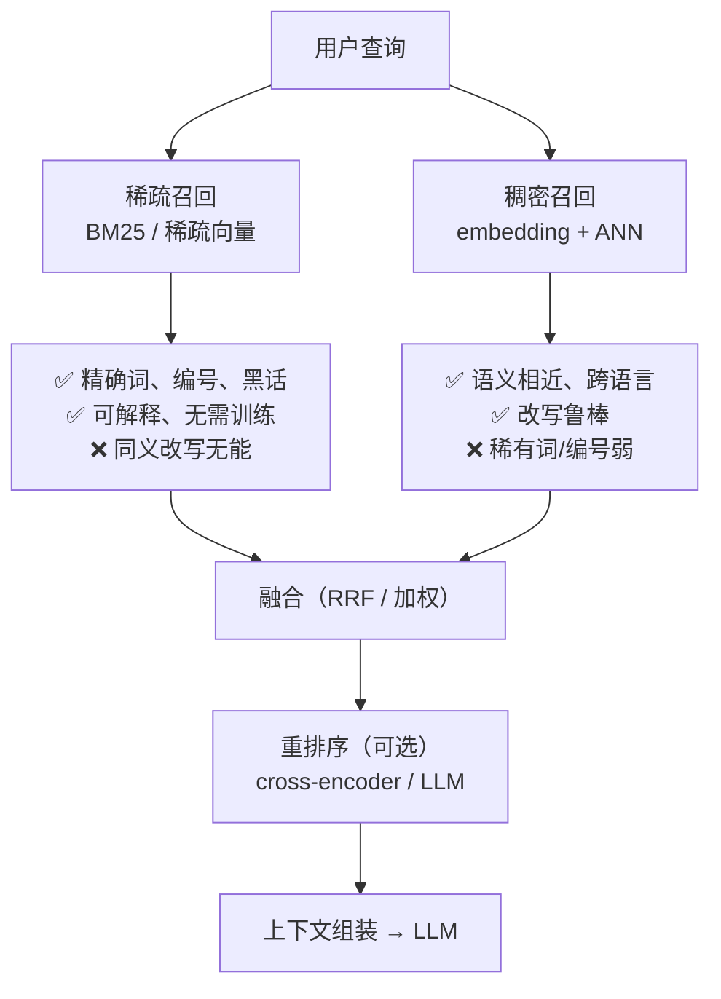
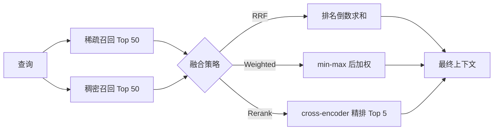

# 4.3 高级检索策略

> 召回决定上限，融合与重排决定你离上限有多近

> **模块**：4.3 | **预计时间**：3.5h | **面试可答**：RRF 为什么不需要调参、加权融合的归一化陷阱、两段式检索的收益与成本、查询改写的四种手法、Recall@k 与 MRR 的口径、embedding 缓存键设计

> 承接 [3.3 Agentic RAG 实现](../03-LangGraph.js复杂工作流编排/03-AgenticRAG实现.md)：那里讲的是「何时检索、检索失败怎么重试」的决策图；本章把检索本身做成可度量、可调优的融合管道。

## 学习目标

- 说清稀疏召回与稠密召回的能力边界，并能设计混合检索管道
- 掌握 RRF 与加权分数融合的公式、差异与适用场景
- 理解两段式检索（召回 → 重排）的工程取舍，能接入 cross-encoder / LLM 重排
- 掌握四类查询改写手法及其成本控制
- 能搭一套最小检索评估（golden set + Recall@k + MRR），用数据驱动调参
- 掌握 embedding 选型维度与缓存设计

---

## 1. 两种召回的能力边界



| 查询类型 | 例子 | 谁更强 |
|---------|------|--------|
| 精确标识 | `ERR_CONN_TIMEOUT`、`LLM07`、订单号 | 稀疏 |
| 领域黑话 | 「红冲」「席位」「死信队列」 | 稀疏 |
| 同义改写 | 「钱怎么退回来」↔「退款」 | 稠密 |
| 跨语言 | 中文查询 → 英文文档 | 稠密（多语言模型） |
| 长问题 | 「我司跨境业务的数据驻留和发票流程分别是什么」 | 稠密（可拆多意图） |

**关键结论**：没有单一召回能覆盖全部查询类型，所以工业界的默认形态是混合检索。4.1 的 Milvus BM25 函数、4.2 的 ES RRF retriever 都是这个结论的产品化。

---

## 2. 混合检索的三条路线

| 路线 | 做法 | 优点 | 缺点 |
|------|------|------|------|
| 结果级融合（RRF） | 各路独立召回 Top-N，按排名融合 | 无需调参、各路分数不可比也能用 | 丢失分数绝对值信息 |
| 分数级融合（加权） | 各路分数归一化后加权求和 | 可表达业务偏好（如更信关键词） | 归一化方式敏感，换数据集要重调 |
| 学习型融合（重排） | 用 cross-encoder / LLM 对候选逐条打分 | 精度最高 | 延迟与成本随候选数线性增长 |



---

## 3. RRF：默认就该先用它

### 3.1 公式

$$
\text{RRF}(d) = \sum_{i=1}^{n} \frac{1}{k + \text{rank}_i(d)}
$$

- $n$：召回路数
- $\text{rank}_i(d)$：文档 $d$ 在第 $i$ 路结果中的排名（从 1 开始）
- $k$：平滑常数，默认 60

$k$ 的作用：控制「排名靠前」的收益陡峭程度。 $k$ 越小，第 1 名与第 10 名差距越大； $k$ 越大，融合越平滑，长尾更容易进来。

### 3.2 为什么 RRF 是默认选择

1. **不需要分数归一化**：BM25 分数无上界、余弦相似度在 [-1,1]（归一化非负向量时为 [0,1]）、内积可正可负——RRF 只看排名，天然免疫
2. **不需要调参**： $k=60$ 是文献与工程实践的共同默认值
3. **鲁棒**：某一路整体偏弱时，只要它在前列给出了正确文档，融合仍能提分

以下片段**节选**自 [demo/src/hybrid.ts](demo/src/hybrid.ts)：放进 demo 的 `src/` 可直接运行；单独复制到其他项目时需把 `Chunk` 换成你自己的文档类型。

```typescript
import type { Chunk } from './corpus.ts'

type Ranked = { chunk: Chunk; score: number }

const rrfFuse = (lists: Ranked[][], k = 60, limit = 5): Ranked[] => {
  const scores = new Map<string, { chunk: Chunk; score: number }>()
  for (const list of lists) {
    list.forEach((item, index) => {
      const delta = 1 / (k + index + 1) // rank 从 1 开始
      const current = scores.get(item.chunk.id)
      if (current) current.score += delta
      else scores.set(item.chunk.id, { chunk: item.chunk, score: delta })
    })
  }
  return [...scores.values()].sort((a, b) => b.score - a.score).slice(0, limit)
}
```

### 3.3 RRF 的失效场景

- 两路召回**高度相关**（比如用同一模型的不同索引）：融合几乎不带来增益
- 某一路**整体偏移**：前 50 名全是噪声，反而会污染融合结果——此时应先修召回，而不是调融合
- 需要**分数阈值**做截断（如「相似度低于 0.6 就不要」）：RRF 分数没有绝对含义，阈值只能靠经验校准

---

## 4. 加权融合与归一化陷阱

```typescript
import type { Chunk } from './corpus.ts'

type Ranked = { chunk: Chunk; score: number }

const minMax = (list: Ranked[]): Map<string, number> => {
  const values = list.map((item) => item.score)
  const min = Math.min(...values)
  const max = Math.max(...values)
  const span = max - min || 1
  return new Map(list.map((item) => [item.chunk.id, (item.score - min) / span]))
}
```

三个必须知道的坑：

1. **min-max 依赖当次结果分布**：同一查询换一批候选，归一化后的分数就变了，阈值不可复用
2. **单路结果为空时除零/无意义**：`span` 要做保护，且空路不应参与加权
3. **权重是数据集相关的**：`0.6/0.4` 在你的语料上调好，换领域就要重调，必须进配置而不是硬编码

> 实践中更稳的替代是 **z-score 归一化**（减均值除标准差）或 **分数排名化后再加权**，前者对分布形状更鲁棒，后者退化成 RRF 的变体。

---

## 5. 两段式检索：召回宽、重排精

### 5.1 为什么需要两段

ANN 检索用的是「双塔」结构：query 与文档**分别**编码成向量再算内积。它快，但 query 与文档从未「见过面」，细粒度的交互信息丢失。cross-encoder 把 `(query, 文档)` 拼成一对输入模型，逐条打分，精度显著更高，但**必须逐条推理**，无法预计算。

所以工程上分两段：

| 阶段 | 目标 | 候选量 | 延迟预算 |
|------|------|--------|---------|
| 召回 | 高召回、低延迟 | 50~200 | 10~50 ms |
| 重排 | 高精度、可控成本 | 10~50 | 50~300 ms |
| 组装 | 去重、截断、拼上下文 | 3~8 | 忽略 |

### 5.2 三种重排方案

| 方案 | 代表 | 精度 | 成本 | 适用 |
|------|------|------|------|------|
| 规则/统计 | 词面重合、字段加权、时间衰减 | 低 | 极低 | 兜底、冷启动 |
| cross-encoder | BGE-reranker、Cohere Rerank | 高 | 中（GPU 或 API） | 主流生产 |
| LLM 重排 | 让模型给候选打分/排序 | 最高 | 高（token 消耗大） | 低 QPS、高价值场景 |

教学仓库里用的是**词面重合替身**（[demo/src/hybrid.ts](demo/src/hybrid.ts) 的 `rerank`），只为演示两段式结构，生产请替换为真实 cross-encoder。

```typescript
// 先宽召回，再精排：候选 10 → 输出 3（rrfTop / rerank 定义见 demo/src/hybrid.ts）
const candidates = rrfTop(query).slice(0, 10)
const reranked = rerank(query, candidates, 3)
```

完整实测输出见 [7.3](#_7-3-实测-五种策略的对比)：召回 10 条里混着 3 篇无关文档，精排 3 条全部收敛到目标文档。

### 5.3 重排的成本控制

- 候选数按「边际收益」截断：从 10 → 50 的精度提升通常远小于延迟增长
- 重排结果**缓存**（query + 候选集哈希），重复查询直接命中
- 高 QPS 场景用「小模型重排 + 大模型只在低置信度时介入」的分级策略

---

## 6. 查询改写

用户输入往往不是好的检索查询。四类手法：

| 手法 | 做法 | 收益 | 成本 |
|------|------|------|------|
| 指代消解 | 多轮对话里把「它」「这个」替换成实体 | 解决「上下文丢失」 | 一次小模型调用 |
| Multi-Query | 让模型生成 3~5 个改写，分别召回后融合 | 提升召回覆盖 | N 倍检索 + 1 次生成 |
| HyDE | 先让模型「编一个假答案」，用假答案去检索 | 短查询 → 长文本，语义更充分 | 一次生成，且有跑偏风险 |
| Step-back | 先问「这类问题的一般原理是什么」，再检索 | 复杂问题先抽象再具体 | 一次生成 + 两轮检索 |

工程纪律：

1. **改写要可关闭**：它引入额外延迟与不确定性，必须能按场景降级
2. **改写结果要缓存**：同一 query 的改写结果稳定，缓存命中率高
3. **改写后要合并去重**：多路召回必然重复，按 chunk id 去重后再融合
4. **HyDE 的假答案不能进最终上下文**：它只用于检索，不能当作证据喂给 LLM

---

## 7. 检索评估：没有度量就没有调优

### 7.1 最小可用评估集

```typescript
interface GoldenItem {
  query: string
  expectedDoc: string   // 期望命中的文档 ID
}
```

三条纪律：

- **golden set 来自真实查询日志**，不是自己编的「好问题」
- **每个查询标注期望文档**（不要求唯一，可以多标，用集合判断）
- **版本化**：语料更新后老查询可能失效，评估集要跟着演进

### 7.2 两个够用的指标

$$
\text{Recall@}k = \frac{1}{|Q|}\sum_{q \in Q} \mathbb{1}[\text{expected}_q \in \text{Top-}k(q)]
$$

$$
\text{MRR} = \frac{1}{|Q|}\sum_{q \in Q} \frac{1}{\text{rank}_q}
$$

- **Recall@k**：正确文档有没有进前 k，衡量「召回能力」
- **MRR**：正确文档排多靠前，衡量「排序质量」

进阶再上 nDCG（考虑多级相关性），但多数 RAG 场景 Recall@5 + MRR 已经够定位问题。

### 7.3 实测：五种策略的对比

`bun run demo:hybrid` 在 6 篇语料、7 条 golden 查询（含 1 条同义改写）上的结果：

| 策略 | Recall@3 | MRR |
|------|:--------:|:---:|
| dense only | 0.86 | **0.88** |
| bm25 only | 0.86 | 0.86 |
| rrf(dense+bm25) | 0.86 | **0.88** |
| weighted 0.6/0.4 | 0.86 | **0.88** |
| rrf + rerank | 0.86 | 0.88 |

这组数字最值得读的不是「谁更高」，而是**为什么几乎打平**：

1. **Recall 全是 0.86**：唯一没命中的是「退钱要等几天」——字面替身 embedding 与 BM25 都无解，这是**模型能力问题**，融合救不了
2. **融合没有超过单路最优（0.88 vs 0.88）**：因为两路都用「字面特征」，高度相关。RRF 的前提是「各路犯错的方式不同」，两路同质时融合增益趋近于零
3. **bm25 的 MRR 略低（0.86）**：长块里关键词命中多但排序不够稳，稠密路反而更稳
4. **重排没带来提升**：候选集本身已经很好，而且替身重排器（词面重合）能力太弱——真实 cross-encoder 才会体现收益

> 这组数字教的是**方法论**：先用评估确认「两路是否互补」，再决定要不要上融合。如果两路同质，正确动作是换 embedding 模型或换召回源，而不是继续调融合参数。换成真实语义模型后，dense 与 bm25 的互补性**预期会**明显得多——这是推断，本章只验证了字面替身下的行为，接入真实模型后请重新跑同一套评估。

两段式检索的实测输出：

```text
[两段式] 发票红冲怎么操作
召回 10 → 02-发票与对公转账#3, 02-发票与对公转账#1, 02-发票与对公转账#2,
          06-开放API与限流#1, 02-发票与对公转账#0, 06-开放API与限流#4,
          04-团队与权限#4, 01-退款政策#5, 02-发票与对公转账#5, 05-数据导出与备份#5
精排 3  → 02-发票与对公转账#3, 02-发票与对公转账#1, 02-发票与对公转账#2
```

召回 10 条里混着 06、04、05 的块（另有 01#5 与「发票红冲后退款」相关，不算噪声），精排后前 3 全部收敛到发票文档——**这就是第二段的价值：不是提高召回，而是把噪声挤出上下文窗口**。

可断言的预期结果（脚本内置断言，跑不通会抛错）：

1. RRF 融合的 Recall@3 不低于任一单路（当前语料下为 0.86，与两路持平）
2. 两段式精排后 top1 的 `docId` 为 `02-发票与对公转账`
3. 评估集里唯一未命中的是改写型查询「退钱要等几天」——脚本用 `failed.length === 1 && failed[0] === '退钱要等几天'` 断言，确保评估能暴露「字面模型的语义盲区」而不是掩盖它

---

## 8. Embedding 选型与缓存

### 8.1 选型维度

| 维度 | 关注点 | 说明 |
|------|--------|------|
| 语言 | 中文 / 多语言 | BGE-M3 多语言能力强；英文可用 text-embedding-3 |
| 维度 | 256~4096 | 维度越高存储与计算越贵，1024 是常见折中 |
| 最大长度 | 512 / 8192 token | 超过会被截断，切块长度要匹配 |
| 部署 | API / 自托管 | 数据合规要求高时自托管 BGE-M3 / Qwen3-Embedding |
| 成本 | 每百万 token 价格 | 入库一次性成本 + 查询持续成本 |
| 一致性 | 换模型必须重灌 | 不同模型的向量空间不可混用 |

### 8.2 主流模型横向对比

| 模型 | 维度 | 最大长度 | 语言 | 部署 | 备注 |
|------|------|---------|------|------|------|
| BGE-M3 | 1024 | 8192 | 100+ 语言 | 自托管（MIT） | 稠密 + 稀疏 + 多向量三合一，中文生态成熟 |
| Qwen3-Embedding（0.6B/4B/8B） | 1024 / 2560 / 4096 | 32k | 100+ 语言 | 自托管（Apache 2.0） | 支持 MRL 降维，规模档位可选 |
| text-embedding-3-large | 3072 | 8191 | 多语言 | OpenAI API | 免运维，按 token 计费，数据出境需评估 |
| text-embedding-3-small | 1536 | 8191 | 多语言 | OpenAI API | 性价比档，适合大规模初筛 |

选型建议：

- **中文/多语言 + 数据不出域**：BGE-M3 或 Qwen3-Embedding 自托管
- **要稠密 + 稀疏一次出**：BGE-M3（稀疏向量可直接进 Milvus 混合检索）
- **团队不想运维、可接受 API 成本**：text-embedding-3 系列
- **维度敏感（存储/内存吃紧）**：优先支持 MRL 的模型，可按需降维再归一化

> 表中维度与长度以各自模型卡为准；上线前务必用**自己的语料**跑一遍 4.3 的评估脚本，别只看榜单。

**换模型的代价**：整个集合要重建、全量重灌，且查询侧必须同步切换。所以选型要在建库前定，并为「模型升级」预留 `embedding_model` 字段。

### 8.3 缓存设计

embedding 是「幂等且昂贵」的典型，必须缓存：

```typescript
// 伪代码：sha256 用 node:crypto 的 createHash('sha256') 实现
// 缓存键 = 模型标识 + 维度 + 文本哈希（不要用文本本身，长文本会把键撑爆）
const cacheKey = `emb:${model}:${dim}:${sha256(text)}`
```

三层缓存：

| 层 | 位置 | 命中率 | 用途 |
|----|------|--------|------|
| 查询 embedding | Redis | 高（热点查询重复度高） | 省 API 调用与延迟 |
| 入库 embedding | Redis / 本地 | 中（重跑、补数时命中） | 幂等重灌不重复付费 |
| 检索结果 | 应用内存 / Redis | 取决于场景 | 高频 FAQ 直接返回 |

注意事项：

- **模型升级必须换命名空间**（`emb:v2:...`），否则新旧向量混用
- **缓存要有 TTL 与容量上限**，embedding 向量体积不小（1024 维 float32 ≈ 4 KB/条）
- **多租户场景键里要带租户**，避免跨租户命中泄露

---

## 面试问答

> **问：RRF 为什么不需要调参？它相比加权分数融合的优势在哪？**
>
> 答：RRF 只用排名不用分数，公式是各路 $1/(k+\text{rank})$ 求和， $k=60$ 是通用默认值。优势在于免疫分数尺度差异：BM25 分数无上界、余弦相似度在 [-1,1]（归一化非负向量时为 [0,1]）、内积可正可负，加权融合必须先归一化，而归一化方式（min-max/z-score）会改变排序结果且依赖当次候选分布。RRF 牺牲了分数绝对值信息，换来的是稳定和免调参，所以适合作为默认策略；需要表达业务偏好时再上加权。

> **问：混合检索一定比单路好吗？什么情况下会变差？**
>
> 答：不一定。两路高度相关时增益接近零；某一路整体质量差时，它的前几名会污染融合结果；候选窗口设置不当（某路取太少）也会让融合退化成单路。判断依据是离线评估：分别测单路与融合的 Recall@k / MRR，如果融合不涨，先修召回而不是继续调融合参数。

> **问：两段式检索的第二段为什么不能用双塔模型？**
>
> 答：双塔是 query 和文档独立编码，只能在向量层面做内积，无法建模细粒度交互；而且文档向量必须预计算，模型无法在看到 query 后调整对文档的表示。cross-encoder 把 query 和文档拼成一个输入，让注意力在两者之间交互，精度更高，但每条候选都要单独前向一次，无法预计算，所以只能用于小候选集的重排。

> **问：怎么判断检索效果差是「召回」问题还是「排序」问题？**
>
> 答：看指标口径。Recall@k 低说明正确文档根本没进候选集，是召回问题——要换 embedding、加稀疏路、调切分；Recall@k 正常但 MRR 低说明正确文档进了候选但排得靠后，是排序问题——要加重排、调融合权重。生产上还会看「golden 查询的 top1 人工标注通过率」，避免指标好看但答案不可用。

> **问：查询改写有哪些风险？生产怎么控制？**
>
> 答：三类风险：延迟（每次改写多一次 LLM 调用）、跑偏（HyDE 生成的假答案可能把检索带偏）、成本（多路召回放大 embedding 与检索开销）。控制手段是：改写开关按场景配置、改写结果缓存、多路结果去重后融合、HyDE 的假答案绝不进入最终上下文、以及把改写后的查询记录下来做离线评估，确认改写确实提升而不是劣化。

---

## 实践练习

> 目标：用评估驱动一次真实的策略选择。

**要求**：

1. 把 `demo/src/hybrid.ts` 的 golden set 扩到 12 条，至少包含 3 条同义改写、2 条含编号/错误码的查询。
2. 新增一路「标题加权」召回（标题命中权重 ×2），与现有两路做三路 RRF，比较 MRR 变化。
3. 把 RRF 的 `k` 从 60 改成 10 和 200，记录 MRR 曲线，说明 $k$ 的影响。
4. 给 `golden` 跑一次「去掉 rerank」与「加上 rerank」的对比，判断当前语料下重排是否值得。

**提示**：

- 同义改写查询在字面替身 embedding 下必然失败，这正好用来确认「评估集能暴露模型能力边界」
- 三路 RRF 时，权重天然相等；如果某路明显更弱，考虑只取它的 Top 10 而不是 Top 50
- `k` 太小会让融合结果被单路的第一名主导，太大则趋于平均

**预期效果**：

- 扩集后 Recall@3 明显低于 1.0，且能指出失败 query 属于哪类（模型能力 / 切分 / 召回缺失）
- 三路融合的 MRR 不低于两路，若下降则说明新增那一路质量不足
- 能给出「当前语料下重排不划算」或「重排提升 X」的结论，而不是凭感觉

---

## 对比：RRF vs 加权融合 vs 重排序

| 维度 | RRF | 加权融合 | 重排序（cross-encoder） |
|------|-----|---------|----------------------|
| 输入 | 多路排名 | 多路分数 | 单路/多路候选文本 |
| 需要调参 | 几乎不需要（$k=60$） | 权重 + 归一化方式 | 模型选择 + 候选数 |
| 精度 | 中 | 中（调好可略优） | 高 |
| 延迟 | 极低 | 极低 | 中高（逐条推理） |
| 成本 | 忽略 | 忽略 | GPU / API 费用 |
| 适用 | 默认首选 | 有明确业务偏好 | 高价值、低 QPS |

**组合姿势**：RRF 做粗融合 → 取 Top 10~20 → cross-encoder 精排 → 取 Top 3~5 组装上下文。这也是多数生产 RAG 的标准三段式。

---

## 总结

1. **稀疏与稠密互补**：精确词靠 BM25，改写靠向量，混合是默认形态
2. **RRF 优先**：免调参、免疫分数尺度；加权融合只在有明确偏好且愿意维护权重时用
3. **两段式是精度杠杆**：召回宽、重排精，代价是逐条推理的延迟
4. **改写要可控**：指代消解、Multi-Query、HyDE、Step-back 都要能关、能缓存、能评估
5. **评估先行**：Recall@k 定位召回、MRR 定位排序，先定位再调参
6. **embedding 换模型 = 重灌**：选型在建模前定，缓存键带模型与维度

**下一步**：

- [4.4 Neo4j 知识图谱与 Graph RAG](04-Neo4j知识图谱与GraphRAG.md)：为「多跳关系」类查询补第三条召回路径
- [4.5 文档入库与治理](05-文档入库与治理.md)：把切分、幂等、权限接进流水线

---

*参考资料*：
- [Reciprocal Rank Fusion 原始论文（Cormack et al., 2009）](https://plg.uwaterloo.ca/~gvcormac/cormacksigir09-rrf.pdf)
- [Elasticsearch RRF retriever 文档](https://www.elastic.co/docs/reference/elasticsearch/rest-apis/reciprocal-rank-fusion)
- [Milvus Hybrid Search（RRF / Weighted Ranker）](https://milvus-io.github.io/milvus-sdk-node/operations/hybrid-search)
- [BGE-M3 模型卡](https://huggingface.co/BAAI/bge-m3)
- [Qwen3-Embedding 模型卡](https://huggingface.co/Qwen/Qwen3-Embedding-0.6B)
