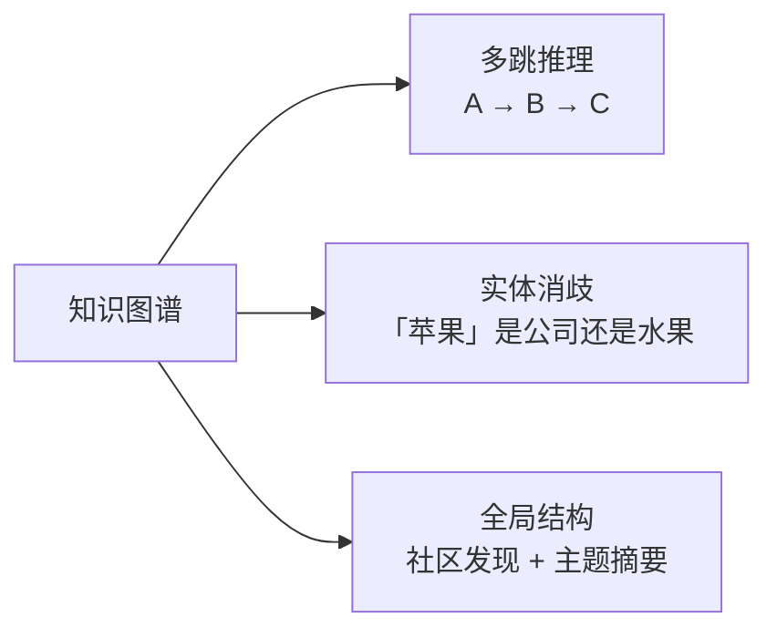
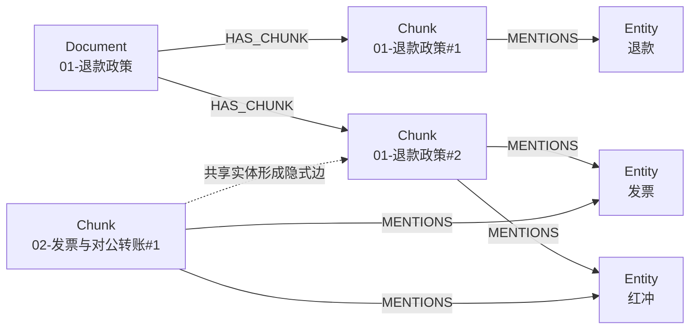
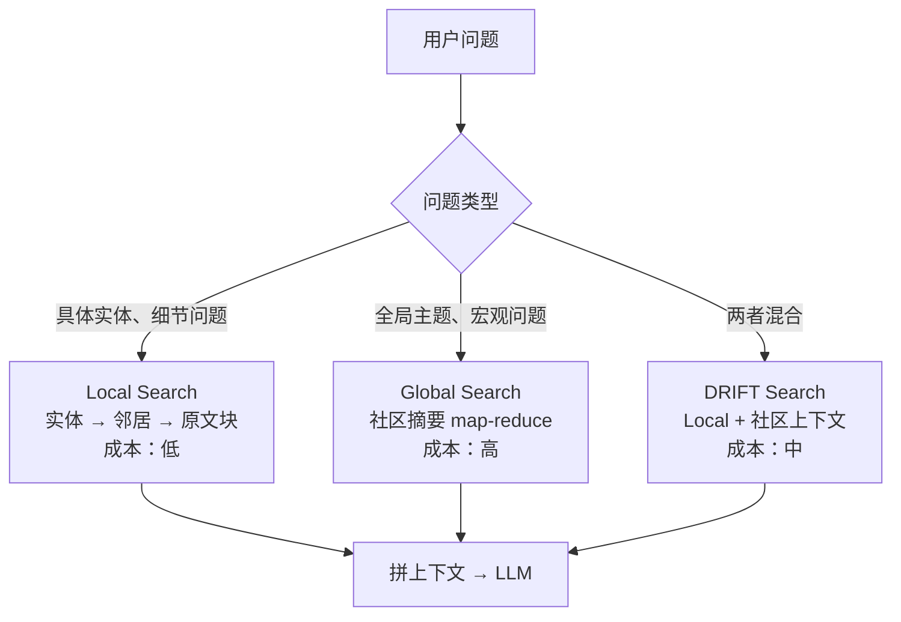
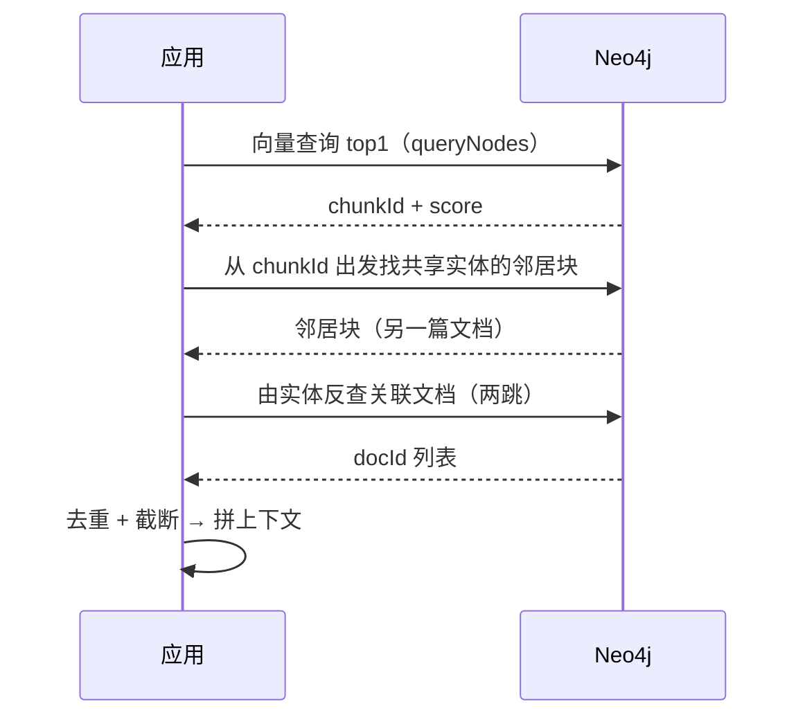

# 4.4 Neo4j 知识图谱与 Graph RAG

> 当答案不在任何一块文档里，而在文档之间——向量检索就到此为止了

> **模块**：4.4 | **预计时间**：4h | **面试可答**：图检索补的是什么能力、Neo4j 图建模与 Cypher 要点、向量索引与多跳扩展怎么组合、GraphRAG 的 local/global/drift 三种模式、实体抽取的噪声控制

## 学习目标

- 说清「多跳关系」类查询为什么向量检索与 BM25 都无能为力
- 掌握 Neo4j 的核心概念与 Cypher 读写，能设计文档-块-实体的图模型
- 能在 Neo4j 里建向量索引，并把「向量入口 + 图扩展」组合成两段式检索
- 理解 GraphRAG 的 local / global / drift 三种查询模式及其成本
- 掌握实体抽取、实体消歧、图规模控制的工程手段

---

## 1. 向量检索的盲区：关系

### 1.1 一个向量检索答不出的问题

假设知识库有这些内容：

- A 文档：「华东区使用法兰克福节点做数据驻留」
- B 文档：「法兰克福节点在 2026 年 3 月完成合规认证」
- C 文档：「合规认证通过后，该区域支持增值税专用发票自动开具」

问题：**「华东区客户的专票自动开具依赖什么前提？」**

答案需要 A → B → C 的三跳推理。无论是稠密向量还是 BM25，都只会返回「和问题字面/语义最像的那一块」——而真正需要的三块分散在三篇文档里，且没有一块与问题高度相似。

| 查询类型 | 向量 | BM25 | 图 |
|---------|:----:|:----:|:-:|
| 「退款政策是什么」 | ✅ | ✅ | ✅（可选） |
| 「A 和 C 通过谁关联」 | ❌ | ❌ | ✅ |
| 「这个模块被哪些服务依赖」 | ❌ | ⚠️ | ✅ |
| 「整个语料的主要主题有哪些」 | ⚠️ 切片后丢失全局 | ❌ | ✅（社区摘要） |
| 「这句话什么意思」 | ✅ | ⚠️ | ❌ |

**结论**：图检索不是替代，是第三条召回路径，专门补「关系」这一维。

### 1.2 图带来的三个能力



---

## 2. Neo4j 核心概念与 Cypher 速查

| 概念 | 关系库类比 | 说明 |
|------|-----------|------|
| Node（节点） | 行 | 有标签（Label）和属性（Property） |
| Relationship（关系） | 外键/关联表 | 有类型和方向，**存储时双向可查** |
| Label | 表名 | 一个节点可有多个标签 |
| Property | 列 | 键值对，可索引 |
| Index | 索引 | 范围索引、全文索引、向量索引 |
| Constraint | 约束 | 唯一性、存在性 |

Cypher 的最小语法集：

```cypher
// 建节点与关系（MERGE = 有则复用，无则创建，天然幂等）
MERGE (d:Document {id: '01-退款政策'})
MERGE (c:Chunk {id: '01-退款政策#0'})
MERGE (d)-[:HAS_CHUNK]->(c)

// 查：从块出发找共享实体的其他块（一跳扩展）
MATCH (c:Chunk {id: $chunkId})-[:MENTIONS]->(e:Entity)<-[:MENTIONS]-(other:Chunk)
WHERE other.id <> c.id
RETURN other.id, e.name
LIMIT 10

// 查：变长路径（1~3 跳）
MATCH path = (a:Entity {name: '发票'})-[*1..3]-(b:Entity)
RETURN path LIMIT 5
```

三个与 SQL 的思维差异：

1. **关系是一等公民**：`(a)-[:R]->(b)` 本身就是存储单元，遍历不用 JOIN
2. **变长路径是一等操作**：`[*1..3]` 直接表达「几跳以内」，SQL 要写递归 CTE
3. **MERGE 是幂等写入**：这是图数据重复导入不产生脏数据的关键

---

## 3. 图建模：Document → Chunk → Entity



设计要点：

| 决策 | 建议 | 理由 |
|------|------|------|
| 块要不要入图 | 要 | 图检索最终要回到「可喂给 LLM 的文本块」 |
| 实体粒度 | 领域名词（产品、政策、功能、错误码） | 太细会爆炸，太粗无法区分 |
| 关系类型 | 先少后多：`MENTIONS` + 少量语义关系（`DEPENDS_ON`、`REPLACES`） | 关系类型爆炸会让抽取与查询都失控 |
| 原文存哪 | 关系库/对象存储，图里只存 `chunkId` + 摘要 | 图库不适合存长文本 |
| 唯一约束 | `Document.id`、`Chunk.id`、`Entity.name` | MERGE 才能幂等 |
| Chunk 属性 | `id`、`docId`、`title`、`tenantId`、`visibility`、`text`、`embedding` | 与 Milvus/ES 保持同一份 chunk 契约，图扩展后才能做租户与权限过滤 |

**不推荐**把整篇文档当一个节点直接连实体：块是检索与上下文组装的最小单位，图里必须保留块粒度。

> 同一份 chunk 在三处存储的字段必须对齐（`chunkId / docId / tenantId / visibility / title / text`），否则 4.5 的三存储融合会在去重与过滤时错位。

---

## 4. 实体与关系抽取

### 4.1 生产做法：LLM + 结构化输出

```typescript
// 伪代码：抽取管线，省略 LLM 客户端初始化与重试
const schema = z.object({
  entities: z.array(z.object({
    name: z.string(),          // 归一化后的实体名
    type: z.enum(['product', 'policy', 'feature', 'error_code'])
  })),
  relations: z.array(z.object({
    from: z.string(),
    to: z.string(),
    type: z.enum(['DEPENDS_ON', 'REPLACES', 'PART_OF'])
  }))
})

const { entities, relations } = await model
  .withStructuredOutput(schema)
  .invoke([{ role: 'user', content: EXTRACT_PROMPT(chunk.text) }])
```

三条工程纪律：

1. **实体名归一化**：`专票` / `增值税专用发票` / `VAT invoice` 必须映射到同一个 `Entity.name`，否则图会被同义词撕碎
2. **抽取结果要可回溯**：关系上带 `sourceChunkId` 与 `confidence`，出问题能定位到原文
3. **低置信度不入图**：宁缺毋滥，噪声边会污染所有多跳查询

### 4.2 本仓库的做法：词典 + 共现（替身）

没有 API Key 也要能跑通，所以 [demo/src/neo4j.ts](demo/src/neo4j.ts) 用领域词典匹配实体、用「同块共现」隐式建立关联：

```typescript
const ENTITY_DICT = ['退款', '发票', '红冲', '对公转账', '两步验证', '审计日志', '备份', '回收站', '限流', 'Webhook']

const extractEntities = (text: string): string[] =>
  ENTITY_DICT.filter((entity) => text.includes(entity))
```

它只能做「包含匹配」，不能抽关系类型，也无法消歧——但足以演示图结构与检索路径。换成 LLM 抽取时，图模型和查询代码一行都不用改。

---

## 5. Neo4j 里的向量索引

### 5.1 建索引

```cypher
CREATE VECTOR INDEX chunk_embedding IF NOT EXISTS
FOR (c:Chunk) ON (c.embedding)
OPTIONS {indexConfig: {
  `vector.dimensions`: 256,
  `vector.similarity_function`: 'cosine'
}}
```

- 维度必须与 embedding 一致，**建完不可改**
- 社区版即可使用向量索引（底层是 Lucene HNSW）
- 索引是**异步填充**的：刚导入完立刻查可能拿到 0 条，脚本里要等索引 ONLINE

### 5.2 查询（两种语法）

```cypher
// 经典过程式写法（兼容性最好，本章示例用它）
CALL db.index.vector.queryNodes('chunk_embedding', $k, $embedding)
YIELD node, score
RETURN node.id AS id, node.docId AS docId, score
ORDER BY score DESC
```

Cypher 25 起还提供了更贴近 SQL 的新语法：

```cypher
MATCH (c:Chunk)
  SEARCH c IN (
    VECTOR INDEX chunk_embedding
    FOR $embedding
    LIMIT 10
  )
  SCORE AS score
RETURN c.id AS id, score
```

> 新语法在 Neo4j 2026.10 社区版实测可用。注意分数绑定必须写 `SCORE AS score`——漏掉 `AS` 会报 `Invalid input 'score', expected: 'AS'`；跨版本脚本建议先用 `queryNodes` 过程，兼容面更广。

### 5.3 与向量库的差异

| 维度 | Neo4j 向量索引 | Milvus / Qdrant |
|------|---------------|-----------------|
| 主职 | 图遍历 + 向量入口 | 大规模向量召回 |
| 过滤能力 | 图模式匹配（最强） | 标量 filter / expr |
| 规模 | 百万~千万级更合适 | 亿级 |
| 多向量字段 | 有限 | 原生支持 |
| 定位 | 关系推理的入口 | 纯召回引擎 |

**选型判断**：如果你的核心查询是「找出相关的一块」，用 Milvus/Qdrant；如果是「找出相关的一块，再沿关系扩展两跳」，用 Neo4j 或「Milvus 召回 + Neo4j 扩展」的组合。

---

## 6. Graph RAG 的三种查询模式

微软 GraphRAG 把图增强检索拆成三种模式，理解它们的成本结构比记名字重要：



| 模式 | 入口 | 取什么 | 适合 | 成本 |
|------|------|--------|------|------|
| Local | 问题中的实体 | 实体邻居 + 关联原文块 | 「专票红冲怎么处理」 | 低（图遍历） |
| Global | 社区层级 | 预先算好的社区摘要，map-reduce 汇总 | 「整个知识库的主题分布」 | 高（摘要预计算 + 多轮 LLM） |
| DRIFT | 实体 + 社区 | Local 为主，补社区上下文 | 既要细节又要全局视角 | 中 |

**工程现实**：Global Search 需要离线跑社区发现（Leiden）并为每个社区生成摘要，是一笔持续成本。多数企业知识库只做 Local Search，把「全局问题」交给预置的统计看板（4.2 的聚合）。

---

## 7. 实战：向量入口 + 图扩展

> 本节实现的就是第 6 节里的 **Local Search**：向量找入口块 → 沿实体扩展邻居 → 组装上下文。

完整脚本：[demo/src/neo4j.ts](demo/src/neo4j.ts)。

```bash
cd doc/04-向量数据库与检索系统/demo
bun install
bun run demo:neo4j
```

### 7.1 检索流程



### 7.2 关键代码

```typescript
// 第一段：向量入口
const hits = await vectorSearch('退款申请怎么提交', 3)

// 第二段：图扩展——沿共享实体找「另一篇文档」的块
const expanded = await expandByEntity(hits[0]?.id ?? '', 5)

// 第三段：两跳反查——某个实体关联了哪些文档
const docs = await entityNeighbors('发票')
```

`expandByEntity` 对应的 Cypher 正是第 2 节的那段一跳查询。它的价值在于：**向量检索只能回到同一篇文档的相邻块，而图扩展能沿实体走到别的文档**——前提是这个实体确实跨文档出现。

### 7.3 实测输出与读法

```text
图中共 36 个块、10 个实体
✅ 块节点数与语料一致
✅ 实体节点非空

[vector] 退款申请怎么提交 →
| id                  | docId             | score  |
| 01-退款政策#2       | 01-退款政策       | 0.6056 |
| 02-发票与对公转账#5 | 02-发票与对公转账 | 0.6049 |
| 03-账号与登录#5     | 03-账号与登录     | 0.5772 |
✅ 向量检索 top1 命中《退款政策》

[graph expand] 命中块 01-退款政策#2 的实体邻居 →
| id            | docId       | via  |
| 01-退款政策#4 | 01-退款政策 | 退款 |
| 01-退款政策#1 | 01-退款政策 | 退款 |
| 01-退款政策#0 | 01-退款政策 | 退款 |
| 01-退款政策#5 | 01-退款政策 | 退款 |
| 01-退款政策#3 | 01-退款政策 | 退款 |
✅ 图扩展返回关联块

[2-hop] 实体「发票」关联的文档 → 02-发票与对公转账, 01-退款政策
✅ 实体反查命中《发票与对公转账》
✅ 实体「发票」跨文档关联到其他文档
```

> ⚠️ **图遍历结果顺序不稳定**：同一份数据、同一条查询，多次执行返回的块顺序可能不同（Neo4j 不保证 pattern 的遍历顺序）。上面表格是某次运行的实际输出，**不要照抄顺序做断言**——断言应按集合判断（`hits.some(...)` / `every(...)`），否则 CI 会偶发失败。

这组输出暴露了一个真实的设计约束：**一跳扩展只返回了同一篇文档的块**，因为 top1 块只含「退款」这个实体，而「退款」只在《退款政策》里出现。真正的跨文档能力由第二段的两跳查询体现——「发票」这个实体同时出现在《发票与对公转账》和《退款政策》里，于是两篇文档被连了起来。

结论：**图扩展的跨文档效果取决于实体在语料中的分布**。实体词典/抽取规则设计得越贴近业务主语，跨文档关联越有效；只抽「退款」这种单文档高频词，图就退化成文档内导航。

脚本内置断言，跑通即满足：

1. 向量检索「退款申请怎么提交」top1 落在 `01-退款政策`
2. 从命中块出发的实体扩展返回非空邻居块
3. 实体「发票」反查到的文档中包含 `02-发票与对公转账`，且**不止这一篇**（跨文档关联成立）

### 7.4 知识图谱可视化与探索

图的价值一半在「看得见」。三条落地路径，按投入从低到高：

| 路径 | 做法 | 适用 |
|------|------|------|
| Neo4j Browser | 浏览器打开 `http://localhost:7474`，直接执行 Cypher | 开发排障、临时核查（社区版自带） |
| Bloom | 官方图探索界面，点选节点展开邻居 | 需 Desktop/Aura（Basic 免费）或 Enterprise 许可；**自托管社区版不带** |
| 应用内嵌图 | 后端把子图序列化成 JSON，前端用 Cytoscape / G6 / D3 渲染 | 产品化知识地图 |

最小可用的一条 Cypher（以本项目的图为例，返回命中块的实体邻域）：

```cypher
MATCH path = (c:Chunk {id: '01-退款政策#2'})-[:MENTIONS]->(e:Entity)<-[:MENTIONS]-(other:Chunk)
RETURN path
LIMIT 25
```

在 Neo4j Browser 里执行后会直接渲染成可点击的图：块节点、实体节点、`MENTIONS` 关系一眼可见，点开节点能看属性。

如果要给业务方用，把查询结果映射成前端图库的数据结构（以 Cytoscape 的 `elements` 为例，节点与边都要）。以下为**节选**，`driver` 初始化见 [demo/src/neo4j.ts](demo/src/neo4j.ts)：

```typescript
// 后端接口：把子图映射成 Cytoscape elements（节点 + 边）
const result = await driver.executeQuery(
  `MATCH (c:Chunk {id: $chunkId})-[r1:MENTIONS]->(e:Entity)
   OPTIONAL MATCH (other:Chunk)-[r2:MENTIONS]->(e)
   RETURN c, r1, e, other, r2 LIMIT 50`,
  { chunkId: '01-退款政策#2' },
  { database: 'neo4j' }
)

const elements = new Map<string, { data: Record<string, unknown> }>()

const addNode = (node: {
  elementId: string
  labels?: string[]
  properties: Record<string, unknown>
} | null): void => {
  if (!node) return
  elements.set(node.elementId, {
    data: { id: node.elementId, label: node.labels?.[0], ...node.properties }
  })
}

const addEdge = (rel: {
  elementId: string
  type: string
  startNodeElementId: string
  endNodeElementId: string
} | null): void => {
  if (!rel) return
  elements.set(rel.elementId, {
    data: {
      id: rel.elementId,
      source: rel.startNodeElementId,
      target: rel.endNodeElementId,
      label: rel.type
    }
  })
}

for (const record of result.records) {
  addNode(record.get('c'))
  addNode(record.get('e'))
  addNode(record.get('other'))
  addEdge(record.get('r1'))
  addEdge(record.get('r2'))
}
```

前端拿到 `[...elements.values()]` 直接交给 Cytoscape 即可渲染；`elementId` 需要 neo4j-driver 5+，节点属性要按需裁剪，别把 embedding 数组带出去。

> ⚠️ 可视化接口必须限制返回节点数（`LIMIT`）并按需裁剪属性：把整张图 `MATCH (n) RETURN n` 拉给前端，几百个节点就会卡死浏览器，几千个会拖垮数据库内存。

---

## 8. 常见踩坑

| 现象 | 根因 | 处理 |
|------|------|------|
| 向量查询返回 0 条 | 索引还在 POPULATING | 轮询 `SHOW INDEXES` 直到 state 为 ONLINE |
| 图越建越大、查询变慢 | 实体粒度过细 / 关系类型爆炸 | 限定实体类型白名单，关系类型 ≤ 10 种 |
| 同一实体出现多个节点 | 未做名称归一化 | 抽取后统一小写、去空格、同义词映射，再 MERGE |
| 多跳查询结果发散 | 变长路径无上限 | 显式限制 `*1..2`，并加 `LIMIT` |
| 写入很慢 | 逐条 `CREATE` | 用 `UNWIND $rows` 批量 MERGE |
| Cypher 注入 | 字符串拼接查询 | 全部走参数化 `$param`，永不拼接用户输入 |
| 内存打满 | 全图加载 / 大路径 | 加限制、用索引、必要时 `CALL {}` 子查询分批 |
| `LIMIT $n` 报整数类型错误 | JS number 被序列化成浮点 | 传 `neo4j.int(n)`，`k` 参数同理 |
| 关系方向写错报 `Invalid input '<'` | 一条关系里出现两个箭头 | 按 `(d)-[:HAS_CHUNK]->(c)` 的实际方向写，反向用 `(c)<-[:HAS_CHUNK]-(d)` |

---

## 面试问答

> **问：有了向量检索，为什么还需要知识图谱？**
>
> 答：向量检索解决的是「语义相似」，它返回的是与问题最像的若干文本块；但有一类问题的答案不在任何单块里，而在块与块的关系里——比如「A 和 C 通过什么关联」「这个改动会影响哪些下游」。这类多跳推理需要显式的实体与关系结构，图遍历可以沿边精确扩展，而向量相似度无法表达「跳」。此外图还能做实体消歧和全局社区摘要，这两点也是纯向量检索做不到的。

> **问：GraphRAG 的 Local Search 和 Global Search 有什么区别？成本差异在哪？**
>
> 答：Local Search 从问题提到的实体出发，沿图扩展邻居并取关联原文块，成本主要是一次图遍历加一次 LLM 生成，适合「某个实体的细节问题」。Global Search 面向「整个语料讲了什么」这类宏观问题，它依赖离线阶段用社区发现算法把图切成社区并为每个社区生成摘要，查询时对摘要做 map-reduce 汇总，成本高在摘要预计算与多轮 LLM 调用。多数生产系统只上 Local Search，全局问题用统计看板兜底。

> **问：实体抽取的噪声怎么控制？**
>
> 答：四层控制：一是白名单——只抽预设的实体类型，避免模型自由发挥；二是归一化——同义词、大小写、简称统一映射到标准名，否则同一个实体散成多个节点；三是置信度阈值——低置信度的实体和关系不入图；四是可回溯——每条关系记录来源 chunkId，线上发现脏边可以精确删除并修 prompt。最后还要有离线评估：抽样人工标注，算实体准确率与关系准确率。

> **问：Neo4j 的向量索引和 Milvus 的向量索引，你会怎么分工？**
>
> 答：按查询形态分工。如果查询就是「找最相似的 N 块」，Milvus 更合适——规模上限高、索引类型多、支持稀疏与多向量。如果查询是「找到相关块之后还要沿关系扩展」，把入口放在 Neo4j 更顺，省一次跨库调用与结果拼装。大规模系统常见做法是双写：Milvus 承担主召回，Neo4j 存图结构，检索时 Milvus 出候选、Neo4j 做扩展，二者用 chunkId 对齐。

---

## 实践练习

> 目标：让图扩展真正提升一次多跳查询的召回。

**要求**：

1. 在现有图上增加一条显式关系：`(e:Entity {name:'发票'})-[:REQUIRES]->(e2:Entity {name:'红冲'})`。
2. 写一个两跳查询：给定实体「发票」，返回 `REQUIRES` 关系中目标实体所关联的所有块。
3. 构造一个多跳问题（如「发票红冲后怎么退款」），对比：
   - 纯向量检索返回的块
   - 向量入口 + 图扩展返回的块
4. 断言图扩展路径能带回「纯向量检索拿不到、但确实相关」的块。

**提示**：

- `MERGE` 关系前先 `MATCH` 两端实体，避免创建重复节点
- 两跳查询用定长模式 `()-[:REQUIRES]->()-[:MENTIONS]-()` 比变长路径可控
- 图扩展结果要去重（同一块可能通过多个实体到达），并按向量分数或实体权重截断

**预期效果**：

- 纯向量路径只返回「发票与对公转账」相关块；
- 图扩展路径额外带回「退款政策」中关于红冲的块；
- 人工判断：扩展回来的块确实回答了多跳问题，而不是噪声。

---

## 对比：Neo4j vs 关系库 JOIN vs 纯向量库

| 维度 | Neo4j | PostgreSQL JOIN | Milvus / Qdrant |
|------|-------|-----------------|-----------------|
| 多跳查询 | 原生（变长路径） | 递归 CTE，深跳性能差 | 不支持 |
| 语义召回 | 有向量索引，规模有限 | pgvector 可补 | 主战场 |
| 事务 | 支持（单库） | 最强 | 无 |
| 灵活建模 | 高（无 schema 约束） | 中（改表成本高） | 低（固定字段） |
| 运维 | 中 | 低（复用现有 PG） | 中高 |
| 适用 | 关系推理、实体网络 | 强一致业务、浅层关联 | 大规模召回 |

**组合建议**：中小规模用「PostgreSQL + pgvector + 递归 CTE」就能覆盖多数场景；关系复杂度上来（多跳、实体网络、需要图算法）再引入 Neo4j；向量规模到亿级时把召回交给 Milvus，图只做扩展。

---

## 总结

1. **图补的是关系维度**：多跳、实体消歧、全局结构，这三件事向量与 BM25 都做不到
2. **块必须入图**：图检索的终点是「可喂给 LLM 的文本块」，只存实体不存块等于白建
3. **MERGE + 唯一约束 = 幂等写入**：图数据重复导入的前提
4. **向量索引入口 + 图扩展**是最实用的 Graph RAG 形态，Global Search 成本高、按需上
5. **抽取质量决定一切**：白名单、归一化、置信度、可回溯，缺一不可

**下一步**：

- [4.5 文档入库与治理](05-文档入库与治理.md)：把解析、切分、权限、版本接成可运维的流水线
- 项目 04（规划中）会把本章的图扩展与 4.3 的融合管道接进企业知识库主线

---

*参考资料*：
- [Neo4j 向量索引（Cypher Manual）](https://neo4j.com/docs/cypher-manual/current/indexes/semantic-indexes/vector-indexes/)
- [Cypher Manual：SEARCH 子句（Cypher 25 向量检索语法）](https://neo4j.com/docs/cypher-manual/current/clauses/search/)
- [Neo4j Vector Index and Search（Developer Guide）](https://neo4j.com/developer/genai-ecosystem/vector-search/)
- [Microsoft GraphRAG：查询模式（Local / Global / DRIFT）](https://microsoft.github.io/graphrag/query/overview/)
- [Neo4j Docker 部署](https://neo4j.com/docs/operations-manual/current/docker/introduction/)
- [neo4j-driver（JavaScript）](https://github.com/neo4j/neo4j-javascript-driver)
