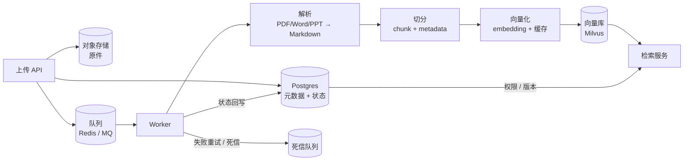
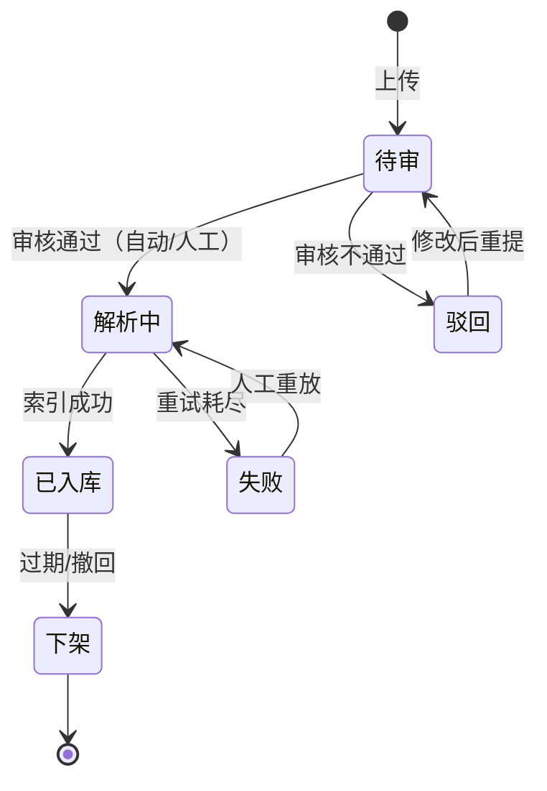
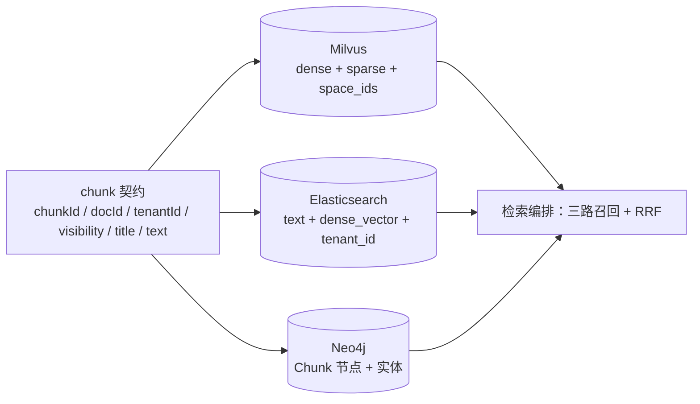

# 4.5 文档入库与治理

> 检索效果的上限，在你把文档灌进去的那一刻就决定了

> **模块**：4.5 | **预计时间**：3.5h | **面试可答**：入库流水线为什么要异步、幂等键怎么设计、切分策略怎么选、权限过滤为什么不能放在检索之后、文档版本与生命周期怎么管

## 学习目标

- 能画出可运维的入库流水线（对象存储 → 队列 → 解析 → 切分 → 向量化 → 索引 → 状态回写）
- 掌握幂等键、失败重试、死信处理的设计，避免重复计费与脏数据
- 掌握四种切分策略与 chunk 元数据设计
- 能把 RBAC 权限翻译成检索过滤条件，理解「检索后过滤」为什么是错的
- 能设计文档审核状态机与版本生命周期

---

## 1. 流水线总览



为什么必须异步：

| 同步入库 | 异步流水线 |
|---------|-----------|
| 上传接口要等解析 + 向量化 + 索引 | 上传只写原件与元数据，立即返回 |
| 大文件超时、HTTP 连接被拖死 | 消费者按自己的节奏处理 |
| 失败只能让用户重传 | 自动重试 + 死信可回放 |
| 无法限流，高峰期打爆 embedding API | 队列天然削峰 |

---

## 2. 解析：多格式 → Markdown

| 格式 | 推荐工具 | 注意 |
|------|---------|------|
| PDF | `unstructured` / `pdf-parse` / MinerU | 扫描件要 OCR；双栏排版易串行 |
| Word | `mammoth` + `turndown`（本章已实测） | Mammoth 出 HTML，需再转 Markdown |
| Excel | `xlsx` / `exceljs` | 每个 sheet 转 Markdown 表格，表头要保留；本章为选型建议 |
| PPT | `pptx` 解析 / `unstructured` | 一页一块，备注单独存；本章为选型建议 |
| HTML | `turndown` | 去导航/页脚，保留正文结构 |

> 除 Word 外，其余格式在本章只给选型建议，没有配套的实测脚本；PDF/Excel 的坑（表格拍平、页眉页脚）在下面单独说明。

统一目标格式是 **Markdown**，因为：

- 标题层级天然对应切分边界
- 表格、列表能保留结构，LLM 与检索都受益
- 纯文本可读，便于人工审核与排障

三个高频质量问题：

1. **页眉页脚重复**：每页都带「XX 公司机密」，切块后变成噪声，解析阶段要按重复率去除
2. **表格被拍平**：PDF 抽取常把表格拆成散乱文本，能识别表格的工具优先
3. **图片信息丢失**：图表内容需要 OCR/多模态模型转成文字描述，否则这部分知识等于不存在

### 2.1 最小解析实现（Word → HTML → Markdown）

本仓库的 demo 只把 `.md` 作为入库输入（`loadUploads` 直接读文件），但解析链路有一个可运行验证：[demo/src/docx.ts](demo/src/docx.ts) 用 `fflate` 现场打包一个最小 `.docx`（不提交二进制 fixture），再走 Mammoth → Turndown，断言标题层级与正文都能落到 Markdown：

```bash
bun run demo:docx
# ✅ 标题层级保留为 Markdown 一级标题
# ✅ 正文文本完整保留
# ✅ 输出已是 Markdown，无 HTML/XML 残留
```

核心代码——**Mammoth 只产出 HTML，还需要一步转 Markdown**：

```typescript
// bun add mammoth turndown && bun add -d @types/turndown
import mammoth from 'mammoth'
import TurndownService from 'turndown'

const turndown = new TurndownService({
  headingStyle: 'atx',     // # 标题，而不是下划线式
  codeBlockStyle: 'fenced' // ``` 代码块
})

const parseDocx = async (buffer: Buffer): Promise<string> => {
  const { value, messages } = await mammoth.convertToHtml({ buffer })
  if (messages.length > 0) {
    // 图片、样式丢失等会以 message 形式返回，必须记录而不是吞掉
    console.warn('docx 解析告警：', messages.map((m) => m.message).join('; '))
  }
  return turndown.turndown(value)   // HTML → Markdown
}
```

PDF 的等价实现是 `pdf-parse`（纯文本）或 `unstructured`（保留结构）；Excel 用 `xlsx` 逐 sheet 转 Markdown 表格。三者的共同纪律是：**解析告警必须记录**，否则「解析成功但内容缺失」会在检索阶段变成查不到的幽灵问题。

---

## 3. 切分：粒度决定召回

### 3.1 四种策略

| 策略 | 做法 | 优点 | 缺点 |
|------|------|------|------|
| 固定长度 | 每 N 字符切，带 overlap | 简单、块大小均匀 | 切断语义，标题与正文分离 |
| 递归切分 | 按段落 → 句子 → 字符逐级降级 | 尽量保留语义边界 | 块大小不均 |
| 结构切分 | 按 Markdown 标题/表格切 | 语义最完整 | 依赖解析质量 |
| 语义切分 | 相邻句向量相似度骤降处断开 | 语义边界准 | 需要 embedding，成本高 |

**默认选择**：结构切分为主（按 `##` 标题），超长段落再递归切分。这也是本仓库 [demo/src/ingest.ts](demo/src/ingest.ts) 的实现。

### 3.2 参数经验值

| 参数 | 建议 | 说明 |
|------|------|------|
| chunk size | 300~800 字符（中文） | 太小丢上下文，太大稀释相关性 |
| overlap | 10%~15% | 只对固定/递归切分有意义，结构切分通常不需要 |
| 父子块 | 子块检索、父块喂模型 | 兼顾召回精度与上下文完整 |
| 每块元数据 | docId、标题路径、版本、租户、可见性、页码 | 缺一个都会在后期返工 |

**父子块**是效果最好也最容易被忽略的技巧：用小块（200~300 字）做向量召回，命中后返回它所属的大块（1000~1500 字）给 LLM。召回精度与上下文完整性同时拿到。

### 3.3 元数据设计

```typescript
interface ChunkMeta {
  chunkId: string      // docId#index，稳定主键
  docId: string
  titlePath: string[]  // ['退款政策', '退款到账时间']
  version: number
  tenantId: string
  visibility: 'public' | 'internal'
  page?: number
  updatedAt: string
}
```

`titlePath` 的价值：拼上下文时能带上层级（「退款政策 > 退款到账时间 > ...」），也方便做「按章节过滤」。

---

## 4. 幂等、重试与死信

### 4.1 幂等键

```typescript
const checksum = sha256(content)   // 用内容哈希，不用时间戳
```

三种幂等层级：

| 层级 | 键 | 效果 |
|------|-----|------|
| 文档级 | `docId + checksum` | 内容没变就不重灌（最常用） |
| 块级 | `chunkId = docId#index` | 重复写入覆盖同一主键，不产生重复块 |
| 请求级 | `Idempotency-Key` 头 | 防止用户重复点击导致多次上传 |

本仓库的实现（`submit`）：

```typescript
if (row && row.checksum === checksum && row.status === 'indexed') {
  return 'skipped'   // 内容未变且已索引：幂等跳过，不重复付费
}
```

### 4.2 更新要先删后写

文档内容变更时，块的数量可能变少。如果只做 upsert，旧版本多出来的块会残留，被检索到就是「已删除的内容还能搜到」。

```typescript
// 节选：assertSafeId 定义见 6.3，完整实现见 demo/src/ingest.ts
// 先按 doc_id 删旧块，再写新块；docId 必须校验后才允许拼进表达式
await milvus.deleteEntities({
  collection_name: COLLECTION,
  expr: `doc_id == "${assertSafeId(doc.id)}"`
})
await milvus.insert({ collection_name: COLLECTION, data: newChunks })
```

注意 Milvus 的删除是**软删除 + 最终可见**，由此带来三个后果：

- **默认一致性下删除有可见窗口**：实测默认（Bounded）`deleteEntities` 后立即检索，被删文档仍会返回，约 1 秒后才消失；需要立即生效时用 `consistency_level: 'Strong'`，或删除后用带 `ids` 的查询确认
- 磁盘空间要等 compaction（容量要预留）
- 高频更新场景建议按版本号建集合，旧版本整体下线，而不是反复删写同一集合

> ⚠️ 这条对「下架 / 权限回收」尤其重要：用户被移出空间后，如果只改元数据而不等索引刷新，短窗口内仍可能召回旧内容。治理动作要按「先收紧检索条件（expr 增加排除）→ 再异步清理索引」的顺序做。

### 4.3 重试与死信

```typescript
// 节选：完整重试循环（含状态回写与日志）见 demo/src/ingest.ts 的 drainQueue
let attempt = 0
while (attempt < MAX_ATTEMPTS) {
  attempt++
  try {
    await indexDoc(doc)
    // 状态回写 indexed
    break
  } catch (error) {
    // 记录最后一次错误，继续重试
  }
}
// 超过上限 → status = 'dead'，进死信队列等人工处理
```

三条纪律：

1. **可重试错误 vs 不可重试错误**：网络超时、限流可重试；解析失败、空文档、格式不支持不可重试，直接进死信
2. **退避要带抖动**：指数退避 + random jitter，避免惊群
3. **死信要可观测**：死信数量、错误分布进监控，超过阈值告警

---

## 5. 审核状态机

> 本节是**设计稿**：demo 只实现了 `pending → indexed / dead` 这一段，审核与下架留作项目 04 的扩展。



关键设计：

- **审核与索引解耦**：审核只改状态，索引由队列驱动，避免「审核通过」接口被索引耗时拖死
- **状态只增不改**：状态流转写事件日志（`doc_events` 表），出问题能还原时间线
- **下架要同步删索引**：只改数据库状态不删向量，等于内容还在被检索到

---

## 6. 权限：过滤必须下推

### 6.1 错误做法

```typescript
// ❌ 检索后过滤：召回被权限吃掉，甚至返回空
const hits = await vectorSearch(query, 10)
const visible = hits.filter((hit) => canRead(user, hit))
```

### 6.2 正确做法

先明确可见性语义（后文所有示例都按这套规则）：

| 可见性 | 谁能看 |
|--------|--------|
| `public` | 同租户所有人 |
| `internal` | 仅 `space_ids` 命中的空间成员 |
| 管理员 | 同租户全部文档（不受空间限制） |

```typescript
// ✅ 节选：expr 由 buildPermissionExpr 生成（见 6.3）
// 权限条件翻译成检索表达式，在 ANN 内部生效
const expr =
  `tenant_id == "acme" and ` +
  `(visibility == "public" or ` +
  `(visibility == "internal" and array_contains_any(space_ids, ["space_pay"])))`

await milvus.search({ collection_name, data: [vector], expr, limit: 10 })
```

### 6.3 RBAC → 过滤条件翻译表

| 权限模型 | 存储字段 | 过滤表达式 |
|---------|---------|-----------|
| 租户隔离 | `tenant_id`（字符串） | `tenant_id == "acme"` |
| 公开/内部 | `visibility`（字符串） | 公开：`visibility == "public"`；内部：`visibility == "internal" and array_contains_any(space_ids, [...])` |
| 空间授权 | `space_ids`（**数组**，如 `["s1","s2"]`） | `array_contains_any(space_ids, ["s1","s2"])` |
| 文档级 ACL | `acl_group_ids`（数组） | `array_contains_any(acl_group_ids, ["g1"])` |
| 密级 | `classification`（整数） | `classification <= 2` |

> ⚠️ 字段名与存储形态必须先统一：上表的 `space_ids` 必须是真正的数组字段（Milvus 支持 `Array` 类型），表达式才能用 `array_contains_any`；如果历史数据存的是逗号串（`"s1,s2"`），需要先规范化成数组再写库，否则 `in` 与 `array_contains_any` 都不会命中。

Milvus 的 Array 字段有硬性参数要求——**`element_type` + `max_capacity` + `max_length` 缺一不可**：

```typescript
{
  name: 'space_ids',
  data_type: DataType.Array,
  element_type: DataType.VarChar,
  type_params: { max_capacity: '16', max_length: '64' }
}
```

实测只写 `max_capacity` 会直接建集合失败：`type param(max_length) should be specified for the field(space_ids)`。demo 的 `kb_ingest` 集合已按此 schema 建立，并用 `array_contains_any(space_ids, ["space_pay"])` 断言了 internal 文档在空间授权后可见。

对应的最小实现（把用户上下文翻译成 `expr`）：

```typescript
interface UserContext {
  tenantId: string
  spaceIds: string[]
  isAdmin: boolean
}

// ID 理想上来自服务端会话/白名单；只要可能被用户影响，就必须先校验再拼接
const ID_PATTERN = /^[A-Za-z0-9_-]{1,64}$/
const assertSafeId = (id: string): string => {
  if (!ID_PATTERN.test(id)) throw new Error(`非法 ID：${id}`)
  return id
}

// 返回 null 表示「无任何可见范围」，调用方直接返回空结果（空权限短路）
const buildPermissionExpr = (user: UserContext): string | null => {
  const tenant = assertSafeId(user.tenantId)
  // 管理员：租户内全部可见，但仍不能跨租户
  if (user.isAdmin) return `tenant_id == "${tenant}"`
  if (user.spaceIds.length === 0) return null

  const spaces = user.spaceIds
    .map((id) => `"${assertSafeId(id)}"`)
    .join(', ')
  return (
    `tenant_id == "${tenant}" and ` +
    `(visibility == "public" or ` +
    `(visibility == "internal" and array_contains_any(space_ids, [${spaces}])))`
  )
}
```

无可见空间时返回 `null`，调用方在发起检索前就短路——**不要把「空条件」拼成 `and false` 或空字符串**：前者依赖表达式引擎对布尔字面量的支持，后者会退化成「无过滤」，直接造成越权。

> ⚠️ **注入面**：`expr` 是字符串拼接，`tenantId` / `spaceIds` 若来自请求参数就是表达式注入点。两条防线：ID 必须是服务端生成的 UUID 或白名单枚举（上面的正则只做兜底），且**永远不要把用户输入原样拼进 expr**。

三个坑：

1. **权限变更要回溯索引**：成员被移出空间后，若过滤字段没更新，旧向量仍可见——权限变更必须触发元数据更新或重新索引
2. **空权限要短路**：用户没有任何可见范围时直接返回空，不要发一次全库检索
3. **管理员视角单独建模**：管理员需要「看全部」，用 `is_admin` 跳过过滤，而不是给管理员加一个 `*` 值

---

## 7. 版本与生命周期

> 与第 5 节同理：下表是设计口径，demo 仅落地 `checksum + status`，版本切换与 TTL 留给项目 04。

| 需求 | 做法 |
|------|------|
| 文档多版本 | `docId + version` 作为逻辑主键，检索只查 `is_latest = true` |
| 灰度重灌 | 新版本写新集合，切换读指针，回滚只需切回 |
| 软删除 | `deleted_at` 标记 + 定时清理任务，给误删留恢复窗口 |
| 保留策略 | 按租户/文档类型设置 TTL，到期先下架再物理删除 |
| 审计 | 每次上传/索引/下架写事件表，保留操作人、时间、checksum |

**为什么用「新集合 + 切读指针」而不是原地重灌**：原地重灌期间检索结果会在新旧之间抖动，且失败后无法回滚。双集合切换是零停机重建的标准做法。

---

## 8. 实战：最小可运维入库管道

完整脚本：[demo/src/ingest.ts](demo/src/ingest.ts)。

```bash
cd doc/04-向量数据库与检索系统/demo
bun install
docker compose -f docker-compose.kb.yml up -d postgres redis milvus-standalone
bun run demo:ingest
```

### 8.1 组件分工

| 组件 | 存什么 |
|------|--------|
| PostgreSQL `kb_documents` | 元数据 + 状态机 + checksum + attempts |
| PostgreSQL `kb_document_contents` | 解析后的正文（向量库只存块） |
| Redis List `kb:ingest` | 待处理任务（`RPUSH` 投递，`BRPOP` 消费） |
| Milvus `kb_ingest` | 块 + 向量 + 过滤字段（tenant / visibility / space_ids / title） |

### 8.2 流程与断言

脚本依次验证七件事：

1. **首轮全量索引**：6 篇文档全部 `indexed`
2. **幂等**：原样重投，checksum 未变 → 全部 `skipped`，零重灌
3. **增量更新 + 旧块清理**：把一篇文档替换成更短内容 → 只重灌这一篇，且旧块全部消失（只剩 `#0`）
4. **失败处理**：空文档 → 重试 3 次 → `dead`，`attempts = 3`
5. **权限下推（public）**：`tenant_id == "acme" and visibility == "public"` 检索，结果 100% 满足条件
6. **空间拒绝分支**：internal 的《团队与权限》只属于 `space_ops`，仅持 `space_pay` 时**不返回**
7. **空间允许分支**：追加 `space_ops` 后，同一篇 internal 文档可见

预期输出（本地栈实测）：

```text
首次投递：queued=6
首轮任务：indexed=6, dead=0
✅ 首轮全部文档索引成功
二次投递：queued=0, skipped=6
✅ 相同 checksum 重投被幂等跳过
变更投递：queued, 重灌=01-退款政策
✅ 仅变更文档被重灌
更新后该文档剩余块： 01-退款政策#0
✅ 更新后旧块已删除，只剩新写入的 1 块
  99-空文档 第 1 次索引失败：空文档：解析后没有任何可索引块
  ...（共 3 次）
故障文档：status=dead, attempts=3
✅ 空文档进入 dead 状态
✅ 重试次数达到上限 3

[filter A] acme + public 检索「备份恢复流程」→（节选，实际 5 条）
| doc               | tenant | vis    |
| 05-数据导出与备份 | acme   | public |
| 06-开放API与限流  | acme   | public |
✅ 过滤检索返回结果
✅ 租户与可见性过滤同时生效

[filter B] 仅 space_pay 授权检索「成员离职笔记怎么交接」→（节选）
| doc              | vis    | spaces    |
| 06-开放API与限流 | public | space_pay |
| 03-账号与登录    | public | space_pay |
✅ 空间拒绝分支：无 space_ops 权限时 internal 文档不返回

[filter C] 追加 space_ops 授权后同一查询 →（节选）
| doc           | vis      | spaces    |
| 04-团队与权限 | internal | space_ops |
| 06-开放API与限流 | public | space_pay |
✅ 空间允许分支：有 space_ops 权限时 internal 文档可见
```

### 8.3 与生产实现的差距

| 本示例 | 生产 |
|--------|------|
| Redis List 做队列 | RabbitMQ / Kafka（见 6.5 消息队列与对象存储） |
| 单进程 worker | 多副本消费者 + 可见性超时 |
| 同步重试 3 次 | 指数退避 + 延迟队列 |
| 状态存 Postgres | 同左，另加事件表与审计 |
| 无审核环节 | 状态机 + 人工审核 |
| 只写 Milvus | 同一份 chunk 元数据同时写 ES（4.2）与 Neo4j（4.4） |

最后一行是阶段收官的缺口：本章的 `indexDoc` 只写了 Milvus。要让 4.2 的关键词检索与 4.4 的图扩展真正接进来，生产上需要一个**统一 chunk 契约**——同一份 `{chunkId, docId, tenantId, visibility, title, text}` 分别投递到三个存储：



三个存储的写入必须共享同一个 `chunkId`（`docId#index`），且**租户与可见性字段在三处都要有**：本章已把 `tenant_id` 补进 4.2 的 mapping、把 `tenantId/visibility/title` 补进 4.4 的 `Chunk` 节点属性。`space_ids` 目前只在 Milvus 落地；ES 若需要同等粒度的空间授权，要额外补 `space_ids: keyword` 字段并写进 bulk，否则 ES 侧只能做到「租户 + 公开/内部」两级。

---

## 9. 常见踩坑

| 现象 | 根因 | 处理 |
|------|------|------|
| 用户重复上传导致重复扣费 | 没有内容哈希幂等 | `docId + checksum` 判重 |
| 更新后还能搜到旧内容 | 只 upsert 未删除多余块 | 先按 `doc_id` 删再写 |
| 权限变更后仍能搜到 | 过滤字段未随权限更新 | 权限变更触发元数据重写 |
| 检索结果全是页眉页脚 | 解析未去重 | 解析阶段按重复率过滤 |
| 表格内容检索不到 | PDF 抽取把表格拍平 | 换支持表格的工具，或转 Markdown |
| 大文件把 worker 卡死 | 同步解析无超时 | 分片解析 + 超时 + 心跳续期 |
| embedding 成本失控 | 无缓存、重复重灌 | 三层缓存（4.3）+ 幂等跳过 |
| 索引与数据库不一致 | 状态回写失败 | 定时对账任务，比对块数与状态 |

---

## 面试问答

> **问：入库为什么必须异步？同步做有什么问题？**
>
> 答：解析、embedding、索引三步都慢且不稳定：大 PDF 解析可能几十秒，embedding 有速率限制，索引要等段加载。同步做会让上传接口超时、连接被占满，失败后用户只能重传，且高峰期无法限流。异步流水线把上传压缩成「写原件 + 写元数据 + 入队」三步，其余由消费者按自己的节奏处理，天然削峰、可重试、可死信回放。

> **问：幂等键为什么用内容哈希而不是时间戳或文件名？**
>
> 答：幂等的目标是「同一份内容重复提交只处理一次」。时间戳每次都不同，文件名可能被改但内容相同，都不能识别重复。内容哈希（SHA-256）能精确判断「内容是否变化」：相同就跳过，不同才重灌。配合 `docId` 还能区分「同一文档的新版本」与「另一篇同名文档」。

> **问：切分粒度怎么定？父子块解决了什么问题？**
>
> 答：切分粒度是召回精度与上下文完整性的权衡：块太大，向量被无关内容稀释，召回不准；块太小，单块信息不足，LLM 拿不到完整答案。父子块把两者拆开——用小块做向量召回保证精度，命中后返回其父块保证上下文完整。参数上小块 200~300 字、父块 1000~1500 字是常见起点，最终要按语料实测。

> **问：为什么权限过滤不能放在检索之后？**
>
> 答：向量检索返回的是 Top-K，如果先取 10 条再在应用层过滤，可能出现两种情况：可见文档不足 K 条，导致上下文不全；极端情况下 Top-10 全不可见，直接返回空结果，而实际上库里明明有可见的相关内容。正确做法是把权限条件翻译成检索表达式（Milvus 的 `expr`、ES 的 `filter`），让过滤发生在 ANN 内部，先剪枝再算距离。

> **问：文档更新后，怎么保证旧内容不被检索到？**
>
> 答：两件事必须同时做。第一，写入侧先按 `doc_id` 删除旧块再写新块，避免块数量减少时残留；第二，版本侧用 `docId + version` 做逻辑主键，检索只查最新版本。对于大规模重建，更稳的做法是写新集合并切换读指针，失败可回滚，也避免重建期间新旧结果抖动。

---

## 实践练习

> 目标：给入库流水线加一道「解析质量闸门」。

**要求**：

1. 在 `splitIntoChunks` 之后加校验：块长度 < 50 字符、或块内重复行占比 > 50% 时，判定为低质量块并丢弃。
2. 统计每篇文档的「有效块数 / 总块数」，低于 0.5 时把文档状态置为 `needs_review` 而不是 `indexed`。
3. 用一份带页眉页脚的 Markdown（每段前都加「云雀内部资料」）验证闸门生效。
4. 给 `needs_review` 状态加一个「人工放行」入口，放行后重新入队。

**提示**：

- 重复行判定可以按「行文本出现次数 > 2」近似
- 状态机新增状态时，记得同步更新审核流转图与死信处理逻辑
- 放行接口要记录操作人，方便审计

**预期效果**：

- 带页眉页脚的文档不会直接 `indexed`，而是停在 `needs_review`
- 人工放行后重新入队，最终状态变为 `indexed`
- 低质量块不再进入向量库，检索结果里看不到「云雀内部资料」这类噪声

---

## 对比：自研流水线 vs 现成知识库平台

| 维度 | 自研（本章） | Dify / FastGPT / RAGFlow |
|------|-------------|-------------------------|
| 可控性 | 完全可控 | 受平台抽象限制 |
| 起步成本 | 中（要写解析、队列、状态机） | 低（开箱即用） |
| 深度定制 | 任意 | 需改源码或插件 |
| 多格式解析 | 自己选型 | 内置，质量参差 |
| 权限与多租户 | 自己设计 | 通常较弱 |
| 适用 | 企业级、需审计与权限 | 快速验证、内部工具 |

**建议路径**：先用现成平台验证「检索能不能解决问题」，确认价值后，把「解析质量、权限、版本、审计」这些平台弱项迁到自研流水线——而不是一开始就全自研。

---

## 总结

1. **异步是底线**：上传只写原件与元数据，解析与索引交给队列
2. **幂等靠内容哈希**：`docId + checksum` 判重，块级 `chunkId` 兜底
3. **更新先删后写**：否则旧块残留，出现「删了还能搜到」
4. **切分决定上限**：结构切分打底，父子块兼顾精度与完整性
5. **权限必须下推**：过滤在 ANN 内部，权限变更要回溯索引
6. **版本用双集合切换**：零停机重建、可回滚，优于原地重灌

**下一步**：

- 第四阶段收官。项目 04（规划中）会把 4.1–4.5 的能力组装成企业级知识库系统
- 继续 [第五阶段：Vercel AI SDK 前端集成](../../readme.md#第五阶段-vercel-ai-sdk-前端集成-规划中)，把检索能力接到对话界面

---

*参考资料*：
- [Milvus：Insert / Upsert / Delete 语义](https://milvus.io/docs/insert-update-delete.md)
- [Milvus：Collection 与 Partition 设计](https://milvus.io/docs/manage-collections.md)
- [unstructured：多格式文档解析](https://docs.unstructured.io/)
- [mammoth：Word → HTML（不含 Markdown 输出）](https://github.com/mwilliamson/mammoth.js)
- [turndown：HTML → Markdown](https://github.com/mixmark-io/turndown)
- [Elasticsearch：filter 上下文与缓存](https://www.elastic.co/docs/reference/query-languages/query-dsl/query-dsl-bool-query)
- [LangChain：Document Loaders（JavaScript）](https://docs.langchain.com/oss/javascript/integrations/document_loaders)
