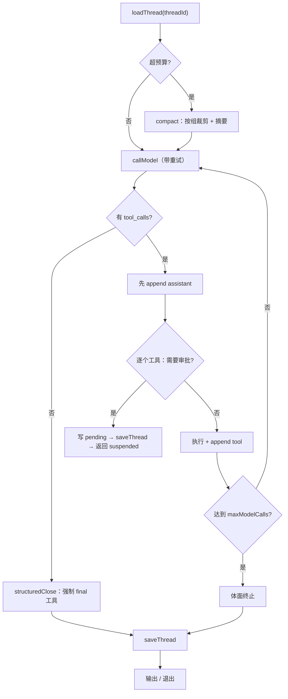

# 实战项目 02-N：智能客服（原生手写版）

> 同一套客服需求，把 02 交给框架的运行时能力，全部用普通函数、`if/else`、`while` 手写一遍。
>
> 目标不是功能对等，而是写完之后能回答：**`createAgent` 为什么要那样设计。**

## 这个项目解决什么问题

02 用 `createAgent` + 中间件栈，三十行就把循环、记忆、摘要、审批、重试、限流、结构化输出全挂上了。看得懂，但说不清每个能力为什么存在。

本项目把框架关掉，只保留 OpenAI 兼容 SDK 和 Zod，从零写一遍。你会先写出一个能跑的裸循环，再一层层撞墙：消息配对、上下文爆掉、进程退出无法恢复、重试重复副作用。**每撞一次，就理解一个框架抽象的必要性。**

## 与 01 / 02 的关系

| 项目                | 循环          | 框架         | 关注点                       |
| ------------------- | ------------- | ------------ | ---------------------------- |
| 01-weather-agent    | 手写          | 无           | 单轮 ReAct 最小闭环          |
| **02-N（本项目）**  | **手写**      | **无**       | **有状态长会话的完整运行时** |
| 02-customer-service | `createAgent` | LangChain v1 | 框架能力与中间件组合         |
| 03-data-analysis    | 显式图        | LangGraph    | 编排层                       |

01 只做到"一轮问答 + 一次工具"。本项目补的是 01 到 02 之间缺的那一级台阶：**会话、压缩、审批、限流、重试、收口**。

## 硬约束

这不是风格建议，是验收条件。

| 允许                                   | 禁止                           |
| -------------------------------------- | ------------------------------ |
| 普通函数、纯函数                       | 插件系统、hooks 管线、事件总线 |
| 普通对象 / 数组当状态                  | 类继承、抽象基类、依赖注入容器 |
| `Record<string, Tool>` 工具表          | Tool 接口 + 注册协议           |
| `while` / `if/else` 控制流             | `AsyncGenerator` 流式协议      |
| 一个 `resume(threadId, decision)` 入口 | 为"将来换实现"预留的间接层     |

判断标准：**为复用写函数，可以；为替换留间接层，不行。** 只有一个实现时，接口就是噪音。

另外三条：

1. 不 import `langchain` / `@langchain/*` / `langgraph`。
2. `src/cli.ts` 必须能从上到下读完，看懂一次 turn 的完整路径。
3. `src/` 总行数 ≤ 1150（含业务规则，不含测试与数据）。

## 必做范围：9 个运行时能力

业务不是重点，但没有业务就验证不了记忆（见「业务底座」一节）。所以只做一套刚好够用的客服数据与四个工具，不加任何额外功能。

| #   | 能力       | 落地位置                              | 一句话验收                              |
| --- | ---------- | ------------------------------------- | --------------------------------------- |
| 1   | ReAct 循环 | `agent/loop.ts`                       | 一轮任务：两次工具 + 一次回答           |
| 2   | 工具系统   | `agent/tool.ts` + `business/tools.ts` | 4 个工具 + Zod 校验 + 未知工具不中断    |
| 3   | 会话记忆   | `agent/store.ts`                      | 进程退出后 `--resume` 能接上            |
| 4   | 上下文压缩 | `agent/compact.ts`                    | 长会话触发摘要，且不破坏消息配对        |
| 5   | 结构化输出 | `agent/structured.ts`                 | 最终结论一定是 schema 校验通过的 JSON   |
| 6   | 调用上限   | `agent/loop.ts`                       | 超过 `maxModelCalls` 体面终止           |
| 7   | 重试       | `agent/model.ts`                      | 模型 429 重试成功；非幂等工具不重试     |
| 8   | 人工审批   | `agent/approval.ts`                   | 挂起 → 进程退出 → 恢复 → 工具只执行一次 |
| 9   | 事件流     | `agent/events.ts`                     | 能从 `events` 断言一次 turn 的执行顺序  |

第 9 项不是新功能，是其余 8 项的**观察面**。第 1 步就引入，之后每加一个能力，先加它对应的事件。

### 场景映射：这 9 项在 Trae Code 里长什么样

这 9 项不是抽象概念，你每天用的 Trae Code 就是它们拼起来的。对照着看，缺失时坏在哪会非常具体。

| 能力       | Trae Code 里的样子                                                       | 没有它会怎样                               | 项目里的验证                                    |
| ---------- | ------------------------------------------------------------------------ | ------------------------------------------ | ----------------------------------------------- |
| ReAct 循环 | 说"修这个 bug"，它先搜、再读、再改、再跑测试，最后总结                   | 只给建议不动手，一次模型调用就结束         | 第 1 步：连续两次工具 + 一次回答                |
| 工具系统   | Glob / Grep / Read / Edit / Bash 各有参数 schema，路径错了报错而不是瞎猜 | 模型只能"说"不能"做"；参数无校验           | 第 1 步：未知工具、非法参数不中断               |
| 会话记忆   | 关掉再打开同一会话，还记得你提过的文件名和约束                           | 每次都要重贴上下文，"刚才那个文件"接不住   | 第 2 步：`--resume` 后不再追问订单号            |
| 上下文压缩 | 几十轮之后早期内容变成摘要，但"别动公共组件"这类约束还在                 | 超出上下文窗口报错，早期约束被丢掉         | 第 5 步：20 轮后仍记得订单号                    |
| 结构化输出 | 结束时的结论可判定：改了哪些文件、测试是否通过、是否还需你确认           | 只能人肉读散文猜任务完成度                 | 第 4 步：最终返回 schema 校验通过               |
| 调用上限   | 同一个报错来回改几次后停下来汇报，而不是无限重试                         | 死循环、费用失控，只能手动点停止           | 第 3 步：`maxModelCalls = 2` 时第三次不发生     |
| 重试       | 接口 429 / 5xx 自动退避重试；但 `git push` 这类操作不会自动重放          | 一次网络抖动全盘失败，或重试造成重复副作用 | 第 3 步：429 重试成功、非幂等工具不重试         |
| 人工审批   | 跑 `rm -rf`、`git push`、改敏感文件前弹确认，批准后从断点继续            | 静默执行危险操作；关掉窗口状态就丢         | 第 6 步：挂起 → 退出 → `resume`，工具只执行一次 |
| 事件流     | 面板上的"正在搜索 / 读取文件 / 等待批准 / 12 passed"和步骤列表           | 只剩一个转圈，不知道卡在哪，也无法复盘     | 第 1 步 + `events.test.ts`：顺序可断言          |

自查方法：每实现一项，回到 Trae Code 找到对应现象，问自己一句——**删掉这段代码，哪个现象会消失？** 答不上来，说明这一项还没真正写进去。

### 选做（必做项全绿之后）

- 意图分类短路（用结构化输出做路由，替代 02 的 `withStructuredOutput`）
- PII 掩码（手机号 / 卡号）

### 明确不做

PostgreSQL / docker、评估 runner、HTTP 服务、向量检索、流式输出。前四项 02 已经有了，不重复；流式会引入 `AsyncGenerator`，与硬约束冲突，留到看完 kern 之后再做——那时你会明白为什么 kern 把它放在协议层而不是循环层。

Hooks / 插件系统、Provider 抽象、abort、沙箱、OTel 也不做：它们是 kern 的答案，提前写就等于抄。

## 业务底座（记忆的验证载体）

没有业务，memory 只能验证"文件里有没有 messages"，验证不了"模型是否真的记住了上文"。业务不是装饰，它是记忆的验收工具。

### 场景

电商客服，3 个用户、每人 3 单，共 9 条订单。用户通过 CLI 咨询政策、查订单、申请退款、投诉建单。

### 数据（`data/seed/`，只读，运行时改内存副本）

`orders.json`：

| 字段          | 类型           | 说明                                                        |
| ------------- | -------------- | ----------------------------------------------------------- |
| `orderId`     | string         | 形如 `SO-2026-0812`                                         |
| `userId`      | string         | 归属用户，用于权限校验                                      |
| `item`        | string         | 商品名                                                      |
| `amount`      | number         | 金额（全项目统一单位）                                      |
| `status`      | enum           | `paid` / `shipped` / `delivered` / `refunding` / `refunded` |
| `paidAt`      | string         | 支付时间（ISO）                                             |
| `deliveredAt` | string \| null | 签收时间                                                    |
| `trackingNo`  | string \| null | 物流单号                                                    |

刻意埋两个坑（与 02 一致，用来验证模型是否如实告知而不是编造）：

- 一条订单 `status` 是 `delivered`，但 `deliveredAt` 为 `null`
- 一条订单 `status` 是 `shipped`，但 `trackingNo` 为 `null`

`tickets.json`：初始为空，`create_ticket` 写入。

`policy-faq.json`：8–10 条 `{ keywords: string[], answer: string, source: string }`，覆盖退款政策、物流时效、会员权益、发票规则。

### 业务规则（`src/business/rules.ts`，纯函数，可单测）

- **权限**：只能查询/操作 `order.userId === currentUserId` 的订单；越权按"不存在"处理，不泄露。
- **可退判定**：`status` 为 `paid / shipped / delivered`；已签收按 `deliveredAt` 起 7 天内，未签收按 `paidAt` 起 7 天内；`refunding / refunded` 直接拒绝。
- **金额不重算**：退款金额取订单 `amount`，不让模型参与数值计算。
- **失败不抛异常**：返回 `{ ok: false, reason }`，由工具层转成 observation。

### 四个工具

| 工具             | 入参（Zod）            | 成功返回          | 失败返回      | 幂等 | 需审批 |
| ---------------- | ---------------------- | ----------------- | ------------- | ---- | ------ |
| `query_order`    | `{ order_id }`         | 订单快照          | 不存在 / 越权 | 是   | 否     |
| `search_policy`  | `{ query }`            | 命中条目 + 出处   | 知识库未覆盖  | 是   | 否     |
| `process_refund` | `{ order_id, reason }` | 新状态 + 预计到账 | 不可退原因    | 否   | 是     |
| `create_ticket`  | `{ type, summary }`    | 工单号            | 参数非法      | 否   | 是     |

两个只读工具不审批；两个写操作必须挂起审批。这一个区分就是第 6 步的验证入口。

### 怎么验证记忆：三个必测场景

三个都要求**跨进程**，进程内 `await` 不算。

**场景 A · 跨进程记住订单号**

```text
$ bun run cli
> 帮我看看订单 SO-2026-0812
  [工具] query_order → 已签收 3 天 / 空气炸锅 / ￥299

$ bun run cli --resume t_001
> 那这个还能退吗
  [工具] search_policy → 7 天无理由
助手: 可以退，需在签收后 7 天内申请……
```

验收：第二个进程没有重新问订单号。

**场景 B · 压缩后关键事实不丢**

先聊 12 轮无关内容触发压缩，再问"最开始那个订单号是多少"。

验收：摘要里保留了 `SO-2026-0812`；请求不返回 400。

**场景 C · 挂起后恢复**

退款触发审批 → 进程退出 → `resume` 审批通过。

验收：工具只执行一次；恢复后的 messages 里 `assistant(tool_calls)` 与 `tool` 仍然配对。

### 业务验收场景

| 场景     | 输入                     | 期望                               |
| -------- | ------------------------ | ---------------------------------- |
| 政策咨询 | "退款政策是什么"         | `search_policy` 命中，不建单       |
| 查订单   | 提供订单号               | `query_order` 返回快照             |
| 退款     | 订单号 + 原因            | 审批 → 状态变 `refunding` → 建工单 |
| 越权     | 查询别人的订单           | 返回不存在，不泄露信息             |
| 投诉     | "服务太差"               | `create_ticket`，审批后工单入库    |
| 不可退   | 对 `refunded` 订单再退款 | 返回原因，模型如实转告             |
| 数据矛盾 | 状态已签收但无签收时间   | 如实说明矛盾，不编造               |

## 一次 turn 的完整路径



注意两条分支的出口不一样：**只有审批挂起会提前返回**，其他失败都转成 observation 继续循环。

## 数据落在哪

| 数据          | 位置                           | 何时写                       |
| ------------- | ------------------------------ | ---------------------------- |
| 会话消息      | `data/threads/<threadId>.json` | 每轮结束、工具执行前后       |
| 待审批        | 同一文件的 `pending` 字段      | 敏感工具执行前               |
| 用量计数      | 同一文件的 `usage` 字段        | 每次模型调用后               |
| 订单/工单/FAQ | `data/seed/` 只读 JSON         | 启动加载，工具写入内存后落盘 |

两个契约先定死，后面不用改：

```typescript
interface ThreadState {
  threadId: string
  messages: ChatMessage[]
  phase: 'model' | 'tools' | 'awaiting-approval' | 'done'
  modelCalls: number
  totalTokens: number
  pending?: PendingApproval
  updatedAt: string
}

interface PendingApproval {
  callId: string
  tool: string
  args: Record<string, unknown>
  summary: string
  createdAt: string
}

type RunEvent =
  | { type: 'turn-start'; threadId: string }
  | { type: 'model-call'; attempt: number; status: 'ok' | 'retry' | 'error' }
  | { type: 'tool-call'; name: string; args: Record<string, unknown> }
  | { type: 'approval-requested'; tool: string; summary: string }
  | { type: 'observation'; name: string; ok: boolean; content: string }
  | { type: 'compacted'; droppedMessages: number }
  | { type: 'turn-end'; reason: 'final' | 'limit' | 'suspended' }
```

`RunEvent` 只是一个联合类型 + `events.push(...)`，不引入 emitter。

**保存点：每次相位切换立即 `saveThread`**

| 相位                        | 写入时机            | 崩溃后能回答什么                 |
| --------------------------- | ------------------- | -------------------------------- |
| `phase='model'`             | 调用模型前          | 还没拿到回复，可以安全重试       |
| `phase='tools'`             | append assistant 后 | assistant 已入历史，只差工具结果 |
| `phase='awaiting-approval'` | 写 `pending` 后     | 该 `resume`，不该重跑模型        |
| `phase='done'`              | 收口完成            | 重复 `resume` 直接返回，幂等     |

## 目录结构

```text
02-customer-service-native/
├── README.md
├── package.json / tsconfig.json / .env.example
├── data/
│   ├── seed/
│   │   ├── orders.json           # 9 条订单（含两个数据矛盾）
│   │   ├── tickets.json          # 初始为空
│   │   └── policy-faq.json       # 8–10 条政策问答
│   └── threads/                  # 运行期落盘（gitignore）
├── src/
│   ├── cli.ts                    # 组装入口：config + seed + tools → REPL
│   ├── config.ts                 # 环境变量校验
│   ├── agent/                    # Agent 运行时：不认识订单与工单
│   │   ├── loop.ts               # ReAct 循环 + 上限 + 压缩触发
│   │   ├── events.ts             # RunEvent 联合类型（无 emitter）
│   │   ├── model.ts              # 一次模型调用 + 重试 + token 计数
│   │   ├── tool.ts               # 工具协议 + 请求体映射
│   │   ├── store.ts              # thread / pending 的读写
│   │   ├── compact.ts            # 按组裁剪 + 摘要
│   │   ├── structured.ts         # 强制 final 工具 + 校验
│   │   └── approval.ts           # 审批决策与 resume
│   └── business/                 # 业务层：只被 cli 组装，不被 agent import
│       ├── types.ts              # Order / Ticket / PolicyFaq / SeedData
│       ├── seed.ts               # 读取 data/seed/*.json
│       ├── rules.ts              # 权限 / 可退判定 / FAQ / 工单
│       ├── tools.ts              # createBusinessTools(seed, userId)
│       └── prompt.ts             # 客服 system prompt
└── test/
    ├── loop.test.ts
    ├── events.test.ts
    ├── business.test.ts
    ├── compact.test.ts
    ├── approval.test.ts
    ├── structured.test.ts
    └── limits.test.ts
```

依赖方向：`cli → agent + business`，`agent` 不 import `business`。业务工具通过 `createBusinessTools(seed, userId)` 闭包持有依赖，所以 `agent/tool.ts` 的 `run` 只接收 `args`。

## 分步实现

每一步都要能独立跑通再进入下一步。**顺序不能调换**，后一步会推翻前一步的设计。

### 第 1 步 · 业务底座 + 裸循环与工具

写：

- `data/seed/`：9 条订单（含两个数据矛盾）+ 空工单 + 8–10 条政策 FAQ
- `business/rules.ts`：权限校验、可退判定、工单写入（纯函数，先写测试）
- `business/tools.ts`：四个工具的定义，用 `createBusinessTools(seed, userId)` 闭包持有业务依赖
- `agent/tool.ts`：`RunEvent` 之外的另一个协议——工具的形状与请求体映射
- `agent/events.ts`：`RunEvent` 联合类型；循环里只做 `events.push(...)`，不引入 emitter
- `agent/model.ts`：一次 `chat.completions.create`，不做重试、不计数
- `agent/loop.ts`：`while` + `messages.push`，无压缩、无审批；多个 `tool_calls` 先串行
- `cli.ts`：组装 config + seed + tools，读一行、跑一轮、打印

跑通标准：

- 一次任务里连续调用两个工具再回答
- 未知工具、参数非法、工具抛错都不中断循环
- 一轮返回多个 `tool_calls` 时，每个结果都单独回填
- `runTurn` 返回的 `events` 顺序与实际执行一致：`model-call → tool-call → observation → turn-end`
- 越权查单返回"不存在"，不泄露订单信息
- 不可退订单返回原因而不是抛错
- 数据矛盾订单（已签收但无签收时间）如实说明，不编造

写完后必须能回答：

- 为什么 `assistant(tool_calls)` 必须先入历史，再执行工具？
- `tool` 消息里为什么是 `tool_call_id` 而不是工具名？
- 模型返回多个 `tool_calls` 时，消息的排列顺序是什么？
- 事件为什么要在循环里产生，而不是在 CLI 里打印？

### 第 2 步 · 会话落盘

写：

- `agent/store.ts`：`loadThread` / `saveThread`，一个文件一个 thread
- `agent/loop.ts`：每次相位切换后立即 `saveThread`（`model / tools / awaiting-approval / done`）
- `cli.ts`：支持 `--resume <threadId>`，没有则新建

跑通标准：

- 退出进程，重新 `--resume`，"那刚才那单呢"能接上上文
- 落盘文件里能看到完整的 `system / user / assistant / tool` 序列
- 每个相位都能在落盘文件里看到，且 `pending` 只在 `awaiting-approval` 时存在

写完后必须能回答：

- 落盘的到底是什么？为什么不能只存"最后一轮问答"？
- 如果进程在工具执行到一半时被杀，文件里应该是什么状态？
- `phase` 和 `messages` 谁更能说明"执行到哪了"？为什么两个都要存？

### 第 3 步 · 调用上限与重试

写：

- `agent/loop.ts`：`modelCalls` 计数，超限时体面终止（返回已有结论，不抛栈）
- `agent/model.ts`：只对 429 / 5xx / 连接错误重试，指数退避，最多 2 次
- `business/tools.ts`：给每个工具标 `idempotent: boolean`

跑通标准：

- 让假模型连续返回 429，第二次成功
- `maxModelCalls = 2` 时，第三次调用不发生，循环退出
- 非幂等工具抛错时**不重试**，错误转成 observation

写完后必须能回答：

- 为什么模型调用可以无脑重试，工具不行？
- 上限应该数模型调用还是工具调用？为什么？
- 重试失败后，是抛出还是转成 observation？

### 第 4 步 · 结构化收口

写：

- `agent/structured.ts`：定义一个 `submit_result` 工具，schema 为 `{ resolution, follow_up_needed }`
- `agent/loop.ts`：正常回答后不直接返回，而是再要一次结构化结论（或强制 `tool_choice`）

跑通标准：

- 最终返回一定是 Zod 校验通过的对象，不是自由文本
- 模型同时给出正文和结构化调用时，正文不丢
- 业务工具名与 `submit_result` 冲突时有显式报错

写完后必须能回答：

- 为什么要占用一个工具位？还有别的实现方式吗？
- 为什么收口放在循环末尾，而不是一开始就要求结构化？

### 第 5 步 · 上下文压缩

写：

- `agent/compact.ts`：估算 token；超过阈值时，把较早的对话压成一条摘要
- 关键：**按组裁剪**，`assistant(tool_calls)` 和它对应的 `tool` 消息必须同进同出

跑通标准：

- 构造 20 轮长会话，触发压缩
- 压缩后请求不返回 400（配对没断）
- 摘要里保留了订单号、用户诉求等关键事实

写完后必须能回答：

- 如果从 `assistant` 和 `tool` 之间切开，会发生什么？
- 压缩后的 messages 是写回文件，还是只用于本次请求？
- `trigger` 和 `keep` 两个阈值分别在解决什么问题？

### 第 6 步 · 审批与挂起恢复

写：

- `agent/approval.ts`：敏感工具执行前写 `pending` 并落盘，返回 `suspended`
- `agent/loop.ts`：并发策略——只读工具可并行，写工具串行；任一调用需审批，停止调度新调用，等 in-flight 完成并落盘后再挂起
- `cli.ts`：检测到 `suspended` 时渲染审批界面，退出进程
- `resume(threadId, decision)`：读回 `pending`，按 `approve / reject` 继续

跑通标准：

- 退款工具执行前，进程退出；重新 `resume` 后继续，工具**只执行一次**
- `reject` 后工具不执行，模型拿到拒绝原因并礼貌收尾
- 挂起期间重复调用 `resume` 不会重复执行
- 三个工具一批、其中第二个要审批：第一个已执行的结果必须已落盘，第三个不启动

写完后必须能回答：

- 挂起时哪些状态必须落盘，哪些可以重算？
- 为什么审批必须和持久化绑在一起？进程内 `await prompt()` 缺了什么？
- `approve` 之后如果进程又崩了，怎么保证不重复执行？
- 为什么"有审批的批次"不能和其他写操作并行？

## 五个会真正绊住你的地方

1. **压缩切断配对。** `assistant(tool_calls)` 与后续 `tool` 是一组。从中间切，下一次请求直接 400。正确做法是按组裁剪，宁可多留一组。
2. **工具重试重复副作用。** 退款、改状态重试就是做两次。必须区分模型重试与工具重试，并且只对标记了幂等的工具重试。
3. **假的挂起。** 在进程内 `await prompt()` 是最容易写的版本，但它绕过了真正的问题：状态落盘、跨进程恢复、幂等执行。本项目要求真实挂起。
4. **结构化收口撞名。** 强制 `tool_choice` 会占用一个工具位，业务工具同名时不会报错，只会静默走错分支。
5. **并发批次夹审批。** 三个工具并行发出去，其中一个要审批：另外两个可能已经产生副作用但没落盘。恢复后要么丢结果，要么重复执行。规则是有审批的批次一律串行。

## 知其所以然：手写时的墙 → kern 的抽象

跑通之后回看这张表，把"我当时怎么解决的"和"框架为什么这么设计"对上。

| 手写时撞到的墙                                      | kern 里对应的设计                                             | 看哪篇  |
| --------------------------------------------------- | ------------------------------------------------------------- | ------- |
| 循环里 `if (压缩) / if (审批) / if (超限)` 越堆越深 | `wrapModelCall` / `wrapToolCall` 洋葱管线，每层只关心一件事   | 03      |
| 只能靠 `console.log` 猜执行顺序                     | Event 协议：`transformEvent` + `onEvent`，terminal 事件不可丢 | 02 / 03 |
| `messages` / `usage` / `pending` 散在闭包和参数里   | `RunState` + `phase` 单一状态对象                             | 02 / 06 |
| 不知道"进程死在哪一步、该从哪续"                    | checkpointer + 保存点                                         | 06      |
| 压缩后 tool 配对断裂                                | `transformInput` 只改请求视图，不回写 `RunState`              | 03 / 06 |
| 审批恢复要重放整轮                                  | `interrupt` + 持久化 pending + `resume()`                     | 02 / 09 |
| 并发批次里夹一个审批，恢复后状态对不上              | tool scheduler：有 ask 的批次一律串行                         | 05 / 09 |
| 工具重试重复副作用                                  | 注册序 + 幂等约定 + 执行洋葱                                  | 03 / 05 |
| 换个模型要改循环                                    | Provider 接口 + 流式 chunk 协议                               | 04      |
| 业务代码与运行时混在一起                            | 插件边界与依赖方向                                            | 01 / 03 |

## 最终验收问题

代码全绿不算过关。能用自己的话答完这 10 个问题才算。

1. checkpointer 存的到底是什么？为什么不是"消息数组"？
2. 为什么压缩必须按 `assistant + tool` 组裁剪？
3. 审批挂起时，哪些状态必须落盘，哪些可以重算？
4. 为什么模型重试和工具重试必须分开？
5. 调用上限应该数模型调用还是工具调用？各自的副作用是什么？
6. 结构化输出为什么占用一个工具位？还有别的实现吗？
7. 一个 turn 内三个工具调用，中途崩溃，恢复后如何保证不重复执行？
8. 如果把 `agent/loop.ts` 里的 `if` 抽成 hooks 数组，顺序怎么排？哪些必须在模型调用前？
9. 为什么事件要区分可丢弃与 terminal？如果 `turn-end` 被插件丢掉会怎样？
10. 一轮三个工具、其中一个要审批，另外两个已经在跑，应该怎么收场？

## 阅读顺序（很重要）

写之前读太多，就会变成抄设计。按这个顺序：

1. **动手前**：只读本 README、02 README 的「业务场景与数据设计 / 四个工具 / 验收标准」三节、01 的 `re-act.ts`。
2. **写的时候**：不读 `agent-kernel/doc/`，不读 02 的 `src/`。
3. **跑通之后**：读 kern 的 02 / 03 / 06，对照上表逐条回看自己的实现。
4. **最后**：diff 02 的源码，产出两份清单——"框架替我做了但我没写"和"我手写了但框架没提供"。

## 测试策略

- 假模型驱动，不依赖 API Key：`createScriptedModel(turns)` 返回一个只有 `chat.completions.create` 的对象，按剧本吐 `tool_calls` 或 `content`。
- 注入方式：`runTurn({ client, ... })` 直接传参，不抽接口。
- 每个能力至少三个用例：正常、失败、恢复。

| 测试                 | 覆盖                                                 |
| -------------------- | ---------------------------------------------------- |
| `loop.test.ts`       | 多工具编排、未知工具、非法参数、多 `tool_calls` 顺序 |
| `events.test.ts`     | 事件顺序、terminal 事件必达、相位与保存点一致        |
| `business.test.ts`   | 权限越权、7 天边界、不可退状态、数据矛盾             |
| `compact.test.ts`    | 触发阈值、按组裁剪、配对不断、关键事实保留           |
| `approval.test.ts`   | 挂起落盘、approve / reject、重复 resume 幂等         |
| `structured.test.ts` | schema 校验、正文保留、工具名冲突                    |
| `limits.test.ts`     | 调用上限、429 重试、非幂等工具不重试                 |

## 反模式与停止条件

出现以下任一情况，说明写过头了：

- 出现 `interface Provider` 或 `interface Checkpointer`
- 出现 `hooks: Hook[]`、`plugins: Plugin[]`、`emitter.on(...)`
- 出现 `class Agent`
- 单个文件超过 300 行（先拆纯函数，不是拆层）
- 为了"以后换数据库"把 `agent/store.ts` 抽成仓储接口

## 运行

```bash
cd projects/02-customer-service-native

bun install
cp .env.example .env      # 填 LLM Key；测试不需要
bun run cli               # 新建会话
bun run cli --resume <id> # 恢复会话
bun test                  # 全离线
```

## 参考

- [02-customer-service](../02-customer-service/README.md)：只看需求章节，不看实现
- [01-weather-agent](../01-weather-agent/README.md)：单轮手写版，写法可复用
- [agent-kernel 设计文档](../../../agent-kernel/readme.md)：跑通后再读，重点 02 / 03 / 06
