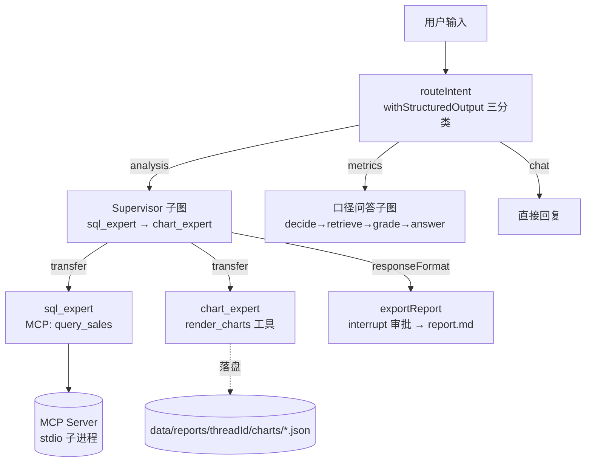
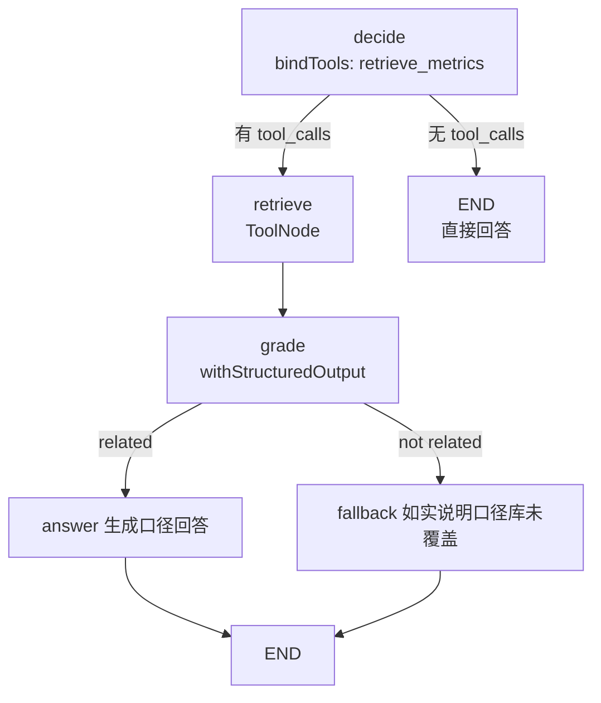

# 实战项目 03：数据分析助手（多 Agent 协作版）

## 项目概述

构建一个基于 **LangGraph.js** 的**命令行多 Agent 数据分析助手**：用户用自然语言提问（"上个月华南区的销售额趋势如何"），**Supervisor 调度两个专家 Agent**（SQL 取数 → 图表生成）协作完成分析，最后由主管收口成一份 Markdown 报告（图表以文件形式落在报告目录）。

本项目只学五件事：**显式图编排（3.1）、Send 并行与 interrupt 审批（3.2）、简化版 Agentic RAG（3.3）、Supervisor 多 Agent（3.4）、MCP 工具服务化（3.5）**。其余内容一律不做或降级，逐项列在文末「刻意不做」。

> 本项目是第三阶段收官项目，也是 02 的能力跃迁：02 用 `createAgent` 的预置循环，03 下沉到 **LangGraph 显式图**——条件边、子图、Send、interrupt 全部亲手组装。业务数据为本地 SQLite（seed 脚本生成），零外部服务依赖。

> **范围声明**：复杂度预算全部花在「图怎么编排」上。同一份工作流，编排管流程、副作用归工具、analysis 分支出口只有一个 `structuredResponse`——这三条边界是本次减法的核心。
>
> 📌 下文代码块是设计节选，省略了部分 import 与辅助函数；可运行实现以 `src/` 为准，每节标注对应文件。
>
> 📖 **源码级教学手册**：[docs/index.html](./docs/index.html) — 15 章、7 张图，覆盖架构、状态、Supervisor、MCP、RAG、interrupt、Send、防幻觉失败案例与验收。

### 与 02 的机制对照

| 机制     | 02 智能客服                            | 03 数据分析                                       |
| -------- | -------------------------------------- | ------------------------------------------------- |
| 编排     | `createAgent` 预置循环                 | LangGraph 显式图（外层工作流 + Supervisor 子图）  |
| 路由     | 代码 if/else + `withStructuredOutput`  | `routeIntent` 条件边                              |
| 人工介入 | `humanInTheLoopMiddleware`             | `interrupt()` + `Command({ resume })`             |
| 持久化   | `PostgresSaver`                        | `MemorySaver`（跨进程持久化 02 已验证，不重复）   |
| 工具来源 | 本地 `tool()`                          | MCP stdio Server + `@langchain/mcp-adapters`      |

## 知识点映射

### Phase 3 核心知识点（本题主线）

| 文档                       | 应用点                                                                                                                  |
| -------------------------- | ----------------------------------------------------------------------------------------------------------------------- |
| **3.1 LangGraph 核心概念** | `StateSchema` + reducer 定义工作流状态；`routeIntent` 条件边三分支；`recursionLimit` 兜底                                 |
| **3.2 LangGraph 高级模式** | `interrupt()` + `Command({ resume })` 报告审批；Supervisor / RAG 子图挂载；`Send` 并行（`demo/` 独立对照）；`MemorySaver` |
| **3.3 Agentic RAG**        | 口径问答子图 `decide → retrieve → grade → answer / fallback`，**去掉 rewrite 环**（只保留一次打分闸门）                   |
| **3.4 多 Agent 编排**      | `createSupervisor` 编排两专家（⚠️ JS 参数是 `llm`、返回值需 `.compile()`）；`outputMode: 'full_history'`；`responseFormat` 收口 |
| **3.5 MCP 开发**           | 自写 **stdio MCP Server**（单工具 `query_sales`），`@langchain/mcp-adapters` 桥接为 SQL Agent 工具                      |

### 前置知识点（Phase 1 / 2）

| 文档                  | 应用点                                                                   |
| --------------------- | ------------------------------------------------------------------------ |
| **1.5 TS + Bun**      | Bun + TypeScript 全程；ECharts option 只落盘不渲染                       |
| **1.6 Prompt 工程**   | SQL 专家的 DDL 注入与脏数据过滤规则；图表专家的结构化约束                |
| **2.3 工具系统**      | `tool()` + Zod（`render_charts`）；工具描述即路由规则                    |
| **2.4 结构化输出**    | `withStructuredOutput`：路由分类、图表 option、RAG 相关性打分            |
| **2.5 记忆管理**      | `MemorySaver` + `thread_id` 会话延续（Checkpointer 的用法已掌握，不重复） |

## 项目亮点

1. **Supervisor 两专家编排**：不手写调度逻辑，用 `createSupervisor` 让调度模型按任务派活——委派接口就是子 Agent 的 name/prompt
2. **MCP 工具服务化**：SQL 查询能力做成独立进程，同一份能力可被任何 MCP 宿主复用，体会「Agent 连工具」的协议化
3. **原生 interrupt 审批**：报告落盘是审批 gate 的副作用；图表在分析阶段已作为中间产物落盘，`interrupt()` 暂停等人工确认，`Command({ resume })` 恢复——掌握恢复语义（节点重跑、副作用位置）
4. **Send 独立对照**：`demo/chart-map-reduce.ts` 二十多行跑通并行扇出 + reducer 汇合，与 Agent 内的顺序版直接对比，看清「并行」到底并行在哪

## 技术栈

```
Runtime:     Bun 1.4+
Language:    TypeScript 5.9+ (strict)
Framework:   langchain v1 + @langchain/langgraph >= 1.4.0（显式图编排；Send 动态超时门槛）
Multi-Agent: @langchain/langgraph-supervisor
MCP:         @modelcontextprotocol/sdk v1（自写 stdio Server）+ @langchain/mcp-adapters
Interface:   CLI（交互分析 + 审批输入）
Validation:  Zod
Database:    bun:sqlite（Bun 内置，只读连接 + query_only；无原生模块编译）
Persistence: MemorySaver（进程内；跨进程持久化见 2.5）
Charts:      ECharts option JSON（只落盘，不打包渲染）
Tracing:     LangSmith（环境变量，选装）
```

## 数据集设计（seed 脚本生成）

`bun run db:seed` 生成 `data/analytics.db`，两张表 + 刻意留的两种「坑」：

| 表         | 字段                                                   | 数据特点                                                                |
| ---------- | ------------------------------------------------------ | ----------------------------------------------------------------------- |
| `orders`   | id, order_date, region, category, product_name, amount | 12 个月 × 4 大区 × 5 品类，约 1200 行；**混入少量脏数据**（负金额、NULL region） |
| `products` | id, name, category, unit_price                         | 与 orders 的 product_name 关联（供 join 练习）                          |

脏数据的作用：SQL Agent 必须在 prompt 中学会 `WHERE amount > 0 AND region IS NOT NULL` 这类防御性过滤——「数据清洗意识」是 NL2SQL 的真实难点，成本只有 seed 脚本两行。

## 架构设计

### 总体流程



### 状态契约：analysis 出口只有 structuredResponse

```typescript
// graph/state.ts
import * as z from 'zod'
import { StateSchema, MessagesValue } from '@langchain/langgraph'

export const ReportSchema = z.object({
  summary: z.string(),
  markdown: z.string()
})

export const WorkflowState = new StateSchema({
  messages: MessagesValue, // append：多 Agent 共用同一段对话历史
  intent: z.enum(['analysis', 'metrics', 'chat']).optional(), // routeIntent 写
  reply: z.string().optional(), // chat 分支直接回复
  structuredResponse: ReportSchema.optional(), // supervisor 收口，last-value
  status: z.enum(['skipped', 'rejected', 'exported']).optional(), // exportReport 写
  reportPath: z.string().optional() // exportReport 写
})
```

五条关键约束：

- `messages` 用 `MessagesValue`（append），`structuredResponse` 用 last-value——**不要把两个都写成 last-value**，否则多 Agent 历史会被覆盖
- ⚠️ `intent` / `reply` 必须在 `WorkflowState` 里声明：LangGraph 对未知 key 的写入会被**静默丢弃**，否则 `routeIntent` 的 `intent` 永远 `undefined`，三分支全部落到 `directReply`
- ⚠️ `structuredResponse` / `status` / `reportPath` 都是 last-value channel，会跨轮残留：`routeIntent` 每轮显式写 `undefined` 清空（见下），否则 analysis 后追问「你好」还会打印上一轮报告
- 图表**不进 state**：`render_charts` 工具把文件写到 `data/reports/<threadId>/`，state 里不放 `charts` 字段——编排管流程，副作用归工具
- metrics / chat 分支不写 `structuredResponse`，它们的出口是 `messages`；「只有一个出口」只针对 **analysis 分支**

### Supervisor 组装（两个高频坑）

```typescript
import { createSupervisor } from '@langchain/langgraph-supervisor'
import { createAgent } from 'langchain'
import { ReportSchema } from './graph/state.ts'

const sqlExpert = createAgent({
  model,
  name: 'sql_expert',
  systemPrompt: SQL_EXPERT_PROMPT, // 内置 DDL + 只读规则 + 脏数据过滤
  tools: mcpTools // 来自 MultiServerMCPClient.listTools()
}).graph

const chartExpert = createAgent({
  model: chartModel, // 低成本档，缺省回落主模型
  name: 'chart_expert',
  systemPrompt: CHART_EXPERT_PROMPT,
  tools: [renderCharts]
}).graph

const supervisor = createSupervisor({
  agents: [sqlExpert, chartExpert], // createAgent 需取 .graph
  llm: model, // ⚠️ JS 版参数名是 llm 不是 model
  prompt: `你是数据分析团队主管。标准流程：先派 sql_expert 取数，
再派 chart_expert 出图，最后自己写 Markdown 报告。数据不足或查询失败时
如实告知，不得编造数字。`,
  outputMode: 'full_history',
  // 该 DeepSeek 端点不支持 json_schema / tool_choice，用 jsonMode 透传
  responseFormat: {
    schema: ReportSchema,
    method: 'jsonMode',
    prompt:
      '根据以上对话生成最终报告，只输出 JSON 对象，形如 {"summary":"...","markdown":"..."}。'
  }
}).compile()
// ⚠️ 返回值是未编译的 StateGraph，必须手动 compile
// ⚠️ 此处【不要】传 checkpointer：supervisor 作为子图挂载，省略后继承外层的 MemorySaver
```

> `createAgent` 返回 ReactAgent，取 `.graph` 才是 Supervisor 可挂载的编译图；`responseFormat` 的对象形式会把额外字段透传给 `withStructuredOutput`。OpenAI 结构化输出可改成直接传 `ReportSchema`。

**为什么是两专家而不是三专家**：`report_writer` 的唯一产出是正文，而正文本来就要靠 `responseFormat` 回外层——让主管自己写成 Markdown 直接收口，省掉一个 Agent、一个 `publish_report` 工具，以及整套「怎么把产物从子图里捞回来」的接线。这是本项目最重要的一处减法。

### 意图路由：谁来分流「分析 vs 口径 vs 闲聊」

```typescript
const RouteSchema = z.object({
  intent: z.enum(['analysis', 'metrics', 'chat']),
  reply: z.string().optional() // chat 分支直接可用
})

const routeIntent = async (state: typeof WorkflowState.State) => {
  const question = state.messages.at(-1)?.text ?? '' // content blocks 归一成字符串
  const out = await routeModel
    .withStructuredOutput(RouteSchema, { method: 'jsonMode' }) // 低成本档
    .invoke([
      new SystemMessage(ROUTE_PROMPT), // 判定规则写在这里
      new HumanMessage(question)
    ])
  return {
    intent: out.intent,
    reply: out.reply,
    // last-value channel 跨轮残留：新一轮先清空上一轮导出结果
    structuredResponse: undefined,
    status: undefined,
    reportPath: undefined
  }
}

const workflow = new StateGraph(WorkflowState)
  .addNode('routeIntent', routeIntent)
  .addNode('analysis', supervisor) // 编译图直接挂载，共享 messages/structuredResponse
  .addNode('metricsQa', ragSubgraph) // 口径问答子图，同样直接挂载
  .addNode('directReply', directReply)
  .addNode('exportReport', exportReport)
  .addEdge(START, 'routeIntent')
  .addConditionalEdges('routeIntent', (s) =>
    s.intent === 'analysis' ? 'analysis' : s.intent === 'metrics' ? 'metricsQa' : 'directReply'
  )
  .addEdge('analysis', 'exportReport')
  .addEdge('exportReport', END)
  .addEdge('metricsQa', END)
  .addEdge('directReply', END)
  .compile({ checkpointer: new MemorySaver() })
```

判定规则写进 `ROUTE_PROMPT`：涉及取数/趋势/对比/图表 → analysis；问指标定义/口径 → metrics；问候与无关闲聊 → chat。**周期与范围（"上个月""华南区"）不做结构化抽取**——SQL 专家直接从问题里读，多一层抽取只是多一个出错点。

### 两个专家的分工

| Agent         | 职责                                             | 工具                       | 模型     |
| ------------- | ------------------------------------------------ | -------------------------- | -------- |
| `sql_expert`  | 把分析需求转成只读 SQL 并执行，返回表格数据      | MCP：`query_sales`         | 主力模型 |
| `chart_expert`| 把表格数据按维度转成 ECharts option JSON 并落盘  | `render_charts`            | 低成本档（缺省回落主模型） |

拆分依据（3.4 的委派边界）：两个角色的工具面完全不重叠，Supervisor 的价值在「决定派活顺序与是否返工」，而不是自己干活。

### 图表：Agent 内顺序版 + demo 并行版

`render_charts` 工具在 Agent 内部**顺序**生成每个维度的 option（工具循环 02 已练过，这里不重复教）：

```typescript
const renderCharts = tool(
  async ({ dimensions }, config) => {
    const charts = []
    for (const dimension of dimensions) {
      // 已是合法 option 直接落盘，否则顺序生成（parseChartOption 见 chart-agent.ts）
      charts.push(
        parseChartOption(dimension.data) ?? (await generateChartOption(dimension))
      )
    }
    const threadId = String(config.configurable?.thread_id ?? 'adhoc')
    const dir = resolveReportDir(threadId) // REPORTS_DIR + thread_id 白名单
    await saveCharts(dir, charts) // 图表是分析中间产物，先落盘
    return JSON.stringify({ count: charts.length, dir: `${dir}/charts/` })
  },
  {
    name: 'render_charts',
    description: '按维度生成 ECharts option 并落盘，返回文件路径与数量',
    schema: z.object({
      dimensions: z.array(z.object({ name: z.string(), data: z.string() }))
    })
  }
)
```

> `resolveReportDir` 会净化 `thread_id`；图表在分析阶段落盘，审批只 gate `report.md`。`chartOptionSchema` 还会校验 legend：bar/line 对应 `series.name`，pie 对应 `series.data[].name`；不同量纲不共轴写进 chart prompt。

并行版单独放在 `demo/chart-map-reduce.ts`，`bun run demo:charts` 直接跑，和上面的顺序版对照：

```typescript
// demo/chart-map-reduce.ts —— Send fan-out → reducer 汇合
import * as z from 'zod'
import { StateGraph, StateSchema, ReducedValue, START, END, Send } from '@langchain/langgraph'
import { chartOptionSchema } from '../src/prompts/chart-schema.ts'

const ChartState = new StateSchema({
  dimensions: z.array(z.object({ name: z.string(), data: z.string() })),
  charts: new ReducedValue(
    z.array(chartOptionSchema).default(() => []),
    // inputSchema 是「单次节点更新」的类型：节点返回一个 option，reducer 负责追加
    { inputSchema: chartOptionSchema, reducer: (cur, next) => [...cur, next] }
  )
})

const renderChart = async ({ dimension }: { dimension: Dimension }) => {
  const option = await chartModel.withStructuredOutput(chartOptionSchema).invoke(/* 按维度生成 */)
  return { charts: option } // ⚠️ 不是 [option]：ReducedValue.inputSchema 是单条
}

export const chartMapReduce = new StateGraph(ChartState)
  .addNode('renderChart', renderChart)
  .addNode('split', async () => ({}))
  .addEdge(START, 'split')
  .addConditionalEdges('split', (s) =>
    s.dimensions.map((d) => new Send('renderChart', { dimension: d }))
  )
  .addEdge('renderChart', END)
  .compile({ name: 'chart_map_reduce' })
```

两个 Send 细节（3.2）：每个 Send 携带**独立子状态**（dimension + data），目标节点只拿到该对象；个别慢维度可给 Send 第三参覆盖超时：`new Send('renderChart', {...}, { timeout: 15_000 })`。

**为什么 Send 不塞进 Supervisor**：`createSupervisor` 的 handoff 工具 schema 是空对象，只转移控制权、不接收业务参数（`dimensions` 传不进去）；子 Agent 返回时还要按 `messages` 契约收结果（`ChartState` 没有 `messages` 会报错）。把 Send 子图硬塞进去要额外套一层工具包装，两个机制互相纠缠、出错时分不清是谁的问题。**拆成独立 demo，两边都学到，且互不牵连。**

### MCP Server（SQL 能力服务化）

独立进程 `mcp-server/index.ts`，stdio transport，**只有一个工具**：

| 工具         | 入参      | 行为                                                         |
| ------------ | --------- | ------------------------------------------------------------ |
| `query_sales`| `{ sql }` | 只读连接执行 SQL，返回前 `SQL_MAX_ROWS` 行（代码层截断）     |

```typescript
const db = new Database(config.ANALYTICS_DB_PATH, { readonly: true })
db.run('PRAGMA query_only = ON')

server.registerTool(
  'query_sales',
  {
    description: '执行只读 SQL 并返回前 500 行',
    inputSchema: { sql: z.string() }
  },
  async ({ sql }) => {
    if (!isReadOnlySql(sql)) {
      return {
        content: [{ type: 'text', text: '仅允许单条 SELECT 查询' }],
        isError: true
      }
    }
    const { rows, rowCount, truncated } = querySales(sql) // 迭代截断，最多 SQL_MAX_ROWS 行
    return {
      content: [{ type: 'text', text: JSON.stringify({ rowCount, truncated, rows }, null, 2) }]
    }
  }
)
```

> `querySales` 在 `services/db.ts` 用 `Statement.iterate()` 逐行取，`rowCount` 是实际返回行数；`truncated=true` 表示还有更多行，需要收窄查询。

> ⚠️ **真正的防线是 `readonly: true` + `query_only = ON`，不是前缀检查**：前缀检查挡不住 SQLite 的 `WITH ... DELETE`，严格的语句类型判定（词法扫描或 AST）属于安全加固，留给 8.4。
>
> ⚠️ **stdio 纪律**：stdout 是 JSON-RPC 通道，Server 内所有日志走 `console.error`；`console.log` 会污染协议流。
>
> 💡 表结构不单独做工具：DDL 直接写进 `sql_expert` 的 systemPrompt，省掉一次工具往返。

Client 侧桥接（3.5 要验证的就是这一层）：

```typescript
import { fileURLToPath } from 'node:url'

const client = new MultiServerMCPClient({
  // v2 默认给工具名加 server 前缀（analytics_query_sales），prompt 里用原名更直观
  prefixToolNameWithServerName: false,
  servers: {
    analytics: {
      transport: 'stdio',
      command: process.execPath,
      args: [fileURLToPath(new URL('../mcp-server/index.ts', import.meta.url))],
      cwd: fileURLToPath(new URL('..', import.meta.url))
    }
  }
})
const mcpTools = await client.listTools()
```

> mcp-adapters v2 把 `mcpServers` 改为 `servers`、`getTools()` 改为 `listTools()`；路径与 `cwd` 以 `src/services/mcp.ts` 为准。

### 口径问答子图（简化版 Agentic RAG）

用户问「GMV 和销售额有什么区别」时走这条分支。`decide / retrieve / grade / answer` 四个主体节点 + `fallback` 兜底 + 一次打分闸门，**不做 rewrite 环**（完整五节点闭环留给 3.3 独立练习）：



要点：`grade` 用 `withStructuredOutput` + `temperature: 0` + 低成本档；三条 prompt 都含防注入指令；`decide` 决定「要不要查口径库」，这才是 Agentic RAG 与前两阶段「检索即工具」的区别。子图用 `MessagesValue` 与外层共享对话，编译后直接 `addNode` 挂载。

### Human-in-the-Loop：报告审批（图表已是中间产物）

```typescript
const exportReport = async (
  state: typeof WorkflowState.State,
  config?: RunnableConfig
) => {
  const report = state.structuredResponse
  if (!report) return { status: 'skipped' as const }
  const dir = resolveReportDir(String(config?.configurable?.thread_id ?? 'adhoc'))

  // interrupt 之前只做纯计算；报告目录名由 thread_id 决定，state 里不重复存
  const decision = interrupt({
    action: 'export_report',
    summary: report.summary,
    targetPath: `${dir}/report.md`
  })
  if (!decision.approved) return { status: 'rejected' as const }

  await writeReport(dir, report.markdown) // 副作用在 interrupt 之后
  return { status: 'exported' as const, reportPath: `${dir}/report.md` }
}

// CLI 侧恢复（同 thread_id）
await workflow.invoke(new Command({ resume: { approved: true } }), config)
```

> ⚠️ 恢复后节点**从头重跑**：`interrupt()` 之前只允许纯计算，不得有写文件等副作用。
>
> ⚠️ 审批只 gate `report.md`。图表是分析中间产物，在 `render_charts` 工具里已先落盘；`reject` 不会删除 `charts/`。

### CLI 交互示例

> 以下为交互示意；实际 `--stream` 输出是 `[子图 ...]` 节点事件，金额与标签以 SQL/运行结果为准。

```bash
$ bun run cli --stream

thread_id: 8f3a2c

> 上个月华南区卖得怎么样？

[派活] sql_expert
[调用] query_sales({ sql: "SELECT ..." })
[派活] chart_expert
[调用] render_charts({ dimensions: ["按月趋势", "按品类占比"] })
[汇总] summary: 华南区上月销售额 128.6 万，环比 +12%……

[审批] 报告已生成，是否导出？ approve / reject
> approve
[导出] data/reports/8f3a2c/report.md

> GMV 和销售额有什么区别？
[口径] 走口径子图：retrieve → grade related → 直接回答
```

## 目录结构

```
03-data-analysis/
├── README.md                     # 本文件（项目需求与设计文档）
├── docs/
│   └── index.html                # 源码级中文教学手册（双击打开；docs/README.md 为索引）
├── package.json / tsconfig.json / .env.example / .oxlintrc.json / .oxfmtrc.jsonc
├── db/
│   └── seed.ts                   # 销售数据集生成脚本（bun run db:seed）
├── mcp-server/
│   └── index.ts                  # stdio MCP Server（单工具 query_sales）
├── demo/
│   └── chart-map-reduce.ts       # Send 并行出图（bun run demo:charts，与 Agent 内顺序版对照）
├── scripts/                      # 可选 spike 验证脚本（结论见 todo.md）
│   └── spike-*.ts
├── src/
│   ├── cli.ts                    # CLI 入口：对话循环 + 审批输入 + --stream 观察
│   ├── config.ts                 # 环境变量集中读取
│   ├── agents/
│   │   ├── sql-agent.ts          # SQL 专家（MCP 工具）
│   │   ├── chart-agent.ts        # 图表专家（createAgent + render_charts 工具）
│   │   └── supervisor.ts         # createSupervisor 组装（不传 checkpointer）
│   ├── graph/
│   │   ├── state.ts              # WorkflowState（StateSchema + reducer）
│   │   ├── workflow.ts           # 外层工作流：routeIntent + 两个子图挂载 + exportReport
│   │   └── rag-subgraph.ts       # 口径问答子图（decide/retrieve/grade/answer）
│   ├── prompts/                  # 三份 systemPrompt + 窄版 ECharts option Zod Schema
│   └── services/
│       ├── db.ts                 # SQLite 只读连接 + query_only
│       ├── metrics-kb.ts         # 指标口径知识库（5 条：GMV / 销售额 / 退款率 / 客单价 / 环比）
│       ├── models.ts             # 模型工厂（DeepSeek thinking 兼容）
│       └── export.ts             # saveCharts + writeReport
└── test/
    ├── chart-agent.test.ts       # parseChartOption：合法 option / 原始行 / 坏 JSON
    ├── chart-map-reduce.test.ts  # Send 扇出 / ReducedValue 单条语义 / 空维度
    ├── chart-schema.test.ts      # legend 规则（bar/line vs pie）
    ├── db.test.ts                # 只读 SQL 前缀检查（多语句 / 非查询 / 字符串分号）
    ├── export.test.ts            # thread_id 净化 / 图表重跑去残留
    ├── mcp.test.ts               # listTools + query_sales 子进程集成
    ├── rag-subgraph.test.ts      # decide / retrieve / grade / answer / fallback
    ├── supervisor.test.ts        # Supervisor fakeModel smoke
    └── workflow.test.ts          # 路由三分支 / interrupt 拒绝与恢复 / 多轮状态
```

## 测试

九个自动化测试文件，覆盖最容易写错的几处：

| 测试文件                  | 覆盖范围                                                                 | 关键手法                                   |
| ------------------------- | ------------------------------------------------------------------------ | ------------------------------------------ |
| `chart-agent.test.ts`     | `parseChartOption`：合法 option 直通 / 原始行 / 坏 JSON                    | 纯函数断言                                 |
| `chart-map-reduce.test.ts`| Send 扇出数量、ReducedValue 单条输入语义、空维度                          | fake 模型 + 直接 invoke 子图               |
| `chart-schema.test.ts`    | legend 规则：bar/line 对 series 名、pie 对数据项名；双轴形态                | 纯 Schema 断言                             |
| `db.test.ts`              | 只读 SQL 前缀检查：多语句 / 非查询 / 字符串内分号                          | 纯函数断言                                 |
| `export.test.ts`          | `thread_id` 净化阻断路径穿越、图表重跑去残留                              | 临时目录 + 白名单                          |
| `mcp.test.ts`             | 拉起 stdio 子进程，`listTools` + `query_sales` 取数                        | 临时 SQLite + MCP 子进程                   |
| `rag-subgraph.test.ts`    | decide → retrieve → grade → answer / fallback；无 tool_calls 直接 END     | fake 模型 + ToolNode                       |
| `supervisor.test.ts`      | handoff 到 sql_expert 后用 responseFormat 收口                            | fake 模型 smoke                            |
| `workflow.test.ts`        | 路由三分支、`reject` 不写报告但保留图表、多轮状态清理、`skipped`           | fake 模型预置 tool_calls + 临时目录 |

> 💡 多 Agent 端到端不必真实 LLM：用 `fakeModel` 预置派活与工具调用序列（官方 unit-testing 指南），02 已落地验证。真实模型 e2e、`--stream` 与数字审计是**手工走查**（可用 `scripts/spike-*` 辅助），不在 `bun test` 内。

## 验收标准

- [ ] `bun run db:seed` 一键生成数据集；`bun run cli` 能通过 MCP 取到数据（`listTools` 可见 `query_sales`）
- [ ] 意图路由：「上个月华南区销售额趋势」→ analysis；「GMV 和销售额的区别」→ metrics；「你好」→ chat 直接回复，三分支互不误入
- [ ] 端到端：「上个月华南区销售额趋势」→ 取数 → 2+ 张图 → 主管收口 → 审批 → `report.md` + `charts/*.json` 落盘
- [ ] 防幻觉：报告中**所有数字**必须能在 SQL 工具返回中找到；派生量（计数/占比/环比）必须由 SQL 聚合返回，禁止手算；图表数量与 `charts/` 目录文件数一致
- [ ] 趋势类数据流：SQL 返回按日 + 按周两段聚合；`chart_expert` 只做格式转换，不自行聚合
- [ ] `reject` 后不写 `report.md`（图表作为分析中间产物保留）；`approve` 后报告生成；`Command({ resume })` 能在同一 `thread_id` 上正确恢复
- [ ] `--stream` 模式能看到 supervisor 子图内部的节点切换事件（`streamMode: 'updates'` + `subgraphs: true`）
- [ ] 脏数据不进入结果：负金额 / NULL region 行被过滤

> ⚠️ 真实模型仍可能在自由文本里派生计数（prompt-only 防线不保证）；手工走查时逐项对照 tool 消息 / SQL 结果，自动化测试不替代数字审计。

## 实现步骤

### 第一步：数据与 MCP 底座

1. 初始化工程（package.json / tsconfig / oxlint / oxfmt / .env.example，参考 02 项目配置；锁 `@langchain/langgraph >= 1.4.0`）
2. `db/seed.ts` 生成数据集（含两种脏数据）；`services/db.ts` 只读连接 + query_only 封装
3. `mcp-server/index.ts` 单工具 + 前缀检查；`mcp-adapters` 连通性验证（临时脚本 listTools + callTool）

### 第二步：两个专家 Agent

4. `prompts/` 三份 systemPrompt（SQL 专家的 DDL 注入与防御性过滤规则是重点）
5. `chart-agent.ts`：`generateChartOption` + `render_charts` 工具（顺序版，落盘）
6. `supervisor.ts` 组装（**不传 checkpointer**）+ `responseFormat` 收口

### 第三步：外层工作流（LangGraph 主场）

7. `graph/state.ts`（`messages` append + `structuredResponse` last-value；`intent` / `reply` 必须声明）
8. `rag-subgraph.ts` 口径问答子图（四个主体节点 + fallback，无回环）
9. `graph/workflow.ts`：routeIntent 条件边、挂载两个子图、exportReport 的 interrupt 审批
10. `test/workflow.test.ts` 全绿（路由三分支、interrupt 拒绝/恢复、报告内容一致）

### 第四步：对照 demo 与 CLI

11. `demo/chart-map-reduce.ts`（Send 并行）+ `test/chart-map-reduce.test.ts`
12. `cli.ts`（对话循环、审批输入、`--stream` 观察模式）；人工走查全部验收标准

## 本地运行

```bash
cd projects/03-data-analysis

bun install
cp .env.example .env          # 填入 LLM API Key

bun run db:seed               # 生成数据集（首次）

bun run cli --stream          # 分析对话（报告与图表落在 data/reports/<threadId>/）
bun run demo:charts           # Send 并行 demo（与 Agent 内顺序版对照）
bun test                      # 全量测试
```

## .env.example 示例

```env
# LLM 配置（OpenAI 兼容端点；无 provider 前缀时按 openai: 处理）
OPENAI_API_KEY=sk-your-api-key-here
OPENAI_BASE_URL=https://api.deepseek.com
DEFAULT_MODEL=deepseek-v4-flash
# 留空回落 DEFAULT_MODEL；单 Key 场景可保持为空
CHART_MODEL=

# 数据与报告
ANALYTICS_DB_PATH=./data/analytics.db
REPORTS_DIR=./data/reports
SQL_MAX_ROWS=500

# LangSmith（选装）
LANGSMITH_TRACING=false
LANGSMITH_API_KEY=lsv2_sk_xxxx
LANGSMITH_PROJECT=data-analysis
```

> 切回 OpenAI 端点时把 `DEFAULT_MODEL` / `CHART_MODEL` 改成 `openai:gpt-...`；DeepSeek 端点下结构化输出走 `jsonMode`，模型工厂会关闭 thinking（见 `src/services/models.ts`）。

## 刻意不做（去哪学）

| 不做                              | 原因                                             | 去哪学                                                   |
| --------------------------------- | ------------------------------------------------ | -------------------------------------------------------- |
| 定时日报 + 阈值预警               | 定时调度不是图编排                               | 6.2（node-cron / BullMQ，同一工作流 `invoke` 即可触发）   |
| 容错三件套 / 模型降级链           | 「无 bug 也要写」的代码，阅读成本高              | 3.7 文档                                                 |
| Agentic RAG 的 rewrite 环 / giveUp| 五节点闭环是 3.3 的独立练习                       | 3.3 文档                                                 |
| 自包含 HTML / ECharts 打包        | 前端工程，不是 Agent 能力                        | 第五阶段                                                 |
| DeepAgents 换装                   | 框架对比，非图编排                               | 3.6 文档                                                 |
| MCP allowlist 词法扫描 / 501 探针 | 安全加固                                         | 8.4（OWASP LLM Top 10）                                  |
| 跨进程持久化（SqliteSaver 等）    | 02 已用 `PostgresSaver` 验证过，不重复           | 2.5 文档；本项目 `MemorySaver` 足够支撑 interrupt 恢复   |
| Hono `/reports` 端点              | 服务化不是本阶段目标                             | 1.5 / 第六阶段                                           |

### 与课程大纲的差异

| 大纲条目 | 本项目处理 | 去向 |
| --- | --- | --- |
| 多数据源集成 | 单 SQLite + 单 MCP Server | 第四阶段 / 3.5 多 Server 练习 |
| 细粒度权限 / 鉴权 | 只读连接 + `query_only` + `thread_id` 白名单 | 8.1 / 8.4；当前是部分实现 |
| 定时报表与预警 | 不做（同一工作流可被 cron 触发） | 6.2 |
| 报告 Agent | 不拆独立 Agent | 主管 `responseFormat` 收口（见“为什么两专家”） |
| 三 Agent 协作 | 两专家 + 主管 | 同上 |

## 参考文档

### 教程文档（本项目知识点出处）

- 项目教学手册：[docs/index.html](./docs/index.html)（本地双击打开，源码级 15 章）
- 第三章：[3.1 核心概念](../../doc/03-LangGraph.js复杂工作流编排/01-LangGraph核心概念.md)、[3.2 高级模式](../../doc/03-LangGraph.js复杂工作流编排/02-LangGraph高级模式.md)、[3.3 Agentic RAG](../../doc/03-LangGraph.js复杂工作流编排/03-AgenticRAG实现.md)、[3.4 多 Agent](../../doc/03-LangGraph.js复杂工作流编排/04-多Agent编排.md)、[3.5 MCP](../../doc/03-LangGraph.js复杂工作流编排/05-MCP开发.md)
- 前置：[2.3 工具系统](../../doc/02-LangChain.js生态深度掌握/03-工具系统.md)、[2.4 结构化输出](../../doc/02-LangChain.js生态深度掌握/04-Agent构建与配置.md)、[2.5 记忆管理](../../doc/02-LangChain.js生态深度掌握/05-记忆与状态管理.md)、[1.6 Prompt 工程](../../doc/01-AI-Agent基础与认知升级/06-Prompt-Engineering系统讲解.md)

### 官方文档

- [createSupervisor API 参考（注意 llm 参数名）](https://reference.langchain.com/javascript/functions/_langchain_langgraph-supervisor.createSupervisor.html)
- [LangGraph.js Interrupts](https://docs.langchain.com/oss/javascript/langgraph/interrupts)
- [LangGraph.js 子图](https://docs.langchain.com/oss/javascript/langgraph/use-subgraphs)
- [官方 Agentic RAG 教程](https://docs.langchain.com/oss/javascript/langgraph/agentic-rag)
- [MCP TypeScript SDK](https://github.com/modelcontextprotocol/typescript-sdk)
- [@langchain/mcp-adapters](https://www.npmjs.com/package/@langchain/mcp-adapters)
- [ECharts 配置项手册](https://echarts.apache.org/zh/option.html)

---

> 完成本项目后，你将具备用 LangGraph 编排多 Agent 系统的核心能力：显式控制流、条件边路由、子图挂载、并行扇出、人工介入与工具协议化——第四章（向量数据库检索升级）之前的全部底盘。
