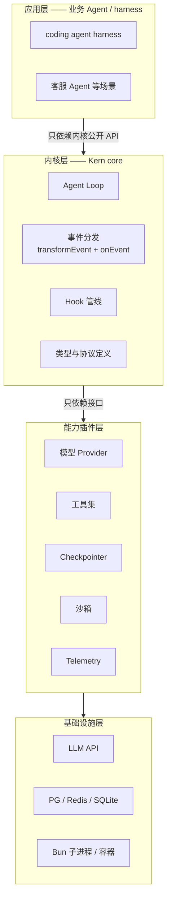

# 01 — 总体架构设计

> **状态**：v2 · 已吸收第一轮评审 · 随 v0.1 实现迭代
> **关联**：[02-核心循环与事件系统](02-核心循环与事件系统.md) · [03-插件系统与钩子设计](03-插件系统与钩子设计.md) · [09-harness层设计](09-harness层设计.md)

## 1. 设计原则

### 1.1 内核最小化

内核负责 **Loop / Event / Hooks + `RunState` 契约**：状态结构与 Checkpointer 接口是协议的一部分，存储实现才是插件。

- 自检标准：把任何候选模块（如 checkpointer 实现、planner）从内核移到插件，内核 API 是否仍然自洽？若自洽，必须移出；`RunState` / `Checkpointer` 接口属于契约，不移出
- 量化口径（可机械化检查）：**内核文件 ≤ 10、core 总 LOC ≤ 1800、单文件目标 ≤ 300 行**；类型定义与注释计入，测试与生成代码不计（见 [08](08-路线图与里程碑.md)）
- 反例：LangChain 把 Runnable 协议做成了 20+ 组合子——本项目用 `AsyncGenerator` 一个原语替代

### 1.2 一切皆插件

- 模型 Provider、工具、记忆、沙箱、观测全部走统一插件协议（见 [03](03-插件系统与钩子设计.md)）
- 内核依赖**接口**而非实现；接口定义在内核，实现全部在插件侧
- 插件可以整套缺失：删掉沙箱插件，其余系统照常运行（v0.2 起用 smoke 脚本自动验证）
- **协议先行**：v0.1 即定义全部钩子与 `runtime.resume()` 签名（默认透传 / no-op 占位），v0.2 只填实现——防止「事后补协议」重演「事后补流式」的返工

### 1.3 流式优先

- **run / model 事件是流，工具执行是 Promise**：`runtime.stream()` / `resume()` / `Provider.stream()` / `wrapModelCall` 统一为 `AsyncGenerator`；`ToolDefinition.execute` 保持 `Promise<ToolResult>`，由内核的 async generator 驱动并发与输出队列
- ⚠️ 事后补流式 = 破坏所有调用方签名，这是 Agent 框架最常见的返工点
- `text-delta` 内核原样透传，节流放消费者侧（内核节流会引入延迟）

### 1.4 Fail-fast + 类型安全

- 配置错误（缺 provider、钩子签名不对、同名工具/插件冲突）在注册与 setup 阶段直接抛出，不带病运行
- Zod schema 是作者侧真源：Agent 配置、插件配置、工具作者侧入参的类型从 schema 推导；工具协议层以 JSON Schema 为唯一真源（Zod 仅作者侧糖，见 [05](05-工具系统.md)）
- 错误一律 `class XxxError extends Error` 类型化，全模型见本文第 3 节

## 2. 术语表（全篇统一口径）

| 术语 | 定义 | 层级 |
| --- | --- | --- |
| thread | 一次会话；跨 run 持久化的隔离键（checkpointer 主键） | 会话 |
| run | 一次 `runtime.stream()` 触发的完整执行，含 1..n 个 turn | 执行 |
| turn | run 内的一次「模型调用 → 工具执行 → 结果回填」循环体 | 轮 |
| runStep | 本次 run 的 turn 序号（从 0 起），`maxIterations` 与它比较 | 计数 |
| totalSteps | thread 级累计 turn 数：每次模型调用计 1（含自然终止轮），仅审计 + 硬上限（默认 10000），防「重启重置计数」绕过 | 计数 |
| session | ❌ 本项目不使用该词，文档与代码一律说 thread | — |

统一口径三条：

- **usage**：`RunState.usage` 存 thread 累计，`RunState.runUsage` 存本次 run 累计；模型调用事件与 `onAfterModelCall` 里的 `usage` 是**本轮增量**
- **maxIterations**：**run 级**（比较 `runStep`）。防死循环是单次 run 的职责——若按 thread 累计，一个长寿 thread 跑两次复杂任务就会被永久锁死
- **maxTotalSteps**：thread 级兜底熔断（比较 `totalSteps`），不参与常规判断

## 3. 统一错误模型

四类错误 + 两个判定位（`retryable` 可重试 / `exposeToModel` 回传模型）：

| 错误类 | 触发 | retryable | exposeToModel | run 结局 |
| --- | --- | --- | --- | --- |
| `AbortError` | 用户取消 / 上游 `AbortSignal` | false | false | 中止（aborted） |
| `KernelError`（`MaxIterationsError` / `MaxTotalStepsError` / `ThreadBusyError` / `ThreadNotResumableError` / `PrincipalMismatchError` / `CheckpointError` / `BudgetExceededError`） | 内核 / 预算约束 | false | false | 中止（error） |
| `ProviderError` | 模型 API（三分类见 [04](04-模型Provider抽象.md)） | 分类而定 | false | 重试耗尽后中止 |
| `ToolPipelineError` | 工具管线自身故障（`transformToolResult` 等钩子 / 序列化抛错） | false | false | 中止（error） |

> 💡 `BudgetExceededError` 由预算插件抛出，但类定义在 core，确保消费者统一识别；`MaxTotalStepsError` 与 `MaxIterationsError` 同属 `KernelError`。

> ⚠️ 工具**业务失败**（入参校验失败 / `execute` 抛错）不是异常：归一为 `ToolResult(ok: false)` 回传模型自纠（见 [05](05-工具系统.md)），不进错误模型、不产生 error 事件。`SandboxPathError` 是沙箱插件错误，由工具归一为 `ToolResult(ok:false, code:'SANDBOX_PATH_DENIED')`，同样不进 run 错误模型。

三条铁律：

1. **先事件后异常**：所有错误先 `yield { type: 'error' }` 再 throw——保证 CLI / SSE / telemetry 三类消费者都能观测到错误后，流才终止
2. **Abort 是例外**：abort 只 `yield { type: 'run-aborted' }` 再抛 `AbortError`，不发 `error` 事件；它不是错误，是控制流终止
3. **ProviderError 三分类**：`retryable`（429 / 5xx / 网络瞬断，重试插件可处理）、`fatal`（401 / 403 / 参数错）、`context-overflow`（上下文超长，触发压缩，不可原样重试）

## 4. 一次 run 的完整时序（钩子顺序的唯一权威）

```mermaid
sequenceDiagram
    participant App as 应用层
    participant Loop as Agent Loop
    participant H as Hook 管线
    participant P as Provider 插件
    participant T as 工具系统

    App->>Loop: stream(threadId, input)
    Loop->>H: onRunStart
    loop 每个 turn
        Loop->>Loop: turn-started（checkpoint 保存点 ①）
        Loop->>H: transformInput（改写 messages）
        Loop->>H: transformTools（裁剪工具）
        Loop->>H: wrapModelCall（异步生成器洋葱）
        H->>P: stream(request)
        P-->>H: text-delta / tool-call-started / tool-call / usage
        H-->>Loop: transformEvent 转发
        Loop->>H: onAfterModelCall
        alt 无工具调用
            Loop->>Loop: 助手回答入历史 → run-finished（checkpoint 保存点 ⑤）→ 结束
        else 有工具调用
            Loop->>Loop: assistant tool_use 入 messages + pendingToolCalls 置 pending 落盘（保存点 ③）
            loop 每个 ToolCall（按并发安全分组调度，见 05）
                Loop->>H: wrapToolCall（前置闸门：审批 / 权限）
                alt requiresApproval 且策略为 ask
                    H-->>Loop: approval-requested → run 暂停（awaiting-approval）
                    Note over App,Loop: 外部决策后 runtime.resume(approvalId, decision) 续跑（v0.2）
                else 直接执行
                    Loop->>Loop: PendingCall 置 running + attemptId → checkpoint（保存点 ④）
                    H->>T: execute
                    T-->>H: tool-output-delta（流式 stdout / stderr）
                    T-->>H: ToolResult
                    H->>H: transformToolResult（截断 / 脱敏 / 归一）
                end
                Loop->>Loop: 完成后 completed + result → checkpoint（保存点 ④）
            end
            Loop->>Loop: 按原始顺序回填 ToolMessage → turn-finished（保存点 ②）
        end
    end
    Note over H: 每个出站事件经过 transformEvent（丢弃/改写/脱敏）→ onEvent（观察最终形态），见 03
    Loop->>H: onRunEnd / onError
```

> 本图是钩子时序的**唯一权威**，与 [03](03-插件系统与钩子设计.md) 的钩子清单配合阅读；其余文档不再单独画时序图。checkpoint 五保存点 + ③b 审批决策（④ 含执行前 `running` / 完成后 `completed` 两次写）详见 [06](06-状态与记忆管理.md)。

## 5. 分层架构



## 6. 依赖方向规则

| 层 | 可依赖 | 禁止 |
| --- | --- | --- |
| 应用层 | 内核公开 API + 任意插件 | 绕过内核直接操作插件内部 |
| 内核层 | 仅 Zod + 运行时内置模块（`package.json` 运行时依赖仅 `zod`，内置模块不产生依赖声明） | 任何插件实现、任何网络 SDK |
| 能力插件 | 内核接口 + 自己的基础设施 SDK | 直接 import 另一个插件 |
| 插件之间 | 通过 `ctx.services` 注册表 + 事件通信 | 静态 import 互通 |

> 💡 插件间禁止静态 import 是硬约束：它逼迫所有跨插件协作收敛到接口与事件两条通道，这正是钩子设计是否够用的试金石。

## 7. 包结构规划

**v0.1 单包起步**（`src/core/` + `src/plugins/` 内置实现），**v0.2 拆 monorepo**。过早 monorepo 只会增加脚手架成本，不产生架构收益。

发布命名用 `@kernjs/*`：

| 包（v0.2 目标布局） | 内容 | 拆出时机 |
| --- | --- | --- |
| `@kernjs/core` | Loop、事件、钩子、类型 | v0.1 主包 |
| `@kernjs/tools` | `defineTool()`：Zod 作者糖、JSON Schema 转换、`validate()` 编译 | v0.1 内置 / v0.2 独立包 |
| `@kernjs/plugin-model-openai` | OpenAI-compatible 适配器（GPT/GLM/DeepSeek/Qwen/Kimi） | 随 v0.1 内置 |
| `@kernjs/plugin-model-anthropic` | Claude 适配器 | v0.2 |
| `@kernjs/plugin-checkpointer-sqlite` | SQLite 会话持久化 | v0.2 |
| `@kernjs/plugin-sandbox` | Bun 子进程沙箱 | v0.2 |
| `@kernjs/plugin-otel` | OTel span + Langfuse 导出 | v0.4a |
| `@kernjs/plugin-todo` | 任务规划插件 | v0.4a |
| `@kernjs/harness` | coding agent 官方插件集 + preset（见 [09](09-harness层设计.md)） | v0.2 起独立包 |
| `@kernjs/server` | HTTP/SSE 壳：`Bun.serve` 起步，Hono 适配器可选（是否独立包见开放问题） | v0.2 |

> 未来编排层 `Kern Graph`（`@kernjs/graph`）不计入 v0.2 布局，见 [10](10-扩展能力与编排层.md)。

## 8. 与现有设计对照

| 本内核 | LangChain 对应物 | 关键差异 |
| --- | --- | --- |
| Agent Loop | `createAgent` 内部循环 | 无 Runnable 协议，直接 `AsyncGenerator` |
| 插件 hooks | v1 middleware 系统 | 钩子粒度自定，洋葱 + 改写两类 |
| Checkpointer 插件 | `MemorySaver` / checkpointer | checkpoint 粒度 = 轮次 + 工具派发前 + 工具执行前/完成后 |
| 事件分发（transformEvent + onEvent） | `streamEvents` v2 | 单消费者生成器 + 两级出站 |
| 工具系统 | `tool()` + Zod | 协议层 JSON Schema，Zod 仅作者侧糖 |
| 规划（todo） | `todoListMiddleware` | 纯插件实现，验证钩子完备性 |
| 多 Agent（v0.3） | LangGraph `Supervisor` | 子 Agent = 普通 Agent 插件 + 委派工具 |
| **harness（[09](09-harness层设计.md)）** | 无直接对应物 | 对照物是 Claude Code 与 DeepAgents（见 agent-fullstack 3.6） |

## 9. 技术选型风险

| 风险 | 影响 | 对策 |
| --- | --- | --- |
| Bun × OTel SDK 兼容性 | plugin-otel 可能跑不起来 | v0.4a 初做冒烟验证；不行则降级为直连 Langfuse HTTP exporter |
| Zod → JSON Schema 转换 | 工具协议生成错误 | 转换放在 `@kernjs/tools` 作者辅助包，core 只接收规范化 `RegisteredTool`；锁版本 + 单测覆盖常用 schema 形态 |
| Bun × node-pty（TUI） | harness 的 TUI 形态受限 | 归属 [09](09-harness层设计.md) 的开放问题，core 不背 |
| 模型 API 兼容性变化 | SSE 协议 / 参数漂移 | Provider 契约测试 + 录制回放（见 [08](08-路线图与里程碑.md) 评测基建） |

## 10. 开放问题（标定稿版本）

- [ ] `[v0.2]` HTTP/SSE 壳放 `examples/` 还是独立包？
- [ ] `[v0.2]` 内核包是否 re-export 插件接口类型？
- [ ] `[v0.1]` 文档-源码映射节：等 v0.1 源码落地后每篇补「对应模块」一节，现在不加
- [x] 已定：预算熔断不进内核——v0.1 只出 `usage` 事件与 `runStep` / `totalSteps` 计数，v0.2 由 `wrapModelCall` 插件在调用前检查预算并抛 core 导出的 `BudgetExceededError`（预算按 thread 累计口径，见术语表）
- [x] 已定：v0.1 单包、v0.2 monorepo

## 11. 附录：核心协议类型（v0.1 冻结草案）

> 这里只冻结跨文档引用的公共类型；具体行为见各专题文档。字段新增必须升版本，不允许 v0.2 静默改协议。`ServiceRegistry` 见 [03](03-插件系统与钩子设计.md)，`Checkpointer` / `RunState` / `PendingCall` / `PendingApproval` 见 [06](06-状态与记忆管理.md)，`ModelProvider` 见 [04](04-模型Provider抽象.md)，`ToolContext` 见 [05](05-工具系统.md)。

```ts
type RunLimits = {
  maxIterations: number   // run 级，默认 25
  maxTotalSteps: number   // thread 级，默认 10000
  maxWallTimeMs?: number
  maxTokens?: number
}

interface RunContext {
  runId: string
  threadId: string
  limits: RunLimits
  signal: AbortSignal
  principal?: Principal        // opaque：来自 RunState.principal；resume 不得替换
  readonly state: Readonly<RunState>  // 只读视图：预算 / 审计插件看 phase、runStep、usage
  getUsage(): Usage           // thread 累计 usage；由 RunState.usage 投影
  logger: Logger
  services: ServiceRegistry
  checkpointer: Checkpointer
  provider: ModelProvider
  metadata(pluginName: string): MetadataScope
}

// 观察钩子（onX / onEvent）的受限上下文：
// 不暴露 checkpointer / provider / services，避免 telemetry 等观察者绕过分层改状态
interface ObserverContext {
  runId: string
  threadId: string
  signal: AbortSignal
  logger: Logger
  metadata(pluginName: string): MetadataScope
}

// 显式装配：provider / checkpointer 是保留服务名，setup 结束后解析并 fail-fast
interface RuntimeOptions {
  plugins: KernelPlugin[]
  limits?: Partial<RunLimits>
  workspaceRoot?: string      // 沙箱 cwd 允许根；默认 process.cwd()
  hookTimeoutMs?: number      // pre/post 与首个 chunk 等待；0 关闭（见 03）
}

interface MetadataScope {
  get<T>(key: string): T | undefined
  set(key: string, value: unknown): void
  delete(key: string): void
}

interface ToolCallContext {
  readonly state: Readonly<RunState>
  readonly call: ToolCall
  readonly pendingCall: Readonly<PendingCall>
  readonly approval?: Readonly<PendingApproval>
  readonly toolContext: ToolContext
}

type ToolDecision = 'allow' | 'deny'

type ToolCall = {
  id: string
  name: string
  input: unknown
}

type Usage = {
  inputTokens: number
  outputTokens: number
  cachedInputTokens?: number
  reasoningTokens?: number
  // costUsd 属 v0.2：单价表在 telemetry 插件，core 不冻结计价协议
}

interface ToolSpec {
  name: string
  description: string
  jsonSchema: Record<string, unknown>
  tags?: string[]
}

interface Logger {
  debug(message: string, meta?: Record<string, unknown>): void
  info(message: string, meta?: Record<string, unknown>): void
  warn(message: string, meta?: Record<string, unknown>): void
  error(message: string, meta?: Record<string, unknown>): void
}

// opaque：core 只透传，不解释字段含义；权限由 harness / ToolContextFactory 计算
type Principal = Record<string, unknown>
```

> v0.1 冻结面只保留实际消费的字段：`providerOptions` / `outputSchema` / `ToolResult.data` / `ContentBlock.diff` / `ContentBlock.image` / `Usage.costUsd` 均推迟到 v0.2（见 [04](04-模型Provider抽象.md)、[05](05-工具系统.md)）。
