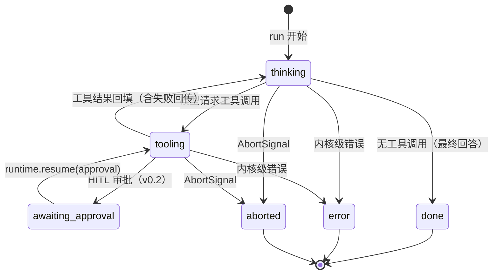

# 02 — 核心循环与事件系统

> **状态**：v2 · 已吸收第一轮评审 · 随 v0.1 实现迭代
> **关联**：[01-总体架构设计](01-总体架构设计.md)（术语表 / 错误模型 / 钩子总时序） · [04-模型Provider抽象](04-模型Provider抽象.md) · [05-工具系统](05-工具系统.md)

## 1. Agent Loop 是什么

一个把「**模型调用 → 工具执行 → 结果回填**」重复到终止条件为止的状态机。对外暴露为单个原语：

```ts
type RunLoop = (state: RunState, ctx: RunContext) => AsyncGenerator<AgentEvent>
```

> 💡 设计决策：不用 LangGraph 的图模型，不用 Runnable 组合子。Agent Loop 本质是变长循环，`AsyncGenerator` 是表达「过程 + 流式产出」的最小原语，图模型留到 v0.3 编排层再评估。

## 2. 状态机



与 [05](05-工具系统.md) 的对齐说明：**工具业务失败不进入 error**——校验失败 / `execute` 抛错都归一为 `ToolResult(ok: false)` 回填消息历史，由模型自纠（[01 错误模型](01-总体架构设计.md)）；只有内核级错误（预算 / 迭代超限 / 观察钩子 critical 异常等）才走 error。

`awaiting-approval` 是 v0.2 HITL 的预留位：进入时 `RunState.status = 'awaiting-approval'`，挂起的 `pendingToolCalls` 已随 checkpoint 落盘（见 [06](06-状态与记忆管理.md)），进程崩溃后也可恢复审批。

## 3. 循环实现草图

```ts
// 伪代码：接口未定稿，展示数据流与终止逻辑；钩子顺序见 01 第 4 节总时序
async function* runLoop(
  state: RunState,
  ctx: RunContext,
): AsyncGenerator<AgentEvent> {
  let finalized = false

  // 统一收口：所有终止路径（自然终止 / 超限 / abort / 异常）必经
  // 顺序：先写终态 → checkpoint（保存点 ⑤）→ yield 终止事件；铁律「先事件后异常」由此保证
  async function* finalize(outcome: 'done' | 'error' | 'aborted', payload: object) {
    if (finalized) return
    finalized = true
    state.status = outcome
    state.pendingToolCalls = []                  // 终态不留挂起
    await checkpoint(state)                      // 保存点 ⑤：run 结束（含 error / aborted）
    const type =
      outcome === 'done' ? 'run-finished' : outcome === 'aborted' ? 'run-aborted' : 'error'
    yield { type, ...payload }
  }

  yield event('run-started', { threadId: state.threadId })

  try {
    while (state.runStep < ctx.limits.maxIterations) {
      if (state.totalSteps >= ctx.limits.maxTotalSteps) {
        throw new MaxTotalStepsError(state.totalSteps)   // thread 级兜底熔断
      }
      await checkpoint(state)                    // 保存点 ①：turn 开始
      yield event('turn-started', { runStep: state.runStep })

      // 1. 模型调用（transformInput / transformTools / wrapModelCall 钩子在内部生效）
      const res = yield* callModel(state, ctx)
      state.usage = addUsage(state.usage, res.usage)   // thread 累计（口径见 01 术语表）

      // 2. 自然终止：模型不再请求工具
      if (res.toolCalls.length === 0) {
        // 最终回答必须进消息历史：否则恢复会话后模型看到「问而无答」
        state.messages.push(toAssistantMessage(res))
        yield* finalize('done', { output: res.text, usage: res.usage })
        return
      }

      // 3. 工具派发前：PendingCall 全部置 pending 并落盘（保存点 ③）——副作用工具崩溃后不重复执行
      state.pendingToolCalls = res.toolCalls.map((call) => ({ call, status: 'pending' as const }))
      await checkpoint(state)

      // 4. 工具执行（wrapToolCall / transformToolResult 钩子在内部生效）
      // 每完成一个：更新 status + result → 立即落盘（保存点 ④）——崩溃恢复只重派 pending
      for await (const done of executeTools(state.pendingToolCalls, ctx)) {
        markPendingCall(state.pendingToolCalls, done)
        await checkpoint(state)                  // 保存点 ④：部分完成持久化
      }

      // 5. 按「模型产出的原始顺序」回填（并发完成顺序不污染消息顺序），清空挂起并计数
      state.messages.push(toAssistantMessage(res), ...toToolMessages(state.pendingToolCalls))
      state.pendingToolCalls = []
      state.runStep += 1
      state.totalSteps += 1
      yield event('turn-finished', { runStep: state.runStep })
      await checkpoint(state)                    // 保存点 ②：turn 结束
    }

    yield* finalize('error', { error: new MaxIterationsError(state.runStep) })
    throw new MaxIterationsError(state.runStep)
  } catch (err) {
    // AbortSignal / 钩子抛错 / Provider fatal 等未收口路径：先收口再抛
    yield* finalize(isAbort(err) ? 'aborted' : 'error', { error: toKernelError(err) })
    throw err
  }
}
```

> 💡 `runStep` / `totalSteps` 拆分的理由：`maxIterations` 是**单次 run 的防死循环闸**，若按 thread 累计，长寿 thread 跑两次复杂任务即被永久锁死；「防止重启重置计数」由 `totalSteps` 硬上限独立承担。HITL 恢复时 `runStep` 从 checkpoint 续（仍在同一 run 内）；**开新 run 时重置为 0**（规则见 [06 恢复表](06-状态与记忆管理.md)）。

```ts
// 伪代码：工具派发的持久化单元——「部分完成」恢复的最小结构（恢复语义见 06）
type PendingCall = {
  call: ToolCall
  status: 'pending' | 'completed' | 'failed'
  result?: ToolResult
}
```

> 💡 为什么不「每完成一个就 push ToolMessage」：并发完成顺序会把消息顺序打乱（`tool_use` 与 `tool_result` 必须成对且顺序稳定）。PendingCall 先存结果，回填时按**模型产出的原始顺序**生成 ToolMessage。

## 4. 终止条件

| 条件 | 行为 | 实现层 |
| --- | --- | --- |
| 自然终止：响应无 `toolCalls` | `finalize('done')` → 保存点 ⑤ → `run-finished` | 内核 |
| `maxIterations` 上限（run 级，比较 `runStep`） | `finalize('error')` → **先 yield `error` 事件再抛** `MaxIterationsError` | 内核（默认 25，可配） |
| `maxTotalSteps` 硬上限（thread 级，比较 `totalSteps`） | 同上，抛 `MaxTotalStepsError` | 内核（默认 10000，防重启重置绕过） |
| `AbortSignal` 触发 | `finalize('aborted')` → 产出 `run-aborted` 事件后抛 `AbortError` | 内核（透传至模型 / 工具调用） |
| 预算耗尽 | 抛 `BudgetExceededError` | `[v0.2]` 插件（`onAfterModelCall` 累加，见 [01 开放问题](01-总体架构设计.md)） |
| 钩子否决 | 改写 / 洋葱钩子抛类型化错误即中止；观察钩子（含 `onEvent`）默认容错（见 [03](03-插件系统与钩子设计.md)） | 钩子管线 |

所有终止路径统一经过 `finalize()` 收口（先写终态 → 保存点 ⑤ → yield 终止事件），不存在漏 checkpoint 的出口。

## 5. 事件协议

### 5.1 事件信封与类型

所有事件携带公共信封字段（多消费者、日志关联、回放的基础）：

```ts
interface EventEnvelope {
  runId: string             // 本次 run 标识（每次 stream 生成）
  seq: number               // run 内单调递增，消费者排序依据
  timestamp: number         // epoch ms
  spanId?: string           // [v0.2] telemetry 建树用（见 07）
  parentSpanId?: string     // [v0.2]
}

type AgentEvent = EventEnvelope &
  (
    | { type: 'run-started'; threadId: string }
    | { type: 'turn-started'; runStep: number }
    | { type: 'text-delta'; delta: string }            // 原样透传，节流在消费者
    | { type: 'reasoning-delta'; delta: string }       // v0.1 即进协议（后加要动所有 switch）
    | { type: 'tool-call-started'; call: ToolCall }    // 参数未聚合完即播报
    | { type: 'tool-call-completed'; call: ToolCall; result: ToolResult }
    | { type: 'turn-finished'; runStep: number }
    | { type: 'run-finished'; output: string; usage: Usage }   // usage 为本轮增量
    | { type: 'run-aborted'; reason?: string }
    | { type: 'error'; error: KernelError | ProviderError | ToolPipelineError }
  )
```

- `tool-call-completed` 携带完整 `ToolResult`（含 `ok` 字段），UI 与 telemetry 无需再猜成败（结果结构见 [05](05-工具系统.md)）
- `usage` 口径：事件里是**本轮增量**，`RunState.usage` 是 **thread 累计**（见 [01 术语表](01-总体架构设计.md)）

### 5.2 错误的流语义（定稿规则）

**所有错误先 `yield { type: 'error' }` 再 `throw`。** CLI 与 SSE 两类消费者遵循同一规则：收到 `error` 事件后流随即终止（生成器 throw 收尾），不存在「只抛不发事件」或「只发事件不抛」的路径。

### 5.3 事件流向

```
Agent Loop ──产出──> transformEvent（丢弃 / 改写 / 脱敏）──> onEvent（观察最终形态）──> 消费者（CLI / SSE）
```

- **顺序定稿：`transformEvent` 在前、`onEvent` 在后**。telemetry 与外部消费者看到**同一份最终形态**——PII 脱敏对两者同时生效，不依赖插件注册顺序（v2 曾把 onEvent 放在 transformEvent 之前，导致 telemetry 记录未脱敏数据，已修正）
- **插件的观察通道是 `onEvent` 钩子**（逐事件调用，见 [03](03-插件系统与钩子设计.md)），不是「订阅」——`AsyncGenerator` 是 pull 模型，只能单消费者，不存在事件总线订阅
- `transformEvent` 返回 `null` 表示丢弃该事件；被丢弃的事件 onEvent 与消费者都不可见
- 外部生成器保持单消费者，TUI fork 留 `[v0.3]`

### 5.4 消费方式

```ts
// 伪代码：单生成器 + for await 消费
for await (const event of runtime.stream({ threadId, input })) {
  switch (event.type) {
    case 'text-delta':
      process.stdout.write(event.delta)
      break
    case 'tool-call-started':
      console.log(`[tool] ${event.call.name} ...`)
      break
    case 'tool-call-completed':
      console.log(`[tool] ${event.call.name} ${event.result.ok ? 'ok' : 'failed'}`)
      break
    case 'run-finished':
      console.log(`\ndone, usage: ${JSON.stringify(event.usage)}`)
      break
  }
}
```

## 6. 设计决策

**为什么用 `AsyncGenerator` 而不是 EventEmitter / RxJS？**

| 维度 | AsyncGenerator ✅ | EventEmitter | RxJS |
| --- | --- | --- | --- |
| 背压 | 天然（pull 模型） | 无，需自行缓冲 | 有但复杂 |
| 错误传播 | `try/catch` 同步语义 | 需 error 事件约定 | Observable error |
| 取消 | `generator.return()` + AbortSignal | 手动移除监听 | subscription.unsubscribe |
| 依赖 | 零 | 零 | 引入外部依赖 |

单消费者场景下生成器最简。插件侧的「多消费者」需求由 `onEvent` 观察钩子解决（见 5.3）；仅外部 UI 同时消费才需要 fork（开放问题）。

**对照 LangChain `streamEvents` v2**：事件命名（`on-chat-model-stream` / `on-tool-start` / `on-tool-end`）与本项目 `text-delta` / `tool-call-started` / `tool-call-completed` 一一对应——LangChain 验证了这套粒度足够覆盖 UI 与观测需求。

## 7. 开放问题（标定稿版本）

- [ ] `[v0.3]` TUI 的多消费者 fork（telemetry / 日志已走 `onEvent` 观察钩子，见 [03](03-插件系统与钩子设计.md)；仅 TUI 需要同时消费同一条生成器流，方案 `broadcast()` 或 tee 到时定）
- [ ] `[待评估]` 事件流重放：配合 checkpointer 可实现，是否进内核 API？
- [x] 已定：`onEvent` 是插件观察事件的唯一通道（v0.1 即进协议），外部生成器保持单消费者
- [x] 已定：`text-delta` 原样透传，节流放消费者侧
- [x] 已定：`reasoning-delta` v0.1 即进协议
- [x] 已定：事件信封 `runId / seq / timestamp` 为必带字段
