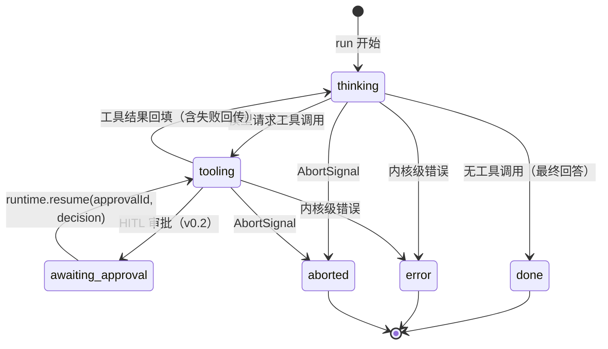

# 02 — 核心循环与事件系统

> **状态**：v2 · 已吸收第一轮评审 · 随 v0.1 实现迭代
> **关联**：[01-总体架构设计](01-总体架构设计.md)（术语表 / 错误模型 / 钩子总时序） · [04-模型Provider抽象](04-模型Provider抽象.md) · [05-工具系统](05-工具系统.md)

## 1. Agent Loop 是什么

一个把「**模型调用 → 工具执行 → 结果回填**」重复到终止条件为止的状态机。对外暴露为单个原语：

```ts
type RunLoop = (state: RunState, ctx: RunContext) => AsyncGenerator<AgentEvent>
```

> 💡 设计决策：不用 LangGraph 的图模型，不用 Runnable 组合子。Agent Loop 本质是变长循环，`AsyncGenerator` 是表达「过程 + 流式产出」的最小原语，图模型留到 v0.3 编排层再评估。

## 2. 状态机



与 [05](05-工具系统.md) 的对齐说明：**工具业务失败不进入 error**——校验失败 / `execute` 抛错都归一为 `ToolResult(ok: false)` 回填消息历史，由模型自纠（[01 错误模型](01-总体架构设计.md)）；只有内核级错误（预算 / 迭代超限 / 观察钩子 critical 异常等）才走 error。

`awaiting-approval` 是 v0.1 即冻结、v0.2 实现的 HITL 暂停态：进入时 `RunState.status = 'awaiting-approval'`，`pendingToolCalls` 与 `pendingApprovals` 随 checkpoint 落盘（见 [06](06-状态与记忆管理.md)），并通过 `approval-requested` 事件通知外部；进程崩溃后也可恢复审批。

## 3. 循环实现草图

```ts
// 伪代码：新 run 草图；resume 按 phase 从断点重入（见 §3.1）；钩子顺序见 01 第 4 节总时序
async function* runLoop(
  state: RunState,
  ctx: RunContext,
): AsyncGenerator<AgentEvent> {
  let finalized = false

  // 终态收口：补配对、写终态、checkpoint ⑤
  // 消费者 break / generator.return() 时不能再 yield，但必须走这里落盘并释放锁
  async function persistTerminal(outcome: 'done' | 'error' | 'aborted') {
    if (finalized) return
    finalized = true

    // 未完成的 tool_use 必须补 ToolMessage，避免恢复后出现 orphan tool_result
    if (state.pendingToolCalls.length > 0) {
      const results = state.pendingToolCalls.map((p) =>
        p.result ?? failResult('RUN_ENDED', `run ${outcome} before tool completed`),
      )
      state.messages.push(...toToolMessages(state.pendingToolCalls, results))
      state.pendingToolCalls = []
    }
    state.pendingApprovals = []
    state.status = outcome
    await checkpoint(state)                      // 保存点 ⑤：run 结束（含 error / aborted）
  }

  // 顺序：先写终态 → checkpoint（保存点 ⑤）→ yield 终止事件；铁律「先事件后异常」由此保证
  async function* finalize(
    outcome: 'done' | 'error' | 'aborted',
    payload: {
      output?: string
      finishReason?: FinishReason
      usageDelta?: Usage
      runUsage?: Usage
      threadUsage?: Usage
      reason?: string
      error?: KernelError
    },
  ) {
    if (finalized) return
    await persistTerminal(outcome)
    const type =
      outcome === 'done' ? 'run-finished' : outcome === 'aborted' ? 'run-aborted' : 'error'
    // aborted 不携带 error：abort 是控制流，不是错误（类型见 §5.1）
    const shaped = outcome === 'aborted' ? { reason: payload.reason ?? 'aborted' } : payload
    yield { type, ...shaped }
  }

  try {
    // run-started 必须在 try 内：消费者在首事件 break 时也要走 finally 收口
    yield event('run-started', { threadId: state.threadId })

    while (state.runStep < ctx.limits.maxIterations) {
      if (state.totalSteps >= ctx.limits.maxTotalSteps) {
        throw new MaxTotalStepsError(state.totalSteps)   // thread 级兜底熔断
      }
      state.phase = 'model'
      await checkpoint(state)                    // 保存点 ①：turn 开始（phase=model）
      yield event('turn-started', { runStep: state.runStep })

      // 1. 模型调用（transformInput / transformTools / wrapModelCall 钩子在内部生效）
      const res = yield* callModel(state, ctx)
      // 本轮增量分别累加到 run 与 thread；事件里的 usage 字段仍是本轮增量
      state.runUsage = addUsage(state.runUsage, res.usage)
      state.usage = addUsage(state.usage, res.usage)   // thread 累计（口径见 01 术语表）

      // 2. 自然终止：模型不再请求工具
      if (res.toolCalls.length === 0) {
        // 最终回答必须进消息历史：否则恢复会话后模型看到「问而无答」
        state.messages.push(toAssistantMessage(res))
        // 自然终止也是一个 turn：先计数，避免 maxTotalSteps 少算最后一轮
        state.runStep += 1
        state.totalSteps += 1
        yield* finalize('done', {
          output: res.text,
          finishReason: res.finishReason,
          usageDelta: res.usage,
          runUsage: state.runUsage,
          threadUsage: state.usage,
        })
        return
      }

      // 3. 工具派发前：assistant tool_use 必须先入 messages，再落 pending（保存点 ③）
      // 否则崩溃/审批恢复后只有 ToolMessage，没有配对的 tool_use
      state.messages.push(toAssistantMessage(res))
      state.pendingToolCalls = res.toolCalls.map((call) => ({ call, status: 'pending' as const }))
      state.phase = 'tools'                    // ③ / ④ 的 resume 入口：崩溃或审批恢复不得重发 callModel
      await checkpoint(state)

      // 4. 工具执行（wrapToolCall / transformToolResult 钩子在内部生效）
      // 每个工具：executeTools 内部先置 running + attemptId → checkpoint（④a）
      // 完成后回到这里置 completed + result → checkpoint（④b）
      // 恢复时：pending 重派；running 按 sideEffect 重试/失败；completed 复用结果
      try {
        for await (const done of executeTools(state.pendingToolCalls, ctx)) {
          markPendingCall(state.pendingToolCalls, done)
          await checkpoint(state)                // 保存点 ④b：部分完成持久化
        }
      } catch (err) {
        if (err instanceof ToolSuspended) {
          // 审批挂起不是 error：保留 pendingToolCalls，正常退出生成器
          state.status = 'awaiting-approval'
          const exists = state.pendingApprovals.some(
            (a) => a.approvalId === err.approval.approvalId,
          )
          if (!exists) state.pendingApprovals.push(err.approval)
          await checkpoint(state)                // 保存点 ③ 的审批扩展：pendingApprovals 落盘
          yield {
            type: 'approval-requested',
            approvalId: err.approval.approvalId,
            call: err.approval.call,
            options: err.approval.options,
          }
          return
        }
        throw err
      }

      // 5. 按「模型产出的原始顺序」回填 ToolMessage（assistant 已在步骤 3 入历史）
      state.messages.push(...toToolMessages(state.pendingToolCalls))
      state.pendingToolCalls = []
      state.phase = 'turn-end'
      await checkpoint(state)                    // 保存点 ②a：回填后、计数前（phase=turn-end）
      yield event('turn-finished', { runStep: state.runStep })
      state.runStep += 1
      state.totalSteps += 1
      state.phase = 'model'
      await checkpoint(state)                    // 保存点 ②b：计数后（phase=model）
    }

    yield* finalize('error', { error: new MaxIterationsError(state.runStep) })
    throw new MaxIterationsError(state.runStep)
  } catch (err) {
    // AbortSignal / 钩子抛错 / Provider fatal 等未收口路径：先收口再抛
    if (isAbort(err)) {
      yield* finalize('aborted', { reason: 'aborted' })
    } else {
      yield* finalize('error', { error: toKernelError(err) })
    }
    throw err
  } finally {
    // 消费者 break / generator.return()：不能再 yield，但必须落盘终态
    // 审批挂起是唯一的非终态正常退出；锁由 runtime 外层释放（见 06 §2.3）
    if (!finalized && state.status !== 'awaiting-approval') {
      await persistTerminal('aborted')
    }
  }
}
```

> 💡 `runStep` / `totalSteps` 拆分的理由：`maxIterations` 是**单次 run 的防死循环闸**，若按 thread 累计，长寿 thread 跑两次复杂任务即被永久锁死；「防止重启重置计数」由 `totalSteps` 硬上限独立承担。HITL 恢复时 `runStep` 从 checkpoint 续（仍在同一 run 内）；**开新 run 时重置为 0**（规则见 [06 恢复表](06-状态与记忆管理.md)）。
>
> ⚠️ **终态写入失败**：保存点 ⑤ 只做一次 best-effort 落盘。`Checkpointer.save` 抛错时不重试、不在 `finalize` 内递归收口；记录 `CheckpointError` 后释放锁，把失败交给调用方（详见 [06 §2](06-状态与记忆管理.md)）。
>
> **生命周期钩子**：`onRunEnd` 在 `done` / `aborted` 路径调用（abort 也需要清理资源）；`onError` 只在 `error` 路径调用，二者不重复触发。

### 3.1 新 run 与 resume 重入

上面的草图描述**新 run**。`resume` 不从头跑 loop，而是按 `RunState.phase` 从断点进入：

| `phase` | `resume` 行为 |
| --- | --- |
| `model` | 重发当前 turn 的 `callModel`；不重放 assistant |
| `tools` | **不 callModel**；按 `pending` / `running` / `completed` 继续工具，完成后补 `ToolMessage` |
| `turn-end` | 不重复回填；只发 `turn-finished`、计数、保存点 ② |

`resume` 保持同一 `runId`，`seq` 继续递增；`stream()` 在 `awaiting-approval` / `running` 且已有 `messages` 时抛 `ThreadNotResumableError`。完整矩阵见 [06 §1](06-状态与记忆管理.md)。
进入 `awaiting-approval` 时触发 `onRunSuspended`，`resume()` 进入时触发 `onRunResume`，用于关闭 / 重建插件自己持有的 per-run 资源（OTel span / 沙箱连接 / 临时目录），不从 `ObserverContext` 取 service（见 [03](03-插件系统与钩子设计.md)）。

> 工具生命周期的所有权：`wrapToolCall` 是 `tool-call-started` 之前的前置闸门，输入 `ToolCallContext`（state / permissions / approval decision / pendingCall），返回 allow / deny 或抛 `ToolSuspended`；它不包 `execute`。内层执行者负责 `running → ④a → execute → completed → ④b`。`tool-call-started` 只在真正 execute 时发，审批挂起不发；任何 wrapper 不得改写 `PendingCall` 状态。

```ts
// 伪代码：工具派发的持久化单元——「部分完成」恢复的最小结构（恢复语义见 06）
type PendingCall = {
  call: ToolCall
  status: 'pending' | 'running' | 'completed'
  attemptId?: string          // 每次真正开始执行时生成；用于识别「执行中崩溃」
  result?: ToolResult
}
```

> 💡 `ToolSuspended = { approval: PendingApproval }` 是内部控制流信号，不是错误：由 loop 收口为 `awaiting-approval`，不进入 `error` 分支。审批拒绝归一为 `failResult('APPROVAL_DENIED', ...)`，不 abort run。
>
> ⚠️ `ToolSuspended` 必须原样穿透 `wrapToolCall` / `executeTools`：不能被归一成 `failResult`，也不能包装成 `ToolPipelineError`。否则审批会变成一次“工具失败”，`awaiting-approval` 永远进不去。

> 💡 为什么不「每完成一个就 push ToolMessage」：并发完成顺序会把消息顺序打乱（`tool_use` 与 `tool_result` 必须成对且顺序稳定）。PendingCall 先存结果，回填时按**模型产出的原始顺序**生成 ToolMessage。

## 4. 终止条件

| 条件 | 行为 | 实现层 |
| --- | --- | --- |
| 自然终止：响应无 `toolCalls` | `finalize('done')` → 保存点 ⑤ → `run-finished` | 内核 |
| `maxIterations` 上限（run 级，比较 `runStep`） | `finalize('error')` → **先 yield `error` 事件再抛** `MaxIterationsError` | 内核（默认 25，可配） |
| `maxTotalSteps` 硬上限（thread 级，比较 `totalSteps`） | 同上，抛 `MaxTotalStepsError` | 内核（默认 10000，防重启重置绕过） |
| `AbortSignal` 触发 | `finalize('aborted')` → 产出 `run-aborted` 事件后抛 `AbortError`；**不发 `error`** | 内核（透传至模型 / 工具调用） |
| 预算耗尽 | 抛 `BudgetExceededError` | `[v0.2]` `wrapModelCall` 前置检查（见 [01 开放问题](01-总体架构设计.md)） |
| 审批挂起：工具需要 ask | 保留 `pendingToolCalls`，`status = awaiting-approval` → 保存点 ③ 扩展 → `yield approval-requested` → 生成器正常结束 | 工具管线 / loop |
| 钩子否决 | 改写 / 洋葱钩子抛类型化错误即中止；观察钩子（含 `onEvent`）默认容错（见 [03](03-插件系统与钩子设计.md)） | 钩子管线 |

所有**终态**路径统一经过 `persistTerminal()` 收口（补配对 → 写终态 → 保存点 ⑤ → yield 终止事件）。审批挂起是唯一的非终态正常退出，保留挂起状态等待 `resume()`。

## 5. 事件协议

### 5.1 事件信封与类型

所有事件携带公共信封字段（多消费者、日志关联、回放的基础）：

```ts
interface EventEnvelope {
  runId: string             // 本次 run 标识（每次 stream 生成）
  seq: number               // run 内单调递增，消费者排序依据
  timestamp: number         // epoch ms
  spanId?: string           // [v0.2] telemetry 建树用（见 07）
  parentSpanId?: string     // [v0.2]
}

type AgentEvent = EventEnvelope &
  (
    | { type: 'run-started'; threadId: string }
    | { type: 'run-resumed'; phase: 'model' | 'tools' | 'turn-end' }
    | { type: 'turn-started'; runStep: number }
    | { type: 'text-delta'; delta: string }            // 原样透传，节流在消费者
    | { type: 'reasoning-delta'; delta: string }       // v0.1 即进协议（后加要动所有 switch）
    | { type: 'tool-call-started'; toolCallId: string; name: string }  // 工具真正开始执行时播报；审批挂起不发
    | { type: 'tool-output-delta'; toolCallId: string; stream: 'stdout' | 'stderr'; delta: string }
    | { type: 'tool-call-completed'; call: ToolCall; result: ToolResult }
    | { type: 'tool-call-retrying'; toolCallId: string; fromAttemptId?: string; reason: 'idempotent-recovery' }
    | { type: 'tool-call-cancelled'; toolCallId: string; reason: 'denied' | 'expired' | 'aborted' }
    | { type: 'approval-requested'; approvalId: string; call: ToolCall; options: Array<'allow' | 'deny'> }
    | { type: 'turn-finished'; runStep: number }
    | {
        type: 'run-finished'
        output: string
        finishReason: FinishReason
        usageDelta: Usage      // 最后一个 turn 的增量
        runUsage: Usage        // 本次 run 累计
        threadUsage: Usage     // thread 累计
      }
    | { type: 'run-aborted'; reason?: string }
    | { type: 'error'; error: KernelError | ProviderError | ToolPipelineError }
  )
```

- `tool-call-started` 只携带 `toolCallId` + `name`；完整入参只在 `tool-call-completed` 的 `call` 中出现，避免伪造半成品 `ToolCall`
- `tool-output-delta` 是工具实时输出的唯一事件通道；工具通过 `ctx.emitOutput()` 写入，不直接写进程 stdout（见 [05](05-工具系统.md)）
- `tool-call-completed` 携带完整 `ToolResult`（含 `ok` 字段），UI 与 telemetry 无需再猜成败（结果结构见 [05](05-工具系统.md)）
- **事件配对不变量**：每个 `tool-call-started` 必须有且只有一个终结事件（`tool-call-completed` / `tool-call-retrying` / `tool-call-cancelled`）；审批挂起的工具**不先发 started**，只发 `approval-requested`；allow 后发 started → completed；deny / 过期 / abort 发 `tool-call-cancelled`；幂等重试发 `tool-call-retrying` 收口旧 attempt。入参校验失败也发 `tool-call-completed(ok:false)`，不留下未闭合 span
- 审批挂起 / 恢复跨 stream 有效：同一 `runId`、`seq` 继续；resume 后的 completed 可以关闭崩溃前已发出的 started
- `approval-requested` 是正常暂停事件，不是 error；外部决策后走 `runtime.resume({ approvalId, decision })`
- `run-resumed` 只由 `resume()` 发出；`run-started` 只由新 run 发出
- `transformEvent` 只能同 type 改写 payload，不能改 type；`error` / `run-finished` / `run-aborted` / `approval-requested` 是 terminal / 关键事件，禁止丢弃；transform 抛错时 terminal 事件改用原事件 + WARN
- `usage` 口径：模型调用事件与 `onAfterModelCall` 里的 usage 是**本轮增量**；`RunState.runUsage` 是本次 run 累计，`RunState.usage` 是 thread 累计；`run-finished` 同时给出三个口径（见 [01 术语表](01-总体架构设计.md)）
- `seq` **允许空洞**：`transformEvent` 丢弃事件不回收序号；消费者按 seq 升序排序即可，不要求连续

### 5.2 错误的流语义（定稿规则）

**所有错误先 `yield { type: 'error' }` 再 `throw`。** CLI 与 SSE 两类消费者遵循同一规则：收到 `error` 事件后流随即终止（生成器 throw 收尾），不存在「只抛不发事件」或「只发事件不抛」的路径。

两个显式例外：

- **abort**：先对 in-flight 工具发 `tool-call-cancelled(reason: 'aborted')`，再 `yield { type: 'run-aborted' }` 并抛 `AbortError`；不发 `error`；
- **审批挂起**：只 `yield { type: 'approval-requested' }` 后正常结束生成器，`status = awaiting-approval`，不发 `error`。

### 5.3 事件流向

```
Agent Loop ──产出──> transformEvent（丢弃 / 改写 / 脱敏）──> onEvent（观察最终形态）──> 消费者（CLI / SSE）
```

- **顺序定稿：`transformEvent` 在前、`onEvent` 在后**。telemetry 与外部消费者看到**同一份最终形态**——PII 脱敏对两者同时生效，不依赖插件注册顺序（v2 曾把 onEvent 放在 transformEvent 之前，导致 telemetry 记录未脱敏数据，已修正）
- **插件的观察通道是 `onEvent` 钩子**（逐事件调用，见 [03](03-插件系统与钩子设计.md)），不是「订阅」——`AsyncGenerator` 是 pull 模型，只能单消费者，不存在事件总线订阅
- `transformEvent` 返回 `null` 表示丢弃该事件；被丢弃的事件 onEvent 与消费者都不可见
- 外部生成器保持单消费者，TUI fork 留 `[v0.3]`

### 5.4 消费方式

```ts
// 伪代码：单生成器 + for await 消费
for await (const event of runtime.stream({ threadId, input })) {
  switch (event.type) {
    case 'text-delta':
      process.stdout.write(event.delta)
      break
    case 'tool-call-started':
      console.log(`[tool] ${event.name} ...`)
      break
    case 'tool-output-delta':
      process.stdout.write(event.delta)
      break
    case 'tool-call-completed':
      console.log(`[tool] ${event.call.name} ${event.result.ok ? 'ok' : 'failed'}`)
      break
    case 'run-finished':
      console.log(`\ndone (${event.finishReason}), usage: ${JSON.stringify(event.threadUsage)}`)
      break
  }
}
```

### 5.5 工具输出队列与并发顺序

- `execute` 是 `Promise<ToolResult>`，loop 在 await 时无法 yield；`executeTools` 必须是 async generator + 有界队列：
  - `ctx.emitOutput()` 只 push 到队列，不直接写 stdout；
  - loop 消费队列 → `tool-output-delta`，工具返回后关闭队列；
  - 队列上限（默认 256 条 / 64KB；spike 先验证条数上限）满时丢最旧或降级为聚合输出，并记录 WARN；
  - execute 返回后的 `emitOutput` 一律忽略。
- 并发工具的事件按**到达顺序**输出，事件都带 `toolCallId`；`ToolMessage` 仍按模型原始顺序回填。
- 事件配对：`tool-call-started → tool-output-delta* → tool-call-completed`；审批挂起不先发 started，拒绝 / 过期 / abort 发 `tool-call-cancelled`；入参校验失败发 `tool-call-completed(ok:false)`。

## 6. 设计决策

**为什么用 `AsyncGenerator` 而不是 EventEmitter / RxJS？**

| 维度 | AsyncGenerator ✅ | EventEmitter | RxJS |
| --- | --- | --- | --- |
| 背压 | 天然（pull 模型） | 无，需自行缓冲 | 有但复杂 |
| 错误传播 | `try/catch` 同步语义 | 需 error 事件约定 | Observable error |
| 取消 | `generator.return()` + AbortSignal | 手动移除监听 | subscription.unsubscribe |
| 依赖 | 零 | 零 | 引入外部依赖 |

单消费者场景下生成器最简。插件侧的「多消费者」需求由 `onEvent` 观察钩子解决（见 5.3）；仅外部 UI 同时消费才需要 fork（开放问题）。

**对照 LangChain `streamEvents` v2**：事件命名（`on-chat-model-stream` / `on-tool-start` / `on-tool-end`）与本项目 `text-delta` / `tool-call-started` / `tool-call-completed` 一一对应——LangChain 验证了这套粒度足够覆盖 UI 与观测需求。

## 7. 开放问题（标定稿版本）

- [ ] `[v0.3]` TUI 的多消费者 fork（telemetry / 日志已走 `onEvent` 观察钩子，见 [03](03-插件系统与钩子设计.md)；仅 TUI 需要同时消费同一条生成器流，方案 `broadcast()` 或 tee 到时定）
- [ ] `[待评估]` 事件流重放：配合 checkpointer 可实现，是否进内核 API？
- [x] 已定：`onEvent` 是插件观察事件的唯一通道（v0.1 即进协议），外部生成器保持单消费者
- [x] 已定：`text-delta` 原样透传，节流放消费者侧
- [x] 已定：`reasoning-delta` v0.1 即进协议
- [x] 已定：事件信封 `runId / seq / timestamp` 为必带字段
