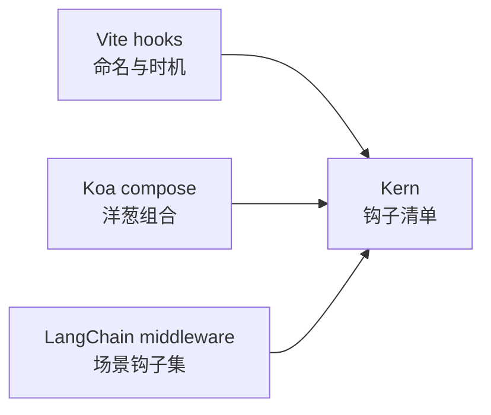
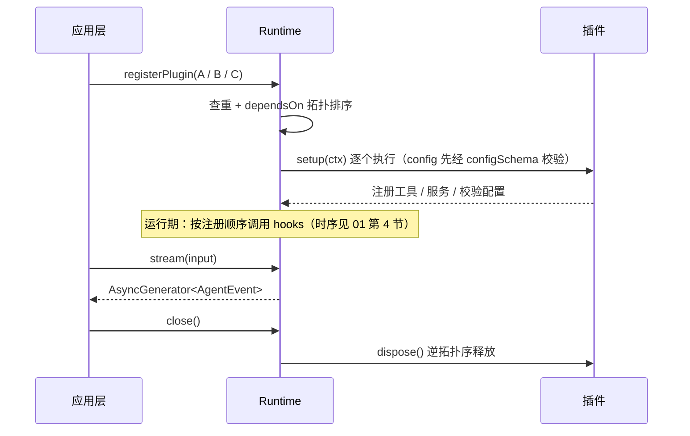

# 03 — 插件系统与钩子设计（核心）

> **状态**：v2 · 已吸收第一轮评审 · 本文档是整个内核的设计中枢，钩子清单的完备性直接决定「一切皆插件」能否成立
> **关联**：[01-总体架构设计](01-总体架构设计.md)（错误模型与钩子总时序） · [02-核心循环与事件系统](02-核心循环与事件系统.md)

## 1. 三个设计参照

动手前先精读三个已验证的实现，本项目的钩子系统 = 三者交集的最小集。

| 参照 | 借鉴什么 | 不抄什么 |
| --- | --- | --- |
| **Vite**（plugin API） | 钩子命名法：`onX` 观察、`transformX` 改写、`wrapX` 包裹 | 钩子数量（60+ 太多）、`enforce` 排序（本项目只按注册序）、Rollup 兼容层 |
| **Koa / Redux**（compose） | 洋葱模型：前置逻辑 + `await next()` + 后置逻辑对称 | 中间件数组的动态变更 |
| **LangChain v1 middleware** | Agent 场景需要的钩子集合（todo / HITL / PII / retry 的落点） | 与 Runnable 协议的耦合 |



## 2. 插件协议

```ts
interface KernelPlugin {
  // 全局唯一，注册时查重（冲突 fail-fast）
  name: string
  version?: string
  // 只决定 setup 的执行拓扑（拓扑排序）；与 hook 执行顺序正交
  dependsOn?: string[]
  // 观察类钩子默认容错；这里列出的钩子抛错时才中止 run（类型安全，拼错无法通过 tsc）
  // onEvent 是 fire-and-forget 队列，不能进 criticalHooks（见 §3）
  criticalHooks?: Array<Exclude<keyof AgentHooks, 'onEvent'>>
  // 插件配置 schema：Runtime 校验通过后经 SetupContext.config 传入
  configSchema?: ZodType
  // 注册期执行一次：注册工具 / 服务 / 校验配置，fail-fast
  setup?(ctx: SetupContext): Promise<void> | void
  // Runtime.close() 时按 setup 拓扑的逆序调用：依赖方先释放，被依赖方后释放
  dispose?(): Promise<void> | void
  // 运行期钩子集合
  hooks?: AgentHooks
}
```

```ts
// 伪代码：SetupContext 暴露注册面，运行期不可再改
interface SetupContext {
  registerTool(def: RegisteredTool): void   // 同名冲突 fail-fast；core 只接收 JSON Schema 形态（见 05）
  registerService<T>(name: string, service: T): void         // 供其他插件经 getService 消费
  getService<T>(name: string): T | undefined
  config: unknown                                            // configSchema 校验后的值
  logger: Logger
}
```

> 💡 `getService` 的类型扩展：各插件包通过 `declare module` 扩充 `ServiceRegistry` 接口，使用处获得类型提示，内核不做 DI 容器。
>
> **唯一 provider / checkpointer 的解析规则**：保留服务名 `provider` / `checkpointer`；全部 `setup` 执行完后由 runtime 解析，缺失或重复注册均 fail-fast。其余服务（`sandbox` / `compaction` / `model:<id>`）按普通服务消费。模型路由通过 `ctx.services.get<ModelProvider>('model:<id>')` 取候选，再在 `wrapModelCall` 里替换 `next`。

## 3. 钩子清单

| 钩子 | 时机 | 类别 | 签名要点 | 典型用途 |
| --- | --- | --- | --- | --- |
| `onRunStart` | 新 run 开始 | 观察 | `(state: Readonly<RunState>, ctx: ObserverContext)` | 初始化资源、计时 |
| `onRunResume` | `resume()` 进入 | 观察 | `(state: Readonly<RunState>, ctx: ObserverContext)` | 重建 OTel span / 沙箱连接 / 临时目录 |
| `onRunSuspended` | 进入 `awaiting-approval` | 观察 | `(state: Readonly<RunState>, ctx: ObserverContext)` | 挂起或关闭 per-run 资源 |
| `onEvent` | `transformEvent` 之后、交付消费者前（观察最终形态） | 观察 | `(event, ctx: ObserverContext) => void`，不 await | telemetry / 日志采集 |
| `transformInput` | 每轮模型调用前 | 改写 | 返回**本次请求视图**，不回写 `RunState.messages` | 上下文压缩、注入系统提示、PII 脱敏 |
| `transformTools` | 每轮模型调用前 | 改写 | 返回裁剪后的工具列表 | 按权限 / tags / 场景动态暴露工具 |
| `wrapModelCall` | 模型调用 | 流式洋葱 | `(req, ctx: RunContext, next) => AsyncGenerator<ModelChunk>` | 重试、降级、缓存、限流、预算 |
| `onAfterModelCall` | 模型响应后 | 观察 | `(res, ctx: ObserverContext)`，只读响应与用量 | 用量统计、审计（预算走 `wrapModelCall` 前置检查 `ctx.getUsage()`） |
| `wrapToolCall` | 工具执行前 | 前置闸门 | `(callCtx: ToolCallContext) => Promise<'allow' \| 'deny'>`，在 `tool-call-started` 之前 | 审批、权限判定 |
| `wrapToolExecution`（v0.1 签名占位 / v0.2 实现） | 工具执行 | 洋葱 | 包住单次 `execute`；日志 / 重试 / 超时后处理 | 仅对 `sideEffect: 'idempotent'` 重试 |
| `transformToolResult` | 工具结果回填前 | 改写 | 返回新的 `ToolResult` | 大结果截断、结果脱敏、错误归一 |
| `transformEvent` | 事件出站 | 过滤 | 返回 `null` 丢弃 | 脱敏、UI 事件适配 |
| `onRunEnd` / `onError` | 结束 / 异常 | 观察 | `onRunEnd` 用于 done / aborted；`onError` 只用于 error | 清理、上报 |

类别含义与容错规则：

- **观察**（`onX` / `onEvent`）：拿到 `Readonly<RunState>` 与受限的 `ObserverContext`（无 checkpointer / provider / services），不得改 `messages` / 工具列表；允许通过 `ctx.metadata('<plugin-name>')` 写插件命名空间。默认**抛错仅记录并继续**（telemetry 故障不应杀掉用户请求）；`criticalHooks` 中列出的钩子抛错才中止 run
- **改写**（`transformX`）：必须返回新值，按顺序串行管道；`transformEvent` 只允许**同 type 改写 payload**，不得改 type；terminal 事件（`error` / `run-finished` / `run-aborted` / `approval-requested`）不可丢弃；抛错中止 run（在主路径上）
- **闸门 / 洋葱**：`wrapToolCall` 是前置闸门（`Promise<'allow' \| 'deny'>`）；`wrapToolExecution`（v0.2）用 Promise 洋葱；`wrapModelCall` 用 AsyncGenerator 洋葱；抛错中止 run（在主路径上）
- **钩子超时**：`RuntimeOptions.hookTimeoutMs`（默认 30s；`0` 关闭）只约束 **pre/post 钩子**与 `wrapModelCall` 的**首个 chunk 等待**；不覆盖整条模型流，也不覆盖 `wrapToolCall` / `wrapToolExecution` 的 `execute`。模型流总时长由 Provider / 网络超时控制，工具由自身 `timeoutMs` 控制。观察钩子超时只记录 WARN，不拖住主路径。`RunContext.signal` 暴露给钩子用于协作取消。
- **推荐 wrapper 顺序**：注册序即外层优先，约定为 `budget（最外）→ compaction → retry（最内）`。compaction 必须在 retry 外层，否则重试插件先抛 `context-overflow` 时压缩看不到；预算必须在最外层，避免重试把预算放大。

`onEvent` 的两级出站约定：

- 事件出站顺序固定：`Agent Loop` → `transformEvent`（丢弃 / 改写 / 脱敏）→ `onEvent`（观察最终形态）→ 外部消费者。**telemetry 与消费者看到同一份最终形态**——PII 脱敏对两者同时生效，不依赖注册顺序
- `AsyncGenerator` 是 pull 模型、只能单消费者，**插件观察一律走 `onEvent`，不存在事件总线订阅**
- `onEvent` 按定义是只读观察（返回值 `void`，内核**不 await**）——这正是它必须排在 `transformEvent` 之后的原因：改写职责归 transform 类钩子，观察类不承担数据整形
- **非阻塞机制**：runtime 持有一个有界观察队列（默认 256 条 / 64KB），`onEvent` 的调用只入队；队列满时丢最旧并累计 `droppedCount`（WARN），**禁止把 Promise 返回值当同步结果 await**。OTel / Langfuse 在队列消费侧批量 + 异步导出，生产者（模型流）永不等待 telemetry。因此 **`onEvent` 不能进 `criticalHooks`**：它不在同步主路径上，抛错无法中止 run；队列消费者出错只记录 WARN 并继续。

**`transformInput` 的返回值语义（定稿）**：返回**本次模型请求的视图**，`RunState.messages` 保持 canonical 全量历史。压缩 / 注入 / 脱敏只影响这一次调用，不写回 state——保证崩溃恢复、审计与后续 turn 看到同一份历史。若 v0.4 需要持久化压缩结果，另加显式 `replaceMessages` API 并写 checkpoint，不在 `transformInput` 里隐式改状态。

> 💡 `transformToolResult` 是 v1 钩子清单评审补充的最关键缺口：没有它，大结果截断、脱敏、错误话术归一只能塞进每个工具实现里重复一遍。
>
> 💡 **协议先行**：v0.1 即实现全部钩子签名——`transformToolResult` / `transformTools` 默认透传，`wrapToolExecution` / `dispose` / `resume` 为 no-op 占位；v0.2 只填实现不改协议（对照 [08](08-路线图与里程碑.md)）。

## 4. 两种洋葱：Promise 与 AsyncGenerator

`wrapToolCall` 是**前置闸门**：在 `tool-call-started` 之前拿到 `ToolCallContext`（含 `toolContext.permissions`、`approval.decision`、`pendingCall`），返回 `allow / deny` 或抛 `ToolSuspended`。它不包 `execute`，因此不会出现「审批挂起但 started 已发」的配对断裂。

需要包住 `execute` 的日志 / 重试 / 后处理走 v0.2 的 `wrapToolExecution`，用 Promise 洋葱；`wrapModelCall` 包住流式 Provider，必须用 AsyncGenerator 洋葱。三者共用「注册顺序 = 外层优先」的语义，但不能共用同一个 `compose`。

```ts
// 伪代码：Promise 洋葱，用于 wrapToolExecution（v0.2，Koa 风格）
type Handler<TIn, TOut> = (input: TIn, ctx: RunContext) => Promise<TOut>
type Wrapper<TIn, TOut> = (
  input: TIn,
  ctx: RunContext,
  next: Handler<TIn, TOut>,
) => Promise<TOut>

function compose<TIn, TOut>(
  wrappers: Wrapper<TIn, TOut>[],
  core: Handler<TIn, TOut>,
): Handler<TIn, TOut> {
  return wrappers.reduceRight((next, wrap) => {
    return (input, ctx) => wrap(input, ctx, next)
  }, core)
}
```

```ts
// 伪代码：AsyncGenerator 洋葱，用于 wrapModelCall
type ChunkHandler<TIn, TChunk> = (
  input: TIn,
  ctx: RunContext,
) => AsyncGenerator<TChunk>

type ChunkWrapper<TIn, TChunk> = (
  input: TIn,
  ctx: RunContext,
  next: ChunkHandler<TIn, TChunk>,
) => AsyncGenerator<TChunk>

function composeStream<TIn, TChunk>(
  wrappers: ChunkWrapper<TIn, TChunk>[],
  core: ChunkHandler<TIn, TChunk>,
): ChunkHandler<TIn, TChunk> {
  return wrappers.reduceRight((next, wrap) => {
    return (input, ctx) => wrap(input, ctx, next)
  }, core)
}
```

重试插件的落地示例（`wrapModelCall` 的典型形态）：

```ts
// 伪代码：model-retry 插件；只重试「尚未产出任何 chunk」的调用
const modelRetryPlugin: KernelPlugin = {
  name: 'model-retry',
  hooks: {
    wrapModelCall: async function* (req, ctx, next) {
      for (let attempt = 0; attempt < 3; attempt++) {
        let emitted = false
        try {
          for await (const chunk of next(req, ctx)) {
            emitted = true
            yield chunk
          }
          return
        } catch (err) {
          if (emitted || !isRetryable(err) || attempt === 2) throw err
          await sleep(backoff(attempt))
        }
      }
      throw new UnreachableError()
    },
  },
}
```

> ⚠️ 流式重试的坑：一旦产出首个 chunk，就不能再重试——消费者已经看到部分响应。v0.1 只对「零 chunk 失败」重试；「本轮作废 + 重放」留到 `[v0.3]` 评估。

## 5. 插件生命周期



设计决策：

- **v0.1 只做静态注册，不做热插拔**。热插拔是伪需求（进程重启即重载），但注册期 fail-fast 是硬需求
- **两个排序维度分离**：`dependsOn` 只管 setup 拓扑；hook 执行顺序 = 注册顺序（不做插件级 `enforce`，需要局部顺序时由插件组合顺序表达）

## 6. 插件间通信

两条通道，禁止第三条（静态 import）：

1. **`ctx.services` 注册表**：`setup` 阶段 `registerService('sandbox', impl)`，其他插件 `getService` 消费。弱类型注册表 + `declare module` 类型扩展点。`provider` / `checkpointer` 是保留服务名，由 runtime 在 setup 后强制解析。
2. **`onEvent` 观察钩子**：插件逐事件接收 `AgentEvent` 做观察类协作（如 telemetry 消费 usage 事件）——`AsyncGenerator` 是 pull 模型，「订阅」不存在，观察一律走钩子（见第 3 节两级出站约定）

`metadata` 命名空间约定：插件写入 `RunState.metadata` 一律通过 `ctx.metadata('<plugin-name>')` 读写 API，底层用 `metadata['plugin:<name>']` 复合键（如 `metadata['plugin:todo']`），防止互相覆盖；内核负责命名空间隔离、序列化校验与 64KB 限制（见 [06](06-状态与记忆管理.md)），不读业务内容。

示例：沙箱插件注册 `services.sandbox`，代码解释器**工具插件**在 `execute` 内取用——工具与沙箱互不 import，靠接口协作。额外模型注册 `services['model:anthropic']`，路由插件在 `wrapModelCall` 里读取并替换 `next`。

## 7. 试金石：六个必须能干净实现的用例

v0.2 时逐个用本内核重写，**任何一个实现别扭 = 钩子清单有缺口，先改设计再写代码**：

| # | 用例 | 落点钩子 | 参照物 |
| --- | --- | --- | --- |
| 1 | todo 任务规划 | `transformInput` + 注册工具 | LangChain `todoListMiddleware` |
| 2 | model 重试 | `wrapModelCall` | LangChain `modelRetryMiddleware` |
| 3 | tool 重试 | `wrapToolExecution`（v0.2）；仅 `sideEffect: 'idempotent'` | LangChain `toolRetryMiddleware` |
| 4 | PII 脱敏 | `transformInput` + `transformEvent` + `transformToolResult` | LangChain `piiMiddleware` |
| 5 | Human-in-the-Loop | `wrapToolCall` 抛 `ToolSuspended` → `awaiting-approval` → `resume` | LangChain `humanInTheLoopMiddleware` |
| 6 | **上下文压缩（compaction）** | `transformInput` | Claude Code（无框架对照） |

> 💡 #6 是评审补充的试金石，也是最难的一个：压缩必须保证 `tool_use` 与 `tool_result` **成对删除**（API 硬约束，见 [06](06-状态与记忆管理.md)），还要兼顾 prompt cache 前缀稳定。它比前五个更能暴露 `transformInput` 的表达力缺口。

## 8. 插件配置约定

- 插件包导出 `configSchema: ZodType`
- `registerPlugin(plugin, config)` 时 Runtime 执行 `configSchema.parse(config)`，失败即抛（fail-fast）
- 校验通过的值经 `SetupContext.config` 传入 `setup`，插件内不再二次校验

## 9. 开放问题（标定稿版本）

- [x] 已定：`hookTimeoutMs` 只约束 pre/post 与 `wrapModelCall` 首个 chunk 等待；不覆盖整条模型流 / 工具 execute；观察钩子只记录 WARN
- [x] 已定：`critical` 改为 `criticalHooks` 按钩子声明；`dispose` 按 setup 拓扑的逆序执行
- [ ] `[待评估]` 流式重试的「本轮作废 + 重放」协议
- [x] 已定：HITL 暂停 = `wrapToolCall` 前置闸门抛 `ToolSuspended` → loop 收口 `awaiting-approval` → `approval-requested` 事件 → `runtime.resume({ approvalId, decision })`；拒绝归一为 `failResult`，不 abort
- [x] 已定：`wrapToolExecution` 与 `wrapModelCall` 共用「注册序 = 外层优先」；tool retry 仅允许 `sideEffect: 'idempotent'`，或在 `next` 之前失败
- [x] 已定：`wrapModelCall` 用 AsyncGenerator 洋葱；`wrapToolExecution`（v0.2）用 Promise 洋葱；`wrapToolCall` 是前置闸门，三者不共用 `compose`
- [x] 已定：观察钩子允许通过 `ctx.metadata('<plugin-name>')` 写插件命名空间，但不得改 messages / 工具列表
- [x] 已定：同名钩子多插件注册 = 串行管道，顺序 = 注册序（不做随机合并、不报错；删除插件级 `enforce`）
- [x] 已定：`transformInput` 返回请求视图，不写回 `RunState.messages`；compaction 只影响本次请求，恢复 / 审计始终使用 canonical 历史
- [x] 已定：`onEvent` 返回 `void` 且不被 await；runtime 有界观察队列（256 条 / 64KB）丢最旧并计数，telemetry 不形成背压
- [x] 已定：`filterTools` 更名 `transformTools`，减少一类心智
- [x] 已定：`onEvent` 为观察类钩子，v0.1 即进协议；telemetry / 日志的采集通道
- [x] 已定：工具注册统一为 `registerTool(def: RegisteredTool)`（JSON Schema 协议层；Zod 作者糖在 `@kernjs/tools`，见 [05](05-工具系统.md)）
