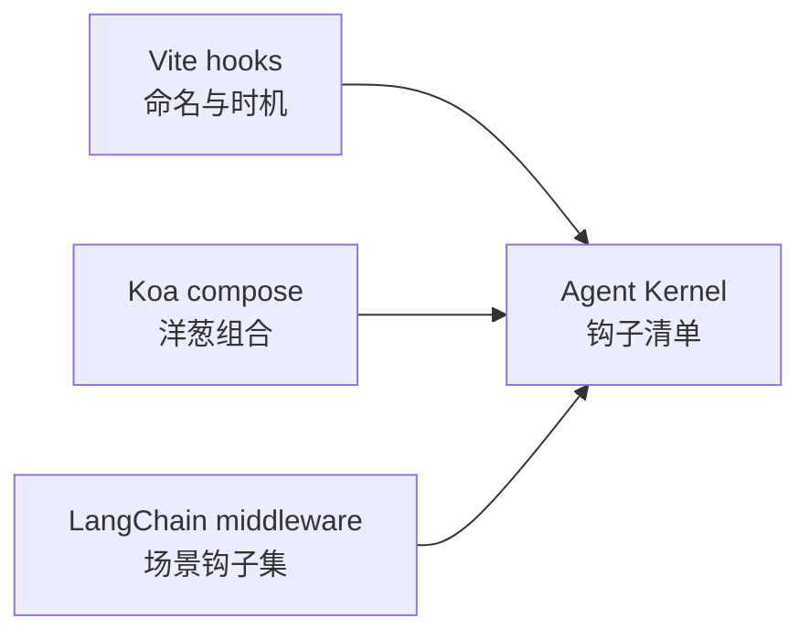
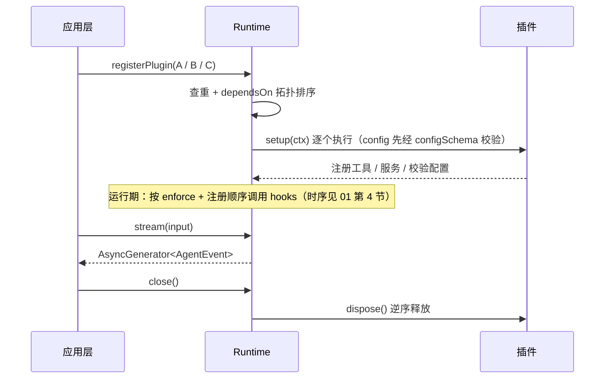

# 03 — 插件系统与钩子设计（核心）

> **状态**：v2 · 已吸收第一轮评审 · 本文档是整个内核的设计中枢，钩子清单的完备性直接决定「一切皆插件」能否成立
> **关联**：[01-总体架构设计](01-总体架构设计.md)（错误模型与钩子总时序） · [02-核心循环与事件系统](02-核心循环与事件系统.md)

## 1. 三个设计参照

动手前先精读三个已验证的实现，本项目的钩子系统 = 三者交集的最小集。

| 参照 | 借鉴什么 | 不抄什么 |
| --- | --- | --- |
| **Vite**（plugin API） | 钩子命名法：`onX` 观察、`transformX` 改写、`wrapX` 包裹；`enforce: 'pre' \| 'post'` 排序 | 钩子数量（60+ 太多）、Rollup 兼容层 |
| **Koa / Redux**（compose） | 洋葱模型：前置逻辑 + `await next()` + 后置逻辑对称 | 中间件数组的动态变更 |
| **LangChain v1 middleware** | Agent 场景需要的钩子集合（todo / HITL / PII / retry 的落点） | 与 Runnable 协议的耦合 |



## 2. 插件协议

```ts
interface KernelPlugin {
  // 全局唯一，注册时查重（冲突 fail-fast）
  name: string
  version?: string
  // 只决定 setup 的执行拓扑（拓扑排序）；与 hook 执行顺序正交
  dependsOn?: string[]
  // hook 执行顺序强化：排到本钩子的最前 / 最后（默认按注册顺序）
  enforce?: 'pre' | 'post'
  // 观察类钩子（onX）抛错时是否中止 run；默认 false（记录并继续）
  critical?: boolean
  // 插件配置 schema：Runtime 校验通过后经 SetupContext.config 传入
  configSchema?: ZodType
  // 注册期执行一次：注册工具 / 服务 / 校验配置，fail-fast
  setup?(ctx: SetupContext): Promise<void> | void
  // Runtime.close() 时按注册逆序调用：释放连接、定时器、子进程
  dispose?(): Promise<void> | void
  // 运行期钩子集合
  hooks?: AgentHooks
}
```

```ts
// 伪代码：SetupContext 暴露注册面，运行期不可再改
interface SetupContext {
  registerTool(def: AnyTool): void   // 同名冲突 fail-fast；AnyTool = ToolDefinition | RawTool（见 05）
  registerService<T>(name: string, service: T): void         // 供其他插件经 getService 消费
  getService<T>(name: string): T | undefined
  config: unknown                                            // configSchema 校验后的值
  logger: Logger
}
```

> 💡 `getService` 的类型扩展：各插件包通过 `declare module` 扩充 `ServiceRegistry` 接口，使用处获得类型提示，内核不做 DI 容器。

## 3. 钩子清单

| 钩子 | 时机 | 类别 | 签名要点 | 典型用途 |
| --- | --- | --- | --- | --- |
| `onRunStart` | run 开始 | 观察 | `(state, ctx)` | 初始化资源、计时 |
| `onEvent` | `transformEvent` 之后、交付消费者前（观察最终形态） | 观察 | 逐事件调用 | telemetry / 日志采集 |
| `transformInput` | 每轮模型调用前 | 改写 | 可增删改 messages | 上下文压缩、注入系统提示、PII 脱敏 |
| `transformTools` | 每轮模型调用前 | 改写 | 返回裁剪后的工具列表 | 按权限 / tags / 场景动态暴露工具 |
| `wrapModelCall` | 模型调用 | 洋葱 | 包住整个调用含流式 | 重试、降级、缓存、限流 |
| `onAfterModelCall` | 模型响应后 | 观察 | 只读响应与用量 | 用量统计、审计、预算熔断 |
| `wrapToolCall` | 工具执行 | 洋葱 | 包住单次工具执行 | 权限审批、日志（超时由内核内建强制执行，见 [05](05-工具系统.md)） |
| `transformToolResult` | 工具结果回填前 | 改写 | 返回新的 `ToolResult` | 大结果截断、结果脱敏、错误归一 |
| `transformEvent` | 事件出站 | 过滤 | 返回 `null` 丢弃 | 脱敏、UI 事件适配 |
| `onRunEnd` / `onError` | 结束 / 异常 | 观察 | 含最终结果 / 类型化错误 | 清理、上报 |

类别含义与容错规则：

- **观察**（`onX` / `onEvent`）：只读。默认**抛错仅记录并继续**（telemetry 故障不应杀掉用户请求）；插件显式声明 `critical: true` 后抛错才中止 run
- **改写**（`transformX`）：必须返回新值，按顺序串行管道；抛错中止 run（在主路径上）
- **洋葱**（`wrapX`）：可前后包逻辑；抛错中止 run（在主路径上）

`onEvent` 的两级出站约定：

- 事件出站顺序固定：`Agent Loop` → `transformEvent`（丢弃 / 改写 / 脱敏）→ `onEvent`（观察最终形态）→ 外部消费者。**telemetry 与消费者看到同一份最终形态**——PII 脱敏对两者同时生效，不依赖注册顺序
- `AsyncGenerator` 是 pull 模型、只能单消费者，**插件观察一律走 `onEvent`，不存在事件总线订阅**
- `onEvent` 按定义是只读观察（返回值忽略）——这正是它必须排在 `transformEvent` 之后的原因：改写职责归 transform 类钩子，观察类不承担数据整形

> 💡 `transformToolResult` 是 v1 钩子清单评审补充的最关键缺口：没有它，大结果截断、脱敏、错误话术归一只能塞进每个工具实现里重复一遍。
>
> 💡 **协议先行**：v0.1 即实现全部钩子签名——`transformToolResult` / `transformTools` 默认透传，`dispose` / `enforce` / `resume` 为 no-op 占位；v0.2 只填实现不改协议（对照 [08](08-路线图与里程碑.md)）。

## 4. 洋葱组合

```ts
// 伪代码：洋葱组合，Koa 风格签名 (input, ctx, next)；注册顺序 = 外层优先
type Handler<TIn, TOut> = (input: TIn, ctx: RunContext) => Promise<TOut>
type Wrapper<TIn, TOut> = (
  input: TIn,
  ctx: RunContext,
  next: Handler<TIn, TOut>,
) => Promise<TOut>

function compose<TIn, TOut>(
  wrappers: Wrapper<TIn, TOut>[],
  core: Handler<TIn, TOut>,
): Handler<TIn, TOut> {
  return wrappers.reduceRight((next, wrap) => {
    return (input, ctx) => wrap(input, ctx, next)
  }, core)
}
```

重试插件的落地示例（`wrapModelCall` 的典型形态）：

```ts
// 伪代码：model-retry 插件；仅重试「未产出任何事件即失败」的调用
const modelRetryPlugin: KernelPlugin = {
  name: 'model-retry',
  hooks: {
    wrapModelCall: async (req, ctx, next) => {
      for (let attempt = 0; attempt < 3; attempt++) {
        try {
          return await next(req, ctx)
        } catch (err) {
          if (!isRetryable(err) || attempt === 2) throw err
          await sleep(backoff(attempt))
        }
      }
      throw new UnreachableError()
    },
  },
}
```

> ⚠️ 流式重试的坑：响应已产出（`text-delta` 已发出）后再失败不能盲目重试——v0.1 只对「未产出任何事件即失败」的调用重试；「本轮作废 + 重放」留到 `[v0.3]` 评估。

## 5. 插件生命周期



设计决策：

- **v0.1 只做静态注册，不做热插拔**。热插拔是伪需求（进程重启即重载），但注册期 fail-fast 是硬需求
- **两个排序维度分离**：`dependsOn` 只管 setup 拓扑；hook 执行顺序 = `enforce` + 注册顺序。此前混在一个开放问题里是错误

## 6. 插件间通信

两条通道，禁止第三条（静态 import）：

1. **`ctx.services` 注册表**：`setup` 阶段 `registerService('checkpointer', impl)`，其他插件 `getService` 消费。弱类型注册表 + `declare module` 类型扩展点
2. **`onEvent` 观察钩子**：插件逐事件接收 `AgentEvent` 做观察类协作（如 telemetry 消费 usage 事件）——`AsyncGenerator` 是 pull 模型，「订阅」不存在，观察一律走钩子（见第 3 节两级出站约定）

`metadata` 命名空间约定：插件写入 `RunState.metadata` 一律用 `metadata['plugin:<name>']` 复合键（如 `metadata['plugin:todo']`），防止互相覆盖；内核不读这个命名空间。

示例：沙箱插件注册 `services.sandbox`，代码解释器**工具插件**在 `execute` 内取用——工具与沙箱互不 import，靠接口协作。

## 7. 试金石：六个必须能干净实现的用例

v0.2 时逐个用本内核重写，**任何一个实现别扭 = 钩子清单有缺口，先改设计再写代码**：

| # | 用例 | 落点钩子 | 参照物 |
| --- | --- | --- | --- |
| 1 | todo 任务规划 | `transformInput` + 注册工具 | LangChain `todoListMiddleware` |
| 2 | model 重试 | `wrapModelCall` | LangChain `modelRetryMiddleware` |
| 3 | tool 重试 | `wrapToolCall` | LangChain `toolRetryMiddleware` |
| 4 | PII 脱敏 | `transformInput` + `transformEvent` + `transformToolResult` | LangChain `piiMiddleware` |
| 5 | Human-in-the-Loop | `wrapToolCall`（暂停语义） | LangChain `humanInTheLoopMiddleware` |
| 6 | **上下文压缩（compaction）** | `transformInput` | Claude Code（无框架对照） |

> 💡 #6 是评审补充的试金石，也是最难的一个：压缩必须保证 `tool_use` 与 `tool_result` **成对删除**（API 硬约束，见 [06](06-状态与记忆管理.md)），还要兼顾 prompt cache 前缀稳定。它比前五个更能暴露 `transformInput` 的表达力缺口。

## 8. 插件配置约定

- 插件包导出 `configSchema: ZodType`
- `registerPlugin(plugin, config)` 时 Runtime 执行 `configSchema.parse(config)`，失败即抛（fail-fast）
- 校验通过的值经 `SetupContext.config` 传入 `setup`，插件内不再二次校验

## 9. 开放问题（标定稿版本）

- [ ] `[v0.2]` HITL 的「暂停 run」语义：`wrapToolCall` 返回特殊标记 vs 事件总线上的中断请求 + `runtime.resume()`（倾向后者，与审批协议统一，见 [09](09-harness层设计.md) 2.3）
- [ ] `[v0.2]` 钩子执行耗时是否强制上报（防止插件拖垮循环）？
- [ ] `[待评估]` 流式重试的「本轮作废 + 重放」协议
- [x] 已定：同名钩子多插件注册 = 串行管道，顺序 = `enforce` + 注册序（不做随机合并、不报错）
- [x] 已定：`filterTools` 更名 `transformTools`，减少一类心智
- [x] 已定：`onEvent` 为观察类钩子，v0.1 即进协议；telemetry / 日志的采集通道
- [x] 已定：工具注册统一为 `registerTool(def: AnyTool)`（Zod 作者与 MCP 直供两种形态，见 [05](05-工具系统.md)）
