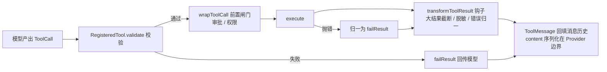

# 05 — 工具系统

> **状态**：v2 · 已吸收第一轮评审 · 随 v0.1 实现迭代
> **关联**：[01-总体架构设计](01-总体架构设计.md)（错误模型 / 钩子总时序） · [02-核心循环与事件系统](02-核心循环与事件系统.md) · [03-插件系统与钩子设计](03-插件系统与钩子设计.md)

## 1. 工具定义

```ts
interface ToolDefinition<TInput = unknown, TOutput = unknown> {
  // 全局唯一，function calling 的 function.name；同名注册冲突 fail-fast
  name: string
  // 给模型看的描述：写清「何时用、输入是什么、返回什么」
  description: string
  // 必须 .strict()（映射 additionalProperties: false，防模型补幻觉字段）
  inputSchema: ZodType<TInput>
  // [v0.2] 可选：仅用于测试断言与文档生成，不强制（很多输出不可静态描述）
  outputSchema?: ZodType<TOutput>
  // 必填，无默认值——隐式超时是事故源
  timeoutMs: number
  // 默认 false：与其他任何工具不可并发（写文件 / 执行命令类一律 false）
  concurrencySafe: boolean
  // [v0.2] HITL 审批标记：true 时 wrapToolCall 前置闸门先走审批
  requiresApproval?: boolean
  // 崩溃恢复语义：idempotent 可重试；non-idempotent 默认不重试（默认 non-idempotent）
  sideEffect?: 'idempotent' | 'non-idempotent'
  // transformTools 按 tag 裁剪（如 ['filesystem'] ['network']）
  tags?: string[]
  execute(input: TInput, ctx: ToolContext): Promise<ToolResult>
}
```

> 💡 `ToolDefinition` 是作者侧形态；core 注册面使用规范化后的 `RegisteredTool`（见 §7），由 `@kernjs/tools` 的 `defineTool()` 完成 Zod → JSON Schema 转换。

工具定义示例（与 `.strict()` 约定保持一致）：

```ts
const weatherTool: ToolDefinition<{ city: string }, WeatherReport> = {
  name: 'query_weather',
  description: '查询中国城市实时天气。输入城市名（中文），返回温度、天气现象与风力。',
  inputSchema: z
    .object({
      city: z.string().describe('城市名，如「杭州」'),
    })
    .strict(),
  timeoutMs: 10_000,
  concurrencySafe: true,
  sideEffect: 'idempotent',
  async execute({ city }, ctx) {
    const res = await fetch(`https://api.example.com/weather?city=${encodeURIComponent(city)}`, {
      signal: ctx.signal,
    })
    if (!res.ok) return failResult('WEATHER_API_ERROR', `上游返回 ${res.status}`)
    return okResult(JSON.stringify(await res.json()))
  },
}
```

## 2. ToolResult：结构化结果

```ts
interface ToolResult {
  ok: boolean
  // 结构化内容块；v0.1 只有 text，Provider 边界再转字符串
  content: ContentBlock[]
  // ok=false 时必有：归一化错误（回传模型的自纠依据）
  error?: { code: string; message: string }
}

type ContentBlock =
  | { type: 'text'; text: string }
  // [v0.2] 以下两种随结构化结果一起加，不进 v0.1 冻结面
  | { type: 'image'; source: ImageSource }
  | { type: 'diff'; hunks: unknown[] }

提供构造器避免手拼对象：

```ts
// 伪代码：结果构造器
okResult(text)                 // → { ok: true, content: [{ type: 'text', text }] }
failResult(code, message)      // → { ok: false, content: [text(message)], error: { code, message } }
```

> 💡 设计决策：`ToolResult.content` 用 `ContentBlock[]` 而非裸字符串——v0.2 的 diff / 图片结果需要结构化传输（harness 的 edit 工具依赖它），只有 Provider 边界才做字符串化。v0.1 只保留 `text`，避免为未实现能力冻结协议。

## 3. ToolContext

工具拿到的运行时上下文——对照 LangChain 的 Runtime Context 设计：

```ts
interface ToolContext {
  signal: AbortSignal          // run 中止时联动取消进行中的请求
  principal?: Principal        // opaque：core 只透传，不解释身份字段
  permissions: PermissionSet   // 由 harness 的 ToolContextFactory 计算
  logger: Logger               // 结构化日志，自动携带 threadId / runId
  services: ServiceRegistry    // 其他插件注册的服务（如 sandbox）
  emitOutput(chunk: ToolOutputDelta): void
}

type ToolOutputDelta = {
  stream: 'stdout' | 'stderr'
  delta: string
}

// 伪代码：权限判定接口（allow / deny / ask 规则模型详见 09 2.3）
interface PermissionSet {
  can(toolName: string, input: unknown): boolean                // allow / deny 判定
  requiresApproval(toolName: string, input: unknown): boolean   // 是否需要 ask
}

interface ToolContextFactory {
  // principal 来自 RunState.principal；不是每次调用重新传入
  create(input: { principal?: Principal; run: RunContext }): {
    principal?: Principal
    permissions: PermissionSet
  }
}

// 工具执行前的每调用上下文：审批 / 权限插件同时拿到 state、pending 与 decision
interface ToolCallContext {
  readonly state: Readonly<RunState>
  readonly call: ToolCall
  readonly pendingCall: Readonly<PendingCall>
  readonly approval?: Readonly<PendingApproval>
  readonly toolContext: ToolContext
}

type ToolDecision = 'allow' | 'deny'
```

> 💡 设计决策：`ctx` 由内核构造骨架，`principal / permissions` 由 harness 注册的 `ToolContextFactory` 提供；core 只透传 opaque `Principal`，不解释 `PermissionSet`。工具函数不接触全局单例——这是可测试性的关键（测试时注入 fake ctx 即可，无需 mock 全局）。
>
> **默认策略**：未注册 `ToolContextFactory` 时（如 v0.1 天气 Agent），core 返回 `allowAllPermissions` 临时默认；一旦 harness 注册工厂，以工厂为准。`requiresApproval` 是**硬下限**：策略只能把 `allow` 升级为 `ask`，不能把 `requiresApproval: true` 降级为直接执行。
>
> **审批契约**：`wrapToolCall` 是 `tool-call-started` 之前的前置闸门，输入 `ToolCallContext`；返回 `allow / deny` 或抛 `ToolSuspended`。审批插件必须能同时读到 `toolContext.permissions`、`approval.decision` 与 `pendingCall`，core 只负责审批状态落盘与 `resume`。包住 `execute` 的日志 / 重试走 v0.2 `wrapToolExecution`。

## 4. 执行管线



1. **校验**：`tool.validate(input)` 失败 → 不执行工具，`failResult` 回传（模型通常会自行修正参数重试）
2. **前置闸门**：`wrapToolCall` 读 `ToolCallContext` → `allow / deny / ToolSuspended`（审批、权限在此层，且在 `tool-call-started` 之前）；包住 `execute` 的日志 / 重试走 v0.2 `wrapToolExecution`。**超时由内核内建强制执行**——`timeoutMs` 计时不归插件、更不归工具自身，策略调整走配置
3. **执行**：`execute()`，`AbortSignal` 全程透传
4. **业务抛错归一**：`execute` 抛错 → 归一为 `failResult` 回传模型（不中止 run，见 [01 错误模型](01-总体架构设计.md)）
5. **管线故障**：`transformToolResult` 等钩子 / 序列化抛错 → `ToolPipelineError`，中止 run（这与业务失败不同，见 [01](01-总体架构设计.md)）
6. **结果改写**：`transformToolResult` 钩子（截断 / 脱敏 / 归一）——[03](03-插件系统与钩子设计.md) 钩子清单
7. **实时输出**：`execute` 内通过 `ctx.emitOutput()` 写入；loop 转成 `tool-output-delta` 事件，不阻塞工具返回
8. **回填**：`ToolMessage` 进消息历史

> 💡 loop 侧的状态落盘：调用 `execute` 前置 `PendingCall` 为 `running + attemptId`，完成后置 `completed + result`（见 [02](02-核心循环与事件系统.md) / [06](06-状态与记忆管理.md)）；工具本身不负责 checkpoint。
>
> **所有权**：`wrapToolCall` 是 `tool-call-started` 之前的前置闸门（`ToolCallContext` → allow / deny / `ToolSuspended`），不包 `execute`；内层执行者负责 `running → ④a → execute → completed → ④b`。`ToolSuspended` 必须原样穿透，不能被归一成 `failResult`；`execute` 内部抛 `ToolSuspended` 视为工具契约错误，转 `ToolPipelineError`；`tool-call-started` 只在真正执行时发。包住 `execute` 的日志 / 重试走 v0.2 `wrapToolExecution`。
>
> **输出队列**：`executeTools` 是 async generator + 有界队列；`ctx.emitOutput()` 只 push，loop 消费成 `tool-output-delta`。候选上限 256 条 / 64KB（spike 先验证条数上限），满时丢最旧并 WARN；`execute` 返回后的输出一律忽略。

## 5. 错误策略（核心决策）

| 错误类型 | 处理 | 理由 |
| --- | --- | --- |
| 入参校验失败 | `failResult` 回传模型 | 模型可自纠，无需人工干预 |
| `execute` 抛业务异常 | `failResult` 回传模型 | 业务失败是模型决策的输入，不是系统故障 |
| `AbortError` | 向上冒泡，中止 run | 用户主动取消，不可被模型「重试掉」 |
| 预算 / 迭代超限 | 向上冒泡，中止 run | 内核级约束优先于模型自纠 |

> 💡 设计决策：**工具错误默认回传模型而非中止 run**（对齐 ReAct 的自纠思路）。代价：模型可能陷入「报错 → 重试 → 再报错」循环——由 `maxIterations` 兜底，v0.2 可加连续同错检测插件。
>
> 📌 `PendingCall` 只有 `pending / running / completed` 三态；业务失败、超时、abort 都归一为 `completed + result.ok=false`，不再有 `failed` 状态。

## 6. 并发调度：按 `concurrencySafe` 分组

> **遇 ask 的批次**：一旦批次中出现 `requiresApproval` 的调用，停止调度新工具；已有 in-flight 工具先完成并落盘（④b），再进入 `awaiting-approval`。挂起期间不得启动新工具；不允许把其余工具留在 `pending` 后直接挂起。

- 同一轮的多个 tool calls：`concurrencySafe: true` 的工具**互相可并发**（`Promise.all` + 全局并发上限，默认 4）
- `concurrencySafe: false` 的工具与**所有其他工具互斥串行**
- 理由：模型并行发两个 `edit_file` 写同一文件必坏——并发安全由工具作者显式声明，不由内核猜测；依赖编排（DAG）留给 v0.3 规划层

> 当前 spike 的 `executePendingTools` 仍串行；`tool-scheduler.ts` 已验证「连续 safe 并发 / unsafe 串行」的分组原型，v0.1 接入 loop 后按此规则执行。

## 7. Schema 战略：协议层 JSON Schema，Zod 作作者侧糖

```text
作者侧 ToolDefinition（Zod）──defineTool()──┐
                                            ├─> RegisteredTool（spec: ToolSpec + execute）
MCP / 外部工具（JSON Schema）──adapt()──────┘
                                                     │
                                                     └─> core.registerTool(RegisteredTool)
```

- core 的 `ToolSpec` 持有 **JSON Schema**（协议层唯一真源）
- `RegisteredTool` 是 core 唯一接受的注册形态：

```ts
interface RegisteredTool {
  spec: ToolSpec              // 直接持有 JSON Schema
  validate(input: unknown):
    | { ok: true; value: unknown }
    | { ok: false; error: string }
  timeoutMs: number
  concurrencySafe: boolean
  requiresApproval?: boolean
  sideEffect?: 'idempotent' | 'non-idempotent'
  tags?: string[]
  execute(input: unknown, ctx: ToolContext): Promise<ToolResult>
}
```

- `defineTool()` 属于 `@kernjs/tools` 作者辅助包，负责 Zod 类型推导、`.strict()` 校验、`validate()` 编译与 JSON Schema 转换；core 不引入 `zod-to-json-schema`，也不引入 JSON Schema validator
- 若 Zod 4 已内置 `z.toJSONSchema`，优先使用内置能力（版本需验证）；否则在辅助包内锁版本 + 单测覆盖常用 schema 形态
- 理由：OpenAI / Anthropic / MCP 的工具协议**全部吃 JSON Schema**。若以 Zod 为中心，MCP 工具要走「JSON Schema → 伪造 Zod → 再转回 JSON Schema」的绕路

## 8. 大结果处理

- 超阈值（默认 32KB，可配）不硬截断：**落盘 + 返回引用**（`content` 里放 `result_ref` + 预览片段，工具可回读全文）
- 硬截断仅作兜底（落盘失败时）
- 存储位置定稿：`<tmpdir>/kern-refs/<threadId>/`；TTL 24 小时或 `thread.delete` 时清理，不进仓库目录（与 [09 §2.2](09-harness层设计.md) 一致）
- 落点：`transformToolResult` 钩子实现为通用插件，工具作者无感

## 9. 对照 LangChain `tool()`

| 维度 | 本内核 | LangChain `tool()` |
| --- | --- | --- |
| 定义 | 作者侧 `ToolDefinition`（Zod）→ `RegisteredTool`（JSON Schema） | `tool(fn, { schema })` 高阶函数 |
| Schema 层级 | 协议层 JSON Schema，Zod 为糖 | Zod 直通 |
| 校验 | 管线第一步，显式 | 框架内隐式 |
| 错误 | 默认回传模型（结构化） | `handleToolErrors` 可配 |
| 并发 | `concurrencySafe` 显式声明 | 无内建概念 |
| 上下文 | 显式 `ToolContext` 注入 | `Runtime` context |

## 10. 开放问题（标定稿版本）

- [x] 已定：大结果落盘到 `<tmpdir>/kern-refs/<threadId>/`，TTL 24h / thread 删除时清理
- [ ] `[v0.1]` 工具执行超时是否允许全局覆盖（`runtime` 级 max 上限）
- [ ] `[v1.0]` MCP 工具源：`transformTools` 能否按 server 裁剪
- [x] 已定：`outputSchema` 为可选字段且属 v0.2，不强制、不进 v0.1 冻结面
- [x] 已定：同名工具注册冲突在 setup 期 fail-fast
- [x] 已定：协议层统一 JSON Schema，Zod 仅作者侧糖
- [x] 已定：core 只接收 `RegisteredTool`；Zod → JSON Schema 转换在 `@kernjs/tools`，core 运行时依赖仍只有 Zod
