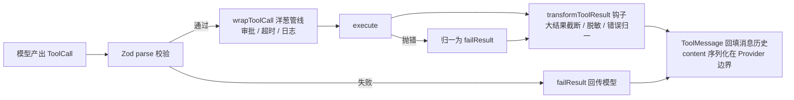

# 05 — 工具系统

> **状态**：v2 · 已吸收第一轮评审 · 随 v0.1 实现迭代
> **关联**：[01-总体架构设计](01-总体架构设计.md)（错误模型 / 钩子总时序） · [02-核心循环与事件系统](02-核心循环与事件系统.md) · [03-插件系统与钩子设计](03-插件系统与钩子设计.md)

## 1. 工具定义

```ts
interface ToolDefinition<TInput = unknown, TOutput = unknown> {
  // 全局唯一，function calling 的 function.name；同名注册冲突 fail-fast
  name: string
  // 给模型看的描述：写清「何时用、输入是什么、返回什么」
  description: string
  // 必须 .strict()（映射 additionalProperties: false，防模型补幻觉字段）
  inputSchema: ZodType<TInput>
  // 可选：仅用于测试断言与文档生成，不强制（很多输出不可静态描述）
  outputSchema?: ZodType<TOutput>
  // 必填，无默认值——隐式超时是事故源
  timeoutMs: number
  // 默认 false：与其他任何工具不可并发（写文件 / 执行命令类一律 false）
  concurrencySafe: boolean
  // [v0.2] HITL 审批标记：true 时 wrapToolCall 管线先走审批
  requiresApproval?: boolean
  // transformTools 按 tag 裁剪（如 ['filesystem'] ['network']）
  tags?: string[]
  execute(input: TInput, ctx: ToolContext): Promise<ToolResult<TOutput>>
}
```

工具定义示例（与 `.strict()` 约定保持一致）：

```ts
const weatherTool: ToolDefinition<{ city: string }, WeatherReport> = {
  name: 'query_weather',
  description: '查询中国城市实时天气。输入城市名（中文），返回温度、天气现象与风力。',
  inputSchema: z
    .object({
      city: z.string().describe('城市名，如「杭州」'),
    })
    .strict(),
  timeoutMs: 10_000,
  concurrencySafe: true,
  async execute({ city }, ctx) {
    const res = await fetch(`https://api.example.com/weather?city=${encodeURIComponent(city)}`, {
      signal: ctx.signal,
    })
    if (!res.ok) return failResult('WEATHER_API_ERROR', `上游返回 ${res.status}`)
    return okResult((await res.json()) as WeatherReport)
  },
}
```

## 2. ToolResult：结构化结果

```ts
interface ToolResult<T = unknown> {
  ok: boolean
  // 结构化内容块：文本 / 图片 / diff 等，Provider 边界再转字符串
  content: ContentBlock[]
  // ok=false 时必有：归一化错误（回传模型的自纠依据）
  error?: { code: string; message: string }
  data?: T
}

type ContentBlock =
  | { type: 'text'; text: string }
  | { type: 'image'; source: ImageSource }   // [v0.2]
  | { type: 'diff'; hunks: unknown[] }       // [v0.2] edit 类工具的结构化输出
```

提供构造器避免手拼对象：

```ts
// 伪代码：结果构造器
okResult(data)                 // → { ok: true, content: [text(JSON.stringify(data))], data }
failResult(code, message)      // → { ok: false, content: [text(message)], error: { code, message } }
```

> 💡 设计决策：`ToolResult.content` 用 `ContentBlock[]` 而非裸字符串——diff / 图片结果需要结构化传输（harness 的 edit 工具依赖它），只有 Provider 边界才做字符串化。

## 3. ToolContext

工具拿到的运行时上下文——对照 LangChain 的 Runtime Context 设计：

```ts
interface ToolContext {
  signal: AbortSignal        // run 中止时联动取消进行中的请求
  userId: string             // 身份（权限判定、日志归属）
  permissions: PermissionSet // transformTools 裁剪后的残余权限
  logger: Logger             // 结构化日志，自动携带 threadId / runId
  services: ServiceRegistry  // 其他插件注册的服务（如 sandbox）
}

// 伪代码：权限判定接口（allow / deny / ask 规则模型详见 09 2.3）
interface PermissionSet {
  can(toolName: string, input: unknown): boolean                // allow / deny 判定
  requiresApproval(toolName: string, input: unknown): boolean   // 是否需要 ask
}
```

> 💡 设计决策：`ctx` 由内核在执行期构造并注入，工具函数不接触全局单例——这是可测试性的关键（测试时注入 fake ctx 即可，无需 mock 全局）。

## 4. 执行管线



1. **校验**：`inputSchema.parse()` 失败 → 不执行工具，`failResult` 回传（模型通常会自行修正参数重试）
2. **洋葱管线**：`wrapToolCall` 钩子链（审批、日志在此层；**超时由内核内建强制执行**——`timeoutMs` 计时不归插件、更不归工具自身，策略调整走配置）
3. **执行**：`execute()`，`AbortSignal` 全程透传
4. **业务抛错归一**：`execute` 抛错 → 归一为 `failResult` 回传模型（不中止 run，见 [01 错误模型](01-总体架构设计.md)）
5. **管线故障**：`transformToolResult` 等钩子 / 序列化抛错 → `ToolPipelineError`，中止 run（这与业务失败不同，见 [01](01-总体架构设计.md)）
6. **结果改写**：`transformToolResult` 钩子（截断 / 脱敏 / 归一）——[03](03-插件系统与钩子设计.md) 钩子清单
7. **回填**：`ToolMessage` 进消息历史

## 5. 错误策略（核心决策）

| 错误类型 | 处理 | 理由 |
| --- | --- | --- |
| 入参校验失败 | `failResult` 回传模型 | 模型可自纠，无需人工干预 |
| `execute` 抛业务异常 | `failResult` 回传模型 | 业务失败是模型决策的输入，不是系统故障 |
| `AbortError` | 向上冒泡，中止 run | 用户主动取消，不可被模型「重试掉」 |
| 预算 / 迭代超限 | 向上冒泡，中止 run | 内核级约束优先于模型自纠 |

> 💡 设计决策：**工具错误默认回传模型而非中止 run**（对齐 ReAct 的自纠思路）。代价：模型可能陷入「报错 → 重试 → 再报错」循环——由 `maxIterations` 兜底，v0.2 可加连续同错检测插件。

## 6. 并发调度：按 `concurrencySafe` 分组

- 同一轮的多个 tool calls：`concurrencySafe: true` 的工具**互相可并发**（`Promise.all` + 全局并发上限，默认 4）
- `concurrencySafe: false` 的工具与**所有其他工具互斥串行**
- 理由：模型并行发两个 `edit_file` 写同一文件必坏——并发安全由工具作者显式声明，不由内核猜测；依赖编排（DAG）留给 v0.3 规划层

## 7. Schema 战略：协议层 JSON Schema，Zod 作作者侧糖

```text
作者侧（Zod ToolDefinition）──toSpec()──┐
                                        ├─> 协议层（ToolSpec.jsonSchema）──> OpenAI / Anthropic / MCP
MCP 工具（RawTool，直接持 JSON Schema）──┘
```

- 内核 `ToolSpec` 持有 **JSON Schema**（协议层唯一真源）
- Zod 只服务 TS 作者：类型推导 + 运行时校验，`toSpec()` 编译期转换
- **注册面两种形态统一**（对接 [03](03-插件系统与钩子设计.md) 的 `registerTool(def: AnyTool)`）：

```ts
// 伪代码：AnyTool 联合——Zod 作者走前者，MCP 等外部 schema 源走后者
type AnyTool = ToolDefinition | RawTool

interface RawTool {
  spec: ToolSpec            // 直接持有 JSON Schema，无 Zod 依赖
  execute(input: unknown, ctx: ToolContext): Promise<ToolResult>
}
```

- 理由：OpenAI / Anthropic / MCP 的工具协议**全部吃 JSON Schema**。若以 Zod 为中心，MCP 工具要走「JSON Schema → 伪造 Zod → 再转回 JSON Schema」的绕路
- 转换库 `zod-to-json-schema`，锁定版本 + 常用 schema 形态单测覆盖（见 [01 风险表](01-总体架构设计.md)）

## 8. 大结果处理

- 超阈值（默认 32KB，可配）不硬截断：**落盘 + 返回引用**（`content` 里放 `result_ref` + 预览片段，工具可回读全文）
- 硬截断仅作兜底（落盘失败时）
- 落点：`transformToolResult` 钩子实现为通用插件，工具作者无感

## 9. 对照 LangChain `tool()`

| 维度 | 本内核 | LangChain `tool()` |
| --- | --- | --- |
| 定义 | 接口对象 + Zod | `tool(fn, { schema })` 高阶函数 |
| Schema 层级 | 协议层 JSON Schema，Zod 为糖 | Zod 直通 |
| 校验 | 管线第一步，显式 | 框架内隐式 |
| 错误 | 默认回传模型（结构化） | `handleToolErrors` 可配 |
| 并发 | `concurrencySafe` 显式声明 | 无内建概念 |
| 上下文 | 显式 `ToolContext` 注入 | `Runtime` context |

## 10. 开放问题（标定稿版本）

- [ ] `[v0.2]` 大结果落盘的存储位置（临时目录生命周期管理）
- [ ] `[v0.1]` 工具执行超时是否允许全局覆盖（`runtime` 级 max 上限）
- [ ] `[v1.0]` MCP 工具源：`transformTools` 能否按 server 裁剪
- [x] 已定：`outputSchema` 为可选字段，不强制
- [x] 已定：同名工具注册冲突在 setup 期 fail-fast
- [x] 已定：协议层统一 JSON Schema，Zod 仅作者侧糖
