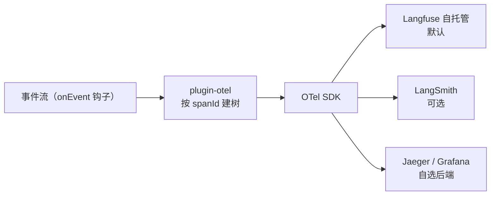

# 07 — 沙箱与可观测性

> **状态**：v2 · 已吸收第一轮评审 · 随 v0.2 实现迭代
> **关联**：[01-总体架构设计](01-总体架构设计.md) · [02-核心循环与事件系统](02-核心循环与事件系统.md)（事件信封 spanId） · [03-插件系统与钩子设计](03-插件系统与钩子设计.md)
> **前置知识**：agent-fullstack [7.1 LangSmith 链路追踪](../agent-fullstack/doc/02-LangChain.js生态深度掌握/07-LangSmith链路追踪.md)（7.5 可观测性建设同见该阶段大纲）

## 1. 沙箱分级

| 级别 | 形态 | 隔离强度 | 版本 |
| --- | --- | --- | --- |
| L0 | 进程内直接执行 | 无（仅限完全可信代码） | 开发调试 |
| L1 | Bun 子进程 + cwd + 超时 + 最小 env | 进程级 | v0.2 |
| L1.5 | L1 + 文件系统白名单（仅指定临时/项目目录） | 进程级 + 路径约束 | v0.2 可选加固 |
| L2 | 容器 / 微 VM（Docker、云沙箱如 E2B） | 系统级 | v1.0+ |

v0.2 目标是 L1：够用、零依赖、贴合 Bun 技术栈。

## 2. Sandbox 接口

```ts
interface Sandbox {
  execute(code: string, opts: SandboxOptions): Promise<ExecResult>
}

interface SandboxOptions {
  cwd: string                // 必填：coding agent 场景必须在项目目录执行
  timeoutMs: number          // 必填，无默认值
  signal?: AbortSignal       // run 中止联动
  env?: Record<string, string>
  maxOutputBytes?: number    // 输出截断阈值
  // 流式输出：bash 工具实时回显的硬需求（不等进程结束）
  onStdout?: (chunk: string) => void
  onStderr?: (chunk: string) => void
}

interface ExecResult {
  exitCode: number | null    // null = 被 signal 杀死
  stdout: string             // 全量聚合（受 maxOutputBytes 截断）
  stderr: string
  durationMs: number
  timedOut: boolean          // 超时被 kill
  killed: boolean            // timedOut || aborted（≠ 业务失败）
}
```

> ⚠️ `killed` 的语义修正（评审指出）：**正常失败命令（exitCode 1）不是被 kill**。`killed = timedOut || aborted`，与业务成败（`exitCode`）正交——bash 工具靠 `exitCode` 判断命令成败，靠 `killed` 判断是否被系统强制终止，两者混淆会污染模型对执行结果的判断。

> 💡 设计决策：**沙箱是插件提供的服务，不是内核特性**。内核只知道接口；「代码解释器 / bash 工具」= 工具插件 + 从 `ctx.services` 取 sandbox。工具与沙箱零耦合，换沙箱实现（如未来换云沙箱）不动工具代码。

## 3. L1 实现要点（Bun 子进程）

```ts
// 伪代码：Bun.spawn 沙箱核心流程，省略错误归一；注意 stdout 流式转发
async function execute(code: string, opts: SandboxOptions): Promise<ExecResult> {
  const started = performance.now()

  // 代码写临时文件再执行（不要 stdin + entry 文件混用）；随机文件名 + 用后即删
  const entry = await writeTempSandboxFile(code)
  const proc = Bun.spawn(['bun', entry], {
    cwd: opts.cwd,                    // 项目目录执行
    stdout: 'pipe',
    stderr: 'pipe',
    env: { ...minimalEnv, ...opts.env },
    // 最小 env：不透传宿主 API Key —— 沙箱逃逸的第一道闸
  })

  let timerFired = false
  const timer = setTimeout(() => {
    timerFired = true                // 标志位判定，避免时间比较的边界歧义
    proc.kill()
  }, opts.timeoutMs)
  let aborted = false
  const abort = () => proc.kill()
  opts.signal?.addEventListener('abort', () => {
    aborted = true
    abort()
  })

  // 两个流必须并行消费：串行 await 会在 stdout 未 EOF 时饿死 stderr，
  // 管道缓冲写满 → 子进程阻塞 → 死锁
  const [collectedStdout, collectedStderr] = await Promise.all([
    pipeStream(proc.stdout, opts.onStdout, opts.maxOutputBytes),
    pipeStream(proc.stderr, opts.onStderr, opts.maxOutputBytes),
  ])

  const exitCode = await proc.exited
  clearTimeout(timer)
  await removeTempFile(entry)        // 用后即删

  return {
    exitCode,
    stdout: collectedStdout,          // 已聚合（受 maxOutputBytes 截断）
    stderr: collectedStderr,
    durationMs: performance.now() - started,
    timedOut: timerFired,
    killed: timerFired || aborted,
  }
}
```

L1 已知边界（如实记录，不夸大隔离性）：

- ✅ 隔离：崩溃隔离、超时强制回收、最小 env 防 API Key 泄露、cwd 边界
- ⚠️ 不隔离：网络（子进程默认可访问）、文件系统（L1.5 白名单可部分收紧）——L1 只防事故不防恶意代码，恶意代码场景必须 L2

## 4. 可观测性设计

### 4.1 采集：telemetry 插件经 onEvent 观察钩子

内核不感知任何观测系统——telemetry 插件经 **`onEvent` 观察钩子**逐事件接收（位于 `transformEvent` 之后，与消费者看到同一份**脱敏后最终形态**；采集通道定稿见 [03](03-插件系统与钩子设计.md)），按 `spanId` 字段构建 span 树：

```
run span（run-started → run-finished/error）
└── turn span（每轮）
    ├── model-call span（含模型名、token 用量）
    └── tool-call span × n（含工具名、成败、耗时）
```

**span 建树不靠全局栈**（评审指出：并发工具下 `tool-call-started` / `tool-call-completed` 交错，全局栈父子关系必乱）。定稿方案：[02 事件信封](02-核心循环与事件系统.md) 的 `spanId` / `parentSpanId` 字段由内核在产出事件时填好，telemetry 插件按字段建树——显式、无并发问题、可回放。

| AgentEvent | 动作 |
| --- | --- |
| `run-started` / `run-finished` / `error` | 建立树根 / 关闭 |
| `turn-started` / `turn-finished` | 建 / 关 turn span |
| `tool-call-started` / `tool-call-completed` | 建 / 关 tool span（带属性） |
| `text-delta` | 不建 span（太碎），聚合文本统计即可 |

### 4.2 导出：OpenTelemetry 为中心



- 属性命名**直接对齐 OTel GenAI 语义约定**（`gen_ai.usage.input_tokens` 等）——自造命名会导致 Langfuse 等后端解析缺失（评审定稿，不再作为开放问题）
- 转储取舍：`text-delta` **不逐条落 trace**，只存聚合文本（本地存储体积与隐私兼顾）
- Langfuse（自托管、数据主权）默认，LangSmith（托管、开箱即用）可选对照——同一份 OTel 数据，切换零成本（详见 agent-fullstack 7.1）

### 4.3 日志约定

- 结构化 JSON lines，非文本拼接
- 必带字段：`ts` / `level` / `threadId` / `runId` / `plugin`（或 `module`）
- 禁止在日志中输出完整消息历史（体积 + 脱敏风险），仅输出事件摘要与用量

### 4.4 成本观测

- `usage` 事件累计到 run span 属性（`gen_ai.usage.*`：input / output / cached tokens）
- 单价表放 telemetry 插件配置（模型单价经常变，不进内核）
- 输出：每 run 成本估算 + 会话累计（usage 口径见 [01 术语表](01-总体架构设计.md)）

## 5. 对照 LangSmith 接入方式

| 维度 | 本内核 | LangChain（环境变量一键接入） |
| --- | --- | --- |
| 接入成本 | 装插件 + 配 OTel endpoint | 设两个环境变量 |
| 数据形态 | 自有事件协议 → OTel GenAI 约定 | Trace 直接按 LangSmith 模型产出 |
| 换后端 | 换 exporter 即可 | 绑定 LangSmith / Langfuse 二选一 |
| 学习收益 | 理解 trace 的本质 = 层级 span + 属性 | 理解托管产品的功能集 |

## 6. 开放问题（标定稿版本）

- [ ] `[v0.2]` L1.5 文件系统白名单的目录声明方式（runtime 级配置 vs 工具级）
- [ ] `[v0.2]` 沙箱输出环形缓冲的默认大小（超长命令的内存保护）
- [x] 已定：`killed = timedOut || aborted`，新增 `timedOut` 字段
- [x] 已定：流式 stdout（`onStdout` 回调）为 Sandbox 接口必选项
- [x] 已定：`cwd` 为 `SandboxOptions` 必填字段
- [x] 已定：span 建树走事件信封 `spanId / parentSpanId`，不用全局栈；属性对齐 `gen_ai.*` 语义约定
