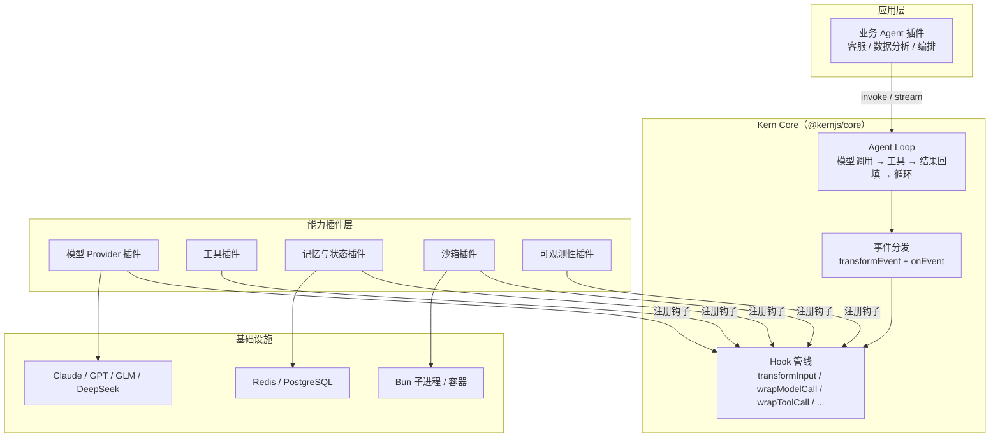
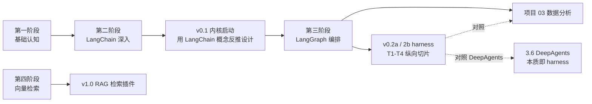

# Kern — 可插件化 Agent 运行时内核

> **Kern**（Kern Agent Runtime）— a minimal, plugin-first agent runtime for TypeScript.
>
> 仿 Vite 插件形态的 Agent 基座：内核只保留最小闭环，模型、工具、记忆、沙箱、观测全部插件化

> **状态**：设计阶段（文档先行，随实现迭代优化）
> **配套学习路线**：[agent-fullstack](../agent-fullstack/readme.md)
> **项目名**：`Kern`；仓库名 `kern`（被占用时用 `kernjs`）；npm scope `@kernjs/*`
> **边界**：本项目是 **single-agent runtime 的 core**，不是 workflow runtime；图 / DAG、多阶段闸门、多 Agent 编排属于 core 之上的独立编排层（见 [10-扩展能力与编排层](doc/10-扩展能力与编排层.md)）。

## 项目定位

**学习型项目**，不是 LangChain 的替代品。

- 用 LangChain 学「是什么」，用自研内核懂「为什么」
- 建议启动时机：学完 agent-fullstack 第二阶段（LangChain.js 生态）后启动 v0.1
- 终极验收：harness 纵向切片任务集 T1–T8（见 [09-harness层设计](doc/09-harness层设计.md)）；v0.3+ 可选对照重写 [agent-fullstack 项目 02（智能客服）](../agent-fullstack/projects/02-customer-service/README.md)，同一需求两种实现的差距就是知识盲区

### 边界：single-agent runtime core，不是 workflow runtime

本项目的主体是**单 Agent 执行内核**：一次 run 只做「模型调用 → 工具执行 → 结果回填」的循环，外加事件与钩子。

它**不负责**工作流编排——图 / DAG、多阶段闸门、多 Agent 协作、工作流状态机都属于 core 之上的编排层；core 不感知、也不 import 它们。分层如下：

| 层 | 职责 | 归属 |
| --- | --- | --- |
| core | 单 Agent run：Loop / Event / Hooks + `RunState` 契约 | 本项目 |
| plugins | Provider / 工具 / Checkpointer / 沙箱 / OTel | 本项目 |
| harness | coding agent 插件集 + preset | 本项目 |
| 编排层（未来） | 图 / DAG、节点闸门、多 Agent | 独立包，见 [10](doc/10-扩展能力与编排层.md) |
| 应用层 | 业务 Agent / 具体工作流 | 使用方 |

> 判断标准：任何模块若能移出 core 而 core API 仍自洽，就必须移出。图编排层正是这条标准的直接推论。

## 为什么值得做

| 价值 | 说明 |
| --- | --- |
| **补断层** | 从「会用 LangChain」到「理解框架为什么这样设计」；用自研内核反推设计动机与取舍 |
| **硬约束** | 内核 ≤10 文件 / 总 LOC ≤1800、运行时仅依赖 Zod、插件可独立删除；约束逼出真实设计判断，而不是功能堆叠 |
| **可验收** | T1–T8 纵向任务集，验收标准是读 / 改 / 跑测试 / 审批 / 恢复 / 压缩 / 子 agent，不是「能聊天」 |
| **可对照** | 与 LangChain / LangGraph / DeepAgents 逐项对照；差异点就是知识盲区清单 |
| **可迁移** | core + harness 可落到真实场景（coding agent、PRD 工作流）；工作流需求由编排层承接，不污染 core |
| **可作品化** | 设计文档 + 可运行 harness + 回归用例 + trace，构成完整工程作品，而不只是「我学过某个框架」 |

## 目标 / 非目标

| 目标 ✅ | 非目标 ❌ |
| --- | --- |
| 内核文件 ≤ 10、core 总 LOC ≤ 1800、单文件目标 ≤ 300 行（口径见 [08](doc/08-路线图与里程碑.md)） | 对标 LangChain 功能全覆盖 |
| 一切能力皆插件，可独立替换 | 通用低代码 Agent 平台 |
| 流式优先：所有接口 `AsyncGenerator` / 事件驱动 | 生产级性能与稳定性承诺 |
| 类型安全：Zod + TS strict 端到端 | 多语言 SDK |
| 通过钩子设计倒逼理解框架设计动机 | 开源竞争 |

> 非目标补充：core 不做工作流编排（图 / DAG、多阶段闸门、多 Agent 调度）；这部分由 core 之上的独立编排层承担，见 [10-扩展能力与编排层](doc/10-扩展能力与编排层.md)。

## 核心理念

1. **内核最小化**：内核负责「循环 + 事件 + 钩子」，并冻结 `RunState` / Checkpointer 契约；判断标准：任何实现模块若能移出内核而内核 API 仍自洽，就必须移出。
2. **一切皆插件**：模型 Provider、工具、记忆、沙箱、观测全部通过统一插件协议注册，内核零运行时依赖（仅 Zod）。
3. **流式优先**：接口签名第一天就是 `AsyncGenerator`，事后补流式等于重写。
4. **钩子三参照**：Vite hooks（命名与时机）+ Koa 洋葱（组合模型）+ LangChain middleware（Agent 场景钩子集合）。
5. **协议先行**：v0.1 即定义全部钩子与 `resume()` 签名（no-op / 透传占位），v0.2 只填实现不改协议。

## 架构总览



> 图中 APP 层的「编排」属于应用层 / 未来编排层，不属于 core；core 只做单 Agent run。边界与扩展清单见 [10](doc/10-扩展能力与编排层.md)。

## 文档索引

| 文档 | 内容 | 状态 |
| --- | --- | --- |
| [01-总体架构设计](doc/01-总体架构设计.md) | 设计原则、分层架构、依赖方向、包结构 | v2 草案 |
| [02-核心循环与事件系统](doc/02-核心循环与事件系统.md) | Agent Loop 状态机、终止条件、事件协议 | v2 草案 |
| [03-插件系统与钩子设计](doc/03-插件系统与钩子设计.md) | 插件协议、钩子清单、洋葱组合、生命周期 | v2（核心） |
| [04-模型Provider抽象](doc/04-模型Provider抽象.md) | 统一模型接口、流式 chunk 协议、多 Provider 适配 | v2 草案 |
| [05-工具系统](doc/05-工具系统.md) | 工具定义、执行管线、错误策略、并发 | v2 草案 |
| [06-状态与记忆管理](doc/06-状态与记忆管理.md) | RunState、Checkpointer、上下文窗口策略 | v2 草案 |
| [07-沙箱与可观测性](doc/07-沙箱与可观测性.md) | 沙箱分级、OTel 埋点、成本观测 | v2 草案 |
| [08-路线图与里程碑](doc/08-路线图与里程碑.md) | v0.1 → v1.0 里程碑、验收标准、任务分解 | v2 草案 |
| [09-harness层设计](doc/09-harness层设计.md) | coding agent 插件集 + preset、契约表、T1-T8 任务集 | 提纲 |
| [10-扩展能力与编排层](doc/10-扩展能力与编排层.md) | core 边界、LangGraph-like 编排层蓝图、后续能力地图 | 提纲 |

## 技术栈

| 类别 | 选型 | 说明 |
| --- | --- | --- |
| 运行时 | Bun | `Bun.spawn` 沙箱、原生 TS、单二进制部署；v0.1–v1.0 不引入 Rust/Go |
| 语言 | TypeScript（strict） | 全量严格模式 |
| Schema | Zod + JSON Schema | Agent / 插件配置与工具作者侧用 Zod；工具协议层以 JSON Schema 为唯一真源 |
| HTTP/SSE 壳（可选） | Bun.serve 起步；Hono 可选 | v0.2 先用 Bun 原生单端点；多路由 / 鉴权 / 中间件 / OpenAPI 变复杂后再引入 Hono（独立包，不进 core） |
| Lint / Format | oxlint / oxfmt | 单引号、无分号、2 空格 |
| 可观测性 | OpenTelemetry | span 导出 Langfuse / LangSmith |

> **性能结论**：Agent runtime 的瓶颈是模型延迟、网络与工具 I/O，不是 JS 计算，Bun + TS 足够；v0.1–v1.0 不引入 Rust/Go。Rust/Go 只在高并发 SSE 网关、CPU 密集解析 / 向量检索、容器编排、海量 trace 等未来场景作为可选插件 / 旁路服务，不进 core。core 保持 runtime-agnostic，`Bun.spawn` 只出现在 sandbox 插件；未来嵌到 Node 20 项目时换 Node sandbox 实现即可。

> **HTTP 壳结论**：单端点 SSE + resume 用 `Bun.serve` 足够；Hono 的价值在路由、中间件、鉴权、OpenAPI，不在性能。它是 server 包的可选依赖，不影响 core 零依赖。

## 目录规划

```
kern/
├── readme.md              # 本文件
├── doc/                   # 设计文档（当前）
├── spikes/                # 设计验证 spike（Bun 子包；验证后删除或迁入 src）
├── src/                   # v0.1 单包内核源码（启动时创建）
├── plugins/               # v0.1 内置插件；v0.2 抽为 packages/plugin-*
├── packages/              # v0.2 起：@kernjs/core、plugin-*、harness、graph
└── examples/              # 示例 Agent（CLI 天气助手 → coding agent CLI）
```

> spikes 为自包含 Bun 子包（`cd spikes && bun test`），不是最终 core；验证通过后删除或迁入 `src/`。
> 当前设计文档仍放在 `agent-kernel/`；实际代码仓库按 `kern/` 创建，迁移时同步改名。
> 包命名：`@kernjs/core` / `@kernjs/tools` / `@kernjs/plugin-*` / `@kernjs/harness`；未来编排层为 `@kernjs/graph`。v0.2 起用 Bun workspaces 拆包。

## 里程碑概览

| 版本 | 主题 | 验收标准 |
| --- | --- | --- |
| v0.1 | 最小闭环（全签名占位） | T0：CLI 天气 Agent（流式 + 工具调用 + 多轮会话 + thread 锁；`wrapModelCall` 异步生成器洋葱） |
| v0.2a | harness 前半 | T1 / T2 / T2a：读 + 编辑（`wrapToolCall` allow 分支；bash 走 `execCommand`） |
| v0.2b | harness 后半 | T2b / T3 / T4：审批 deny 分支 + 多文件重构 + 测试修复循环 |
| v0.3 | harness-safe | T5 / T7（含 T7b）：完整审批协议 + 崩溃恢复；可选对照：重写智能客服 |
| v0.4a | harness-scale 前半 | T6：上下文压缩 + otel / todo |
| v0.4b | harness-scale 后半 | T8：子 agent 委派 + 模型路由 + 评测 |
| v1.0 | ecosystem | MCP 工具接入 + RAG 检索插件 + 技能系统 |

详见 [08-路线图与里程碑](doc/08-路线图与里程碑.md) 与 [09-harness层设计](doc/09-harness层设计.md)。

> 📌 v0.2 主验收已从「重写智能客服」切换为 coding agent 纵向切片（客服测不出审批、压缩、沙箱等新钩子）；项目 02 降为 v0.3+ 可选对照，学习路线连接不断。

> 编排层（图 / DAG、多 Agent 工作流）不在上表承诺范围内；作为后续扩展候选，见 [10-扩展能力与编排层](doc/10-扩展能力与编排层.md)。

## 与 agent-fullstack 学习路线的嵌入关系


