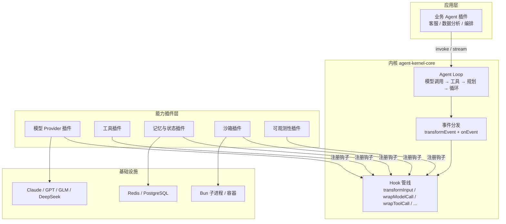
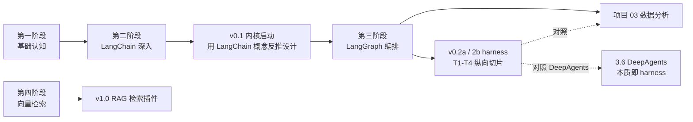

# Agent Kernel — 可插件化 Agent 运行时内核

> 仿 Vite 插件形态的 Agent 基座：内核只保留最小闭环，模型、工具、记忆、沙箱、观测全部插件化

> **状态**：设计阶段（文档先行，随实现迭代优化）
> **配套学习路线**：[agent-fullstack](../agent-fullstack/readme.md)

## 项目定位

**学习型项目**，不是 LangChain 的替代品。

- 用 LangChain 学「是什么」，用自研内核懂「为什么」
- 建议启动时机：学完 agent-fullstack 第二阶段（LangChain.js 生态）后启动 v0.1
- 终极验收：harness 纵向切片任务集 T1–T8（见 [09-harness层设计](doc/09-harness层设计.md)）；v0.3+ 可选对照重写 [agent-fullstack 项目 02（智能客服）](../agent-fullstack/projects/02-customer-service/README.md)，同一需求两种实现的差距就是知识盲区

## 目标 / 非目标

| 目标 ✅ | 非目标 ❌ |
| --- | --- |
| 内核文件 ≤ 10、单文件 ≤ 200 行（口径见 [08](doc/08-路线图与里程碑.md)） | 对标 LangChain 功能全覆盖 |
| 一切能力皆插件，可独立替换 | 通用低代码 Agent 平台 |
| 流式优先：所有接口 `AsyncGenerator` / 事件驱动 | 生产级性能与稳定性承诺 |
| 类型安全：Zod + TS strict 端到端 | 多语言 SDK |
| 通过钩子设计倒逼理解框架设计动机 | 开源竞争 |

## 核心理念

1. **内核最小化**：内核只做「循环 + 事件 + 钩子」。判断标准：任何模块若能移出内核而内核 API 仍自洽，就必须移出。
2. **一切皆插件**：模型 Provider、工具、记忆、沙箱、观测全部通过统一插件协议注册，内核零运行时依赖（仅 Zod）。
3. **流式优先**：接口签名第一天就是 `AsyncGenerator`，事后补流式等于重写。
4. **钩子三参照**：Vite hooks（命名与时机）+ Koa 洋葱（组合模型）+ LangChain middleware（Agent 场景钩子集合）。
5. **协议先行**：v0.1 即定义全部钩子与 `resume()` 签名（no-op / 透传占位），v0.2 只填实现不改协议。

## 架构总览



## 文档索引

| 文档 | 内容 | 状态 |
| --- | --- | --- |
| [01-总体架构设计](doc/01-总体架构设计.md) | 设计原则、分层架构、依赖方向、包结构 | 草案 |
| [02-核心循环与事件系统](doc/02-核心循环与事件系统.md) | Agent Loop 状态机、终止条件、事件协议 | 草案 |
| [03-插件系统与钩子设计](doc/03-插件系统与钩子设计.md) | 插件协议、钩子清单、洋葱组合、生命周期 | 草案（核心） |
| [04-模型Provider抽象](doc/04-模型Provider抽象.md) | 统一模型接口、流式 chunk 协议、多 Provider 适配 | 草案 |
| [05-工具系统](doc/05-工具系统.md) | 工具定义、执行管线、错误策略、并发 | 草案 |
| [06-状态与记忆管理](doc/06-状态与记忆管理.md) | RunState、Checkpointer、上下文窗口策略 | 草案 |
| [07-沙箱与可观测性](doc/07-沙箱与可观测性.md) | 沙箱分级、OTel 埋点、成本观测 | 草案 |
| [08-路线图与里程碑](doc/08-路线图与里程碑.md) | v0.1 → v1.0 里程碑、验收标准、任务分解 | 草案 |
| [09-harness层设计](doc/09-harness层设计.md) | coding agent 插件集 + preset、契约表、T1-T8 任务集 | 提纲 |

## 技术栈

| 类别 | 选型 | 说明 |
| --- | --- | --- |
| 运行时 | Bun | `Bun.spawn` 沙箱、原生 TS、单二进制部署 |
| 语言 | TypeScript（strict） | 全量严格模式 |
| Schema | Zod | 工具入参、配置校验、类型推导唯一真源 |
| HTTP 壳（可选） | Hono | v0.2 起为内核套 HTTP/SSE 服务层 |
| Lint / Format | oxlint / oxfmt | 单引号、无分号、2 空格 |
| 可观测性 | OpenTelemetry | span 导出 Langfuse / LangSmith |

## 目录规划

```
agent-kernel/
├── readme.md              # 本文件
├── doc/                   # 设计文档（当前）
├── src/                   # 内核源码（v0.1 启动时创建）
├── plugins/               # 官方插件（v0.2 起逐个拆出）
└── examples/              # 示例 Agent（CLI 天气助手 → coding agent CLI）
```

## 里程碑概览

| 版本 | 主题 | 验收标准 |
| --- | --- | --- |
| v0.1 | 最小闭环（全签名占位） | T0：CLI 天气 Agent（流式 + 工具调用 + 多轮会话 + thread 锁） |
| v0.2a | harness 前半 | T1 / T2：读 + 编辑（requiresApproval 拦截生效） |
| v0.2b | harness 后半 | T3 / T4：多文件重构 + 测试修复循环 |
| v0.3 | harness-safe | T5 / T7：完整审批协议 + 崩溃恢复；可选对照：重写智能客服 |
| v0.4 | harness-scale | T6 / T8：上下文压缩 + 子 agent 委派 |
| v1.0 | ecosystem | MCP 工具接入 + RAG 检索插件 + 技能系统 |

详见 [08-路线图与里程碑](doc/08-路线图与里程碑.md) 与 [09-harness层设计](doc/09-harness层设计.md)。

> 📌 v0.2 主验收已从「重写智能客服」切换为 coding agent 纵向切片（客服测不出审批、压缩、沙箱等新钩子）；项目 02 降为 v0.3+ 可选对照，学习路线连接不断。

## 与 agent-fullstack 学习路线的嵌入关系


