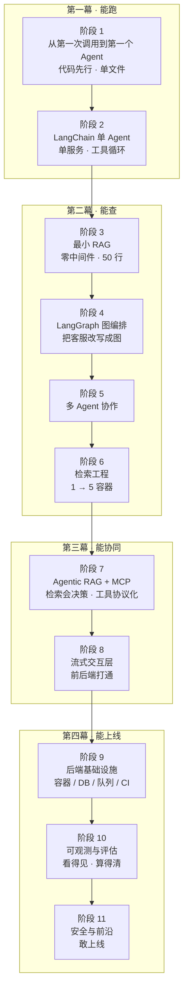

# AI Agent 全栈工程师养成计划（工程实战版）

> **主题：从「能跑」到「能上线」——一次只加一个新变量的 Agent 工程阶梯**
>
> **HTML 讲义**：`docs/`（React + Vite，阶段一 1.1–1.4、阶段二 2.1–2.6 已完结，3.1 已上线；项目 02 v1 人工转接待补）
>
> 整条路径只做一件事：每章只引入一个新变量，用上一章已经跑通的代码去验证它，最后留下一个能运行、能演示、能写进简历的产物。算法不深挖，只讲到「能选型、能调参、能答面试」。

---

## 0. 这次重排解决什么问题

旧版前两章学得动、从第三章开始吃力，原因不是内容难，而是三个结构性断层：

| 断层 | 旧版表现 | 新版处理 |
|------|---------|---------|
| **依赖倒置** | Agentic RAG 排在向量库之前，只能在假检索器上练 | 检索先行，Agentic RAG 移到检索工程之后（阶段七） |
| **一章多变量** | LangGraph 一章同时引入图范式、RAG 决策、多 Agent、MCP、DeepAgents | 拆成阶段四（图）、阶段五（多 Agent）、阶段七（协议与开箱框架） |
| **入口即劝退** | 检索章开篇先起 5 个容器、8 GB 内存，概念还没落地 | 新增阶段三：零中间件、50 行代码跑通检索（仅需一个 Embedding API Key）；容器逐级加 |

### 0.1 三条坡度线

整份大纲沿三条线同时爬坡。任何一章只允许在一条坡度线上前进；容器类章节按篇逐级增加，不跳级：

| 坡度线 | 起点 | 中点 | 终点 |
|--------|------|------|------|
| **依赖坡度** | 零中间件（内存 / 假实现，仅一个 API Key） | 单容器 | 多容器 / 集群 |
| **控制坡度** | 固定 Prompt | 单 Agent 循环 → 显式图 | 多 Agent 协作 |
| **工程坡度** | 脚本 | CLI → HTTP 服务 | 可观测 / 可回滚 / 可审计 |

### 0.2 五条设计规则

1. **零中间件起步**：每个能力域的入门篇不装任何中间件，先用最小实现把概念跑通（外部依赖只允许一个 API Key）；生产化章节（阶段六、阶段九）例外——容器与编排本身就是当章的学习对象，从单容器起步逐级增加。
2. **一章一变量**：范式、检索、协议、部署各自成章，不叠加新概念。
3. **产物驱动**：每章以一个可交付物收口，项目沿两条生长链长大（见 §4）。
4. **面试点显式**：每篇篇首标「面试可答」，隐性知识变成可检索的知识。
5. **深度分级**：每篇标 `精讲` / `速过` / `引子`，非主线允许跳过。

### 0.3 明确不写什么

- 不推导 Transformer 注意力公式，只讲对工程有影响的部分（上下文、token、幻觉）。
- 不实现 ANN 索引，HNSW / IVF 只讲到「参数含义 + 调优顺序 + 面试答法」；算法细节外链 [rag-algorithms](../rag-algorithms/README.md)。
- 不训练、不微调模型，Embedding 微调列为选修。
- 不搭建 K8s 集群，会读 YAML、会排障、知道什么时候不该上即可。
- 不重复 `agent-kernel` 的运行时自研内容，本册只讲「用框架交付」。

---

## 1. 定位

| 项目 | 内容 |
|------|------|
| 目标读者 | 有 TypeScript / 前端 / Node 经验，想转型做 AI Agent 开发的全栈工程师 |
| 前置要求 | 熟悉 TS、会用 Bun、了解 HTTP 与数据库基本概念；阶段八需要 React 基础（或按 8.1 的 vanilla fetch 路径）；不需要机器学习基础 |
| 学习目标 | 能独立交付一个带检索、多 Agent、可观测、可部署的企业级 Agent 服务 |
| 面试目标 | Agent / RAG / 协议 / 工程化四类高频题能答，且能给出取舍理由 |
| 技术主场 | Bun + TypeScript + Hono + Zod；框架以 LangChain.js / LangGraph.js 为主 |

---

## 2. 学习路径图

---

## 3. 篇目规划

### 阶段一：从第一次调用到第一个 Agent

> **定位**：把「AI 是什么」压缩到面试够用的最小集，同时一次立好工程基线。整阶代码先行：第一篇跑通一次模型调用，第二篇起一个 HTTP 服务，概念全部跟着代码走。

**相对旧版的改动**：旧 1.1 的 Transformer / Embedding 科普压缩为「判断工程影响」的版本，不推公式，并改为「边跑边讲」；旧 1.5 工程基线前移到 1.2，兑现「第一篇就能跑」；旧 1.6 Prompt 后移到 1.3，挂在实际服务上练；旧 1.2 Agent 架构后移到 1.4，并补「手写最小工具循环」（原生 fetch，先协议层后框架），为阶段二提供框架动机；旧 1.3 记忆系统拆走（会话记忆并入 2.4，长期记忆并入 9.4）；旧 1.4 RAG 概念独立成阶段三，且必须先跑通代码。

| 序号 | 篇名 | 深度档 | 解决什么问题 | 前置 | 面试可答 |
|------|------|--------|-------------|------|---------|
| 1.1 | 直连 LLM：50 行跑通第一次调用 | 精讲 | token、上下文窗口、温度、幻觉、成本模型、选型决策树；两张决策表作为正文结论表，更长的追问清单放附录 A/B（选做）——边跑边讲 | 无 | token 怎么计费、长上下文与 RAG 怎么选、微调/RAG/Prompt 怎么选 |
| 1.2 | TypeScript + Bun + Hono 工程基线 | 精讲 | 把 1.1 的裸调用包成服务：Zod 校验、最小 SSE、分层（route / service / agent）、超时与错误码、API Key 最小鉴权（只做身份，不做配额） | 1.1 | 为什么选 Hono、SSE 与 WebSocket 的取舍 |
| 1.3 | Prompt 工程：从「会问」到「可验证」 | 精讲 | 结构化输出、few-shot 选择、CoT、模板版本化、注入防护——挂在实际服务上练 | 1.2 | 怎么让输出稳定可解析、Prompt 注入怎么防 |
| 1.4 | Agent 范式：手写最小工具循环 | 精讲 | ReAct、Function Calling 协议、Memory、Planning、单 / 多 Agent 边界；30 行核心循环只覆盖 happy path，跑通后故意撞三个坑（并行调用、参数校验、无限循环），以失败测试形式保留，作为 2.3 / 2.5 / 4.3 / 10.4 的召回点 | 1.3 | Agent 与 Chain 的区别、ReAct 循环、工具调用协议 |

**阶段产物**：项目 01 天气 Agent（Hono + SSE + 单工具）——四篇代码的自然汇合，而非概念之后的「终于动手」。源码为练习项目：四篇的代码块即参考实现，完整工程暂未随 docs 交付。

**项目落点**：项目 01 = 1.1 调用 + 1.2 服务 + 1.3 Prompt + 1.4 工具循环；四篇合成一个可运行服务。

---

### 阶段二：LangChain.js 单 Agent 工程

> **定位**：用框架把一个 Agent 写「完整」——工具、结构化输出、记忆、中间件、追踪。这一章不引入新范式，只把阶段一的散装代码工程化。

**相对旧版的改动**：基本平移。2.1 改为「createAgent 重写项目 01」上手先行，Runnable 协议降为篇内小节；2.2 模型与消息降为速过；原 2.3 工具 + 2.4 结构化输出合并为 2.3「工具与输出契约」，Thread ID 归入 2.4 记忆；2.6 LangSmith 降为速过，与 10.1 分工——本篇只管接入与看 trace，指标与评估回归见 10.1。

| 序号 | 篇名 | 深度档 | 解决什么问题 | 前置 | 面试可答 |
|------|------|--------|-------------|------|---------|
| 2.1 | createAgent 30 分钟：用框架重写天气 Agent | 精讲 | 先跑通再讲架构——包生态地图、Model + Harness 分层；Runnable 协议降为小节（invoke / stream / batch 够用），LCEL 编排（pipe / RunnableLambda）引子化 | 1.4 | LangChain 的抽象基类是什么、Runnable 解决什么问题 |
| 2.2 | 模型与消息系统 | 速过 | 多 Provider 初始化、消息类型、Prompt 模板、content_blocks、流式 | 2.1 | 消息角色怎么设计、流式事件怎么消费 |
| 2.3 | 工具与输出契约 | 精讲 | 以「工具契约」为骨架：入参 Schema + 权限上下文 + 输出 Schema；tool() + Zod、Runtime Context、responseFormat | 2.1, 2.2 | 工具怎么定义、工具太多怎么办、如何保证输出可解析 |
| 2.4 | 记忆与状态管理 | 精讲 | 以「状态生命周期」串：创建（Thread ID）→ 读取（MemorySaver）→ 持久化（Checkpointer）→ 裁剪（上下文压缩） | 2.3 | 多轮对话怎么存、上下文怎么裁 |
| 2.5 | 中间件系统 | 精讲 | todoList、重试、PII 过滤、Human-in-the-Loop、自定义中间件；补 1.4 的三个坑；HITL 只讲中间件用法，interrupt / 断点恢复见 4.4 | 2.4 | 中间件在 Agent 循环的哪个位置执行 |
| 2.6 | LangSmith 链路追踪 | 速过 | 环境变量接入、Trace 分析、失败定位；只管「接入与会看」，指标与评估回归见 10.1 | 2.4 | 怎么定位一次 Agent 调用失败 |

**阶段产物**：项目 02 客服系统 v1（多轮 + FAQ 工具 + HITL；收口示例 `docs/examples/project-02-v1` 已交付，人工转接仍待补）。

**项目落点**：项目 02 v1 = 2.1 框架重写 + 2.3 工具契约 + 2.4 状态 + 2.5 HITL；2.2 / 2.6 是支撑篇。

---

### 阶段三：最小 RAG（零中间件入门）

> **定位**：不装任何中间件，用 50 行代码把「文档 → 向量 → 检索 → 回答」跑通，先建立检索手感。这是旧版最缺的一级台阶。

**关键约束**：本篇所有练习必须能在 `bun run` 下零中间件运行——不出现 Docker、不出现数据库，仅需一个 Embedding API Key（或本地模型）。

| 序号 | 篇名 | 深度档 | 解决什么问题 | 前置 | 面试可答 |
|------|------|--------|-------------|------|---------|
| 3.1 | 检索第一原理：50 行内存检索 | 精讲 | chunk → embed → cosine → top-k 的最小闭环，为什么需要向量检索 | 1.1 | RAG 全链路、cosine 与 dot 的区别、为什么要 chunk |
| 3.2 | 文档切分、Embedding 与召回质量 | 精讲 | 切分策略与 overlap、BGE-M3 / Qwen3-Embedding 选型、归一化 | 3.1 | chunk 怎么切、Embedding 怎么选、召回差怎么归因 |
| 3.3 | 最小 RAG 评估 | 速过 | 三条可断言：命中、引用、拒答；recall@k 与忠实度手算 | 3.1, 3.2 | RAG 怎么评估、指标怎么定 |

**阶段产物**：项目 03 文档问答 CLI（本地 Markdown 目录 → 带引用的回答）。

**项目落点**：项目 03 = 3.1 检索 + 3.2 切分与选型 + 3.3 评估；不依赖任何中间件。

---

### 阶段四：LangGraph 图编排

> **定位**：只引入「图」这一个新变量，业务仍然是项目 02 的客服系统。用同一份业务对比两种实现，是消除范式断层最有效的方式。

**相对旧版的改动**：旧 3.1 / 3.2 拆成四篇，每篇只讲一个机制；旧 3.3 Agentic RAG 移到阶段七；旧 3.4 多 Agent 移到阶段五。

| 序号 | 篇名 | 深度档 | 解决什么问题 | 前置 | 面试可答 |
|------|------|--------|-------------|------|---------|
| 4.1 | 从 createAgent 到图：把客服 v1 重写 | 精讲 | 为什么需要显式控制流、createAgent 的能力边界、图的最小结构 | 2.1, 2.3, 2.4 | LangGraph 与 createAgent 怎么选 |
| 4.2 | State、reducer 与节点契约 | 精讲 | StateSchema、reducer 归并、节点返回值、消息裁剪 | 4.1 | State 与 reducer 原理、节点为什么返回部分状态 |
| 4.3 | 条件路由、循环与防失控 | 精讲 | addConditionalEdges 与 Command 两种路由、recursionLimit、退出条件 | 4.2 | 两种路由的区别、怎么防死循环 |
| 4.4 | 中断与检查点：可恢复的图 | 精讲 | interrupt、Checkpointer、断点恢复；HITL 的中间件用法见 2.5；子图复用与并行节点降为篇内小节（了解即可，不展开） | 4.3 | HITL 怎么实现、断点恢复原理 |

**阶段产物**：项目 02 客服系统 v2（图化 + 人工审批 + 断点恢复）。

**项目落点**：项目 02 v2 = 4.1 图化 + 4.2 State + 4.3 路由 + 4.4 中断/恢复；业务代码复用 v1。

---

### 阶段五：多 Agent 协作

> **定位**：单图不够用时才上多 Agent。先学拓扑与边界，再学任务分解，最后学容错。

**相对旧版的改动**：旧 3.4 拆成三篇；旧 3.7 的容错部分并入 5.3。

| 序号 | 篇名 | 深度档 | 解决什么问题 | 前置 | 面试可答 |
|------|------|--------|-------------|------|---------|
| 5.1 | 多 Agent 拓扑与选型 | 精讲 | Supervisor / Hierarchical / Peer-to-Peer、什么时候不该用多 Agent | 4.3 | 多 Agent 协作模式、上下文怎么隔离 |
| 5.2 | 任务分解、上下文传递与结果聚合 | 精讲 | 子任务 Schema、上下文裁剪、结果合并、冲突处理 | 5.1 | 子 Agent 之间怎么传上下文 |
| 5.3 | 容错、降级与调试 | 精讲 | 限流、超时、Fallback 模型链、Trace 定位失败节点 | 5.2 | LLM 调用失败怎么兜底、怎么定位哪个 Agent 出错 |

**阶段产物**：项目 04 数据分析助手（SQL Agent + 可视化 Agent + 主管收口）。

**项目落点**：项目 04 = 5.1 拓扑 + 5.2 任务分解 + 5.3 容错；SQL / 可视化 Agent 各司其职。

---

### 阶段六：检索工程（生产检索栈）

> **定位**：把阶段三的 50 行检索逐级换成生产组件。每一级只换实现，`Retriever` 接口不变，代码是生长而不是推倒重来。

**容器策略**：6.1 单容器起步；6.2 起 Milvus 三件套；6.3 加 ES；6.5 加 Neo4j。每篇只在需要时增加服务，不再「开篇先起全栈」。6.6 用 PostgreSQL job 表 + worker 实现异步，不引入 MQ / 对象存储；9.5 再替换为 MQ + S3。

| 序号 | 篇名 | 深度档 | 解决什么问题 | 前置 | 面试可答 |
|------|------|--------|-------------|------|---------|
| 6.1 | 向量库入门：pgvector / Qdrant | 精讲 | 持久化、collection、索引、元数据过滤、upsert | 3.3 | 向量库怎么选、pgvector 的适用边界 |
| 6.2 | Milvus 索引调优与最小架构 | 精讲 | HNSW / IVF 参数、过滤下推、segment 最小模型；Milvus 分层架构只给一张图，细节外链 | 6.1 | HNSW 参数怎么调、为什么过滤要下推 |
| 6.3 | 混合召回：BM25 + 向量 + RRF | 精讲 | 双路召回（稀疏 BM25 + 稠密向量）的最小实现；RRF 与加权融合的取舍；三路以上（+ 图谱 / 结构化过滤）怎么扩展；什么时候不值得混合 | 6.1 | 有向量了为什么还要 BM25、双路召回怎么融合、RRF 怎么算 |
| 6.4 | 重排与查询改写 | 精讲 | cross-encoder rerank、HyDE、多查询、成本权衡 | 6.3 | rerank 原理与收益、什么时候不值得 |
| 6.5 | GraphRAG 与知识图谱 | 引子 | Neo4j 与 Cypher 最小集、Local / Global、什么时候值得上图谱 | 6.3 | GraphRAG 适用场景、和向量检索怎么配合 |
| 6.6 | 文档解析与异步入库 | 精讲 | 多格式解析（PDF / Word / Excel / PPT → Markdown）、异步索引流水线、幂等与失败重试；用 PostgreSQL job 表 + worker 实现 `IndexJob`，不引入 MQ | 6.1, 6.3 | 文档更新怎么保证一致性、异步入库怎么防重复 |
| 6.7 | 文档治理：审核、RBAC 与版本 | 速过 | 审核状态机、RBAC 与检索可见性、知识库版本与生命周期 | 6.6 | 权限怎么落到检索、文档生命周期怎么管 |

> **深度边界**：6.2 / 6.3 / 6.4 只讲到「选型、调参、排障」；HNSW 图结构、PQ 量化、BM25 推导、Milvus 分层架构等细节外链 [rag-algorithms](../rag-algorithms/README.md)。
>
> **选型边界**：ES 是混合召回的一等公民，默认进主链路；Neo4j 只在多跳关系 / 全局摘要场景上，默认不进主链路。融合时让 ES / 向量负责文本召回，Neo4j 负责关系扩展，最后用 RRF + rerank 收口。

**选型说明（ES / Neo4j 什么时候用）**：

| 技术 | 解决什么问题 | 什么时候用 | 什么时候不用 |
|------|-------------|-----------|-------------|
| ES / BM25 | 精确词、编号、中文分词、元数据过滤、混合召回 | 文档里有大量专有名词 / 订单号 / 条款号；需要 BM25 + 向量 + RRF；需要按租户 / 权限过滤 | 文档很少、只做语义问答；ES 的运维成本大于收益 |
| Neo4j / GraphRAG | 多跳关系、实体导航、全局摘要 | 问题需要跨实体跳转（合同 → 供应商 → 项目）；已有干净的关系数据；需要解释「为什么关联」 | 单跳 FAQ；没有实体 / 关系数据；团队没有图建模与维护经验 |

**阶段产物**：项目 05 企业知识库 v1（项目 03 CLI 升级为服务，带混合检索、重排、异步入库与引用溯源）。

**项目落点**：项目 05 v1 = 6.1 向量库 + 6.3 混合召回 + 6.4 重排 + 6.6 入库 + 6.7 治理；6.2 / 6.5 是选型与引子。

---

### 阶段七：Agentic RAG 与协议生态

> **定位**：检索组件齐了，才让 Agent 自己决定「要不要检索、用哪个检索器、结果够不够好」；再把工具协议化，接入外部生态。

**相对旧版的改动**：旧 3.3 从 LangGraph 章移到这里，此时才有真实检索器可用；旧 3.5 MCP 拆成两篇；旧 3.6 DeepAgents 降为速过。

| 序号 | 篇名 | 深度档 | 解决什么问题 | 前置 | 面试可答 |
|------|------|--------|-------------|------|---------|
| 7.1 | Agentic RAG：让检索会决策 | 精讲 | 检索前决策、文档打分、改写重试、Self-RAG、防失控 | 4.4, 6.4 | Agentic RAG 与传统 RAG 的本质区别 |
| 7.2 | MCP 协议与 Server 开发 | 精讲 | Server / Client / Transport、TS SDK、工具与资源注册 | 2.3 | MCP 解决什么问题、和 Function Calling 的关系 |
| 7.3 | MCP Client、安全与生态 | 精讲 | 接入 LangChain、权限最小化、工具投毒、MCP vs A2A | 7.2 | MCP 的安全风险、A2A 与 MCP 的分工 |
| 7.4 | DeepAgents 开箱框架 | 速过 | 虚拟文件系统、子 Agent 委派、上下文压缩、选型对比 | 7.1 | DeepAgents 与 LangGraph 各自适合什么 |

**阶段产物**：项目 05 企业知识库 v2（Agentic 检索 + MCP 工具网关）。

**项目落点**：项目 05 v2 = 7.1 Agentic 检索 + 7.2/7.3 MCP 工具网关；7.4 是框架选型。

---

### 阶段八：流式交互层

> **定位**：把 Agent 的能力通过流式协议暴露给前端，做「能看见过程」的界面。

| 序号 | 篇名 | 深度档 | 解决什么问题 | 前置 | 面试可答 |
|------|------|--------|-------------|------|---------|
| 8.1 | Vercel AI SDK 核心 | 精讲 | useChat / useCompletion、消息协议、工具调用渲染；补 React 最小前置，或给出 vanilla fetch 消费路径 | 1.2 | 前端怎么接流式 Agent |
| 8.2 | AGUI 与 SSE 端到端 | 精讲 | Hono streamSSE、事件设计、断线重连、错误降级 | 8.1 | SSE 与 WebSocket 怎么选、断线怎么恢复 |
| 8.3 | Agent UI 设计 | 速过 | 思维链展示、工具过程、错误态、取消与重试 | 8.2 | 怎么避免「黑盒等待」 |

**阶段产物**：项目 06 实时协作写作助手。

**项目落点**：项目 06 = 8.1 AI SDK + 8.2 SSE 端到端 + 8.3 Agent UI。

---

### 阶段九：后端基础设施与部署

> **定位**：从本机 compose 到可部署、可扩缩、可回滚。
>
> **载体**：项目 07 自动化工作流平台——独立最小业务，只承载队列、调度、重试与补偿，不与其他项目耦合。

| 序号 | 篇名 | 深度档 | 解决什么问题 | 前置 | 面试可答 |
|------|------|--------|-------------|------|---------|
| 9.1 | Docker 容器化 | 精讲 | Bun 多阶段构建、镜像瘦身、健康检查、compose 编排 | 6.1 | 多阶段构建怎么做、镜像为什么大 |
| 9.2 | 部署与 K8s 基础 | 速过 | Serverless vs 容器、Pod / Service / Deployment、ConfigMap / Secret、探针 | 9.1 | 什么时候该上 K8s |
| 9.3 | PostgreSQL 落地 | 精讲 | Prisma / Drizzle 建模、多租户隔离、Checkpoint 共库部署（断点恢复语义见 4.4）、pgvector 轻量向量检索 | 2.4, 6.1（4.4 推荐） | 会话存哪、Checkpoint 与业务共库有什么坑 |
| 9.4 | Redis 会话、缓存与长期记忆 | 速过 | 会话缓存、JWT / session 校验、缓存策略、SCAN 纪律、长期记忆存储选型（Mem0 形态：向量库 vs 关系库） | 9.3 | 缓存穿透怎么防、长期记忆存向量库还是关系库 |
| 9.5 | 消息队列与对象存储 | 精讲 | RabbitMQ / BullMQ 选型、ACK 与死信、延迟重试、S3 预签名；把 6.6 的 `IndexJob` 实现替换为 MQ + S3，接口不变 | 9.1 | 长耗时任务怎么解耦 |
| 9.6 | CI/CD 与配置管理 | 速过 | GitHub Actions、环境变量、灰度与回滚 | 9.1 | 发布流程怎么设计 |

**阶段产物**：项目 07 自动化工作流平台。

**项目落点**：项目 07 = 9.1 容器 + 9.3 数据库 + 9.5 队列/对象存储 + 9.6 CI；9.2/9.4 是速过支撑。

---

### 阶段十：可观测、评估与成本

> **定位**：上线不是终点，能看见、能评估、能算账才是。
>
> **载体**：项目 08 监控与评估平台——独立最小业务，只承载 LangSmith / Langfuse / Prometheus 的接入、评估与成本看板，不与其他项目耦合。

| 序号 | 篇名 | 深度档 | 解决什么问题 | 前置 | 面试可答 |
|------|------|--------|-------------|------|---------|
| 10.1 | LangSmith 全链路追踪 | 精讲 | Trace、Token、延迟、失败节点定位 | 2.6 | 怎么定位一次 Agent 失败 |
| 10.2 | Langfuse 与 OpenTelemetry | 速过 | 自托管、双通道接入、与 LangSmith 对照 | 10.1 | 数据主权与选型 |
| 10.3 | Prometheus + Grafana | 速过 | 指标设计、告警规则、看板 | 10.2 | Agent 该监控哪些指标 |
| 10.4 | Agent 测试与评估 | 精讲 | Mock LLM、集成测试、评估集、回归、CI 集成；幻觉治理分层：检索、引用、拒答、评估、人工兜底 | 3.3 | Agent 怎么测、评估集怎么建、幻觉怎么分层治理 |
| 10.5 | 性能与成本优化 | 精讲 | 缓存、批处理、Token 截断、限流熔断、预算护栏 | 10.4 | 成本怎么降、限流怎么设计 |

**阶段产物**：项目 08 监控与评估平台。

**项目落点**：项目 08 = 10.1 Trace + 10.3 指标 + 10.4 评估 + 10.5 成本看板。

---

### 阶段十一：安全、合规与前沿

> **定位**：把「能上线」变成「敢上线」。

| 序号 | 篇名 | 深度档 | 解决什么问题 | 前置 | 面试可答 |
|------|------|--------|-------------|------|---------|
| 11.1 | Agent 安全防护 | 精讲 | 直接 / 间接注入、工具权限、输出过滤、敏感信息脱敏 | 1.3, 2.3（7.3 推荐） | 间接注入怎么防、工具权限怎么收 |
| 11.2 | OWASP LLM Top 10 与合规 | 速过 | 十项风险映射到本教程的实现点、数据生命周期与合规 | 11.1 | 过度授权、敏感信息泄露怎么落地防护 |
| 11.3 | 多模态与语音 | 引子 | 图像理解、ASR + 流式 TTS、时延与成本 | 8.3 | 语音链路怎么搭 |
| 11.4 | 自主 Agent 与 Computer Use | 引子 | 浏览器自动化、沙箱隔离、E2B、风险边界 | 11.1 | Computer Use 的安全边界 |

**阶段产物**：项目 02 客服系统 v3（安全加固版）。

**项目落点**：项目 02 v3 = 11.1 安全防护 + 11.2 OWASP 合规；11.3/11.4 是前沿引子。

---

## 4. 项目生长链

不做十个孤立 Demo，只做两条生长链 + 五个独立项目。每个版本都复用上一版的代码，新增的只有本章那一个变量。

| 生长链 | 版本 | 所在阶段 | 新增能力 |
|--------|------|---------|---------|
| **客服链** | 项目 02 v1 | 阶段二 | LangChain 多轮、工具、结构化输出、HITL |
| | 项目 02 v2 | 阶段四 | 改写为 LangGraph 图，加断点恢复 |
| | 项目 02 v3 | 阶段十一 | 注入防护、权限收紧、脱敏与审计 |
| **知识库链** | 项目 03 CLI | 阶段三 | 零中间件检索、引用、拒答 |
| | 项目 05 v1 | 阶段六 | 生产检索栈：向量库 + 混合 + 重排 + 异步入库 |
| | 项目 05 v2 | 阶段七 | Agentic 检索 + MCP 工具网关 |
| **独立项目** | 项目 01 天气 Agent | 阶段一 | 工程基线：Hono + SSE + 单工具 |
| | 项目 04 数据分析助手 | 阶段五 | 多 Agent 协作 |
| | 项目 06 写作助手 | 阶段八 | 流式前端 |
| | 项目 07 自动化工作流平台 | 阶段九 | 容器化 + 队列 + 调度 + 补偿 |
| | 项目 08 监控与评估平台 | 阶段十 | 观测 + 评估 + 成本 |

### 4.1 每个项目的企业级验收标准

与「能跑」无关，与「敢交付」有关。六条标准按阶段分级达标，不要求第一个项目就全绿：

1. **可启动**：README 写明依赖、环境变量、启动命令、验收断言。
2. **可降级**：超时、重试、Fallback 模型链至少各有一处。
3. **可鉴权**：接口有身份，配额与工具权限按阶段补齐（见下表）。
4. **可追踪**：每条请求有 trace id，关键节点有结构化日志。
5. **可测试**：至少一组单测 + 一组集成测试，LLM 调用可 Mock。
6. **可算账**：给出单次请求的平均 token 与成本估算。

| 阶段 | 验收范围 |
|------|---------|
| 阶段一至五 | 第 1 / 2 / 4 / 5 / 6 条 + API Key 身份（1.2）；第 3 条允许「预留接口 + 最小身份」 |
| 阶段六 | 补第 3 条的检索侧 RBAC 与文档可见性（6.7） |
| 阶段九 | 补租户隔离（9.3）、JWT / session（9.4） |
| 阶段十 | 补配额、限流与预算护栏（10.5） |
| 阶段十一 | 补工具权限、注入防护与审计（11.1 / 11.2） |

阶段十一之后，所有项目按六条全量验收；早期项目允许分级达标，但必须在 README 标注缺口与补齐篇目。

**例外**：项目 01 是阶段一的练习项目，不随 `docs/` 交付源码，也不要求六条全绿；它的验收以 1.1–1.4 四篇的代码块、运行检查与三条断言为准。

---

## 5. 练习递进线

| 层级 | 练习形态 | 出现在 | 示例 |
|------|---------|--------|------|
| L1 跟做 | 照抄示例跑通，改一个参数观察结果 | 阶段一至三 | 换 chunk 大小，观察命中变化 |
| L2 改造 | 换数据、换工具、换模型 | 阶段二至五 | 把 FAQ 工具换成数据库查询 |
| L3 排障 | 给定错误现象，定位到具体节点 | 阶段四至七 | 图死循环 / 检索召回为 0 / MCP 握手失败 |
| L4 设计 | 只给需求，自己画图、选型、定接口 | 阶段六至九 | 设计一个带审核状态机的入库流水线 |
| L5 压测 | 注入失败、限流、超预算，观察降级 | 阶段十至十一 | 让主模型 429，验证 Fallback 链 |

---

## 6. 面试覆盖图

| 高频面试问题 | 覆盖篇目 |
|-------------|---------|
| Agent 与 Chain / Workflow 有什么区别？ | 1.4 |
| ReAct 循环怎么工作？Function Calling 的协议是什么？ | 1.4 |
| Agent 的 Planning 有哪些范式？ReAct 与 Plan-and-Execute 怎么选？ | 1.4, 5.1 |
| 长上下文和 RAG 怎么选？什么情况下不该建库？ | 1.1 |
| 微调、RAG、Prompt 三者怎么选？ | 1.1 |
| 直接注入和间接注入怎么防？ | 1.3, 11.1 |
| 上下文窗口超了怎么处理？多轮记忆怎么存？ | 2.4 |
| 短期记忆和长期记忆怎么分层？存储怎么选？ | 2.4, 9.4 |
| 上下文工程怎么组装、裁剪、压缩与传递？ | 2.4, 5.2 |
| 怎么保证结构化输出稳定可解析？ | 2.3 |
| 工具太多怎么选？工具检索 / 分组怎么做？ | 2.3 |
| 中间件在 Agent 循环的哪个位置执行？HITL 怎么实现？ | 2.5 |
| State 和 reducer 怎么工作？两种路由怎么选？ | 4.2, 4.3 |
| 怎么防图死循环？recursionLimit 之外还有什么手段？ | 4.3 |
| Checkpointer 怎么实现断点恢复？ | 4.4 |
| 多 Agent 有哪些拓扑？上下文怎么隔离？ | 5.1, 5.2 |
| RAG 全链路是什么？chunk 怎么切？ | 3.1, 3.2 |
| Embedding 模型怎么选？为什么要归一化？ | 3.2 |
| 检索召回为 0 怎么排障？ | 3.1, 3.2, 6.1 |
| 向量库怎么选？HNSW / IVF 参数怎么调？为什么过滤要下推？ | 6.1, 6.2 |
| 有了向量检索为什么还要 BM25？RRF 怎么算？ | 6.3 |
| 双路召回怎么融合？RRF 和加权求和怎么选？ | 6.3 |
| Rerank 为什么有效？什么时候不值得？ | 6.4 |
| GraphRAG 适合什么场景？和向量检索怎么配合？ | 6.5 |
| ES 和 Neo4j 需要一起上吗？怎么融合？ | 6.3, 6.5 |
| 文档更新怎么保证一致性？权限怎么落到检索？ | 6.6, 6.7 |
| Agentic RAG 和传统 RAG 的本质区别是什么？ | 7.1 |
| MCP 解决什么问题？和 Function Calling 是什么关系？ | 7.2 |
| MCP 有哪些安全风险？A2A 与 MCP 怎么分工？ | 7.3 |
| SSE 和 WebSocket 怎么选？断线怎么恢复？ | 8.2 |
| 前端怎么消费流式 Agent 事件？ | 8.1, 8.2 |
| 什么时候该上 K8s？ | 9.1, 9.2 |
| 会话存哪？缓存穿透怎么防？ | 9.3, 9.4 |
| 长耗时任务怎么解耦？消息队列怎么选？ | 9.5 |
| 怎么定位一次 Agent 失败？ | 2.6, 10.1 |
| Agent 该监控哪些指标？ | 10.3 |
| Agent 怎么测试？评估集怎么建？ | 10.4 |
| 幻觉怎么分层治理？ | 10.4 |
| Token 成本怎么降？限流怎么设计？ | 10.5 |
| OWASP LLM Top 10 有哪些？怎么落地？ | 11.2 |

---

## 7. 最小学习路径

按目标选读，不必按顺序读完。下表是最短可达路径，「前置补齐」列列出路径外仍需补的篇目；严格依赖以每篇「前置」列为准，未掌握的需按前置列补齐。

| 目标 | 只读这几篇 | 前置补齐 | 产出 |
|------|-----------|---------|------|
| 做一个能用的单 Agent | 1.1 → 1.4 → 2.1 → 2.3 → 2.4 | 1.2、1.3、2.2（按前置列补齐） | 带工具与结构化输出的服务 |
| 做一个 RAG 问答 | 上一个目标 + 3.1 → 3.2 → 6.1 → 6.3 → 6.4 | 3.3（6.1 的前置） | 带引用与重排的问答服务 |
| 做多 Agent 工作流 | 上一个目标 + 4.1 → 4.2 → 4.3 → 5.1 | 无 | 主管 + 专家的协作图 |
| 上线并运维 | 上一个目标 + 2.6 → 8.1 → 8.2 → 9.1 → 9.3 → 9.5 → 10.1 → 11.1 | 9.2 / 9.4 / 9.6 可选；按需补 6.2 | 可观测、可降级、有防护的部署 |

---

## 8. 文档完成标准

每篇交付时需同时满足：

1. **可运行**：提供不依赖外部服务的运行路径（内存 / fake adapter），或明确的单容器启动命令；README 记录命令与预期输出。
2. **可验证**：给出 3 条可断言的预期结果（输出结构、检索命中、错误分支）。
3. **可复用**：至少 1 个可带走产出（代码片段、compose 文件、prompt 模板、配置样例）。
4. **有练习**：含「实践练习」小节，按 §5 的层级标注难度，精讲篇采用三段式（要求 / 提示 / 预期效果）；核心篇附折叠参考答案。
5. **有对比**：选型篇必做三角对比（本技术 + ≥1 同类方案 + 基线方案），至少覆盖 6.1 / 6.3 / 6.4 / 9.5 / 10.2；非选型篇不强制。
6. **面试可答**：篇首给出「面试可答」一句话，正文至少 1 组问答。
7. **可溯源**：版本断言与关键 API 处附官方文档或 Release Notes 链接；选型与版本结论写作时以官方资料复核。
8. **深度合规**：算法只讲到选型 / 调参 / 排障；超出部分外链 `rag-algorithms`，不在本册展开。
9. **篇幅预算**：精讲篇控制在一个专注会话内（阅读 + 练习约 90 分钟），速过篇不超过 30 分钟；全系列精讲占比不超过 70%，超出即降档或拆篇。

**统一模板**：每篇篇首用五栏卡（本篇变量 / 不改什么 / 产物 / 3 条验收 / 面试题）；启动命令与 3 条断言写进本篇「运行前检查 / 验收清单」，成本估算在涉及模型调用的篇目按需给出。当前 HTML 以课程首页 + 单篇页交付，不单独设阶段首页。

---

## 9. 与旧版内容复用映射

旧版已交付的 25 篇可作为素材迁移，但结构与代码需按新版重写，不是直接搬运：

| 旧版位置 | 新版去向 | 处理方式 |
|---------|---------|---------|
| 1.1 AI/ML 科普 | 1.1 | 压缩为面试最小集，删公式推导，改为「边跑边讲」 |
| 1.2 Agent 架构 | 1.4 | 后移，补手写最小工具循环（playground ch01 的 real-agent 可迁移） |
| 1.3 记忆系统 | 2.4 / 9.4 | 拆分：会话记忆与工程存储（长期记忆选型落在 9.4） |
| 1.4 RAG 架构 | 3.1 / 3.2 | 改写为零中间件可运行版本 |
| 1.5 TS + Bun | 1.2 | 前移，补 Hono 分层与错误处理 |
| 1.6 Prompt | 1.3 | 后移，挂在实际服务上练，补注入防护 |
| 阶段二各篇 | 2.1–2.6 | 原 2.3 + 2.4 合并为「工具与输出契约」；2.2、2.6 降为速过 |
| 3.1 / 3.2 | 4.2–4.4 | 拆细，每篇只讲一个机制 |
| 3.3 Agentic RAG | 7.1 | 后移，等检索组件就绪 |
| 3.4 多 Agent | 5.1 / 5.2 | 拆分 |
| 3.5 MCP | 7.2 / 7.3 | 拆分并独立成章 |
| 3.6 DeepAgents | 7.4 | 降为速过 |
| 3.7 企业级实践 | 5.3 + 9.1 | 容错与部署分开 |
| 4.1 Milvus / Qdrant | 6.1 / 6.2 | 拆成「入门」与「架构调优」 |
| 4.2 ES | 6.3 | 并入混合检索 |
| 4.3 高级检索 | 6.3 / 6.4 | 拆分 |
| 4.4 Neo4j | 6.5 | 降为引子 |
| 4.5 入库治理 | 6.6 / 6.7 | 拆分为「解析入库」与「治理」两篇 |
| 项目 01–03（源码） | 项目 01 / 02 / 04 | 仅作编号参考；新项目独立重建，不复用旧源码（旧项目 03 重编号为新项目 04） |
| 阶段五至九 | 8.x / 9.x / 10.x / 11.x | 按本大纲重新分篇 |

> 旧版目录保留在 [agent-fullstack](../agent-fullstack/readme.md)，本目录是重构版；迁移按阶段推进，不一次性搬完。

---

## 10. 交付状态

| 状态 | 范围 |
|------|------|
| 已交付 | 本大纲 + HTML 讲义 1.1–1.4 / 2.1–2.6 / 3.1（React + Vite，`docs/`） |
| 规划中 | 其余 38 篇 + 8 个项目目录 |

> 标注「规划中」的内容不作为已完成能力对外表述。
>
> **HTML 讲义入口**：`docs/`，在目录内运行 `bun install && bun run dev`；独立构建，base 为 `/kb-vault/agent-fullstack/`。
>
> **首批交付**：纵切 11 篇（1.1–1.4 + 2.1–2.4 + 3.1–3.3）中，阶段一 4 篇 + 阶段二 6 篇 + 3.1 已上线；阶段二框架主线与项目 02 v1 的 HITL 已收口。

---

## 11. 附录规划

| 附录 | 内容 | 入口 |
|------|------|------|
| A | 长上下文 vs RAG：追问清单 + 3 个追问 | 1.1 |
| B | 微调 vs RAG vs Prompt：追问清单 + 3 个追问 | 1.1 |
| C | 排障索引：症状 → 篇目 | 全系列 |

**附录 C 最小集**：图死循环 → 4.3；检索召回为 0 → 3.2 / 6.1；MCP 握手失败 → 7.2；429 / 超时 → 2.5 / 5.3 / 10.5；SSE 断线 → 8.2；Checkpoint 冲突 → 4.4 / 9.3；入库重复或丢失 → 6.6 / 9.5。

---

*大纲持续更新；技术选型与版本结论在写作时以官方文档复核，不凭记忆断言。*
