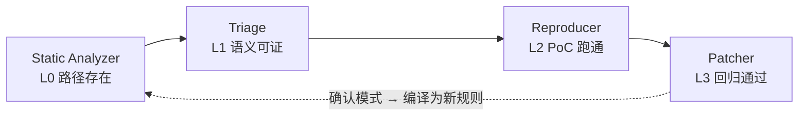
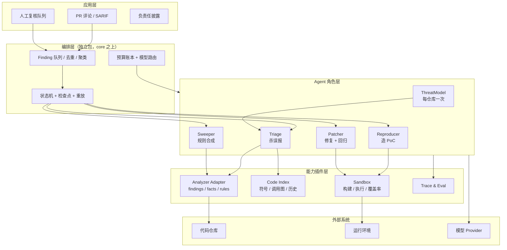
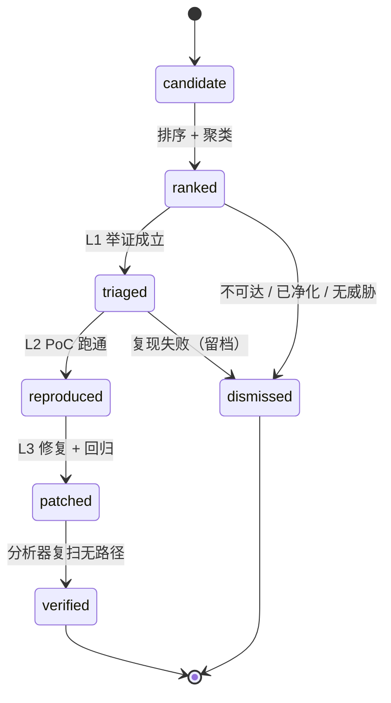

# Agent + 静态分析双引擎漏洞挖掘：架构设计报告

> 调研对象：OpenAI「A Thousand Fewer Paths to Root」——用 Agent 流水线在 Linux 内核中确认 948 个本地提权漏洞
> 本文定位：开源项目架构预研 · 设计草案（非教学篇）
> 所属方向：[程序分析学习大纲](./program-analysis-learning-outline.md)
> 关联项目：[Kern Agent Runtime](../../artificial-intelligence/agent/agent-kernel/readme.md)

## 📌 元信息

| 项目 | 说明 |
| --- | --- |
| 目标读者 | 作者本人；已具备程序分析与 Agent 运行时认知，不需要背景科普 |
| 输入假设 | 已有可运行的静态分析器，能够输出 finding 与数据流路径（语言待定） |
| 输出目标 | 一套可落地的架构：角色划分、数据契约、状态机、验证阶梯、评测与路线图 |
| 不覆盖 | 具体规则实现、沙箱镜像构建脚本、商业与合规细节 |
| 状态 | 设计草案，开工前需确认第 12 节的 5 个问题 |

## 0. 结论摘要

1. **Agent 不该负责「发现」**。静态分析器已经把发现做完了，且单位成本低 2~3 个数量级；Agent 只做三件事：杀误报、造可执行证据、把确认模式编译回规则。
2. **双引擎是双向闭环，不是串行拼接**。分析器产候选，Agent 产「确认的 finding + 可执行规则」，后者回灌分析器，下一轮更便宜、更准。这是唯一的复利来源。
3. **架构重心不是 Agent Loop，而是 Finding 状态机 + 验证阶梯**。每个 finding 是一个可恢复、可计费、可重放的 job，不是一段对话。
4. **没有可执行判定器的阶段不值得做**。OpenAI 74.7% 的复现率来自沙箱执行；3.1% 的脑补误报也是被「跑不起来」挡掉的。
5. **每份对外报告必须绑定它真实到达过的最高证据等级**。L0 路径存在不算漏洞，L2 PoC 跑通才算。
6. **开源卖点不是「AI 找漏洞」，而是「每条报告都自带可复现证据」**。这是 CodeQL / Semgrep / Snyk 目前给不了的差异点。

## 1. 案例拆解：948 个 LPE 是怎么来的

### 1.1 四段流水线

| 阶段 | Agent | 输入 → 输出 | 规模 / 耗时 | 成本 | 判定器 |
| --- | --- | --- | --- | --- | --- |
| 侦察 | Scout | 全量代码 → 高价值区域 | 4000 万行 → 280 万行（7%） | $3,426 | 人工抽检相关性 |
| 分析 | Analyst | 高价值区域 → 疑似漏洞 | 12 小时 → 2,308 条 | $316,000 | 无（纯生成） |
| 验证 | Triage | 疑似漏洞 → PoC + 运行结果 | 30 小时 → 1,724 条复现（74.7%） | 含在上阶段 | 沙箱里真的崩溃 |
| 利用 | ExploitDev | 崩溃 → 可利用性结论 | 291 信息泄露 PoC + 1,169 root Exploit → 合并变体 948 个 | $359/个 | 真的拿到 root |

总投入约 120 万美元，摊到每个确认漏洞约 $1,279。同期人类研究员一年能在内核里找到约 20 个同类漏洞。

### 1.2 数字背后的三个结构

- **漏斗每一级都在用更贵的算力换更确定的判断**：40M → 2.8M → 2308 → 1724 → 948。前两级是「便宜地缩小范围」，后两级是「昂贵地证明」。
- **执行是唯一可靠的过滤器**：2,308 条里 74.7% 能真实复现；模型逻辑脑补导致的彻底误报只有 3.1%。这两个数字说明生成端精度已经够用，瓶颈在验证吞吐。
- **变体合并是必需的收尾**：1,169 个 Exploit 合并成 948 个独立漏洞，说明不做聚类，报告数量会虚高 20% 以上。

### 1.3 可复用的六条

| # | 结论 | 在本项目中的映射 |
| --- | --- | --- |
| 1 | 窄角色 + 独立上下文 | ThreatModel / Triage / Reproducer / Patcher / Sweeper 五个角色，各自独立预算与工具集 |
| 2 | 每阶段一个可执行判定器 | 覆盖率命中、进程退出码、测试前后翻转、规则在历史语料上的 precision |
| 3 | 先便宜后昂贵 | 分析器全量跑，Agent 只处理排序后的头部候选 |
| 4 | 变体合并 | `clusterId` 聚合同 sink × 同模式 × 同模块的 finding |
| 5 | 意外发现要单独收口 | ExploitDev 曾用未分配的漏洞拿 root；需要 `incidental` 通道，而不是硬性约束 Agent |
| 6 | 模型升级 = 同语料重跑 | 流水线必须可重放：固定环境摘要、固定 seed、留全量 trace |

### 1.4 不可照搬的三条

| # | 现实差异 | 应对 |
| --- | --- | --- |
| 1 | 对方有定制网络安全模型，我们只有通用模型 | 用「窄任务 + 强约束 + 机械校验」补偿模型能力 |
| 2 | 对方有 120 万美元预算与大规模并行 | 用静态分析器替代 Scout/Analyst，把 Agent 调用量压到候选头部 |
| 3 | 内核的复现环境极重（编译、启动、提权链路） | 首个语言必须选「秒级起环境」的生态，先把闭环跑通 |

> 💡 最值得抄的不是「多 Agent」，而是「**每个阶段都有判定器 + 整个漏斗按成本排序**」。

## 2. 核心判断：两个引擎各自擅长什么

| 维度 | 静态分析器 | LLM Agent |
| --- | --- | --- |
| 单位成本 | 低，可全量跑 | 高，必须采样 |
| 覆盖方式 | 穷举、确定性 | 启发式、易漏 |
| 强项 | 语法结构、数据流、调用关系、规则一致性 | 语义意图、业务约束、部署上下文、跨文件推理 |
| 弱项 | 可达性、净化语义、业务前提、框架约定 | 幻觉、不可复现、上下文漂移 |
| 输出性质 | 「可能存在」的路径 | 「我认为」的结论 |
| 适合角色 | 候选生成器、事实层、规则执行器 | 判定器、复现器、修复器、规则作者 |

结论：

> **分析器负责「可能」，Agent 负责「确实」，规则库负责「下次别再问」。**

如果让 Agent 去扫描全仓，等于用最贵的组件做最便宜的事；如果让分析器直接产出对外报告，误报率会毁掉项目信誉。两者必须按「候选 → 判定 → 沉淀」的顺序耦合。

## 3. 总体架构



完整分层：



### 分层职责

| 层 | 职责 | 不应该做什么 |
| --- | --- | --- |
| 契约层 | Finding / Fact / Rule 三个 IR，状态枚举 | 不写业务逻辑 |
| 编排层 | 队列、状态迁移、并发、预算、重试、检查点 | 不感知具体漏洞类型 |
| 角色层 | 五个窄 Agent 的 prompt、工具集、判定标准 | 不直接操作仓库与网络 |
| 能力层 | 分析器适配、代码索引、沙箱、trace | 不决定流程 |
| 应用层 | SARIF、PR 评论、复核 UI、披露 | 不绕过状态机 |

### 与 Kern 的边界

这正是 [Kern 10 号文档](../../artificial-intelligence/agent/agent-kernel/doc/10-扩展能力与编排层.md) 所说的「core 之上的编排层」的第一个真实客户：

- 单 Agent run、事件流、钩子、Checkpointer 复用 core；
- 队列、状态机、多角色调度、预算路由放在独立 `@scope/graph` 或 `@scope/security-orchestrator` 包里；
- **安全领域知识只能以插件形式进入**：analyzer adapter、sandbox、prompt preset，不允许写进 core；
- 若不复用 Kern，这套分层仍然成立，只是需要自己实现 run 与 checkpointer。

## 4. 四份契约

先定契约，再写实现。契约冻结之前不要写 prompt。

### 4.1 Finding IR

```ts
type Rung = 0 | 1 | 2 | 3 | 4

type Evidence =
  | { kind: 'citation'; file: string; startLine: number; endLine: number; snippet: string }
  | { kind: 'exec'; argv: string[]; exitCode: number; stderrTail: string }
  | { kind: 'coverage'; sinkFile: string; sinkLine: number; hit: boolean }
  | { kind: 'test'; name: string; before: 'fail' | 'pass'; after: 'fail' | 'pass' }

interface Finding {
  id: string
  clusterId: string
  engine: 'static' | 'agent' | 'hybrid'
  ruleId: string
  cwe: string
  location: CodeLocation
  trace: TraceStep[]
  rung: Rung               // 只能等于真实到达过的最高等级
  evidence: Evidence[]     // 每一级都要留证，不允许口头结论
  status: FindingStatus
  budget: { tokens: number; usd: number; wallMs: number }
}
```

设计要点：

- `rung` 由证据推导，不由模型自评。没有 `exec` / `coverage` 证据就不可能到 L2。
- 引用证据必须机械校验：`file:line` 存在、片段能匹配、符号能解析。不匹配直接判为幻觉，不重试。
- `clusterId` 在进入 Triage 之前生成，同簇只判定代表样本。

### 4.2 状态机



每个状态都要持久化：输入、输出、证据、花费、耗时、模型与环境摘要。恢复时从最后一个稳定状态继续，不重跑已完成的阶段。

### 4.3 Fact IR

Agent 不应该读源码文本，而应该查事实。分析器需要暴露三类产物：

| 产物 | 内容 | 用途 |
| --- | --- | --- |
| Findings | 规则命中 + source→sink 路径 + 置信度 | 候选队列 |
| Facts | 符号表、调用图、入口点、路由与中间件、sanitizer 清单、配置项 | Triage 的可达性推理 |
| Rules | 可执行规则文本 + 目标 CWE + 来源 finding | Sweeper 回流 |

最小查询接口：

```ts
interface FactQuery {
  entrypoints(scope: Scope): Promise<Entrypoint[]>
  callers(symbolId: SymbolId, depth: number): Promise<CallEdge[]>
  reaches(from: SymbolId, to: SymbolId): Promise<Path | null>
  sanitizersBetween(from: Point, to: Point): Promise<SanitizerHit[]>
  config(key: string): Promise<ConfigValue[]>
}
```

这是整套架构里杠杆最高的一条：**事实层让 Agent 从「读文件」变成「问问题」**，上下文体积和幻觉率都会显著下降。

### 4.4 Rule IR

Agent 的第二种产出不是报告，是规则：

```ts
interface ProposedRule {
  engine: 'semgrep' | 'codeql' | 'ast-grep' | 'internal-dsl'
  source: string
  targetCwe: string
  derivedFrom: string[]        // 来源 finding id
  precision: { sample: number; confirmed: number }
}
```

验收标准：规则能被分析器直接执行、能在历史语料上跑出可解释的 precision、命中量在可复核范围内。自然语言描述的「模式」不算产出。

### 4.5 Sandbox 接口

```ts
interface Sandbox {
  provision(repo: RepoRef, revision: string): Promise<EnvHandle>
  run(env: EnvHandle, argv: string[]): Promise<RunResult>
  coverage(env: EnvHandle, runId: string): Promise<CoverageReport>
  destroy(env: EnvHandle): Promise<void>
}
```

约束：镜像 digest 固定、默认无外网、仓库只读挂载、CPU / 内存 / 时长硬限额、每次运行产出可归档日志。

## 5. 验证阶梯

| 等级 | 名称 | 证据形态 | 产生者 | 能否对外 | 相对成本 |
| --- | --- | --- | --- | --- | --- |
| L0 | 路径存在 | 规则命中 + 数据流路径 | 分析器 | ❌ 仅内部候选 | 极低 |
| L1 | 语义可证 | 引用行 + 调用链 + 威胁模型判断 | Triage | ⚠️ 只能作为「疑似」 | 低 |
| L2 | PoC 跑通 | 退出码 / 覆盖率命中 sink 行 / sanitizer 报告 | Reproducer | ✅ 可作为漏洞报告 | 中 |
| L3 | 修复验证 | 复现用例由 fail 变 pass + 回归通过 + 复扫无路径 | Patcher | ✅ 可作为修复建议 | 高 |
| L4 | 可利用性 | 绕过缓解措施后的权限 / 数据边界变化 | ExploitDev（默认关闭） | ❌ 不公开武器化细节 | 极高 |

规则：

- **报告等级 = 实际到达的最高等级**，不允许用模型置信度跨级。
- L4 默认关闭，且只在私有部署 + 明确授权下运行；开源仓库只接收 L0–L3 的贡献。
- L2 的判定不要只依赖「崩溃」。更便宜、更稳定的 oracle 是「**sink 行被覆盖 + 输入确实来自不可信源**」；崩溃只是其中一种表现。

## 6. Agent 角色设计

| 角色 | 输入 | 关键工具 | 判定器 | 模型档 | 触发频率 |
| --- | --- | --- | --- | --- | --- |
| ThreatModel | 仓库 + 构建/部署配置 | 路由解析、配置读取、依赖清单 | 人工抽检 | 强 | 每仓库一次（按 commit 缓存） |
| Triage | 同文件/同簇的一批 candidate | facts 查询、调用链、git blame | L1 引用校验 | 便宜 | 高频 |
| Reproducer | 单条 L1 finding + 环境句柄 | sandbox、覆盖率、编辑 | L2 执行结果 | 强 | 中频 |
| Patcher | 单条 L2 finding + 测试 | 编辑、测试、复扫 | L3 双向测试 | 强 | 中频 |
| Sweeper | 一批 L3 集群 | 规则生成、语料回放 | 规则 precision | 强 | 低频 |
| ExploitDev | L3 + 隔离靶机 | 调试、缓解绕过 | L4 权限变化 | 最强 | 默认关闭 |

### 6.1 ThreatModel（先建地图，再判个案）

每个仓库生成一次并缓存，产物是全仓库共享的上下文：

- 入口点：HTTP 路由、CLI 参数、消息队列、文件解析器、定时任务；
- 信任边界：鉴权中间件、租户隔离、内外网分区；
- 数据源：请求体、查询参数、Header、Cookie、上传文件、第三方回调；
- Sink 清单与框架约定：ORM、模板引擎、序列化、命令执行；
- 部署事实：是否公网、是否多租户、是否开启沙箱/转义。

没有这份共享上下文，每个 Triage job 都会重新推理「这个输入是不是攻击者可控」，既贵又不一致。

### 6.2 Triage（默认假设「不可利用」）

这是与「让模型找漏洞」最相反的设定：**Agent 的任务是推翻候选，而不是确认候选**。

- 输出只能是五选一：`exploitable / not-reachable / sanitized / needs-repro / out-of-scope`；
- 每条结论必须绑定 `file:line` 引用，引用由工具层机械校验；
- 不允许在这一步给修复建议（那是 Patcher 的职责，会污染判断）；
- 按文件或按簇批处理，一次 5–20 条，避免一条一 job 的固定开销；
- 优先用便宜模型：这是判别任务，不需要长链推理。

### 6.3 Reproducer（只认执行结果）

- 先用覆盖率确认 sink 可达，再构造最小输入；顺序不能反；
- PoC 必须是可归档的脚本/测试，不是自然语言步骤；
- 失败要留失败原因（环境、依赖、超时、输入不合法），供下一轮复用；
- 严禁在未复现的情况下进入利用或修复阶段。

### 6.4 Patcher（修根因，不修症状）

- 输出最小 patch + 根因说明；
- 双向验证：复现用例修复前 fail、修复后 pass；原有测试不回归；
- 修复后再跑一次分析器，确认原路径消失，而不是被新的 sanitizer 掩盖；
- 无法修复时输出「缓解建议 + 风险说明」，状态停在 L2。

### 6.5 Sweeper（把个案变成规则）

- 输入是一批已确认的同类 finding，输出是可执行规则；
- 规则先在历史语料上回放，precision 不达标就不入库；
- 入库后由分析器全量执行，Agent 不再逐条扫同类模式；
- 这是把「每次都要问模型」变成「一次问完，长期复用」的唯一机制。

## 7. 上下文与预算工程

1. **先排序再送模型**。排序信号：威胁模型相关性、source 可控性、sink 严重度、路径长度、代码变更热度、历史误报率。只送头部，长尾留给规则扫描。
2. **按文件/簇批处理**。同一文件的多条 finding 共享文件内容与调用链，batch 能把固定开销摊薄。
3. **事实查询优先于读文件**。只读函数体与必要上下文，不整文件灌入。
4. **共享 ThreatModel**。每仓库一份，按 commit + 配置哈希失效。
5. **引用机械校验**。这是最便宜的防幻觉手段：行号不存在、片段不匹配、符号解析失败，直接判幻觉。
6. **预算硬上限**。每个 job 设 token / 金额 / 墙钟上限，超出转「未决」而不是无限重试；主指标是 `$/confirmed finding`。
7. **模型路由**。判别用便宜模型，写代码与修复用强模型，规则合成低频用强模型。

## 8. 评测体系

没有评测集，就无法回答「换模型有没有变好」，也无法对外证明精度。

### 8.1 语料自动构造

- 取历史 CVE 的修复提交：**父提交是天然正样本，修复提交是天然负样本**；
- diff 提供漏洞位置与修复方式，可作为定位评测与 patch 评测的参照；
- 语料按语言、CWE、年份分层，避免只挑容易的样本；
- 参考公开数据集：CVEfixes、Vul4J、OWASP Benchmark、Big-Vul 系列。

### 8.2 指标

| 指标 | 定义 | 用途 |
| --- | --- | --- |
| recall@L2 | 语料中真实漏洞被复现的比例 | 能力上限 |
| precision@report | 对外报告中确认为真的比例 | 信誉底线 |
| $/confirmed | 平均每个确认漏洞的花费 | 成本模型 |
| time-to-confirm | 从候选到 L2 的墙钟时间 | 吞吐 |
| dup-rate | 合并变体后的重复率 | 报告质量 |
| agent-touch-rate | 每个确认漏洞触达 Agent 的次数 | 规则回流是否有效 |

### 8.3 可重放

同语料 + 同环境摘要 + 同 seed 必须能重现同一结果。环境摘要至少包含：镜像 digest、依赖锁文件哈希、模型版本、prompt 版本、工具版本。否则升级模型的对比没有意义。

## 9. 开源定位与安全边界

### 9.1 定位

> **Reproducer-first SAST：每条报告都自带一个能跑起来的证据。**

对比现有工具：

| 工具 | 产出 | 差异 |
| --- | --- | --- |
| ESLint / Semgrep | 模式命中 | 快，但无跨过程语义与可达性 |
| CodeQL | 声明式数据流查询 | 精度高，但需要人写查询，且仍停在「路径存在」 |
| Snyk / Dependabot | 已知依赖漏洞 | 不覆盖自有代码逻辑漏洞 |
| 本项目 | 候选 + 判定 + PoC + 修复 | 贵，但每条都可验证 |

开源可贡献的部分：角色 prompt、规则集、评测语料构造脚本、沙箱编排、SARIF 输出。这些恰好是别人最难自己拼起来的部分。

### 9.2 双用途边界

- 默认只做到 L3；L4 需要显式开关，且不发布武器化细节；
- 沙箱默认无外网，禁止对真实第三方目标执行；
- 披露走维护者优先流程，设定合理窗口；
- 公开仓库不接受「未修复的真实 0day」作为 issue，另设私有渠道。

## 10. 路线图

| 版本 | 范围 | 验收标准 |
| --- | --- | --- |
| v0.1 | 单语言 + 单漏洞类；分析器 → Triage → 人工复核；无沙箱 | 每条报告带可校验引用；人工复核 30 条，误报原因可解释 |
| v0.2 | Reproducer + 沙箱 + 覆盖率 oracle | 固定语料上至少 3 类漏洞能自动生成并跑通 PoC；复现率有基线数字 |
| v0.3 | Patcher + 双向测试 | patch 使复现用例 fail→pass，原测试不回归，复扫路径消失 |
| v0.4 | Sweeper + 规则回流 + 评测 harness | 新规则在历史语料上 precision 达标；同类漏洞的 Agent 触达次数下降 |
| v1.0 | 多语言 + CI/PR + SARIF + 披露流程 | PR 场景增量运行，单次评论在可接受时延内 |

> ⚠️ v0.1 不要接沙箱。先把「候选 → 语义判定 → 带证据的报告」跑通，否则会在环境适配上无限打转。

## 11. 明确不做

1. **不做万能安全 Agent**：一个 prompt 挂 30 个工具，必然贵且不稳定。
2. **不让 Agent 扫全仓**：那是分析器的活。
3. **不在 L2 之前写 exploit 或 patch**：顺序反了就会产出无法验证的文本。
4. **不用模型置信度替代证据**：置信度不可校准，证据可校验。
5. **不做无沙箱的「报告生成器」**：那只是更贵的 CodeQL。
6. **不把分析器事实全量塞进 prompt**：要用查询接口按需取。

## 12. 开工前要定的 5 件事

1. **分析器能力盘点**：是否已有稳定 finding ID、调用图、入口点、sanitizer 事实？没有的话先补 Fact IR。
2. **首个语言与漏洞类**：建议从「起环境成本最低」的生态开始；Node/TS 服务端的命令注入、路径穿越、SSRF、原型污染都是好起点。
3. **单 finding 成本上限**：决定模型档位、并行度、以及是否需要本地小模型做 Triage。
4. **是否复用 Kern**：复用则先确认 core 的 Checkpointer 与事件协议是否够用；不复用则先写最小状态机。
5. **双用途策略**：是否做 L4、是否接收真实 0day、披露窗口多长。这个决定会影响 README 的定位与社区预期。

## 参考资料

- [A Thousand Fewer Paths to Root（OpenAI）](https://openai.com/index/a-thousand-fewer-paths-to-root/)
- [CVEfixes](https://github.com/secureIT-project/CVEfixes)
- [Vul4J](https://github.com/prospr-lab/Vul4J)
- [OWASP Benchmark](https://github.com/OWASP-Benchmark/BenchmarkJava)
- [CodeQL 文档](https://codeql.github.com/docs/)
- [Semgrep 规则语法](https://semgrep.dev/docs/writing-rules/overview/)
- 本仓库：[程序分析学习大纲](./program-analysis-learning-outline.md) · [Kern Agent Runtime](../../artificial-intelligence/agent/agent-kernel/readme.md)
