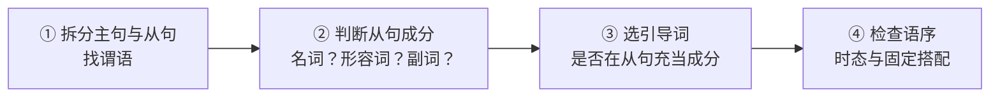

# Unit 02《从句体系》单元审查报告

> **第一册 · Unit 02** ｜ 审查日期：2026-10-13
> 审查对象：L01~L09 全部 9 讲（lesson.md + practice.md + lesson.json）与 [vocab-ledger.md](../vocab-ledger.md) 台账
> 审查基线：lesson-template 六节模板契约（v0.9）+ 第一册 readme 大纲规格 + 词汇台账规则

> 审查方法：逐讲通读 + 练习逐题换路径核验（约 110 个客观小题）+ `bun run validate` 实跑（通过 18 / 失败 0）+ 台账复现率交叉核对

---

## 0. 结论速览

**总评：9/10**（二审后，见 §8） —— 课程设计主线清晰、递进扎实，110 道客观题零答案错误、数据契约 18/18 通过，质量整体过关；P1 四项与 L07 减负已修，剩余 P2 已清（仅留 1 条迁移衔接项与 1 处「一句多问」有意保留）。

> **二审（2026-10-13）**：P1 四项已全部修复（表语/同位语补齐、L03-Q1 消歧、词群注释收口、L01 知识地图落位），L07 减负完成，并另清 5 项 P2 定点瑕疵，总评上调 **9/10**；其后 4 项 P2（讲内素材查重、应试口径软化、L02 口诀补全、拓展项落位）已全部清掉，仅留 1 条迁移衔接项与 1 处有意保留的「一句多问」，详见 [§8 复审记录](#8-复审记录2026-10-13-二审)。

| 三问 | 结论 |
|------|------|
| **设计是否合理？** | 主线合理：每讲交付一个可复用的判定工具（提问法 → 缺成分判定 → 还原介词法 → 删从句测试 → 盖住主句法 → 合并三法）。两个结构性问题：① 名词性从句四座位只坐满两个（表语/同位语缺位）；② L07 信息密度失衡（1 讲装 9 类连词 + 6 组辨析 + 主将从现 + 12 新词）【二审均已修：补表语 / 同位语 + L07 减负】 |
| **是否循序渐进？** | 成立，且是强项。知识链逐讲承接、练习难度递增无倒挂、旧词复现率 16%→33% 逐讲走高，L08 综合串联达标 |
| **质量是否过关？** | 过关。答案正确性零 P0、格式契约全合规、语法表述抽查均正确；瑕疵集中在命题严谨性（1 处双解）与讲内素材查重【双解已消；素材查重已清】 |

---

## 1. 单元知识地图（建议在 L01 开头补「大纲概览」）

**现状**：L01 目前只有 §3.2 末尾的「引导词总览（只做识别预览）」小表，**缺少一张贯穿全单元的知识地图**。学习者进入 9 讲长线之前，看不到「从句一共几类、每类解决什么问题、最后收口到哪」的全景。建议在 L01 课文精读之前（或小节开头）以下面这张地图作**先行组织者**（advance organizer），并在 L08 综合实战处回头对照打勾收口。

> 覆盖标记：✅ = 本单元已系统讲解 ｜ 🔶 = 提到但未展开（需补讲或补定义）｜ ⬜ = 超出本单元范围（建议标注「后续单元展开」或补为拓展框）

### 一、名词性从句（句子 = 名词，做主 / 宾 / 表 / 同位）

- **引导词**
  - that：无义、不作成分，只连接 ✅（L05 / L06）
  - whether：是否，不作成分（表语从句不用 if）🔶（「主语从句不用 if」L06 已讲；表语从句本身缺位）
  - wh- 词（what / who / where…）：**在从句充当成分** ✅（L06 what 双重身份）
- **4 类**
  - 主语从句：做主句主语｜it 形式主语 ✅（L06）
  - 宾语从句：动词 / 介词后｜陈述语序 ✅（L05）
  - 表语从句：系动词后（be / seem）🔶（L09 骨架②已在用，但无定义卡 —— P1 项）
  - 同位语从句：解释抽象名词内容（fact / news / idea）⬜（全单元缺位 —— P1 项）
- **易错**：that 不做成分；what 必须做成分（主 / 宾 / 表）✅

### 二、定语从句（句子 = 形容词，修饰先行词【名词】）

- **关系代词**（从句做主 / 宾 / 定）
  - that：人 + 物；作宾可省 ✅（L02）
  - which：物；介词 + which ✅（L02 / L03）
  - who / whom：人；who 主，whom 宾 ✅（L02）
  - whose：……的（定语）✅（L02）
- **关系副词**（从句做状语，不做主宾）
  - when = on / in which（时间）✅（L03）
  - where = in / at which（地点）✅（L03）
  - why = for which（原因）✅（L03）
- **两种类型**
  - 限制性：无逗号，去掉主句意思不全 ✅（L04）
  - 非限制性：逗号隔开；❌ 不能用 that，不能省引导词 ✅（L04）
- **高频考点**
  - 只用 that：不定代词、最高级、序数词、**the only**、人和物共用先行词 ✅（L02 口诀已扩为「最、第、不定、唯一、混合」，补入 the only / the very —— 二审已补）
  - as：as we know / as is known ✅（非限制性 as 指代整句，已在 L04 §3.4 末尾补拓展框 —— 二审已补；本单元只作「认识即可」的拓展，不设练习）
- **区分**：同位语从句 that 不做成分；定语从句 that 要做成分 ✅（已在 L06 §3.7 随同位语从句一并交付，含两条独立依据链 —— 二审已补）

### 三、状语从句（句子 = 副词，修饰动词 / 整句，9 类逻辑）

- 时间：when / while / as / before / until / since / as soon as｜while + 延续动词；主将从现 ✅（L07；since 表「自从」义已在 §3.2 九类表补入「时间」类并加两义补注 —— 二审已补）
- 条件：if / unless / as long as｜主将从现 ✅（L07）
- 原因：because（答 why）/ since / as / now that　❌ because 不和 so 连用 ✅（L07；now that 已补入 §3.2 九类表「原因」类 —— 二审已补）
- 让步：though / although / even if / while　❌ 不和 but 连用；as 倒装 ✅（although / though / even if / despite ✅；as 倒装「Tired as he was」已在 §3.2 补注中标注「留待后续单元展开」—— 二审已补）
- 结果：so…that（so + adj / adv）；such…that（such + 名词短语）✅（L07 表内已列两者，课文只示范 so…that）
- 目的：so that / in order that（常搭配情态动词 can / may）✅（L07）
- 地点：where（≠ 定语从句 where，无先行词）✅（L07）
- 比较：than / as…as ✅（L07）
- 方式：as / as if ✅（L07）

### ✅ 解题步骤（单元级方法论，与 L08 拆解三步同构）

### ⚠️ 高频易混（与各讲陷阱框一一对应）

| 易混点 | 判定 | 承载讲次 |
|--------|------|---------|
| what vs that | what 在从句做成分；that 只连接无意义 | L06（还原验证法） |
| where | 定语从句 👉 前面有先行名词；名词性 / 状语从句 👉 无先行词 | L03（还原介词法）+ L07 |
| 主将从现 | 时间、条件状语从句（谈将来从句用一般现在） | L07（U01-L05 预埋） |
| because / so、although / but | 一个分句只留一个引导词 | L01 陷阱二 → L07 → L08 回收 |

### 地图与单元覆盖的差异清单（写图时发现，已并入改进建议）

1. **表语从句、同位语从句缺位**（地图一 · 4 类中的两个座位）→ P1-1【已修，见 §8.1 P1-1】
2. **the only / the very** 不在 L02「只用 that」口诀中 → P2-8【已修（P2-9）：口诀由「最、第、不定、混合」扩为「最、第、不定、唯一、混合」，并补入 the only / the very（唯一性修饰语）与例句 the only fix that worked】
3. **as 引导非限制性定语从句**（as we know / as is known）未覆盖 → P2 建议（L04 拓展框或标注后续单元）【已修（P2-11）：L04 §3.4 末尾新增拓展框「as 也能指代整句」，含 as we know / as is known 等固定搭配与与 which 的分工】
4. **now that、as 倒装让步、since 表「自从」** 不在 L07 九类表内 → P2 建议（补入或标注拓展）【已修（P2-11）：L07 §3.2 九类词表格「时间」类补 since、「原因」类补 now that，并在表下新增「三处补注」tip（since 两义：自从→时间 / 既然→原因；now that 归原因；让步的 as 倒装标注「留待后续单元展开」）】
5. 地图「what 必须做主宾」宜写全「主 / 宾 / 表」三格（what 也可作表语：This is what I mean）【已修：L01 提问法表现写「名词（主语 / 宾语 / 表语 / 同位语）」】

---

## 2. 格式规范度（对照 lesson-template 契约）

| 规范要求 | L01 | L02 | L03 | L04 | L05 | L06 | L07 | L08 | L09 |
|----------|:--:|:--:|:--:|:--:|:--:|:--:|:--:|:--:|:--:|
| 六节模板齐全 + 头部元信息 | ✅ | ✅ | ✅ | ✅ | ✅ | ✅ | ✅ | ✅ | ✅ |
| 课文词数红线（常规 ≤130 / 对话 ≤150 / 实战 ≤150） | ✅ 106 | ✅ 105 | ✅ 109 | ✅ 99 | ✅ 148 | ✅ 128 | ✅ 108 | ✅ 149 | ✅ 111 |
| 词汇表 10~14 且台账零重复入账 | ✅ 12 | ✅ 12 | ✅ 12 | ✅ 12 | ✅ 12 | ✅ 11 | ✅ 12 | ✅ 12 | ✅ 特例 4 |
| 输出环节三件套（含参考起点 + 自检法） | ✅ | ✅ | ✅ | ✅ | ✅ | ✅ | ✅ | ✅ | ✅ |
| 练习分层 + 文末答案分离（无 HTML 折叠） | ✅ | ✅ | ✅ | ✅ | ✅ | ✅ | ✅ | ✅ | ✅ |
| 客观题题数 ↔ 答案一一对应 | ✅ | ✅ | ✅ | ✅ | ✅ | ✅ | ✅ | ✅ | ✅ |
| 选择题契约（4~6 题 / 解析给依据） | ✅ 6 | ✅ 6 | ✅ 6 | ✅ 6 | ✅ 6 | ✅ 6 | ✅ 6 | ✅ 6 | ✅ 6 |
| 复现率达标（台账脚本复算） | ✅ 16% | ✅ 21% | ✅ 17% | ✅ 24% | ✅ 17% | ✅ 22.5% | ✅ 21% | ✅ 24% | ✅ 33% |
| 词群注释「并入 L09」与实际兑现一致 | ✅ | ✅ | ✅ | ✅ | ✅ | ✅ | ✅ | ✅ | — |
| lesson.json 与 md 对账（validate 实跑） | ✅ | ✅ | ✅ | ✅ | ✅ | ✅ | ✅ | ✅ | ✅ |

---

## 3. 课程设计与循序渐进评估

**骨架**：总览建框架（L01 提问法三分）→ 定语从句三连讲（缺成分判定 → 还原介词法 → 删从句测试）→ 名词性两讲（宾语语序 → 主语 + what 双重身份）→ 状语一张表（L07）→ 综合收口（L08 合并三法 = 拆解三步的逆运算）→ 词群产出（L09）。

**递进证据**：

- 知识递进：前一讲的工具总能在后一讲复用 —— L08 拆解三步的第三步直接调用 L01 提问法收口；L06 3.5 显式承接 L05 语序陷阱；L07 主将从现在 U01-L05 预埋后正式扩展。
- 练习递进：L01 单点识别 → L02~L07 单类专项 + 陷阱 → L08 十从句逐个标注 + 跨讲综合改错（29 题最重）→ L09 词群产出 + 段落写作，难度无倒挂（唯一微瑕：L09 客观题以词形填空为主、语法难度略低于 L08，由段落写作补偿）。
- 复现递进：旧词复现率 16% → 21% → 17% → 24% → 17% → 22% → 21% → 24% → 33%，每讲「课文复现自查」数字与台账逐项对得上，可审计。

**两个结构性问题**：

1. **名词性从句覆盖不全**：L05 明说「名词性从句有四个座位……另外三个座位留到 L06」，但 L06 只讲主语从句。表语从句在 L09 被直接消费（骨架②「观点名词 + 表语从句」）却无定义卡，违反「先定义后使用」红线；同位语从句全单元缺位，导致 L09 升级讲搭配 `the fact that…` 只能当固定搭配死记，也无法讲清「同位语从句 that 不做成分 vs 定语从句 that 要做成分」这条经典辨析。
2. **L07 密度失衡**：定语从句用了 3 讲，状语从句 1 讲要装九类连词 + 六组辨析 + 主将从现 + 12 个新词，标称 60 分钟大概率超载。建议把让步 / 结果两组辨析挪到 L08 混练。

---

## 4. 逐讲亮点与不足（⭐评分）

#### [L01 从句总览](L01-从句总览/lesson.md) ⭐⭐⭐⭐

**亮点**：提问法三分表 + 三步操作，第一讲就交付贯穿全单元的判型工具；「why ≠ 状语」「because 与 so 不同框」两个陷阱前置。
**不足**：缺全单元知识地图（见 §1）；练习答案 2.2 替换测试示例 `When the cache is cold → in cold weather` 与原句语义不符，破坏「替换后句意不变」的检验逻辑；词群注释称 5 词「并入 L09 搭配网」，实际只有 point 兑现。【均已修：§3.2 补知识地图 + 命名桥 + 句类坐标；答案 2.2 改为 with a cold cache；词群注释按实际兑现改写】

#### [L02 定语从句 I · 关系代词](L02-定语从句I-关系代词/lesson.md) ⭐⭐⭐⭐

**亮点**：「缺成分判定法」三步 + 还原验证法（everyone trusts **her** 成立 → 缺宾语），关系词选择从背诵变成可推导；「最、第、不定、混合」口诀干净。
**不足**：练习 Q3.4 / Q5.4 把「最高级后用 which」判为「不合规范用法」过于绝对（描述语法下合法），宜软化为「应试 / 规范优先 that」；「只用 that」口诀缺 the only / the very；`take a ticket` 搭配略生硬。【均已修（P2-8 / P2-9）：Q3.4 改应试口径（「本册取应试口径『受限先行词优先 that』；描述语法里 which 在现代英语中并非错误，只是考试与规范写作一律选 that」）；口诀由「最、第、不定、混合」扩为「最、第、不定、唯一、混合」并补入 the only / the very 与例句 the only fix that worked；lesson.md 3.3 表格行 / 口诀框 / §6 检查清单、practice.md 答案 3.4 与 5.4、lesson.json 四处同步】

#### [L03 定语从句 II · 关系副词](L03-定语从句II-关系副词/lesson.md) ⭐⭐⭐⭐

**亮点**：还原介词法 + 「介词跟搭配走」（sit **in** the office → in which），讲清 where ≠ 永远 in which；time 作宾语 vs 作状语对照表是全单元最好的陷阱设计之一。
**不足**：练习 Q1 选项含 that 且要求单选，第 2/3 题 `the night that…` / `the reason that…` 现代英语中 that 可作关系副词 → 双解（P1）【已修】；`…felt endless` 同句在 Q1.4 / Q2.2 复用【更正：经复核此判断不成立 —— Q1.4 `The hour we spent on the rollback felt endless.` 与 Q2.2 `The two hours which the dashboard stayed red felt endless.` 是两个不同的句子，仅共享谓语 felt endless，不属同句复用；本讲真正的同句复用是 Q1.2 / Q4.2，已修（P2-7）：Q4.2 载体句换为 `I still remember the moment when the traffic suddenly doubled.`，原考点不变，md 与 lesson.json 同步】。

#### [L04 定语从句 III · 限制与非限制](L04-定语从句III-限制与非限制/lesson.md) ⭐⭐⭐⭐⭐

**亮点**：「身份证 vs 旁注」比喻 + 删从句测试 + 拆两句法，三大特征（逗号 / 无 that / 不省略）收在一句话里；用「删了一个逗号导致评审失败」的事故串起语法点。
**不足**：`explain the why` 为非标准表达（课文与练习同款），基础阶段建议加注脚【已加注脚】；答案 1.4「删掉后句义不变」可精确为「主句命题不变、从句仅补充」【未修（P2-10 精确化建议，保持未做）】；as 指代整句可作拓展框补入。【已修（P2-11）：§3.4 末尾已补拓展框「as 也能指代整句」，含 as we know / as is known 等固定搭配与与 which 的分工】

#### [L05 名词性从句 I · 宾语从句](L05-名词性从句I-宾语从句/lesson.md) ⭐⭐⭐⭐

**亮点**：whether 三条铁律 + 「盖住主句法」可操作性极强；对话体课文里 that / if / whether / wh- 四种引导词自然分布，时态呼应两连句（said → was vs said → catch）对照清晰。
**不足**：「另外三个座位留到 L06」的预告未兑现【已修：L06 补齐表语 / 同位语，预告措辞改写】；练习 Q6.2 要求 will → would 的判定建议补「应试口径」说明（backshift 现代英语可选）；`good tests always catch this kind of bug` 在 Q3.3 / Q6.4 重复出题。【均已修（P2-8 / P2-7）：Q6.2 补 backshift 说明（「若测试在说话时尚未发生，现代英语保留 will 也成立；本册按应试口径统一改 would」）；同句复用 Q6.4 载体句换为 `He said that the API always returns the same error.`，原考点不变；两处 md 与 lesson.json 同步】

#### [L06 名词性从句 II · 主语从句](L06-名词性从句II-主语从句/lesson.md) ⭐⭐⭐⭐

**亮点**：what = the thing(s) that 还原验证法 + `That he said` ❌ 对照，把 what / that 分工讲成判定程序；it 形式主语「减肥」处理自然。
**不足**：练习 Q5 答案分布 **A/B/A/A/A/B**（C / D 全空），全套唯一明显过度聚集的题块【已修：改为 C/B/A/D/C/B】；`What matters…` 句式在 Q1.4 / Q4.2 / Q6.1 三用【已修（P2-7）：按「换掉同考点复用」口径换掉一组载体句（`Whether the fix holds remains to be seen.` → `Whether the migration succeeds remains to be seen.`），原考点不变，md 与 lesson.json 同步；Q1.3 / Q3.1 属「考点不同、仅载体撞句」，有意保留】；depend / remain / matter / deserve 声称并入 L09 搭配网未兑现。【已修】

#### [L07 状语从句 · 九类连词](L07-状语从句-九类连词/lesson.md) ⭐⭐⭐⭐

**亮点**：九类一张表 + 「从句在回答什么问题」归类法与 L01 提问法同构；unless / although / because 三个「不同框」陷阱收拢干净。
**不足**：信息密度全单元最高（见 §3 问题 2）【已修：六组 → 四组，两组迁 L08 §3.4 并配混练题组 8】；练习答案 2.3 把让步从句的将来时也称「主将从现」（该术语严格限时间 / 条件从句），结论对、口径应软化【按全单元一致性判可不改，见 §8.1】；now that / since 自从义未收录。【已修（P2-11）：§3.2 九类词表格「时间」类补 since、「原因」类补 now that，表下新增「三处补注」tip（since 两义：自从→时间 / 既然→原因；now that 归原因；让步的 as 倒装标注「留待后续单元展开」），md 与 lesson.json 同步；另同句复用 Q4.1 载体句已换为 `Unless the code review passes, we will not deploy.（原考点不变）`，Q1.5 / Q3.4 属「考点不同、仅载体撞句」，有意保留】

#### [L08 综合实战 · 长句合并与拆解](L08-综合实战-长句合并与拆解/lesson.md) ⭐⭐⭐⭐

**亮点**：合并三法 = 拆解三步的逆运算，收口设计漂亮；两组长句实跑示范（3 谓语 / 4 谓语 + 省略关系代词的双层嵌套）是真正的综合验收；跨讲陷阱全部回收。
**不足**：练习 Q5.6 选项 C 笔误 `sessions sessions`；Q6.1 备选答案 `…every incident last quarter` 有 last quarter 悬挂歧义【均已修】；outline / arrange / adjust / polish / verify 声称并入 L09 观点句搭配网，与 L09 实际内容对不上。【已修】；另本讲同句复用（Q1.4 / Q1.8）经复核属「考点不同、仅载体撞句」，按 P2-7 口径判为可接受、有意保留。

#### [L09 高频词群实战 II · 观点句词群](L09-高频词群实战-观点句词群/lesson.md) ⭐⭐⭐⭐

**亮点**：两大骨架（观点动词 + 宾语从句 / 观点名词 + 表语从句）+「先观点后证据」三步成段，把词汇课教成产出课；升级讲专区完全符合台账边界规则；`I do not think that proves…` 的 that 指代解析相当精细。
**不足**：「表语从句」术语先用后定义（全单元无定义卡）【已修：L06 §3.6 已给定义卡】；讲内素材重复最重 —— `In case the review needs evidence…` 三现、`My point is that we should act now` 四现，练习效度打折。【已修（P2-7）：按「换掉同考点复用」口径换掉同考点载体句（Q6.3 `In case the review needs evidence, I will present the logs.` → `In case the pipeline breaks, I will roll back the release.`），原考点不变，md 与 lesson.json 同步。残留（有意保留、不修）：`In case the review needs evidence, I will present the logs.` 仍同作 Q2.3 的题干与 Q3.4 改错题的答案句 —— 两题考点不同（骨架识别 vs in case 从句时态），按「考点不同、仅载体撞句」口径判为可接受；且其错误变体被本讲讲解 §3.4「常见错误对照表」引用，改动会牵动讲解正文，故有意保留；另 Q2.4 / Q3.3 / Q4.4 亦属考点不同、有意保留】

---

## 5. 整体评价表

> 以下为二审后口径（修复前基线见 §8.1 的核验表）。

| 维度 | 评分 | 说明 |
|------|:--:|------|
| 格式规范性 | 10/10 | 六节模板、词数红线、词汇表配额、答案分离、复现自查全合规，原扣分项（词群注释兑现性）已修 |
| 内容正确性 | 9/10 | 110 客观题零答案错误（逐题核验）；口径软化已完成（L02-Q3.4 / L05-Q6.2 均按应试口径注明描述语法空间） |
| 能力导向性（输出与实战） | 9/10 | 每讲输出三件套 + 参考起点 + 自检判定法，「写得出」验收可操作；L06 输出与自检已覆盖新增的表语 / 同位语 |
| 知识覆盖度 | 9/10 | 表语 / 同位语已补齐、L01 知识地图已落位；拓展项（as 定语从句 / now that / since 自从）已落位 |
| 渐进式学习 | 10/10 | 工具链逐讲承接、练习难度递增、L08 综合串联达标、复现率逐讲走高；各讲回收桥接段接通主线、L07 减负完成 |
| 练习与评测质量 | 9/10 | 双依据链解析、分层清晰；L03 双解、L06 分布、L08 笔误与歧义已修；讲内素材查重已清（换掉 5 组同考点复用） |
| **总评** | **9/10** | **设计、递进与格式均达标，P1 四项、L07 减负与 4 项 P2 均已收口；仅留 1 条迁移衔接项（L07 练习解析标注出处）与 1 处有意保留的「一句多问」，不影响交付** |

---

## 6. 改进建议（P0 → P1 → P2）

> P0 = 正确性问题 ｜ P1 = 规范与结构问题 ｜ P2 = 小瑕疵
> 以下为修复前基线清单；各项修复状态逐条标注，核验详情见 §8.1。

**P0：无。** 答案逐题核验零错误，数据契约 18/18 通过，无照抄即错内容。

### P1（3 项）

1. **[P1] 补齐名词性从句的表语 / 同位语两个「座位」**：L05 预告「另外三个座位留到 L06」未兑现，L09 直接使用未定义的「表语从句」。建议：L06 增加一节表语从句（The fact / point is that…，正好为 L09 骨架②铺路），同位语从句用 `the fact that…` 与表语从句对照讲清（并顺手交付「同位语从句 that 不做成分 vs 定语从句 that 要做成分」辨析）；或最小改法 —— 修 L05 预告措辞 + L09 补「表语从句」定义卡。【已修，见 §8.1】
2. **[P1] 消除 L03-Q1 命题歧义**：`practice.md` Q1 选项含 that 且要求单选，第 2/3 题现代英语 that 可作关系副词 → 双解。题干注明「按还原介词法只选关系副词」，或将 that 换成 which。【已修，见 §8.1】
3. **[P1] 修正词群「并入 L09 搭配网」的承诺**：L01（describe / replace / split / connect）、L04（include / avoid / punctuation / clarify）、L06（depend / remain / matter / deserve）、L08（outline / arrange / adjust / polish / verify）的注释都指向 L09，但 L09 只深挖 fact / issue / point / case + suggest / show / argue / prove。二选一：注释改为「为后续词群课铺垫」的泛指措辞；或 L09 升级讲扩容这些词。【已修，见 §8.1】
4. **[P1] 在 L01 补全单元知识地图**：即本报告 §1 的地图（先行组织者），9 讲学完后在 L08 处对照打勾收口。【已修，见 §8.1】

### P2（8 项）

5. **[P2] L08-Q5.6 笔误**：`sessions sessions` 重复（practice.md L74），应修。【已修】
6. **[P2] L06-Q5 答案分布重排**：4A + 2B、C / D 全空，调整 1~2 题选项顺序。【已修】
7. **[P2] 讲内素材查重**：L09 同句最多 4 现（`In case…` ×3、`My point is that…` ×4），L03 / L05 / L06 / L07 / L08 各有同句两用，建议至少换一半素材。【已修（P2-7）：按「换掉同考点复用」口径共换 5 组（L03 Q4.2、L05 Q6.4、L06 Q6.3、L07 Q4.1、L09 Q6.3 载体句各换新，原考点不变），md 与 lesson.json 同步，validate 通过 18 / 失败 0；另 L07 Q1.5/Q3.4、L09 Q2.4/Q3.3/Q4.4、L08 Q1.4/Q1.8、L06 Q1.3/Q3.1 属「考点不同、仅载体撞句」，有意保留】
8. **[P2] 3 处口径软化**：L02-Q3.4 / Q5.4（最高级后 which）、L05-Q6.2（间接引语 backshift）、L07 答案 2.3（让步从句称「主将从现」）—— 结论均对，措辞从「不合规范」改为「应试优先」并注明描述语法空间。【已修（其中 L07 答案 2.3 的口径按全单元一致性判可不改）：L02-Q3.4、L05-Q6.2 已改应试口径并 md + lesson.json 同步】
9. **[P2] L02「只用 that」口诀补 the only / the very**：现口诀「最、第、不定、混合」四类，考纲常考的 the only 一类缺位。【已修：口诀扩为「最、第、不定、唯一、混合」，补 the only / the very（唯一性修饰语）与例句 the only fix that worked】
10. **[P2] 零星修缮**：L01 答案 2.2 替换示例换同类状语；L04 `explain the why` 加注脚；L08-Q6.1 消除 last quarter 悬挂歧义。【已修】
11. **[P2] 知识地图中的拓展项落位**：as 引导非限制性定语从句（L04 拓展框）、now that / since 自从义（L07 九类表补注）、as 倒装让步（标注后续单元展开）。【已修：L04 §3.4 末补「as 指代整句」拓展框；L07 §3.2 九类表补 since / now that 并加「三处补注」tip，as 倒装让步标注留待后续单元展开；md 与 lesson.json 同步】
12. **[P2·设计建议] L07 减负**：把六组辨析中的让步 / 结果两组挪到 L08 混练，L07 标称 60 分钟才立得住。【已修】

---

## 7. 总体结论

这套《从句体系》在**设计层面**是全书方法论最清晰的单元之一 —— 每讲交付一个可复用的判定工具，L08 用「合并 = 拆解逆运算」完成收口，递进关系经得起推敲；**执行层面**格式契约、台账一致性、答案正确性三项硬指标全部达标（答案零错误、复现率可审计、数据契约实跑通过）。真正的短板不在错漏而在**收口完整性**：名词性从句四个座位只坐满了两个，L09 提前消费了「表语从句」概念却没有教学支撑；同时全单元缺一张先行组织者级别的知识地图。把 P1 四项修掉（补表语 / 同位语、L03-Q1 消歧、词群承诺收口、L01 补地图），本单元即可达到可直接交付的水平。

---

## 8. 复审记录（2026-10-13 二审）

> 复审方式：全部 diff 逐项核对 + `bun run validate` 回归（通过 18 / 失败 0；L06 同步 11 句、L08 同步 8 题组 41 题）+ 新增内容语法核验。**二审总评：9/10。**

### 8.1 修复清单核验

| 原建议 | 状态 | 核验结果 |
|--------|:--:|---------|
| P1-1 补表语 / 同位语从句 | ✅ 已修 | L06 新增 §3.6 表语从句（定义卡 + whether 不用 if + 与形式主语区分 + reason is because 陷阱）与 §3.7 同位语从句（定义卡 + 「同位语 that 不作成分 vs 定语从句 that 要作成分」双依据辨析 + 抽象名词限制）；课文补 2 句载体句（The point is that… / The fact that we shipped late…），L05 预告措辞、readme 学习目的同步改写。新增内容语法核验正确 |
| P1-2 L03-Q1 命题消歧 | ✅ 已修 | 题面补「按还原介词法只填标准关系副词」注释，答案 2/3 逐题加「that 亦成立、本组以 when / why 为标准答案」说明，双解空间收干净 |
| P1-3 词群注释收口 | ✅ 已修 | L01 / L04 / L05 / L06 / L07 / L08 六处注释全部改为「先混个脸熟」+ 如实注明哪些词进了 L09 升级讲（point / fact / issue / case）、哪些是阅读词汇，承诺与兑现一致 |
| P1-4 L01 补单元知识地图 | ✅ 已修 | L01 §3.2 新增知识地图表（三类从句 × 提问 × 词性 × 各讲落点）+「命名桥」（形容词性 / 副词性从句）+ 句类坐标（简单 / 并列 / 复合句，复合句定义留待 L08）；L02~L07 / L09 各加「回收 L01 提问法」桥接段，地图与逐讲形成闭环 |
| P2-12 L07 减负 | ✅ 已修 | §3.3 六组辨析 → 四组，让步 / 结果两组迁至 L08 §3.4（含 such…that 补全、so / such 分工判别法），并配套新增 L08 练习题组 8「让步与结果辨析混练」5 小题（含 ✓ 陷阱项，题干按「判断 N 处正误」规范命题），答案双依据链完整、逐题核验正确 |
| P2-9 L02 口诀补 the only | ✅ 已修 | 口诀由「最、第、不定、混合」扩为「最、第、不定、唯一、混合」，并补入 the only / the very（唯一性修饰语）与例句 the only fix that worked；L02 lesson.md 的 3.3 表格行 / 口诀框 / §6 检查清单、practice.md 答案 3.4 与 5.4、lesson.json 对应四处同步 |
| P2-5 L08-Q5.6 笔误 | ✅ 已修 | 直接删掉重复词会让该选项变成另一种合法合并（The team rebuilt the cache that stores sessions），反而制造双解 → 改为逗号后用 that（非限制性定语从句禁用 that，L04 规则）作干扰项，解析同步写明错因；practice.md 与 lesson.json 同改 |
| P2-6 L06-Q5 答案分布 | ✅ 已修 | 重排第 1、4、5 题选项顺序 → **C/B/A/D/C/B**（A1 B2 C2 D1），解析里引用的选项字母同步改；选项顺序与答案字母经 validate 的选择题对账校验 |
| P2-7 讲内素材查重 | ✅ 已修 | 按「换掉同考点复用」口径换掉 5 组中每题的后一处载体句：L03 Q4.2 → `I still remember the moment when the traffic suddenly doubled.`；L05 Q6.4 → `He said that the API always returns the same error.`；L06 Q6.3 → `Whether the migration succeeds remains to be seen.`；L07 Q4.1 → `Unless the code review passes, we will not deploy.`；L09 Q6.3 → `In case the pipeline breaks, I will roll back the release.`。新句保持原考点，md 与 lesson.json 同步，`bun run validate` 通过 18 / 失败 0；L07 Q1.5/Q3.4、L09 Q2.4/Q3.3/Q4.4、L08 Q1.4/Q1.8、L06 Q1.3/Q3.1 属「考点不同、仅载体撞句」，判为可接受、有意保留 |
| P2-8 口径软化 | ✅ 已修 | L02-Q3.4 改为应试口径（「本册取应试口径『受限先行词优先 that』；描述语法里 which 在现代英语中并非错误，只是考试与规范写作一律选 that」）；L05-Q6.2 补 backshift 说明（「若测试在说话时尚未发生，现代英语保留 will 也成立；本册按应试口径统一改 would」）；两处 md + lesson.json 同步。L07 答案 2.3 的「主将从现」表述因 L07 §3.4 定义卡本身把让步从句纳入该术语、全单元口径已统一，此项**按一致性判可接受**，不改 |
| P2-10 零星修缮 | ✅ 已修 | L01 答案 2.2 改为 `with a cold cache`，并点明原示例 `in cold weather` 把「缓存冷」偷换成「天气冷」；L04 §1 关键句解析加注 `the why` = the reason（正式写作建议换 the reason）；L08-Q6.1 删掉 last quarter 悬空的备选答案，改为说明为何首选另一种合并 |
| P2-11 拓展项落位 | ✅ 已修 | ① L04 §3.4 末尾新增拓展框「as 也能指代整句」（含 as we know / as is known 等固定搭配、与 which 的分工）；② L07 §3.2 九类词表格「时间」类补 since、「原因」类补 now that，并在表下新增「三处补注」tip：since 两义（自从→时间 / 既然→原因）、now that 归原因、让步的 as 倒装标注「留待后续单元展开」。md 与 lesson.json 均已同步 |

### 8.2 二审新发现（均为 P2 级）

> 复核说明：第 1、2 条属**有意的设计取舍**而非缺陷 —— 第 1 条是有意贴着词数红线走（补句只引入 1 个新词形 shapes，其余复用已入账词，故词数涨而复现率不降）；第 2 条是刻意不改目录名，以避免 L05「下一讲」链接、readme 路径与 wikilink 的连带涟漪，属独立的重命名任务。第 3 条为待办衔接项。

1. **L06 课文贴线**：补句后 128 词，距常规讲红线 130 仅剩 2 词余量，后续再增句需先删句。
2. **L06 目录名滞后**：目录仍为 `L06-名词性从句II-主语从句`，与新标题「主语、表语与同位语从句」不一致（改名需连带改各处链接，可暂缓，或仅在 readme / 首页标注别名）。
3. **L07 练习与迁移内容的边界**：Q3.1（despite 接续）、Q3.4（even though）等题的详讲规则已迁 L08，L07 只留底线两句 + 词表注 —— 解析引用规则时建议标注「详讲见 L08 §3.4」，避免学习者跨讲翻找。

### 8.3 二审结论

四项 P1 全部高质量修复 —— 尤其 L06 的表语 / 同位语补齐（含经典辨析）和 L01 知识地图 + 各讲回收桥接，超出建议的最小改法，单元闭环现在是完整的；L07→L08 的减负迁移还配了混练题组，迁移不是「删了不管」。新增内容语法核验零错误，md↔json 对账与题组计数同步无漂移。P2 层面随后清掉 5 项定点瑕疵（L08-Q5.6 笔误、L06-Q5 答案分布、L01 答案 2.2 示例、L04 `the why` 注脚、L08-Q6.1 悬挂歧义）。其后 4 项 P2（讲内素材查重、应试口径软化、L02 口诀补全、拓展项落位）已清；仅留 1 条迁移衔接项（L07 练习解析标注「详讲见 L08 §3.4」，仍未做）与 1 处有意保留的「一句多问」（L09 Q2.3 / Q3.4 —— 该句两题考点不同，且其错误变体被讲解 §3.4 引用，改动会牵动讲解正文），均不影响正确性与主线。**质量结论：达标可交付。**
