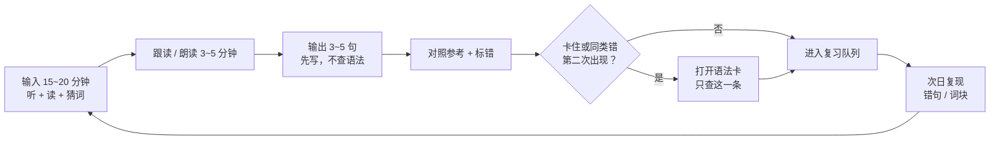
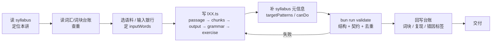

# 通用英语体系重构方案（v3 · 语感优先 · 主题多元）

> 目标：把 `src/english/general` 从「以讲为单位的语法教材」重构为「以输入量为基础、以复现为节奏、以输出为检验」的语感系统。
> 内容路线：课程组织轴从「语法」换成「主题」，语料从「程序员专题」换成多主题真实短文本；语法降为暗线标签与查表卡片。
> 技术路线：平台完全重写，按 `src/artificial-intelligence/agent/full-stack/docs` 的 React SPA + TypeScript 内容模块 + Zod 构建期校验实现；**废弃 md → json 管线**。
> 状态：M0 已交付 — `platform-v2/` 骨架 + 试点单元 p01 内容 + 教学契约 `validate`；旧版课程与平台已归入 `archive/`。

---

## 0. 一句话结论

平台的主体不再是「课文播放器 + 题库」，而是四件事：

1. **主题输入引擎**：每天稳定给你 1500~2500 词可理解、略高于当前水平的语料；技术只是主题之一。
2. **输出反馈环**：写完立刻对照、标注错误、进入复习队列。
3. **语法查表**：语法不再是第三节课，而是卡住或写错时打开的一张卡片。
4. **复现队列**：词块、错句、语法卡按间隔回来，而不是靠重读课文。

平台整体重写，不复用旧架构与 UI；只保留 LCS、TTS、本地存储等算法与思路。

课文仍然是样本，但样本不再是学习单位；**输入的词数、复现的次数、错误的复现率**才是。

---

## 1. 现状诊断

### 1.1 资产盘点

| 资产 | 现状 | 判断 |
|------|------|------|
| 三册大纲 | 95 讲（35 + 33 + 27） | 结构完整，可保留 |
| 已产出课文 | 第一册 Unit 01 + Unit 02，共 18 讲 | 不整体迁移；作为试点单元的素材与难度参照 |
| 每讲课文 | 约 100~130 词 | 作为精读样本够用，作为输入量远远不够 |
| 平台 Lexio | 课文 / 讲解 / 拼写 / 练习 四 tab | 架构、UI、交互都不满意，整体重写 |
| 数据管线 | `lesson.md → lesson.json → validate` | 本次要废弃 |
| 语法合集 | 29 讲线性大纲 | 降级为查表来源，不再是学习主线 |
| 词汇台账 | 每册一份，精讲唯一 + 复现 | 保留，扩展为「词块 + 错误」台账 |
| 语料主题 | 开发者 / 技术场景为主 | 需要多元化，技术只占一部分 |

### 1.2 核心问题：输入量差了一到两个数量级

- 已产出 18 讲 × 约 120 词 ≈ **2160 词**。
- 成人形成语感的目标输入量：**每天 1500~2500 词**，持续数月。
- 也就是说，现有全部课文加起来，大约只够**一天**的输入量。

这不是材料质量问题，是**学习单位**问题：

| 维度 | 旧单位 | 新单位 |
|------|--------|--------|
| 进度 | 学完第几讲 | 今天接触了多少词、复现了多少次 |
| 语法 | 第 3 节必读 | 卡住时才打开的卡片 |
| 输出 | 课后仿写，写完即止 | 写完对照、标错、进复习队列 |
| 练习 | 选择题为主 | 回忆、复述、改写为主 |
| 复习 | 错题记录 | 按 1 / 3 / 7 / 14 天间隔复现 |

### 1.3 为什么「抱着语法啃」反自然

- 现有每讲的结构是「课文 → 词汇 → 语法 → 输出 → 练习」，语法在输出之前，且写得最完整。
- 人很容易把 §3 当主课读完，课文降级为例句库，§4 输出草草了事。
- 语法合集 29 讲是线性大纲，天然鼓励「先学完规则再使用」。
- 结果：规则是陈述性知识，能判断对错，却调不出来。

### 1.4 组织轴错了：语法做单元，主题做配菜

第一册的单元是「句子工程 / 从句体系 / 非谓语与被动 / 篇章阅读」，单元本身就是语法分类。只要单元按语法命名，语法就必然是主线，课文只能是例句库。

输入优先要求反过来：**单元按主题组织，语法模式作为暗线标签**。例如一个「城市与日常」单元里，同时出现一般现在、进行时、there be、可数与冠词；语法卡只在需要时出现。

同时，现有语料几乎全是程序员场景。语境单一会让词汇与句式的覆盖面变窄，也容易把英语学成「技术文档英语」。新体系按主题配比选材，技术只是其中一类。

重设计的边界：

| 保留 | 重排 | 暂不动 |
|------|------|--------|
| 三册能力阶梯与词汇目标 | 第一册 unit 的组织轴（语法 → 主题） | 第二、三册的单元细节 |
| 词汇台账与验收标准 | 每讲块顺序、课文长度、讲数 | 考研英语二应试线 |
| 考研英语二终点 | 第一册的主题配比与选材 | — |

先只重排第一册的一个试点单元；试点指标达标后，再决定第一册整体重排幅度。

---

## 2. 目标与指标

### 2.1 产品目标

把 Lexio 从「课程播放器」改成「每日语感训练器」：

- **输入**：课文 + 课外输入银行，默认先听/读，中文默认隐藏；技术、生活、科学、社会、旅行等主题混排。
- **输出**：先写再对照，错误必须落账。
- **语法**：只从卡点和错误进入，不设线性语法课。
- **复习**：词块、错句、语法卡按间隔复现。
- **对照**：中文/重庆话与英语的思维差异单独成台账。

### 2.2 只看四个指标

| 指标 | 定义 | 目标 |
|------|------|------|
| 每日输入词数 | 完成「读/听 + 1 道理解检查」的文本词数 | 1500~2500 / 天 |
| 输出量 | 保存并自检的英文句子/段落数 | ≥ 5 句/天（约 35 句/周） |
| 错误复现率 | 同一错误标签在 14 天内再次出现 / 总错误数 | < 20% |
| 查表前置率 | 未尝试输出就打开语法卡的比例 | 0 |

### 2.3 反指标（可以显示，但不作为目标）

讲数、学习时长、语法卡阅读数、连续打卡天数。它们容易制造「很努力」的错觉。

### 2.4 主题配比（建议值，可调）

| 主题 | 占比 | 例子 |
|------|------|------|
| 技术 / 工作 | 30% | 工具、协作、产品、AI、工程文化 |
| 生活 / 习惯 | 20% | 饮食、作息、消费、居住 |
| 科学 / 自然 | 20% | 身体、气候、动物、空间 |
| 社会 / 文化 | 15% | 教育、城市、传统、媒体 |
| 旅行 / 地方 | 15% | 交通、城市、食物、见闻 |

技术仍是最大单一主题，但不再是唯一语境。每个试点单元至少覆盖 3 类主题。

---

## 3. 学习模型

### 3.1 每日循环



### 3.2 每讲循环


### 3.3 六条硬规则

1. **主题驱动**：单元按主题组织，语法模式只做暗线标签；不按语法分类建单元。
2. **先输入后规则**：任何语法卡必须排在课文与输出之后；验证脚本强制检查块顺序。
3. **先输出后讲解**：没写过就不允许打开语法卡；平台记录打开时机。
4. **语法只查不讲**：语法卡一屏内讲完：一句规则 + 两个课文锚句 + 一个母语差异 + 两个常见错误。
5. **复现按间隔**：词块、错句、语法卡进入 1 / 3 / 7 / 14 天队列；不靠「再读一遍课文」。
6. **对照防迁移**：中文/方言与英语的差异单独成卡，错误标签直接挂到对照卡。

### 3.4 语法的最小可用集

只优先做这些高回报、且与中文差异大的点，其余等输入里遇到再补卡：

- 时态与体（尤其完成体 ≠「了」）
- 可数性、单复数、冠词
- 介词（时间/空间/搭配）
- 从句连接与语序（陈述语序）
- 非谓语作定语/状语
- 被动语态（中性，不等于「遭」）
- 疑问/否定/倒装的助动词
- 主谓一致

虚拟语气细节、独立主格、倒装变体等低频项，不进首批卡片。

---

## 4. 内容模型

### 4.1 层级

```
book（册） → unit（单元） → lesson（讲） → block（内容块）
```

课文不再是 markdown 文件，而是一个 TypeScript 模块，导出 `LessonContent`。每讲必须标注 `topic`，并至少链接 1 篇同主题输入文本。

### 4.2 Block 类型

| kind | 用途 | 关键字段 | 出现页面 |
|------|------|----------|----------|
| `passage` | 精读课文 | `sentences[{en,zh}]`、`words`、`audio?` | 精读 |
| `chunks` | 句块/搭配 | `text`、`frame`、`note` | 精读 / 复习 |
| `vocab` | 词汇 | `word`、`phonetic`、`meaning`、`example`、`collocation` | 精读侧栏 |
| `grammar` | 语法卡 | `id`、`rule`、`anchors`、`contrast`、`commonErrors`、`lookupOnly` | 查表 |
| `contrast` | 母语差异 | `zh`、`en`、`tag`、`note` | 台账 / 查表 |
| `output` | 输出任务 | `kind`、`prompt`、`sample`、`checklist` | 输出 |
| `drill` | 跟读/听写/填空 | `mode`、`items` | 精读 |
| `exercise` | 练习题 | `level`、`question`、`hint`、`answer`、`solution` | 练习 |
| `note` / `p` / `h2` / `table` / `list` | 讲解与排版 | 通用 | 任意 |

与 `full-stack/docs` 的 `Block` 判别联合保持同构：`block.kind` 直接路由到组件。

### 4.3 TS 内容示例

```ts
import {
  chunks,
  defineLesson,
  exercise,
  grammar,
  output,
  passage
} from '../../../data/builders.ts'

export const p01 = defineLesson({
  id: 'p01',
  title: 'The Corner Bakery',
  topic: 'daily-life',
  minutes: 30,
  // inputWords 由 defineLesson 从 passage 计算，不手填
  targetPatterns: ['五大句型', '一般现在', 'there be'],
  canDo: ['能拆任意简单句的主干', '能各写一句五大句型'],
  blocks: [
    passage({
      title: 'The Corner Bakery',
      sentences: [
        {
          en: 'The bakery opens before the sun.',
          zh: '面包店在太阳升起前开门。'
        },
        {
          en: 'Maria turns on the oven and puts the first bread inside.',
          zh: '玛丽亚打开烤箱，把第一条面包放进去。'
        },
        {
          en: 'The smell wakes the neighbors.',
          zh: '香味叫醒了邻居。'
        },
        {
          en: 'She calls the bread her quiet alarm.',
          zh: '她把这面包称作她的安静闹钟。'
        }
      ],
      translation: '……'
    }),
    vocab([
      {
        word: 'bakery',
        phonetic: '/ˈbeɪkəri/',
        meaning: 'n. 面包店',
        example: 'The bakery on the corner opens before the sun.',
        collocation: 'a corner bakery'
      }
    ]),
    chunks([
      {
        text: 'opens before the sun',
        frame: 'before + 名词/从句',
        note: '用时间点做对比，比 in the morning 更有画面'
      }
    ]),
    output({
      kind: 'writing',
      prompt: '用五大句型各写一句你常去的店或地方',
      sample: 'The shop opens at seven.\nThe owner knows my name.',
      checklist: ['每句能指出主语和谓语', '双宾句能改写成 to / for 结构']
    }),
    drill([
      {
        id: 'p01-d1',
        mode: 'spelling',
        prompt: 'bakery',
        hint: '面包店',
        answer: 'bakery'
      }
    ]),
    grammar({
      id: 'five-patterns',
      title: '五大句型',
      rule: '先找谓语，再往前找主语，往后看宾语或补语',
      anchors: [
        'The bakery opens before the sun.',
        'She calls the bread her quiet alarm.'
      ],
      commonErrors: ['把 there be 当成主谓宾', '双宾与宾补混淆'],
      lookupOnly: true
    }),
    exercise({
      title: '基础层',
      items: [
        {
          level: '基础',
          question: 'She calls the bread her quiet alarm. 属于哪种句型？',
          hint: '在宾语和后面成分之间加 be 试试',
          answer: '主谓宾补',
          solution: 'the bread is her quiet alarm 成立，所以后面是宾补。'
        }
      ]
    })
  ]
})
```

> 下面代码为结构示意，省略了重复数据；完整内容见 `platform-v2/src/content/pilot/p01.ts`。

### 4.4 教学契约（由 `validate.ts` 强制）

- 每讲必须标注 `topic`，同一单元至少覆盖 3 类主题。
- `passage` 必须出现在第一个 `grammar` 之前。
- `output` 必须出现在第一个 `grammar` 之前。
- 每讲至少 1 个 `output`，且必须带 `sample` 与 `checklist`。
- 每讲至少 5 个 `chunks`，且 `text` 必须能在课文中找到。
- 每讲至少 6 个 `vocab`，且 `example` 必须是课文原句。
- 每讲至少 4 道 `drill`，`spelling` / `dictation` / `recall` 各至少 1 道；`spelling` / `dictation` 的 `answer` 必须等于朗读文本。
- 每个 `grammar` 至少 2 个 `anchors`，且必须来自本讲课文或本单元已学课文。
- 每个 `exercise` 必须有 `answer` 与 `solution`；客观题答案唯一。
- `chunks` 全局去重；同一词块不在两讲重复精讲（复现允许，入账唯一）。
- `inputWords` 由 `sentences` 复算，字段值与复算结果不一致即失败。
- `passage` 长度 150~250 词（试点单元）；输入银行 200~400 词。
- `canDo` 至少 2 条，且每单元验收时逐条勾选。

> 这套契约把「先输入、后语法」从建议变成构建期错误：顺序不对，`bun run validate` 直接失败。

### 4.5 目录结构

```
platform-v2/src/
├── content/
│   ├── pilot/                    # 试点单元：5~8 讲，主题混排
│   │   ├── p01.ts
│   │   └── ...
│   ├── book-01/
│   │   ├── unit-01/
│   │   │   ├── l01.ts
│   │   │   └── ...
│   │   └── unit-02/
│   ├── input/                    # 输入银行（课外泛读/泛听）
│   │   ├── tech-001.ts
│   │   └── ...
│   ├── grammar/
│   │   └── cards.ts              # 语法卡索引
│   └── index.ts                  # 内容总表
├── data/
│   ├── types.ts                  # Block / LessonContent / InputText
│   ├── syllabus.ts               # 册 → 单元 → 讲元信息
│   └── builders.ts               # defineLesson / passage / chunks 等
├── schema/
│   └── content.ts                # Zod 契约
├── scripts/
│   └── validate.ts               # 结构 + 教学契约 + 全局去重
├── components/
│   ├── block-renderer.tsx
│   └── blocks/                   # passage / chunks / grammar-card / contrast / output / drill
├── pages/                        # today / read / write / review / grammar / ledger / library / stats
├── lib/                          # progress / review / ledger / text / diff
└── app/
```

---

## 5. 平台功能

### 5.1 页面优先级

| 优先级 | 页面 | 作用 | 数据来源 |
|--------|------|------|----------|
| P0 | `/today` | 今日输入 + 复习 + 输出入口 | syllabus + review queue |
| P0 | `/read/:id` | 先听/读，逐句高亮，中文默认隐藏 | `passage` |
| P0 | `/write/:id` | 先写，后对照 sample，标错误标签 | `output` + diff |
| P0 | `/review` | 1/3/7/14 天复现队列 | 词块 / 错句 / 语法卡 |
| P0 | `/grammar` | 语法卡搜索与查表 | `grammar` |
| P0 | `/ledger` | 错误台账 + 母语差异台账 | 用户输入 |
| P1 | `/library` | 册 → 单元 → 讲目录 | syllabus |
| P1 | `/stats` | 输入词数、输出量、错误复现率 | 本地日志 |
| P1 | `/input` | 课外输入银行 | `InputText` |
| P2 | 考试模式 | 限时阅读、题型训练 | postgraduate 数据 |

### 5.2 P0 细节

**`/today`**

- 顶部只显示三个数字：今日输入词数、待复习条目、今日输出句数。
- 主按钮「开始今天的 30 分钟」：复习 5 分钟 + 输入 15 分钟 + 输出 10 分钟。
- 不展示课程进度百分比；完成输入即算达标，不要求「学完一讲」。

**`/read/:id`**

- 默认顺序：整篇盲听 → 逐句听读 → 看文本 → 划句块。
- 中文默认折叠；点开才算「求助」，记录一次。
- 句块高亮：点击句子显示可复用框架，而不是语法术语。
- 跟读：播放 → 暂停 → 用户复述 → 下一句；可录音回放，不做自动评分。

**`/write/:id`**

- 先写，提交后才揭示 sample。
- 用 LCS diff 标出增删改；用户自己给差异打标签：`时态`、`冠词`、`介词`、`语序`、`搭配`、`拼写`、`母语迁移`。
- 标完进 `/ledger` 与 `/review`；同一标签 14 天内第二次出现时，弹出对应语法卡。

**`/grammar`**

- 只做搜索和标签筛选，不做章节顺序。
- 卡片结构固定：一句规则 → 两个锚句 → 一个母语差异 → 两个常见错误 → 关联练习。
- 首批 20 张卡，按错误频率补，不一次性搬 29 讲。

**`/ledger`**

- 两个 tab：错误台账、母语差异台账。
- 错误台账列：我写的 | 地道说法 | 标签 | 第几次 | 下次复习日。
- 差异台账列：中文/重庆话 | 英语 | 差异点 | 我犯过的错。
- 差异标签固定枚举，避免自由文本无法统计。

### 5.3 进度与存储

- `localStorage` 分四个命名空间：`progress`、`review`、`ledger`、`inputLog`。
- 每条记录带 `schemaVersion`；升级时保留迁移函数。
- 提供「导出 JSON / 导入 JSON」，防止清缓存丢数据。
- 不做账号、不做云同步（除非 §9 拍板需要）。

### 5.4 UI / 交互重写

旧 Lexio 的问题不是皮肤，而是结构：四个 tab 并列，学习被拆成「课文 / 讲解 / 拼写 / 练习」，没有一个「今天该做什么」的入口。

新平台按「一屏一件事」重写：

- **入口只有 `/today`**：今天输入什么、复习什么、写什么，一屏决定。
- **阅读器优先**：默认盲听 → 逐句听读 → 看文本 → 划句块；中文折叠。
- **写作页是编辑器，不是表单**：写完才揭示 sample，diff 与错误标签在同一屏。
- **不用四 tab**：课文、词汇、语法、练习都在同一条阅读流里按需出现。
- **移动端优先**：听读与复习必须单手可用；写作可以后置。

视觉方向另出一份 `design-v3.md`，不在本方案里定稿。

### 5.5 明确不做

- AI 批改与发音评分（无后端、成本不可控）。
- 完整错题本（只做错误标签与复现）。
- 语法线性课程。
- 以「讲完」为目标的进度条。

---

## 6. 技术路线（对齐 full-stack/docs）

### 6.1 技术栈

Bun + Vite + React 19 + TypeScript strict + Zod + oxlint/oxfmt。运行时依赖保持最小：`react`、`react-dom`、`zod`；不引 markdown 解析器、不引状态库、不引 diff 库（沿用现有 LCS）。

### 6.2 数据流

```text
src/content/**/*.ts          ← 唯一数据源（人工或 skill 生成）
        ↓ import
src/content/index.ts
        ↓
bun run validate             ← Zod 结构 + 教学契约 + 全局去重
        ↓
React SPA                    ← block-renderer 按 kind 渲染
        ↓
localStorage                 ← 进度 / 复习 / 台账 / 输入日志
```

没有 `lesson.md → lesson.json`，也没有 `md ↔ json` 对账。内容错在 TypeScript 类型或 `validate` 阶段暴露。

### 6.3 从 docs 抄什么、不抄什么

| 抄 | 不抄 |
|----|------|
| `Block` 判别联合 + `block-renderer` 路由 | docs 的课程内容与 demo |
| `syllabus.ts` 单一元信息来源 | 「精讲 / 速过 / 引子」深度模型 |
| `schema.ts` + `validate.ts` 构建期校验 | 固定的章节数 / 篇数 / 总时长断言 |
| `content/*.ts` 一讲一模块 | 面试题、项目落点等开发者文档字段 |
| localStorage 进度 + 导出 | 其视觉样式与四 tab 结构（不复用） |
| GitHub Pages 部署流程 | — |

### 6.4 归档与删除清单

- 旧 `platform/`、`book-01-foundation/`、`book-02-intermediate/`、`book-03-advanced/`：已移动到 `archive/`，只读保留
- `archive/book-01-foundation/**/lesson.json`（18 份，随归档保留）
- `archive/platform/src/scripts/reconcile.ts`（随归档保留）
- `archive/platform/src/schema/lesson.ts`（旧契约，随归档保留）
- `archive/platform/src/app/data.ts` 里的 `import.meta.glob('*.json')`（随归档保留）
- `archive/platform/src/app/components/grammar-notes.tsx`（被 block-renderer 取代）
- `.agents/skills/english-lesson-crafter/reference/lesson-template.md` 的 md 模板与 md↔json 契约（待 skill v1.0 更新）
- `general/readme.md` 里的 md 模板、md→json 流程、语法优先闭环（已重写）

### 6.5 保留与迁移

| 现有资产 | 处理 |
|----------|------|
| `lcs.ts` / `text.ts` | 可移植算法，重写进 `lib/diff.ts` / `lib/text.ts` |
| `use-speech` | 只保留 Web Speech 调用思路，按新阅读器重写 |
| `progress.ts` | 只保留「本地存储 + 版本号」思路，schema 重写 |
| `reading-player` | 不复用，按新阅读器重写 |
| `spelling-drill` / `dictation-drill` / `sentence-spelling` | 功能保留：重写为 `DrillBlock`（听音拼写 + 听写整句 + 看中文写英文，含 LCS diff、首错统计、全对推进） |
| `practice-grader` / `library` | 不复用，按新交互重写 |
| `design.md` | 不复用；新平台另写 `design-v3.md` |
| 旧 `platform/` | 已归档到 `archive/platform/`，不再维护 |
| 18 讲 md 课文 | 归档；只把内容素材用于试点单元重写 |

### 6.6 内容生产流程（english-lesson-crafter v1.0）



skill 的红线改为：

- 输出 `content/**.ts` + syllabus 元信息，不再输出 md/json。
- 块顺序必须是 `passage → vocab → chunks → output → drill → grammar → exercise`。
- 语法卡必须引用课文锚句，`lookupOnly: true`。
- 输出任务必须有 `sample` 与 `checklist`。
- 每讲标注 `topic`，同一单元至少 3 类主题。
- 每讲至少链接 1 篇输入银行文本（同主题窄读）。
- `bun run validate` 不过不交付。

---

## 7. 迁移计划

| 阶段 | 范围 | 交付物 | 验收 |
|------|------|--------|------|
| M0 试点设计与骨架 | 新平台骨架、试点单元大纲（5~8 讲、3 类以上主题）、L01 样板 | `platform-v2` 可跑；`validate` 通过；L01 可读、可听、可写 | 块顺序 / topic / 主题覆盖校验生效 |
| M1 试点闭环 | `/today`、`/read`、`/write`、`/review`、`/ledger`；试点单元 5~8 讲；词汇表 + 拼写/听写/中译英 | 每日输入 + 输出 + 词块复现 + 错误标签 | 连续 7 天输入 ≥1500 词/天；输出 ≥3 句/天；错误条目 ≥10 |
| M2 语法查表与对照 | 20 张语法卡、母语差异台账；第二个单元设计 | `/grammar`、`/ledger` 差异 tab | 语法卡只从错误/卡点打开；14 天错误复现率 <20% |
| M3 输入银行与跟读 | 30 篇多主题真实短文本、影子跟读、`/stats` | `/input`、录音回放、仪表盘 | 每周 3 篇课外输入；主题覆盖 ≥3 类/月；跟读 ≥60 分钟/周 |
| M4 扩展与退休 | 按试点结果重排第一册；清理 md/json 管线；skill v1.0 | 内容与平台稳定 | 全仓无活跃 `lesson.json`；旧平台只留在 `archive/`；`bun run validate` 是唯一内容门禁 |

> 每阶段不追求讲数，只追求指标。讲数可以少，输入量不能少。

### 7.1 试点单元：城市醒来 / A City Wakes Up

用一座城市的 6 个片段做试点：主题分散，但共享同一套高频场景词，便于窄读复现。

| # | 标题 | 主题 | 目标模式 | 输出任务 | Can-do |
|---|------|------|----------|----------|--------|
| 01 | The Corner Bakery | 生活 | 五大句型、there be、一般现在 | 用 5 句写常去的店 | 能拆主干；能写 there be |
| 02 | The Night Bus | 旅行 / 城市 | 一般现在 vs 现在进行、when / while | 写一段夜归路线 | 能区分习惯与正在发生 |
| 03 | The Library Hold Queue | 社会 / 文化 | 被动、现在完成 | 说明一个流程 | 能用被动描述过程 |
| 04 | The Rooftop Garden | 科学 / 自然 | 比较级、可数与冠词 | 比较两个空间 | 能比较并描述存在 |
| 05 | The Walk-In Clinic | 社会 / 健康 | 情态、条件句 | 给三条建议 | 能表达建议与条件 |
| 06 | The Sunday Market | 生活 / 旅行 | 一般过去、数量表达 | 叙述一次逛市场 | 能讲过去的事 |

覆盖 4 类主题（生活、旅行、社会、科学），每讲 150~220 词，6 讲合计约 1100~1300 词；配合输入银行，周输入量可达 1 万词以上。

---

## 8. 风险与取舍

| 风险 | 影响 | 对策 |
|------|------|------|
| TS 写内容比 md 啰嗦 | 写作成本上升 | 提供 builders；只写 P0 字段；skill 生成初稿 |
| 输入银行内容不足 | 语感目标落空 | 先建 30 篇；优先技术文档/发行说明；背景知识抵消难度 |
| 版权 | 不能整段复制 | 只存短摘录 + 来源链接；优先公有文档与自写语料 |
| TTS 口音/断句 | 听力输入质量不稳 | 允许选声、调速、单句循环；后续可换音频 |
| localStorage 丢数据 | 台账/进度丢失 | 导出/导入 JSON；版本化 schema |
| 指标被刷 | 输入量虚高 | 只计「读完 + 理解检查通过」的词数，不计时长 |
| 语法卡又变成线性课 | 回到老路 | 查表页不做顺序；卡片只能从错误/卡点进入 |
| 过度建设 | 平台做完，语感没练 | M1 只做 5 个 P0 页面；不做 AI、不做同步、不做评分 |
| 重写平台拖慢内容 | 平台做很久，输入量没上来 | M0 先做最小可跑；内容与平台同阶段交付；不做大而全的设计系统 |
| 主题多元导致词汇失控 | 生词率过高，输入不可理解 | 每篇控制生词率 5~10%；超纲词给中文注释；主题变、词表仍按册控制 |

---

## 9. 已确认决策

| 事项 | 决策 |
|------|------|
| 现有 18 讲 | 不整体迁移；先做一个 6 讲的试点单元，旧内容归档作素材 |
| 课程设计 | 重设计：组织轴从语法换成主题，语法降为暗线；三册能力阶梯保留 |
| 平台 | 完全重写，不复用旧架构、UI、交互 |
| 输入银行 | 真实短文本；技术为主，但必须多主题混排 |
| 进度存储 | localStorage + 导出/导入 JSON |
| 每日投入 | 30 分钟：复习 5 + 输入 15 + 输出 10 |
| 考试线 | 暂不同步，先做通用能力线 |
| 第一册讲数 | 接受压缩重排：先做 6 讲试点，指标达标后再定全册 |
| 视觉方向 | 阅读器优先的编辑部 / 杂志排版，不做数据面板 |

---

## 10. 附录

### 10.1 平台上线前，本周就能执行的学习顺序

1. 每天 15 分钟读短文章（技术 / 生活 / 科学混着来），生词先猜，不查。
2. 旧材料每讲先做输出任务，再翻语法节，只查卡住的地方。
3. 建一个 5 列错误台账：我写的 | 地道说法 | 标签 | 第几次 | 下次复习日。
4. 每天 5 分钟跟读课文，播放 → 暂停 → 复述。
5. 每周看一次错误标签分布，只补出现两次以上的规则。

### 10.2 现有文件映射

| 现有 | 新位置 |
|------|--------|
| `archive/book-01-foundation/01-句子工程/L01-*/lesson.md` | 素材用于 `platform-v2/src/content/pilot/p01.ts` |
| `archive/book-01-foundation/01-句子工程/L01-*/practice.md` | 同上，`exercise` block |
| `archive/book-01-foundation/01-句子工程/L01-*/lesson.json` | 归档保留，不再维护 |
| `archive/book-01-foundation/vocab-ledger.md` | 归档；新词块台账随试点单元重建 |
| `archive/platform/`（旧 Lexio） | 只读归档，不再维护 |
| `archive/platform/src/schema/lesson.ts` | `platform-v2/src/schema/content.ts` |
| `archive/platform/src/scripts/validate.ts` | 重写为教学契约校验 |
| `archive/platform/src/scripts/reconcile.ts` | 归档，不再使用 |
| `archive/platform/src/app/components/spelling-drill.tsx` 等 | 逻辑迁入 `platform-v2/src/app/components/DrillBlock.tsx` |
| `general/readme.md` | 已重写为语感优先体系索引 |
| `.agents/skills/english-lesson-crafter` | v1.0：输出 TS 内容模块 |
