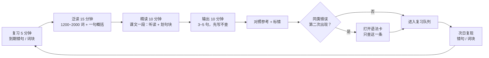
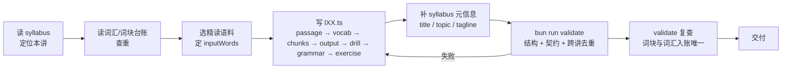

# 通用英语体系重构方案（v3 · 语感优先 · 主题多元）

> 目标：把 `src/english/general` 从「以讲为单位的语法教材」重构为「以输入量为基础、以复现为节奏、以输出为检验」的语感系统。
> 内容路线：课程组织轴从「语法」换成「主题」，语料从「程序员专题」换成多主题真实短文本；语法降为暗线标签与查表卡片。
> 技术路线：平台完全重写，按 `src/artificial-intelligence/agent/full-stack/docs` 的 React SPA + TypeScript 内容模块 + Zod 构建期校验实现；**废弃 md → json 管线**。
> 状态：M0 已交付，M0.5 已按「双轨」口径修订；M1 输出闭环（逐句 diff → 预填标签 → 台账 → 1/3/7/14 复习）已交付。旧版课程与平台已归入 `archive/`。

---

## 0. 一句话结论

平台的主体不再是「课文播放器 + 题库」，而是四件事：

1. **主题输入引擎**：泛读每天 1200~2000 词外部文本，精读每天 150~250 词课文；两个计数器分开记。技术只是主题之一。
2. **输出反馈环**：写完立刻对照、标注错误、进入复习队列。
3. **语法查表**：语法不再是第三节课，而是卡住或写错时打开的一张卡片。
4. **复现队列**：词块、错句、语法卡按间隔回来，而不是靠重读课文。

平台整体重写，不复用旧架构与 UI；只保留 LCS、TTS、本地存储等算法与思路。

课文仍然是样本，但样本不再是学习单位；**输入的词数、复现的次数、错误的复现率**才是。

---

## 1. 现状诊断

### 1.1 资产盘点

| 资产 | 现状 | 判断 |
|------|------|------|
| 三册大纲 | 95 讲（35 + 33 + 27） | 结构完整，可保留 |
| 已产出课文 | 第一册 Unit 01 + Unit 02，共 18 讲 | 不整体迁移；作为试点单元的素材与难度参照 |
| 每讲课文 | 约 100~130 词 | 作为精读样本够用，作为输入量远远不够 |
| 平台 Lexio | 课文 / 讲解 / 拼写 / 练习 四 tab | 架构、UI、交互都不满意，整体重写 |
| 数据管线 | `lesson.md → lesson.json → validate` | 本次要废弃 |
| 语法合集 | 29 讲线性大纲 | 降级为查表来源，不再是学习主线 |
| 词汇台账 | 每册一份，精讲唯一 + 复现 | 保留，扩展为「词块 + 错误」台账 |
| 语料主题 | 开发者 / 技术场景为主 | 需要多元化，技术只占一部分 |

### 1.2 核心问题：输入量差了一到两个数量级

- 已产出 18 讲 × 约 120 词 ≈ **2160 词**。
- 成人形成语感的目标输入量：**每天泛读 1200~2000 词**，持续数月；精读另计 150~250 词。
- 也就是说，现有全部课文加起来，大约只够**一天**的输入量。

这不是材料质量问题，是**学习单位**问题：

| 维度 | 旧单位 | 新单位 |
|------|--------|--------|
| 进度 | 学完第几讲 | 今天接触了多少词、复现了多少次 |
| 语法 | 第 3 节必读 | 卡住时才打开的卡片 |
| 输出 | 课后仿写，写完即止 | 写完对照、标错、进复习队列 |
| 练习 | 选择题为主 | 回忆、复述、改写为主 |
| 复习 | 错题记录 | 按 1 / 3 / 7 / 14 天间隔复现 |

### 1.3 为什么「抱着语法啃」反自然

- 现有每讲的结构是「课文 → 词汇 → 语法 → 输出 → 练习」，语法在输出之前，且写得最完整。
- 人很容易把 §3 当主课读完，课文降级为例句库，§4 输出草草了事。
- 语法合集 29 讲是线性大纲，天然鼓励「先学完规则再使用」。
- 结果：规则是陈述性知识，能判断对错，却调不出来。

### 1.4 组织轴错了：语法做单元，主题做配菜

第一册的单元是「句子工程 / 从句体系 / 非谓语与被动 / 篇章阅读」，单元本身就是语法分类。只要单元按语法命名，语法就必然是主线，课文只能是例句库。

输入优先要求反过来：**单元按主题组织，语法模式作为暗线标签**。例如一个「城市与日常」单元里，同时出现一般现在、进行时、there be、可数与冠词；语法卡只在需要时出现。

同时，现有语料几乎全是程序员场景。语境单一会让词汇与句式的覆盖面变窄，也容易把英语学成「技术文档英语」。新体系按主题配比选材，技术只是其中一类。

重设计的边界：

| 保留 | 重排 | 暂不动 |
|------|------|--------|
| 三册能力阶梯与词汇目标 | 第一册 unit 的组织轴（语法 → 主题） | 第二、三册的单元细节 |
| 词汇台账与验收标准 | 每讲块顺序、课文长度、讲数 | 考研英语二应试线 |
| 考研英语二终点 | 第一册的主题配比与选材 | — |

先只重排第一册的一个试点单元；试点指标达标后，再决定第一册整体重排幅度。

---

## 2. 目标与指标

### 2.1 产品目标

把 Lexio 从「课程播放器」改成「每日语感训练器」：

- **输入**：精读课文 + 泛读外部文本；精读默认先听/读、中文默认隐藏，泛读只记词数与一句概括；技术、生活、科学、社会、旅行混排。
- **输出**：先写再对照，错误必须落账。
- **语法**：只从卡点和错误进入，不设线性语法课。
- **复习**：词块、错句、语法卡按间隔复现。
- **对照**：中文/重庆话与英语的思维差异单独成台账。

### 2.2 只看四个指标

| 指标 | 定义 | 目标 |
|------|------|------|
| 泛读词数 | 读完并写出一句英文概括的外部文本词数 | 1200~2000 / 天；8400~14000 / 滚动 7 天 |
| 精读词数 | 完成「听读 + 1 道理解题」的课文词数 | 150~250 / 天；1050~1750 / 滚动 7 天 |
| 输出量 | 保存并自检的英文句子数 | ≥ 5 句/天（约 35 句/周） |
| 重复错误率 | 同一 `patternKey` 在 14 天内再现：分母为创建于 14~28 天前的条目；先算各键比率，再对样本 ≥5 的键取平均；样本 <5 的键只列出、不聚合 | < 20%（有样本的键 ≥10 个才作为验收） |
| 查表转化率 | 查卡后 24 小时内写出含该结构的句子 | ≥ 80%（M3 起统计，依赖台账） |
| 未分类占比 | 无法归类的 diff / 总 diff | < 30%（诊断值，不设目标） |

两个计数器必须分开，原因是速率不同：泛读是连续默读，80~133 wpm，15 分钟约 1200~2000 词；精读要听、要猜词、要划句块，有效速率只有 50~70 wpm，10 分钟约 500~700 词，实际只取 150~250 词，余量留给跟读与查词。

旧版把两者合成一个「1500~2500 词/天」。这个数字只有在泛读速率下成立，而且两端分别对应 80 与 133 wpm：词数区间和速率区间必须一起写，单写词数，下一个改文档的人一定会混用两个版本。

指标按滚动 7 天结算：单日不足不判失败。「最低达标日」20 分钟（泛读 15 + 一句概括），「完整日」40 分钟；7 天累计守住 8400 词即可。界面显示的是「最近 7 天」，不是自然周——自然周要等 M1 之后再按周一 00:00 切。

复现率不能按 8 个 tag 算。`tense` 占错误 40% 时，14 天内必然再现，比率会退化成「标签分布」的函数：高频 tag 天生不达标，低频 tag 天生达标，聚合值和学习进步无关。判定粒度必须降到结构键 `patternKey`（如 `third-person-s`、`there-be-agreement`、`a-vs-the`、`by-time`），一个键对应一个能单独修的小结构。聚合用 macro，但只对样本 ≥5 的键取平均，否则一个一次性键就能把均值拉偏；样本不足的键单独列出，不下结论。当前只有 1 张卡，键太少，复现率只能当诊断；要等 M3 的 10 张卡才具备验收条件。

### 2.3 反指标（可以显示，但不作为目标）

讲数、学习时长、语法卡阅读数、连续打卡天数。它们容易制造「很努力」的错觉。

### 2.4 主题配比（周口径）

配比不落在讲数上，落在「一周的输入」上。6 讲去除 30% 得到 1.8 讲，这个数字没有意义；但一周 28 篇泛读里 8 篇技术类是能执行的。

| 主题 | 周输入占比 | 例子 |
|------|-----------|------|
| 技术 / 工作 | 30% | 工具、协作、产品、AI、工程文化 |
| 生活 / 习惯 | 20% | 饮食、作息、消费、居住 |
| 科学 / 自然 | 20% | 身体、气候、动物、空间 |
| 社会 / 文化 | 15% | 教育、城市、传统、媒体 |
| 旅行 / 地方 | 15% | 交通、城市、食物、见闻 |

约束拆成两条：**单元层面**只要求至少覆盖 3 类主题（课文选材）；**周层面**用泛读记录的主题分布对齐上表。试点 6 讲里没有技术讲，由泛读补足，不必为了凑比例硬加一讲。

---

## 3. 学习模型

### 3.1 每日循环



分两档执行：「最低达标日」20 分钟（泛读 15 + 一句概括），「完整日」40 分钟（上图）。指标按滚动 7 天结算，单日不足不判失败——日剂量可以让位，行为门槛不能让位。

### 3.2 每讲循环


### 3.3 七条硬规则

1. **主题驱动**：单元按主题组织，语法模式只做暗线标签；不按语法分类建单元。
2. **先输入后规则**：任何语法卡必须排在课文与输出之后；验证脚本强制检查块顺序。
3. **先输出后讲解**：没写过就不允许打开语法卡；平台记录打开时机。
4. **语法只查不讲**：语法卡一屏内讲完：一句规则 + 三个课文锚句 + 一个母语差异 + 两个常见错误。
5. **复现按间隔**：词块、错句、语法卡进入 1 / 3 / 7 / 14 天队列；不靠「再读一遍课文」。
6. **对照防迁移**：中文/方言与英语的差异单独成卡，错误标签直接挂到对照卡。
7. **归因先位置后范畴**：diff 已经算出来，系统按形态预填候选标签（同位置动词变形 → 时态，冠词增删 → 冠词，相邻 token 换序 → 语序，前缀编辑距离 ≤2 → 拼写），学习者只做确认或改判；归不进任何一类就记「未分类」，不强迫命名。

### 3.4 语法的最小可用集

只优先做这些高回报、且与中文差异大的点，其余等输入里遇到再补卡：

- 时态与体（尤其完成体 ≠「了」）
- 可数性、单复数、冠词
- 介词（时间/空间/搭配）
- 从句连接与语序（陈述语序）
- 非谓语作定语/状语
- 被动语态（中性，不等于「遭」）
- 疑问/否定/倒装的助动词
- 主谓一致

虚拟语气细节、独立主格、倒装变体等低频项，不进首批卡片。

「五大句型」也不进首批卡片：它是拆句的框架，不是一条可查的规则。p01 已把卡片从「五大句型 + there be」改成「主谓一致与 there be」，句型分析只留在练习里。

---

## 4. 内容模型

### 4.1 层级

```
book（册） → unit（单元） → lesson（讲） → block（内容块）
```

课文不再是 markdown 文件，而是一个 TypeScript 模块，导出 `LessonContent`。每讲必须标注 `topic`，并至少链接 1 篇同主题输入文本。

### 4.2 Block 类型

| kind | 用途 | 关键字段 | 出现页面 |
|------|------|----------|----------|
| `passage` | 精读课文 | `sentences[{en,zh}]`、`title`；整段译文由句级 `zh` 拼接，不单独存 | 精读 |
| `chunks` | 句块/搭配 | `text`、`frame`、`note` | 精读 / 复习 |
| `vocab` | 词汇 | `word`、`phonetic`、`meaning`、`example`、`collocation` | 精读侧栏 |
| `grammar` | 语法卡引用 | `cardId`（指向 `content/grammar/cards.ts`）；`covers: patternKey[]` 计划在 M2 加 | 精读页内联 / 查表 |
| `output` | 输出任务 | `id`、`kind`（writing / retell / check）、`prompt`、`sample`、`checklist`；只有 retell / check 入台账 | 输出 |
| `drill` | 跟读/听写/填空 | `mode`、`items` | 精读 |
| `exercise` | 练习题 | `focus`（`comprehension` / `form`）、`level`、`kind`、`options`、`answer`、`solution` | 练习 |
| `note` / `p` / `h2` / `table` / `list` | 讲解与排版 | 通用 | 任意 |

与 `full-stack/docs` 的 `Block` 判别联合保持同构：`block.kind` 直接路由到组件。

### 4.3 TS 内容示例

```ts
import {
  chunks,
  defineLesson,
  drill,
  exercise,
  grammar,
  output,
  passage,
  vocab
} from '../../data/builders.ts'

export const p01 = defineLesson({
  id: 'p01',
  title: 'The Corner Bakery',
  topic: 'daily-life',
  minutes: 30,
  // inputWords 由 defineLesson 从 passage 计算，不手填
  targetPatterns: ['五大句型', '一般现在', 'there be'],
  canDo: ['能拆任意简单句的主干', '能各写一句五大句型'],
  blocks: [
    passage({
      title: 'The Corner Bakery',
      sentences: [
        {
          en: 'The bakery opens before the sun.',
          zh: '面包店在太阳升起前开门。'
        },
        {
          en: 'Maria turns on the oven and puts the first bread inside.',
          zh: '玛丽亚打开烤箱，把第一条面包放进去。'
        },
        {
          en: 'The smell wakes the neighbors.',
          zh: '香味叫醒了邻居。'
        },
        {
          en: 'She calls the bread her quiet alarm.',
          zh: '她把这面包称作她的安静闹钟。'
        }
      ]
    }),
    vocab([
      {
        word: 'bakery',
        phonetic: '/ˈbeɪkəri/',
        meaning: 'n. 面包店',
        example: 'The bakery on the corner opens before the sun.',
        collocation: 'a corner bakery'
      }
    ]),
    chunks([
      {
        text: 'opens before the sun',
        frame: 'before + 名词/从句',
        note: '用时间点做对比，比 in the morning 更有画面'
      }
    ]),
    output({
      id: 'p01-writing',
      kind: 'writing',
      prompt: '用五大句型各写一句你常去的店或地方',
      sample: 'The shop opens at seven.\nThe owner knows my name.',
      checklist: ['每句能指出主语和谓语', '双宾句能改写成 to / for 结构']
    }),
    drill([
      {
        id: 'p01-d1',
        mode: 'spelling',
        prompt: 'bakery',
        hint: '面包店',
        answer: 'bakery'
      }
    ]),
    grammar('there-be-agreement'),
    exercise('理解与形式', [
      {
        id: 'p01-e1',
        kind: 'choice',
        focus: 'form',
        level: '基础',
        question: 'The bakery on the corner opens before the sun. 主语的核心词是？',
        options: ['The bakery', 'before the sun', 'opens', 'the sun'],
        answer: 'The bakery',
        solution: 'on the corner 是后置定语，主语核心词是 bakery；opens 是谓语。'
      }
    ])
  ]
})
```

> 下面代码为结构示意，省略了重复数据；完整内容见 `platform-v2/src/content/pilot/p01.ts`。

### 4.4 教学契约（由 `validate.ts` 强制）

- 每讲必须标注 `topic` 与 `title`，且与 `syllabus.ts` 完全一致；同一单元至少覆盖 3 类主题。
- 块顺序固定为 `passage → vocab → chunks → output → drill → grammar → exercise`，缺块或顺序颠倒都失败；渲染层按同一顺序渲染，不再有第二套顺序。
- 每讲至少 1 个 `output`，必须带 `sample` 与内容向 `checklist`（至少 3 条描述内容，不写语法要求）。
- 每讲至少 1 个 `kind: 'retell'` 或 `'check'` 的 output：`sample` 是逐句目标文本，只有它产台账；`writing` 只做对照与自评，不入账。output 的 `id` 必须唯一。
- 每讲至少 5 个 `chunks`、6 个 `vocab`；`chunk.text` 与 `vocab.word` 必须按词边界出现在课文里（`by six` 不能命中 `by sixteen`）；`vocab.example` 必须是课文原句。
- `chunks` 与 `vocab` 都跨讲唯一：同一词块、同一单词只能入账一次（复现允许，入账唯一）。
- 每讲至少 4 道 `drill`，`spelling` / `dictation` / `recall` 各至少 1 道；拼写与听写的 `answer` 必须等于朗读文本。
- 每讲至少 2 道 `focus: 'comprehension'` 的练习；不足 2 道时，本讲的 `inputWords` 不能计入；其中至少 1 道必须是 `kind != 'choice'`，要写英文，不能靠排除法秒答。
- 语法卡只写 `cardId`，卡片在 `content/grammar/cards.ts` 注册；每张卡至少 3 个锚句，锚句必须逐字出现在同单元已上线讲的课文里。
- `inputWords` 由 `sentences` 复算，字段值与复算结果不一致即失败；课文长度 150~250 词。
- `canDo` 至少 2 条，且每单元验收时逐条勾选。
- 泛读不进构建：只记标题、词数、主题、生词密度与一句英文概括，不存全文、不做逐句翻译。

> 这套契约把「先输入、后语法」从建议变成构建期错误：顺序不对，`bun run validate` 直接失败。

### 4.5 目录结构

```
platform-v2/src/
├── content/
│   ├── pilot/                    # 试点单元
│   │   ├── p01.ts
│   │   └── ...
│   ├── book-01/                  # 后续单元
│   │   └── unit-02/
│   ├── grammar/
│   │   └── cards.ts              # 语法卡注册表（跨讲复用，id 唯一）
│   └── index.ts                  # 内容总表 + 注册表导出
├── data/
│   ├── types.ts                  # Block / LessonContent / ReadingEntry
│   ├── syllabus.ts               # 册 → 单元 → 讲元信息
│   └── builders.ts               # defineLesson / passage / grammar(cardId)
├── schema/
│   └── content.ts                # Zod 契约（含语法卡与泛读记录）
├── scripts/
│   └── validate.ts               # 结构 + 教学契约 + 跨引用 + 去重
├── app/
│   ├── block-renderer.tsx        # 按内容顺序渲染
│   ├── router.ts                 # hash 路由 #/lesson/:id
│   ├── components/               # passage / vocab / chunks / output / drill / grammar / exercise
│   └── pages/                    # HomePage（今日 + 泛读记录）/ LessonPage
├── lib/                          # progress（含泛读与导出）/ text / lcs / speech
└── main.tsx
```

---

## 5. 平台功能

### 5.1 页面收敛

只有 1 讲上线时，`/today` 的决策是常数，`/ledger` 没有独立写入路径。两者不做页面；`/grammar` 只做一个列表，不做搜索。

| 优先级 | 界面 | 作用 | 数据来源 |
|--------|------|------|----------|
| P0 | `#/` 今日 | 今日 / 本周泛读词数、记一篇泛读、精读入口、导出/导入 | readings + progress |
| P0 | `#/lesson/:id` 精读 | 六段按内容顺序；语法卡在提交输出后解锁 | `LessonContent` |
| P0 | `#/grammar` 语法卡列表 | 规则、锚句、母语差异、常见错误；无搜索 | `grammar/cards.ts` |
| P0 | `#/review` 复习 | 1/3/7/14 到期列表 + 逐条过；顶部显示未分类占比 | 台账 + diff |
| 延后 | 语法卡搜索 | 等卡片数 ≥10 再做 | `grammar/cards.ts` |
| 取消 | `/library` | 今日页已经列出全部讲，不再单独做目录 | syllabus |
| 取消 | `/stats` | 今日页三个数字够用；指标进复盘表，不进页面 | readings + progress |

### 5.2 三个界面的细节

**今日（`#/`）**

- 三个数字：今日泛读词数、最近 7 天泛读词数（8400）、已提交精读数。指标按滚动 7 天结算，单日不足不判失败。
- 「记一篇泛读」：标题、链接、词数、用时（可空，按 130 wpm 估）、主题、第一段 100 词里不认识的词数（>3 换一篇）、一句英文概括。概括为空不许提交，它就是理解检查。
- 30 秒前置闸：先读第一段数生词，超过 3 个就换文，不记录。事后自评会被沉没成本污染——读了十分钟就不愿承认太难。
- 词数由学习者填，界面不做字数估算：外部文本拿不到可靠字数，估出来的数字只会污染指标。
- 数据区：导出 / 导入 JSON；本地存储不可用时直接横幅提示，不静默失败。

**精读（`#/lesson/:id`）**

- 六段按内容顺序渲染，编号由位置生成。旧版「内容里 drill 在 grammar 前、界面上反过来」的两套顺序已删除。
- 一讲 `sessions: 3`，每次约 10 分钟；列表与页头都显示「分 3 次」，避免把 30 分钟当成一天的任务。
- 理解题至少 1 道要写英文（非选择题），与泛读的「写一句概括」对齐，避免精读靠排除法秒答。
- 语法卡默认锁定，输出提交后解锁；同一张卡可被多讲引用，锚句标了出处讲。
- 播放器：整篇播放、单句点读、语速、中文默认隐藏；整段译文由句级中文拼接，不再单独维护一份。
- 「盲听 → 逐句 → 看文本」的状态机尚未实现：现在是一进页面就看到文本。这条留在 §8 风险里，不再当作已完成。

**复习与台账（已实现）**

- `#/review`：到期列表 + 逐条过（先看自己写的，再选「记住了 / 没记住」）；顶部显示到期数、台账总数、已走完 14 天、未分类占比。
- 1/3/7/14 天队列目前只做「句对」一本账；词块与语法卡共用同一调度留到 M2，不假装已经覆盖。
- 只有 `retell` / `check` 入台账；`writing` 只对照与自评。p01 因此有两个输出：自由写（不入账）+ 5 句中译英（入账）。
- 输出提交后展示逐句 diff，系统按形态预填 tag 与 patternKey，用户只确认或改判；`tagSource` 记 `prefill` / `manual`。
- 可比性门槛：两句 token 重叠 <40% 时只对照、不入账，避免把「换了一种写法」记成错误。
- 标签枚举：`tense`、`agreement`、`article`、`noun-number`、`preposition`、`word-order`、`collocation`、`spelling`、`transfer`、`unsorted`。比原计划多 `agreement` 与 `noun-number`，否则主谓一致和单复数只能塞进未分类。
- `patternKey` 独立注册表，**不复用语法卡 id**：错误要先于卡片可记。卡片的 `covers: patternKey[]` 留到 M2 再加，现在代码里没有这个字段。
- 记录 shape 已落地：`{ id, createdAt, lessonId, mySentence, targetSentence, tag, patternKey, tagSource, stage, nextReviewAt }`。
- 台账只收输出侧的错误；练习错题不进台账：`AnswerRecord` 没有 `targetText`，练习正确率本来就在 `answers` / `drill` 里可算。
- diff 规则覆盖第三人称 -s、单复数、冠词、介词、语序、完成体混用、be 动词缺失、拼写、搭配等形态，当前 15 条单测；真实 diff 攒到 20 条后再校准 `unsorted` 阈值。
- 复现率仍没有读数：分母要求条目创建于 14~28 天前。`/review` 现在只显示「最近 7 天各 patternKey 出现次数」，不做通过条件。

**查表（`#/grammar`）**

- 一个列表页：遍历注册表，列出规则、三个锚句（可跳回出处讲）、母语差异、常见错误。无搜索、无章节顺序。
- 精读页的卡片仍然默认锁定，避免把语法推成第三节课；但锁定卡下面有入口，卡住时可以主动去列表查。锁定挡的是「被推送」，不是「主动查」。
- 查表转化率要等台账：没有「查了哪张卡」与「之后写了什么」这两个数据点，≥80% 无法计算。M3 之前不展示这个指标。
- 跨讲搜索等卡片数 ≥10 再做；现在做搜索页只会有一个结果，是假功能。

### 5.3 进度与存储

- 一个 `localStorage` 键：`lexio-v2:store:v2`，内含 `schemaVersion`、`lessons`、`readings`。
- 旧键 `lexio-v2:progress:v1` 在首次读取时自动迁移，不要求手动导。
- 提供「导出 JSON / 导入 JSON」；导入后重新校验记录形状，坏记录直接丢弃并计数。
- 写入失败不再静默：`writeStore` 返回布尔值，今日页检测到不可用就显示横幅。
- 暂不拆 `progress` / `review` / `ledger` / `inputLog` 四个命名空间：现在只有一个消费者，拆了只是四处读写同一份数据。等复习队列落地再拆。
- 不做账号、不做云同步。

### 5.4 UI / 交互重写

旧 Lexio 的问题不是皮肤，而是结构：四个 tab 并列，学习被拆成「课文 / 讲解 / 拼写 / 练习」，没有一个「今天该做什么」的入口。

新平台按「一屏一件事」重写：

- **入口只有今日页**：今天读了多少、还差多少、从哪篇开始，一屏决定。
- **阅读器优先**：整篇播放、单句点读、中文折叠；「盲听 → 逐句 → 看文本」的状态机还没做。
- **写作是编辑器，不是表单**：写完才揭示 sample；diff 与标签预填在复习队列里一起做。
- **不用四 tab**：课文、词汇、语法、练习都在同一条阅读流里按需出现。
- **移动端优先**：听读与泛读记录必须单手可用；写作可以后置。

视觉方向原本计划另出 `design-v3.md`，目前没写；先用现有的编辑部排版，不新增设计系统。

### 5.5 明确不做

- AI 批改与发音评分（无后端、成本不可控）。
- 完整错题本（只做错误标签与复现）。
- 语法线性课程。
- 以「讲完」为目标的进度条。
- 泛读全文入库与逐句翻译（产能撑不住，见 §7.2）。
- 界面自动估算英文词数（估出来的数字会污染唯一的输入指标）。

---

## 6. 技术路线（对齐 full-stack/docs）

### 6.1 技术栈

Bun + Vite + React 19 + TypeScript strict + Zod + oxlint/oxfmt。运行时依赖保持最小：`react`、`react-dom`、`zod`；不引 markdown 解析器、不引状态库、不引 diff 库（沿用现有 LCS）。

### 6.2 数据流

```text
src/content/**/*.ts          ← 唯一数据源（人工或 skill 生成）
        ↓ import
src/content/index.ts
        ↓
bun run validate             ← Zod 结构 + 教学契约 + 全局去重
        ↓
React SPA                    ← block-renderer 按 kind 渲染
        ↓
localStorage                 ← 进度 / 复习 / 台账 / 输入日志
```

没有 `lesson.md → lesson.json`，也没有 `md ↔ json` 对账。内容错在 TypeScript 类型或 `validate` 阶段暴露。

### 6.3 从 docs 抄什么、不抄什么

| 抄 | 不抄 |
|----|------|
| `Block` 判别联合 + `block-renderer` 路由 | docs 的课程内容与 demo |
| `syllabus.ts` 单一元信息来源 | 「精讲 / 速过 / 引子」深度模型 |
| `schema.ts` + `validate.ts` 构建期校验 | 固定的章节数 / 篇数 / 总时长断言 |
| `content/*.ts` 一讲一模块 | 面试题、项目落点等开发者文档字段 |
| localStorage 进度 + 导出 | 其视觉样式与四 tab 结构（不复用） |
| GitHub Pages 部署流程 | — |

### 6.4 归档与删除清单

- 旧 `platform/`、`book-01-foundation/`、`book-02-intermediate/`、`book-03-advanced/`：已移动到 `archive/`，只读保留
- `archive/book-01-foundation/**/lesson.json`（18 份，随归档保留）
- `archive/platform/src/scripts/reconcile.ts`（随归档保留）
- `archive/platform/src/schema/lesson.ts`（旧契约，随归档保留）
- `archive/platform/src/app/data.ts` 里的 `import.meta.glob('*.json')`（随归档保留）
- `archive/platform/src/app/components/grammar-notes.tsx`（被 block-renderer 取代）
- `.agents/skills/english-lesson-crafter/reference/lesson-template.md` 的 md 模板与 md↔json 契约（待 skill v1.0 更新）
- `general/readme.md` 里的 md 模板、md→json 流程、语法优先闭环（已重写）

### 6.5 保留与迁移

| 现有资产 | 处理 |
|----------|------|
| `lcs.ts` / `text.ts` | 可移植算法，重写进 `lib/diff.ts` / `lib/text.ts` |
| `use-speech` | 只保留 Web Speech 调用思路，按新阅读器重写 |
| `progress.ts` | 只保留「本地存储 + 版本号」思路，schema 重写 |
| `reading-player` | 不复用，按新阅读器重写 |
| `spelling-drill` / `dictation-drill` / `sentence-spelling` | 功能保留：重写为 `DrillBlock`（听音拼写 + 听写整句 + 看中文写英文，含 LCS diff、首错统计、全对推进） |
| `practice-grader` / `library` | 不复用，按新交互重写 |
| `design.md` | 不复用；当前沿用编辑部排版，`design-v3.md` 未产出 |
| 旧 `platform/` | 已归档到 `archive/platform/`，不再维护 |
| 18 讲 md 课文 | 归档；只把内容素材用于试点单元重写 |

### 6.6 内容生产流程（english-lesson-crafter v1.0）



skill 的红线改为：

- 输出 `content/**.ts` + syllabus 元信息，不再输出 md/json。
- 块顺序必须是 `passage → vocab → chunks → output → drill → grammar → exercise`。
- 语法卡只在 `content/grammar/cards.ts` 注册，课时写 `grammar(cardId)`；每张卡至少 3 个锚句，锚句逐字来自同单元已上线讲。
- 每讲至少 2 道 `focus: 'comprehension'` 的练习；不足则不允许声明这一讲的输入词数。
- 输出任务必须有 `sample` 与内容向 `checklist`；checklist 不写「用一次双宾」这类形式要求。
- 每讲标注 `topic` 与 `title`，与 syllabus 一致；同一单元至少 3 类主题。
- 每讲在 tagline 或单元说明里给 1~3 条同主题泛读线索，但不把泛读全文写进仓库。
- `bun run validate` 不过不交付。

---

## 7. 迁移计划

| 阶段 | 范围 | 交付物 | 验收 |
|------|------|--------|------|
| M0 骨架 | 新平台骨架、p01、教学契约 | 可跑；`validate` 通过；p01 可读、可听、可写 | 块顺序 / topic / 主题覆盖校验生效 |
| M0.5 双轨口径（已完成） | 指标拆分、语法卡注册表、渲染层按内容顺序、今日页与泛读记录、导出/导入 | 两个计数器 + 泛读记录 + 首错不覆盖 + hash 路由 | `bun run check` 通过；刷新后数据仍在（已实测） |
| M1 输出闭环（已交付） | 复习队列、diff 预填标签、台账；p01 | 句对能按 1/3/7/14 回来 | 7 天窗口内：泛读 ≥8400、精读 ≥1050、输出 ≥35 句；未分类 <30% |
| M2 泛读规模化 | 外部来源清单与每周选材流程；跟读（录音回放） | 每周 28 条来源 + 记录 | 周泛读 ≥8400 词；主题分布按月对齐 §2.4 |
| M3 语法卡扩容 | 10 张卡，按错误频率补；跨讲搜索 | 卡片注册表 + 搜索页 | 卡只从卡点/错误进入；查表转化率 ≥80% |
| M4 第一册重排 | 按试点结果重排第一册；skill v1.0 | 内容与平台稳定 | 全仓无活跃 `lesson.json`；`bun run validate` 是唯一内容门禁 |

> 每阶段不追求讲数，只追求指标。讲数可以少，输入量不能少。

### 7.1 试点单元：城市醒来 / A City Wakes Up

用一座城市的 6 个片段做试点：主题分散，但共享同一套高频场景词，便于窄读复现。

| # | 标题 | 主题 | 目标模式 | 输出任务 | Can-do |
|---|------|------|----------|----------|--------|
| 01 | The Corner Bakery | 生活 | 五大句型、there be、一般现在 | 用 5 句写常去的店 | 能拆主干；能写 there be |
| 02 | The Night Bus | 旅行 / 城市 | 一般现在 vs 现在进行、when / while | 写一段夜归路线 | 能区分习惯与正在发生 |
| 03 | The Library Hold Queue | 社会 / 文化 | 被动、现在完成 | 说明一个流程 | 能用被动描述过程 |
| 04 | The Rooftop Garden | 科学 / 自然 | 比较级、可数与冠词 | 比较两个空间 | 能比较并描述存在 |
| 05 | The Walk-In Clinic | 社会 / 健康 | 情态、条件句 | 给三条建议 | 能表达建议与条件 |
| 06 | The Sunday Market | 生活 / 旅行 | 一般过去、数量表达 | 叙述一次逛市场 | 能讲过去的事 |

覆盖 4 类主题（生活、旅行、社会、科学），每讲 179~220 词，6 讲合计约 1100~1300 词。

> 这 6 讲约等于 5 天的精读量，不到 1 天的泛读目标。单元不再承担输入量，只承担「样本 + 输出 + 查表」；输入量由泛读记录承担。这不是降级，是把两件事拆开。

### 7.2 内容产能是唯一硬约束

泛读 1200 词/天 ≈ 8400 词/周。按每篇 300 词算，是 **28 篇/周**；90 天约 **360 篇**。这个量不可能用手写 TS 模块承担：一讲 179 词的课文已经要 9 个词汇、6 个句块、10 道拼写、7 道练习。

因此架构上做了一次明确取舍：

- **精读**：仍手工生产，每周 1~2 讲，走 `content/*.ts` + validate，管难度、结构与可查的锚句。
- **泛读**：只记元数据（标题、词数、主题、生词密度、一句概括），不存全文、不做逐句中文，零内容生产成本。

原先「30 篇输入银行」两头不靠：按精读标准生产，30 篇要写一个月；按泛读标准消耗，30 篇只够 6 天。拆成两条轨之后，量的问题不再由仓库解决，难度的问题仍由契约解决。

要记一笔账：泛读计数从此是**自报数据**——词数手填、概括一句、无全文可核。所以「周泛读 8400」只能当依从性提示，不能当体系有效的证据。效果评估另立一条：每 4 周做一次 400 词未读文本的限时理解 + 口头复述，那次才回答「语感有没有变」。自报数据的上限也写清楚：概括可以抄原文首句，没有全文就无法识破，只能每周人工抽 3 条。

泛读的难度门槛与精读不同：精读 5~10% 生词（150~250 词 → 8~25 个），有译文、句块、练习兜底；泛读按 1200 词算，5% 就是 60 个生词，按每个「猜 + 跳过」3~5 秒会吃掉 15 分钟预算的两到三成，连续默读被打断。泛读按第一段 100 词实测，健康区间 **1~2%**，超过 3 个就换文。

---

## 8. 风险与取舍

| 风险 | 影响 | 对策 |
|------|------|------|
| 泛读供给不可控 | 找不到每天 28 篇合适的文章，指标断供 | 固定 6~8 个来源（技术博客、科普、城市观察）；同一来源连读一周；宁可读 800 词也别读太难的 |
| 词数、生词数、概括都可自报 | 指标被注水：虚报词数、概括抄原文 | 当天填；每周抽 1 篇复述 3 句，复述不出就剔除；每 4 周做一次 400 词未读文本的限时理解 |
| 标签分布偏向可观察项 | 复现率虚降，语法卡永远不触发 | diff 预填候选标签；「未分类」独立统计，占比 >30% 视为缺卡 |
| 精读结构暴露不足 | 「只查不讲」归纳不出来：p01 的 there be 只出现 1 次 | 锚句 ≥3、卡片只覆盖最小集；泛读不保证同结构，接受部分卡片长期不被自然触发 |
| 泛读难度失控 | 生词过多，连续默读被打断 | 第一段 100 词实测：≤2 健康，>3 换文；连续 3 天 >3 就换来源，不是换文章 |
| TS 写内容比 md 啰嗦 | 写作成本上升 | 提供 builders；只写 P0 字段；skill 生成初稿 |
| 版权 | 不能整段复制 | 泛读只存链接与元数据；精读自写或公有文档改写 |
| TTS 口音/断句 | 听力输入质量不稳 | 允许选声、调速、单句循环；后续可换音频 |
| localStorage 丢数据 | 台账/进度丢失 | 单一 store + `schemaVersion` + 导出/导入 + 写入失败横幅 |
| 指标被刷 | 输入量虚高 | 只计「读完 + 写出概括」的词数，不计时长；每周抽检复述 |
| 语法卡又变成线性课 | 回到老路 | 卡片只从卡点/错误进入；不做章节顺序；搜索等卡片数 ≥10 |
| 过度建设 | 平台做完，语感没练 | 只保留今日页、精读页、复习队列三块；不做 AI、同步、评分 |
| 重写平台拖慢内容 | 平台做很久，输入量没上来 | 泛读零内容成本；精读每周 1~2 讲；先跑满 7 天再动架构 |

---

## 9. 已确认决策

| 事项 | 决策 |
|------|------|
| 日输入口径 | 双轨：泛读 1200~2000 词 + 精读 150~250 词，两个计数器分开 |
| 现有 18 讲 | 不整体迁移；先做 6 讲试点单元，旧内容归档作素材 |
| 课程设计 | 组织轴从语法换成主题，语法降为暗线；三册能力阶梯保留 |
| 平台 | 完全重写；只保留今日页、精读页、复习队列 |
| 输入银行 | 泛读走外部文本，只记元数据与一句概括；不存全文 |
| 语法卡 | 注册表 + `cardId` 引用，跨讲复用；首批只做最小集 |
| 进度存储 | 单 store + `schemaVersion` + 导出/导入 JSON |
| 每日投入 | 最低达标日 20 分钟（泛读 15 + 概括）；完整日 40 分钟（复习 5 + 泛读 15 + 精读 10 + 输出 10）；按滚动 7 天结算 |
| 泛读难度 | 第一段 100 词生词 ≤2 为健康，>3 换文；精读仍按 5~10% |
| 考试线 | 暂不同步，先做通用能力线 |
| 第一册讲数 | 接受压缩重排：先做 6 讲试点，指标达标后再定全册 |
| 视觉方向 | 阅读器优先的编辑部排版，不做数据面板 |

---

## 10. 附录

### 10.1 平台上线前，本周就能执行的学习顺序

1. 每天先泛读 15 分钟：挑一篇 300 词左右、生词不超过 10 个的短文，读完写一句英文概括，记下词数与主题。
2. 再精读 10 分钟：一讲只读一段，先听一遍，再划两个句块；不要一次学完整讲。
3. 写 3~5 句，写完再对照 sample；先不要查语法。
4. 卡住的地方只查一张卡；查完把那句话重写一遍。
5. 建 5 列错误台账：我写的 | 地道说法 | 标签 | 第几次 | 下次复习日；标签先按 diff 位置猜，猜不出记「未分类」。
6. 每周看一次错误标签分布：只补出现两次以上的规则；「未分类」超过三成，说明缺卡，不是你不努力。

### 10.2 现有文件映射

| 现有 | 新位置 |
|------|--------|
| `archive/book-01-foundation/01-句子工程/L01-*/lesson.md` | 素材用于 `platform-v2/src/content/pilot/p01.ts` |
| `archive/book-01-foundation/01-句子工程/L01-*/practice.md` | 同上，`exercise` block |
| `archive/book-01-foundation/01-句子工程/L01-*/lesson.json` | 归档保留，不再维护 |
| `archive/book-01-foundation/vocab-ledger.md` | 归档；新词块台账随试点单元重建 |
| `archive/platform/`（旧 Lexio） | 只读归档，不再维护 |
| `archive/platform/src/schema/lesson.ts` | `platform-v2/src/schema/content.ts` |
| `archive/platform/src/scripts/validate.ts` | 重写为教学契约校验 |
| `archive/platform/src/scripts/reconcile.ts` | 归档，不再使用 |
| `archive/platform/src/app/components/spelling-drill.tsx` 等 | 逻辑迁入 `platform-v2/src/app/components/DrillBlock.tsx` |
| `general/readme.md` | 已重写为语感优先体系索引 |
| `.agents/skills/english-lesson-crafter` | v1.0：输出 TS 内容模块 |
