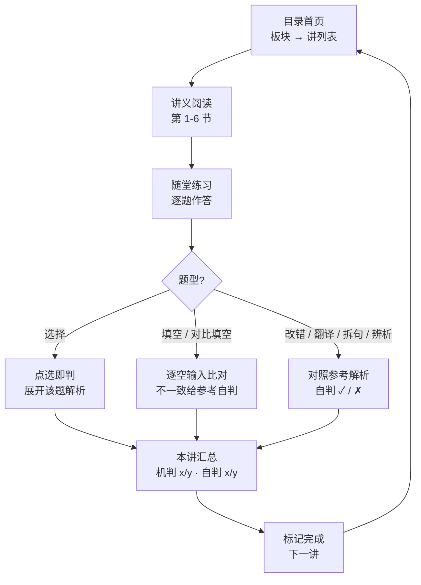
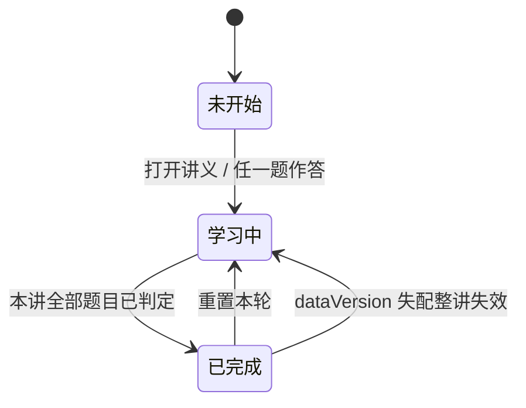

# 语法学习平台 · 需求文档（v0.3 · 范围冻结，实现已交付）

> 状态：**v0.3 范围冻结（2026-10-15）**，P0 闭环（F1–F4）实现已交付并通过五轮评审；开放问题仅余 Q2（折叠/锚点）与 Q3（P1 排期）。部署子路径已裁定（Q8）。文档按「产品行为与决策」编写。
> 内容源：[grammar/](../readme.md) 语法精讲合集（29 讲 · 5 板块），每讲统一七节模板，随堂练习 B / S / T 分层、题目与答案文末分离。
> 同体系参照：[Lexio](../../general/platform/requirements.md)（general 三册练习平台）—— 本平台与其分工：Lexio 管「听 → 拼 → 写」的词汇与产出训练，本平台管「读 → 拆 → 判」的语法认知训练。工程骨架（进度模块、队列状态机、校验脚本）参照 Lexio 现成形态。

---

## 1. 背景与目标

语法合集目前是纯 markdown，只能在 Obsidian / 站点里「读」：随堂练习要自己写答案再翻文末对，做没做、对不对没有痕迹；教程反复强调的「动词定句型、长句拆回简单句」是**推导式**认知框架，但纯阅读缺少「拆一个句子 → 立即验证自己推对了没」的闭环。

本平台把 29 讲讲义编译成**可交互的学习页**，覆盖「查看 → 学习 → 练习」闭环：

- **查看**：按板块 / 讲次浏览讲义，七节结构完整；阅读视图直出第 1–6 节（目标 → 概念规则 → 例句精讲 → 常见坑 → 总结 → 练习题干），第 7 节「参考答案与解析」不在阅读流直出（见 §6 答案可见性规则）
- **学习**：规则表格、例句精讲、「常见坑」提示在阅读视图中一等公民呈现，而不是 md 源码里的裸文本
- **练习**：随堂练习交互化，客观题即时判分，主观题对照参考解析自判；答案与解析保持「默认隐藏、按需展开」，不破坏教程「题目与答案分离」的命题设计

原则：**markdown 讲义是唯一数据源**（Obsidian 编辑维护），平台只读消费结构化数据，不做任何反向编辑。

## 2. 用户与场景

- 唯一用户：作者本人（开发者，语法重建期）
- 场景：桌面端为主（通读一讲 → 做完随堂练习）；移动端能读讲义、做客观题
- 使用节奏：跟学合集时每讲一次「读 + 练」闭环；复习时直接跳到某讲的「随堂练习 / 常见坑」节

## 3. 范围

**最小完整旅程（P0）**：进入目录 → 选一讲 → 通读讲义 → 完成随堂练习并判分 → 查看解析 → 该讲标记完成 → 一键进入下一讲。

- 入口条件：打开站点即可用，无登录、无配置
- 完成证据（用户可见）：讲次在目录中显示完成标记，汇总分列「机判 x/y · 自判 x/y」可见
- 恢复路径：进度存本地，刷新 / 关闭浏览器后「继续学习」回到上次讲次；「重置本轮」可清空单讲练习记录重做

**P1（支持性，非首发必须）**：

- 语法地图页：呈现 L01 的五步推导链（动词 → 句型 → 成分 → 词性 → 句法变形），可点击跳转对应讲次（图直接复用 readme.md 的推导链 mermaid）
- 错题重做：汇总页「只重做错项」（机判错项与自判 ✗ 项分开列、分开重做）
- 讲内小节锚点目录（长讲快速跳转）

**明确不做**（避免与 Lexio 或教程本身重复）：

- 听写 / 拼写训练（Lexio 职责）、词汇台账
- 讲义在线编辑、账号体系、云端同步、后端服务
- 练习题新增 / 编辑功能（命题仍走教程侧的 exam-item-toolkit 流程）

## 4. 核心学习流程

## 5. 功能需求

### F1 课程导航（P0）

- **目的**：随时知道「学到哪了、下一讲是什么」，新增讲次零接入成本。
- **触发**：打开平台即落地目录首页。
- **布局**：板块 → 讲两级列表（29 讲 · 5 板块），每讲显示标题 + 核心问题 + 练习进度（未开始 / x/y 题 / ✓ 全对）；顶部「继续学习」直达上次学习的讲次。
- **处理规则**：讲次顺序 = 教程自然顺序（L01–L29），跨板块连续；学习页头部提供「上一讲 / 下一讲」快捷切换（首尾禁用）与「返回目录」。
- **结果与状态**：选中讲次进入讲义阅读页；目录不产生持久化写入。
- **异常**：`继续学习` 无历史记录时隐藏；讲次数据缺失（构建校验兜底）时该讲显示占位并不阻塞其他讲。

### F2 讲义阅读（P0）

- **目的**：把七节模板的讲义变成结构化阅读视图，读的过程中直接可用「常见坑」和「一句话总结」做自检。
- **触发**：从目录选中一讲，或学习页切换上一讲 / 下一讲。
- **布局**：讲次头部（讲号 + 标题 + 一句话学习目标）→ 第 1–6 节正文；第 6 节「随堂练习」在阅读视图**只出题干**（题型与作答交互由 F3 承接）；第 7 节「参考答案与解析」**不进入阅读流**，内容只由 F3 按题消费（作答后展开该题解析）。「七节」在数据模型中完整保留、阅读视图不直出答案节——这是对「答案默认隐藏」的统一裁定，不构成矛盾。节标题可折叠与否见开放问题 Q2，首发为全展开长文。
- **处理规则**：
  - 正文元素按类型渲染：段落（首行缩进）、规则表格、例句（英文例句 + 中文解说）、公式化规则（如 `4 时间 × 4 态 = 16 时态`，讲义中为行内文本 / 代码，无需数学引擎）、⚠️ 常见坑条目、引用块（一句话总结）
  - 英文例句与中文正文排版区分（英文不缩进、可辨识的等宽或强调样式）
  - 文内讲次引用（如「详见 L23」）渲染为可点击链接，跳转对应讲次——**作用域为阅读视图正文**（§1–§5 各节）；练习题干与解析内的引用仅展示不跳转（避免作答流被打断）
- **结果与状态**：讲义内容只读；进入讲义页将该讲标记为「学习中」（若此前未开始）。

### F3 随堂练习（P0）

- **目的**：把每讲 3~~5 道随堂练习（各讲题量不齐，3~~5 题）变成可作答、可判分、可复盘的交互题，替代「手写答案 → 翻文末对照」。
- **触发**：讲义阅读页「随堂练习」节（同一页面内，读完即练）。
- **题型与判分规则**（题型全集来自教程现状的**实际命题形态**，新增题型需回写本表）：

| 题型     | 教程中的实际形态                                                                                                 | 交互与判分                                                                                                                                 |
| -------- | ---------------------------------------------------------------------------------------------------------------- | ------------------------------------------------------------------------------------------------------------------------------------------ |
| 选择     | 四选项 `A. / B. / C. / D.`                                                                                       | 点选即判 ✓ / ✗，随即展开该题解析；选后不可改（重做走「重置本轮」）                                                                         |
| 填空     | 填词 / 填数字 / 填类别，含多空题（如 L15 B2 两空、L29 B2 一题内 ①②③）                                            | 逐空输入（一题含 `blanks[]`），空内归一化比对（见 §6 判分归一化）；**题粒度判定**：全部空都对才 ✓，任一空错整题 ✗ 后展示各空参考答案供自判 |
| 对比填空 | 教程中标 `（判断）` 的题实为多空对比填空（如 L03 B3「前者是 \_\_\_\_ 动词，后者是 \_\_\_\_ 动词」、L09 B3 四空） | 与「填空」同一交互与判分（可机判）；题型标注沿用教程原样，平台侧归入填空家族                                                               |
| 改错     | 找出语病并改正（答案可能不唯一）                                                                                 | 输入自己的改正 → 展示参考答案 → 自判 ✓ / ✗                                                                                                 |
| 翻译     | 中译英（答案多变体）                                                                                             | 输入自己的译文 → 展示参考答案与可接受变体 → 自判 ✓ / ✗                                                                                     |
| 拆句     | 找主干、指句子成分                                                                                               | 对照参考标注自判 ✓ / ✗                                                                                                                     |
| 辨析     | 混合形态：判断正误 + 说理（L01 S2 / L02 S1）、四选一分类 + 说理（L23 S2）、填空 + 造句（L28 S2）                 | 统一自判 ✓ / ✗；正误 / 分类等客观小问可点选，但整题判定以自判为准（说理与造句不可机判）                                                    |

- **空答案（零冠词类）**：参考答案为「不填」的空（如 L12 B2）允许空串提交判定；UI 提供显式「∅ 不填」按钮，与空提交等价，避免「空输入不允许提交」误伤合法作答。
- **难度层**：题目标注 B（基础）/ S（强化）/ T（真题级），按层分组展示（当前讲义以 B / S 为主）。
- **答案可见性**：**答案与解析默认隐藏**，单题作答后才展开该题解析；不允许「一键看全部答案」。（与 F2 的阅读视图规则同源，见 §6 答案可见性规则。）
- **结果与状态**：每题判定（机判 ✓ / ✗ 或自判结果）即时持久化（见 F4）；本讲全部作答后显示汇总：**机判 x/y 与自判 x/y 分列**，错题清单同样分列，错题可跳回原题。
- **异常**：空输入不允许提交判定（提示先作答）——但参考答案为「不填」的空豁免（见上）；自判题必须显式选择 ✓ 或 ✗ 才计入统计。

### F4 学习进度持久化（P0）

- **目的**：关掉浏览器不丢进度，下次直接续学。
- **存储内容（localStorage，按讲存）**：每题判定记录、本讲完成状态、上次学习讲次、**数据指纹 `dataVersion`**（讲义内容 hash 或构建版本号 + 题号集合）。
- **处理规则**：已判定题目再进入显示原判定与解析（只读回看）；「重置本轮」清空该讲练习判定并恢复可作答；进度统计（目录页 x/y 题）直接由判定记录计算，不单独存计数字段。
- **数据指纹**：讲义更新 / 题号重排（如 B2 改成 B3）后，`dataVersion` 不符的判定**整讲失效**并提示「本讲内容已更新，进度已重置」，防止旧判定错位挂到新题；「重置本轮」语义不变（手动清空当前版本判定）。
- **异常**：localStorage 不可用（隐私模式等）时平台降级为「单次会话内可用」，不阻塞读与练，退出提示进度不保存。

## 6. 共享对象与状态（统一定义）

**讲（Lesson）** —— 平台的核心对象，来源为教程每讲一个 markdown 文件。

| 字段            | 说明                                                                                                                                             |
| --------------- | ------------------------------------------------------------------------------------------------------------------------------------------------ |
| 唯一标识        | **板块标识 + 讲号**复合键（如 `02-动词体系` + `L03`），禁止仅用讲号 `L03` 做全局键（跨板块同讲号会冲突）                                         |
| 标题 / 学习目标 | 讲首行标题 + 引用块一句话目标                                                                                                                    |
| 板块            | 5 个板块之一（语法体系总览 / 动词体系 / 从句 / 词性与构词 / 句法专题）                                                                           |
| 七节内容        | 概念与规则、例句精讲、常见坑、一句话总结、随堂练习、参考答案与解析（「为什么需要」并入阅读流）。第 6 节阅读视图只出题干，第 7 节只由 F3 按题消费 |
| 练习题集        | 见下「题」                                                                                                                                       |

**题（Question）**：

| 字段                          | 说明                                                                                       |
| ----------------------------- | ------------------------------------------------------------------------------------------ |
| 标识                          | 讲内唯一（如 `B1` / `S2`），与答案解析条目一一对应                                         |
| 难度层                        | B / S / T                                                                                  |
| 题型                          | 选择 / 填空（含「对比填空」家族）/ 改错 / 翻译 / 拆句 / 辨析（映射见 F3 题型表）           |
| 空列表 `blanks[]`             | 填空家族必有：每空含参考答案（可多可接受答案，可为「不填」标记）；题干中的空位与之一一对应 |
| 题干 / 选项 / 参考答案 / 解析 | 选项仅选择题有；解析与答案同源（文末第 7 节那部分）                                        |

**参考答案提取口径**（第 7 节自由文本 → 结构化答案，与 Q1 数据管线一体）：

1. 解析条目按 `- **题号**：` 切分，每条对应一题。
2. 题号后第一个加粗 / 行内代码片段 best-effort 提取为该题参考答案；填空家族按空位顺序对齐到 `blanks[]`，解析条目里的「（或 …）」约定承载可接受变体（如翻译题）。
3. 解析全文保留为 `explanation` 字段。
4. 提取失败的题**降级为自判题**（展示解析、用户自判），不阻塞构建；CI 对提取失败清单告警。

**判分归一化**（填空家族机判口径）：

- 大小写不敏感；首尾空白不敏感；内部空白折叠为单空格
- 标点不敏感（改错题参考答案带句号不计入比对——改错本身自判，此条主要护住填空答案内的标点变体）
- **不做词干 / 词形还原**（`snows` vs `snow` 判不同，超纲）；形态题按参考答案枚举多可接受答案
- 比对在单空粒度进行，空内多可接受答案任一匹配即该空对

**答案可见性规则**（跨 F2 / F3 的统一裁定）：

- 数据模型保留第 7 节完整内容；阅读视图（F2）不渲染第 7 节，第 6 节只出题干
- 解析仅在「该题已作答（机判已判 / 自判已选）」后展开，逐题解锁
- 禁止任何「一键看全部答案」入口

**讲次状态机**（判定驱动，无手动「标记完成」按钮）：

## 7. 非功能需求与约束

| 项       | 要求                                                                                                                                                                                                                                         |
| -------- | -------------------------------------------------------------------------------------------------------------------------------------------------------------------------------------------------------------------------------------------- |
| 形态     | 纯前端静态项目，构建产物可托管于 GitHub Pages（与站点同仓部署，路径 `[TBD]`）                                                                                                                                                                |
| 技术栈   | Bun + TypeScript strict + Vite + React + oxlint / oxfmt（仓库 Demo 统一栈）                                                                                                                                                                  |
| 数据流   | **md 单文件为源 + 构建期解析**（Q1 已拍板）：29 个讲义 md 保持「每讲一文件」现状，构建脚本按七节模板 + 题号格式解析生成结构化数据并校验；平台只读消费；讲义更新 = 重新构建，无运行时数据同步                                                 |
| 一致性   | 讲义 md 与结构化数据的一致性检查固化为 CI 测试，构建前自动执行（参照 Lexio `scripts/validate.ts` + `bun test` 现成模式）                                                                                                                     |
| 部署隔离 | 项目目录不得被 VitePress 站点构建收录：`.vitepress/config.mts` 的 `srcExclude` 需补 `**/playground/**`（当前只排除了 `**/playground-work/**`，`playground/` 下的 md 会被编译进站点），或将项目目录移出 `src/`——二选一，落地时必须处理        |
| UI       | **Trae 主题风格：白绿（light）/ 黑绿（dark）双主题**，瑞士极简主义布局；中文界面；响应式（PC + 移动端）；UI 图标用 lucide-react 不用 emoji，讲义原文中的 ⚠️ 等表情**保留原样渲染**（内容与 UI 图标的边界）；正文两端对齐、段落首行缩进两字符 |
| 依赖纪律 | 运行时依赖仅 react / react-dom 及校验库；不引 md 运行时解析库（数据构建期已结构化）、不引状态库、不引数学引擎（讲义无 LaTeX / mermaid，公式化规则是行内文本）                                                                                |
| 兼容     | 现代浏览器即可；无音频 / TTS 依赖（本平台不做听说训练）                                                                                                                                                                                      |

## 8. 决策记录与开放问题

### 已拍板（评审后裁定）

| #   | 问题               | 决策                                                                                                                                                                     |
| --- | ------------------ | ------------------------------------------------------------------------------------------------------------------------------------------------------------------------ |
| Q1  | 数据落地形态       | **md 单文件为源 + 构建期解析**。理由：29 讲七节结构高度规整（题号格式统一），改造目录结构收益小；CI 一致性测试照抄 Lexio 现成模式。答案提取口径见 §6「参考答案提取口径」 |
| Q4  | 「判断」题型口径   | 教程标 `（判断）` 的题实为对比填空（多空、可机判），归入填空家族；「辨析」保留为说理类混合形态（自判），不再与「判断」混称                                               |
| Q5  | 空答案判定         | 参考答案为「不填」的空允许空串 / 「∅ 不填」按钮提交；「空输入不允许提交」对此豁免                                                                                        |
| Q6  | 「全对才算 ✓」粒度 | 定到**题粒度**：空内多可接受答案任一匹配算该空对，全部空对整题才 ✓；空级判定结果随解析展示                                                                               |
| Q7 | 答案可见性矛盾 | 阅读视图只出 1–6 节题干，第 7 节内容只由练习交互按题消费（§6 答案可见性规则为唯一口径） |
| Q8 | 部署子路径（原 A1） | **`/kb-vault/grammar-play/`**（2026-10-15 裁定）：与 Lexio 同级并入 GitHub Pages 产物，push 触发 CI；`srcExclude` / 侧边栏双处隔离已落地（§7 部署隔离） |                                                                                  |

### 开放问题

| #   | 类型                | 内容                                                                                                                                                               |
| --- | ------------------- | ------------------------------------------------------------------------------------------------------------------------------------------------------------------ |
| Q2  | `[TBD]`             | 讲义阅读是否需要「七节折叠 / 小节锚点」导航（影响 F2 布局）                                                                                                        |
| Q3  | `[TBD]`             | P1 的语法地图页、错题重做是否在首发一起做，还是首发只做 P0 闭环                                                                                                    |
| A2  | `[Assumption, TBD]` | 假设选择题判分后不可改答（防「看到解析再改」污染统计）；如需「答题卡模式」后议                                                                                     |
