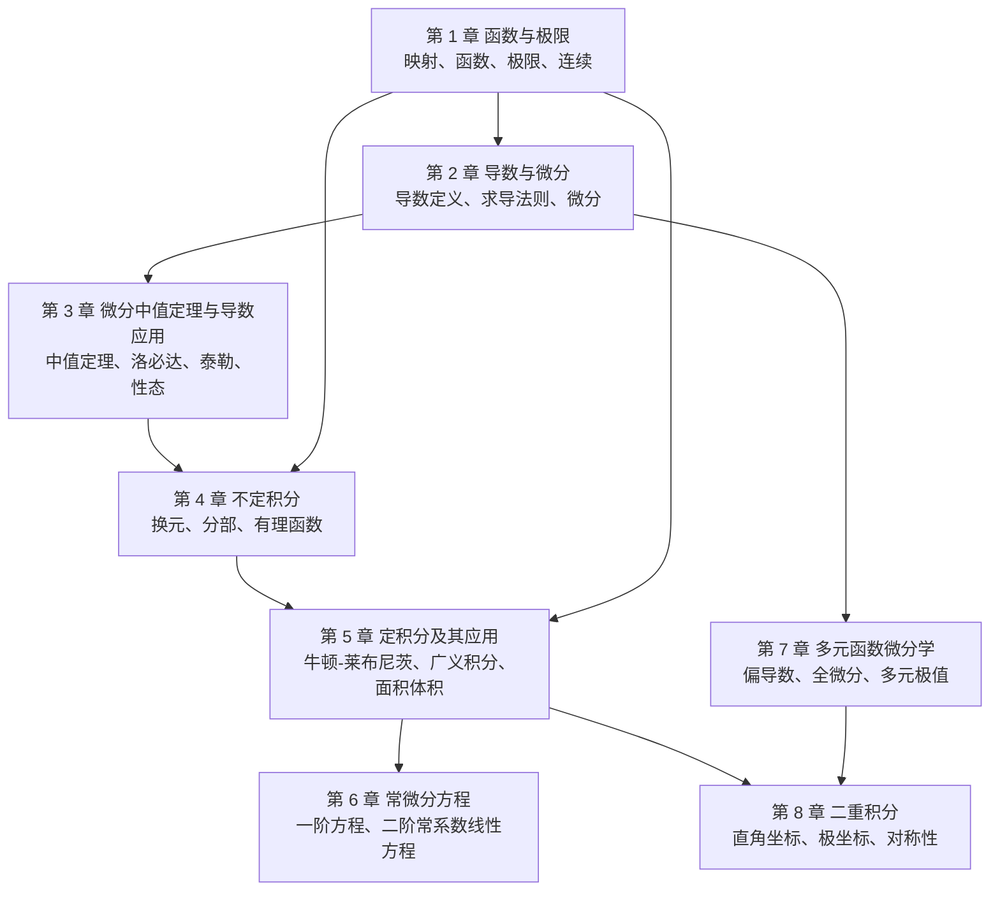

# 高等数学（微积分）学习大纲

> 面向 **考研数学二** 的高等数学学习路径。数二高等数学约占 80%（约 120 分），是复习的绝对主体。
>
> 🖥️ **交互学习台**：[belos-street.github.io/kb-vault/calculus](https://belos-street.github.io/kb-vault/calculus/) —— 按视频讲次拆分，配公式渲染、交互函数图与进度记录。
> 本地运行：`cd src/mathematics/calculus/platform && bun install && bun run dev`

---

## 📌 元信息

| 项目 | 说明 |
|------|------|
| **考试定位** | 考研数学二，高等数学约占 80%（约 120 分） |
| **分值分布** | 整卷结构：选择题 10×5=50 分 + 填空题 6×5=30 分 + 解答题 6 题共 70 分；高数部分约 120 分（各题型内的高数分值为按占比估算） |
| **大纲依据** | 全国硕士研究生招生考试数学考试大纲（2021 年试卷结构改革后口径） |
| **章节划分** | 上册按框框老师《高等数学（上）》49 个视频分 P 归并为 **6 章 39 讲**，另补 6.9 微分方程应用 1 讲，共 **上册 6 章 40 讲**；再按数二考试大纲补多元函数微积分 **2 章 8 讲**，合计 **8 章 48 讲** |
| **核心能力** | 计算能力（求极限、求积分、解微分方程）> 证明能力 |
| **学习周期** | 约 10-12 周（基础阶段），课程总时长约 37 小时（含视频与讲义） |
| **教材推荐** | 同济大学《高等数学》第七版（上、下册） / 汤家凤《高等数学辅导讲义》 / [框框老师视频课](https://www.bilibili.com/video/BV11XhF6REBv) |
| **数二特有** | ⚠️ 不考空间解析几何与向量代数、三重积分、曲线曲面积分、无穷级数、概率统计 |

---

## 🧠 知识体系总览

> ⚠️ **大题组合模式**：数二解答题常跨章联合出题——"微分方程 + 定积分应用"、"变限积分 + 中值定理证明"、"二重积分 + 极坐标换元"是固定搭配，复习时需刻意练习跨章综合题。

**数二考试结构**（按分值排序）：
1. **一元函数积分学** — 分值最高，大题主力（第 4、5 章）
2. **一元函数微分学** — 选择填空多，大题常与积分结合（第 2、3 章）
3. **常微分方程** — 一道大题，常与积分结合（第 6 章）
4. **函数、极限、连续** — 贯穿所有章节的基础（第 1 章）
5. **多元函数微积分学** — 二重积分必考大题，偏导与全微分常驻选择填空（第七、八章）

---

## 📚 学习内容（48 讲细化大纲）

> 上册前 6 章共 40 讲：视频正课 39 讲 + 6.9 微分方程应用补充 1 讲；第七、八章按数二考试大纲补充多元函数微积分 8 讲。讲义见 [doc/ch4-multivariable-calculus.md](doc/ch4-multivariable-calculus.md)（旧编号第四章，对应平台第七、八章）。每讲下列出细分知识点，平台内可逐讲打开讲义。
>
> ⭐ **考试优先级**：平台按数二真题分布为每讲标注 1-5 星——★★★★★ 必考核心、★★★★ 高频、★★★ 常考、★★ 低频、★ 了解。5 星集中在极限计算、导数应用、积分应用、微分方程与二重积分。

### doc ↔ 平台编号映射

旧 `doc/` 是 5 章编号，平台按视频与数二大纲拆成 8 章，二者不一一对应：

| 旧 doc 文件 | 内容 | 平台章节 |
|------|------|------|
| `doc/ch1-functions-limits-continuity.md` | 函数、极限、连续 | 第一章 |
| `doc/ch2-single-variable-differential.md` | 导数、微分、中值定理、导数应用 | 第二、三章 |
| `doc/ch3-single-variable-integral.md` | 不定积分、定积分及应用 | 第四、五章 |
| `doc/ch4-multivariable-calculus.md` | 多元函数微分学、二重积分 | 第七、八章 |
| `doc/ch5-ordinary-differential-equations.md` | 常微分方程 | 第六章 |

> 旧讲义保留作迁移底稿；平台章节编号以本 readme 为准。

### 第一章 函数与极限（9 讲，约 8.5 小时）

| 讲次 | 主题 | 细化知识点 | 时长 |
|------|------|-----------|------|
| 1.1 | 映射与函数 | 函数的概念与三要素；映射的概念；映射的分类（单射/满射/双射）；逆映射；复合映射；几种常见的函数；函数的四种特性（有界、单调、奇偶、周期）；反函数与反三角函数；初等函数 | 118 min |
| 1.2 | 数列极限 | 数列极限的 ε-N 定义；极限的几何意义；收敛数列的唯一性、有界性、保号性；子数列与原数列的收敛关系；数列极限的四则运算；常用数列极限与"先猜后证" | 113 min |
| 1.3 | 函数极限 | x→x₀ 时函数极限的定义；x→∞ 时函数极限的定义；左极限与右极限；局部有界性与局部保号性；极限存在的充要条件；函数极限与数列极限的联系 | 77 min |
| 1.4 | 无穷小与无穷大 | 无穷小的定义与 0 的特殊地位；无穷大的定义；无穷小与无穷大的倒数关系；无穷小的运算性质；有界量 × 无穷小 = 无穷小 | 24 min |
| 1.5 | 极限的运算法则 | 四则运算法则及使用前提；复合函数极限与极限号穿透；多项式与有理函数的极限；0/0 型与 ∞/∞ 型的初步处理；拆项、通分、有理化技巧 | 38 min |
| 1.6 | 极限存在准则与两个重要极限 | 夹逼准则；单调有界准则；第一个重要极限 $\lim_{x \to 0}\frac{\sin x}{x}=1$ ；第二个重要极限 $\lim_{x \to \infty}(1+\frac{1}{x})^x=e$ ； $1^\infty$ 型与 e 的推广；递推数列极限的证明思路 | 48 min |
| 1.7 | 无穷小的比较 | 高阶、低阶、同阶、等价无穷小；等价无穷小替换定理；乘除可换、加减慎换；常用等价无穷小表；无穷小的阶在极限计算中的应用 | 29 min |
| 1.8 | 函数的连续性与间断点 | 函数在一点连续的定义；左连续与右连续；间断点的四种类型（可去/跳跃/无穷/振荡）；第一类与第二类间断点的划分；分段函数在分界点的连续性；连续函数的四则运算与复合；初等函数在其定义区间内连续 | 39 min |
| 1.9 | 闭区间上连续函数的性质 | 最大值最小值定理；有界性定理；零点定理；介值定理；闭区间连续性质在证明题中的应用；章末综合练习 4 题（自测） | 18 min |

**第一章要点**：极限计算是数二的基本功，一张试卷至少有 5-8 处涉及极限计算；变限积分求导、中值定理证明都建立在第 1、3 章。1.9 末尾附章末综合练习 4 题，18 min 为视频时长，练习建议另留 30-40 分钟。

### 第二章 导数与微分（5 讲，约 3.1 小时）

| 讲次 | 主题 | 细化知识点 | 时长 |
|------|------|-----------|------|
| 2.1 | 导数概念 | 瞬时速度与切线斜率引例；导数定义与导函数；左导数与右导数；可导必连续，连续不一定可导；导数的几何意义与切线、法线方程；可导性与连续性关系的反例 | 36 min |
| 2.2 | 函数的求导法则 | 导数的四则运算法则；反函数求导法则；复合函数链式法则；基本初等函数求导公式；复合函数多层求导；抽象函数求导 | 45 min |
| 2.3 | 高阶导数 | 高阶导数定义与记号；常见函数的 n 阶导数；莱布尼茨公式；高阶导数在极限与微分方程中的应用 | 32 min |
| 2.4 | 隐函数与参数方程求导 | 隐函数求导法；对数求导法；参数方程确定函数的一阶导数；参数方程的二阶导数；幂指函数求导 | 31 min |
| 2.5 | 函数的微分 | 微分的定义；可微与可导的等价关系；微分形式不变性；近似计算与误差估计；微分在几何与物理中的应用 | 42 min |

**第二章要点**：求导是纯计算流水线，目标是形成"看到结构就知道用哪条法则"的条件反射；隐函数与参数方程的二阶导数是高频易错点。

### 第三章 微分中值定理与导数的应用（7 讲，约 5.5 小时）

| 讲次 | 主题 | 细化知识点 | 时长 |
|------|------|-----------|------|
| 3.1 | 微分中值定理 | 费马引理；罗尔定理；拉格朗日中值定理；柯西中值定理；辅助函数的构造方法；中值定理证明题的三种套路 | 91 min |
| 3.2 | 洛必达法则 | 0/0 型洛必达法则；∞/∞ 型洛必达法则；其他未定式的转化；使用洛必达的三个前提；洛必达失效的反例与替代方法 | 35 min |
| 3.3 | 泰勒公式 | 泰勒多项式与泰勒公式；佩亚诺余项；拉格朗日余项；麦克劳林展开；常用五个展开式；泰勒公式求极限与证明不等式 | 43 min |
| 3.4 | 函数单调性与凹凸性 | 一阶导数判定单调性；二阶导数判定凹凸性；拐点的判定；单调区间与凹凸区间的求法；利用单调性证明不等式 | 44 min |
| 3.5 | 函数的极值与最值 | 极值的必要条件和第一充分条件；第二充分条件；最大值与最小值的求法；实际问题的最值建模；极值与最值的区别 | 47 min |
| 3.6 | 渐近线与函数作图 | 水平渐近线；铅直渐近线；斜渐近线；函数作图的标准步骤；渐近线与极限的关系 | 31 min |
| 3.7 | 曲率 | 弧微分；曲率与曲率公式；曲率半径与曲率圆；曲率在几何中的应用 | 37 min |

**第三章要点**：中值定理证明题的核心是"构造辅助函数"；洛必达和泰勒是极限计算的两把快刀，但要清楚各自的适用边界。

### 第四章 不定积分（4 讲，约 3.6 小时）

| 讲次 | 主题 | 细化知识点 | 时长 |
|------|------|-----------|------|
| 4.1 | 不定积分的概念与性质 | 原函数与不定积分的概念；不定积分与导数的关系；基本积分表；不定积分的线性性质；原函数存在性 | 44 min |
| 4.2 | 换元积分法 | 第一类换元法（凑微分）；第二类换元法（变量代换）；三角代换；根式代换；倒代换；换元法的选择策略 | 88 min |
| 4.3 | 分部积分法 | 分部积分公式；u 与 dv 的选取原则；循环分部积分；递推型分部积分；分部积分与换元的组合 | 40 min |
| 4.4 | 有理函数的积分 | 有理函数的分解；部分分式法；真分式与假分式；三角有理式的积分；简单根式的有理化 | 43 min |

**第四章要点**：不定积分没有统一算法，核心是"识别题型 → 选换元或分部"；基本积分表必须熟练到不用查。

### 第五章 定积分及其应用（6 讲，约 5.5 小时）

| 讲次 | 主题 | 细化知识点 | 时长 |
|------|------|-----------|------|
| 5.1 | 定积分的概念与性质 | 曲边梯形面积与定积分定义；可积的充分条件；定积分的几何意义；线性性质；区间可加性与保号性；估值定理与积分中值定理 | 51 min |
| 5.2 | 微积分基本公式 | 变上限积分函数；变上限积分求导；牛顿-莱布尼茨公式；变限积分与洛必达结合；原函数存在与定积分计算 | 36 min |
| 5.3 | 定积分的换元积分法 | 定积分换元法；换元必换限；对称区间的奇偶性；周期函数的积分性质；三角换元在定积分中的应用 | 53 min |
| 5.4 | 定积分的分部积分法 | 定积分分部积分公式；分部积分处理变限积分；递推公式；定积分与不定积分分部的关系 | 26 min |
| 5.5 | 广义积分 | 无穷限广义积分；无界函数的广义积分（瑕积分）；广义积分的敛散性；比较判别法；广义积分的计算 | 50 min |
| 5.6 | 定积分的应用 | 极坐标方程与参数方程；直角坐标下的面积；极坐标下的面积；旋转体体积（绕 x 轴/绕 y 轴/柱壳法）；平行截面面积为已知的立体体积；平面曲线弧长；旋转体侧面积；物理应用（功、引力、水压力、质心、平均值） | 113 min |

**第五章要点**：数二大题主力。变限积分 + 洛必达/中值定理是固定组合；定积分应用要能独立完成"建模 → 列式 → 计算"。

### 第六章 常微分方程（9 讲，约 3.1 小时）

| 讲次 | 主题 | 细化知识点 | 时长 |
|------|------|-----------|------|
| 6.1 | 微分方程的概念 | 微分方程的定义与阶；通解与特解；初始条件与初值问题；微分方程的分类 | 7 min |
| 6.2 | 可分离变量的微分方程 | 可分离变量方程；分离变量与积分；隐式通解；初值问题的特解 | 10 min |
| 6.3 | 齐次方程 | 齐次方程的形式；变量代换 y/x；可化为齐次的方程；齐次方程的求解步骤 | 8 min |
| 6.4 | 一阶线性微分方程 | 标准形式；常数变易法；通解公式；伯努利方程（了解） | 15 min |
| 6.5 | 可降阶的高阶微分方程 | y⁽ⁿ⁾=f(x) 型；缺 y 型降阶；缺 x 型降阶；降阶后的求解流程 | 30 min |
| 6.6 | 高阶线性微分方程 | 二阶线性微分方程解的结构；齐次方程通解结构；非齐次方程特解结构；叠加原理 | 22 min |
| 6.7 | 常系数齐次线性微分方程 | 特征方程；两个相异实根；二重实根；共轭复根；高于二阶的常系数齐次线性方程；通解的三种形式 | 24 min |
| 6.8 | 常系数非齐次线性微分方程 | 待定系数法；$f(x)=P_m(x)e^{\lambda x}$ 型；λ 是否为特征根的三种设法； $f(x)=e^{\lambda x}[P\cos\omega x+Q\sin\omega x]$ 型；特解叠加原理 | 41 min |
| 6.9 | 微分方程的应用 | 几何条件的翻译（切线、法线、面积、弧长）；物理建模（变化率与正比关系）；列方程、定初值、解方程、回代检验；跨章综合（微分方程 + 定积分） | 30 min |

**第六章要点**：先识别方程类型，再套对应解法，最后代初值定特解；二阶常系数非齐次是数二必考，特解设法看 λ 与特征根的关系；应用题的关键是把几何/物理条件翻译成方程。

### 第七章 多元函数微分学（4 讲，约 4.2 小时）

| 讲次 | 主题 | 细化知识点 | 时长 |
|------|------|-----------|------|
| 7.1 | 多元函数的概念与极限 | 二元函数的定义与定义域；几何意义（空间曲面）；二重极限的定义与任意路径趋近；用两条路径证伪极限不存在；二元函数的连续性；有界闭区域上二元连续函数的性质 | 55 min |
| 7.2 | 偏导数与全微分 | 偏导数的定义与几何意义；偏导数的计算方法；高阶偏导数与混合偏导相等的条件；全微分的定义；可微、偏导存在、连续之间的关系；全微分形式不变性 | 65 min |
| 7.3 | 多元复合函数与隐函数求导 | 多元复合函数链式法则；依赖树（变量关系图）的画法；抽象复合函数的偏导数；复合函数的二阶偏导数；由一个方程确定的隐函数求导；隐函数存在定理与求导公式 | 70 min |
| 7.4 | 多元函数的极值与最值 | 二元函数极值的必要条件；极值的充分条件（$AC-B^2$ 判别法）；无条件极值的求解步骤；条件极值与拉格朗日乘数法；有界闭区域上的最大值与最小值；简单应用建模 | 60 min |

**第七章要点**：偏导是「固定其余变量」的一元求导；复合函数求导先画依赖树，每条路径相乘、所有路径相加；极值判别先求驻点，再用 $AC-B^2$ 定类型。

### 第八章 二重积分（4 讲，约 3.6 小时）

| 讲次 | 主题 | 细化知识点 | 时长 |
|------|------|-----------|------|
| 8.1 | 二重积分的概念与性质 | 二重积分的定义与几何意义；可积性；线性性质；区域可加性与保号性；估值定理与中值定理；二重积分与定积分的区别 | 45 min |
| 8.2 | 直角坐标下的二重积分 | X 型区域与 Y 型区域的积分限写法；先对 y 后对 x 的累次积分；先对 x 后对 y 的累次积分；交换积分次序；分块积分与区域拆分；直角坐标下的典型题型 | 65 min |
| 8.3 | 极坐标下的二重积分 | 极坐标变换与雅可比因子 $r$；圆域、扇形域、环形域的积分限；极坐标与直角坐标的转换；极坐标下的积分次序；何时该用极坐标；极坐标计算的易错点 | 55 min |
| 8.4 | 对称性与二重积分的应用 | 关于坐标轴的奇偶对称性；关于 $y=x$ 的轮换对称性；利用对称性化简积分；平面薄片的质量与质心；二重积分求体积；二重积分的估值与比较 | 50 min |

**第八章要点**：二重积分的方法选择比计算更重要——看到圆域或被积函数含 $x^2+y^2$ 先想极坐标，看到对称性先化简；区域定限永远先画图。

---

## 🧮 常用公式速查

### 等价无穷小（ $x \to 0$ ）

| 公式 | |
|------|--|
| $\sin x \sim x$ | $\tan x \sim x$ |
| $\arcsin x \sim x$ | $\arctan x \sim x$ |
| $\ln(1+x) \sim x$ | $e^x - 1 \sim x$ |
| $a^x - 1 \sim x\ln a$ | $(1+x)^\alpha - 1 \sim \alpha x$ |
| $1 - \cos x \sim \frac{1}{2}x^2$ | $x - \sin x \sim \frac{1}{6}x^3$ |

### 常用麦克劳林展开

| 展开 | |
|------|--|
| $e^x = 1 + x + \frac{x^2}{2!} + \frac{x^3}{3!} + \cdots$ | |
| $\sin x = x - \frac{x^3}{3!} + \frac{x^5}{5!} - \cdots$ | |
| $\cos x = 1 - \frac{x^2}{2!} + \frac{x^4}{4!} - \cdots$ | |
| $\ln(1+x) = x - \frac{x^2}{2} + \frac{x^3}{3} - \cdots$ | |
| $\frac{1}{1-x} = 1 + x + x^2 + x^3 + \cdots$ | |

### 基本积分公式

| 积分 | 结果 |
|------|------|
| $\int x^\alpha dx$ | $\frac{x^{\alpha+1}}{\alpha+1} + C$ |
| $\int \frac{1}{x} dx$ | $\ln \|x\| + C$ |
| $\int e^x dx$ | $e^x + C$ |
| $\int \sin x dx$ | $-\cos x + C$ |
| $\int \cos x dx$ | $\sin x + C$ |
| $\int \frac{1}{1+x^2} dx$ | $\arctan x + C$ |
| $\int \frac{1}{\sqrt{1-x^2}} dx$ | $\arcsin x + C$ |
| $\int \tan x dx$ | $-\ln \|\cos x\| + C$ |
| $\int \sec^2 x dx$ | $\tan x + C$ |

---

## ✅ 基础阶段验收清单

- [ ] 能在 2 分钟内用等价无穷小/洛必达/泰勒展开求极限，正确率 > 90%
- [ ] 能用夹逼准则或单调有界准则求 $n$ 项和、递推数列的极限
- [ ] 熟练掌握基本求导公式，3 分钟内完成复合函数/隐函数求导
- [ ] 能正确对变限积分函数求导（含复合上下限），并用于求极限
- [ ] 能应用中值定理（罗尔、拉格朗日）完成证明题，会构造辅助函数
- [ ] 能在 5 分钟内完成不定积分（换元 + 分部），正确率 > 85%
- [ ] 能计算定积分并应用于面积、旋转体体积（8 分钟内完成一道应用题）
- [ ] 会用微元法处理物理应用（变力做功、水压力、形心、平均值）
- [ ] 能解一阶线性微分方程和二阶常系数线性微分方程（5 分钟内）
- [ ] 能求二元函数的偏导数、全微分，会用链式法则与隐函数求导（含二阶偏导）
- [ ] 会求二元函数极值与条件极值，能用拉格朗日乘数法求解简单应用
- [ ] 能在 10 分钟内完成一道二重积分（直角坐标定限、交换次序、极坐标）
- [ ] 能独立完成一道跨章综合大题（如"微分方程 + 定积分应用"，15 分钟内）

---

## 🔗 关联模块

- [linear-algebra/](../linear-algebra/readme.md) — 线性代数（数二另一半，约占 20%）
- [platform/](https://github.com/belos-street/kb-vault/tree/main/src/mathematics/calculus/platform) — 交互学习台源码（React + Vite + Mafs + KaTeX）
- probability-statistics/ — 概率论与统计（数二不考，目录暂未创建）
- discrete-mathematics/ — 离散数学（目录暂未创建）
